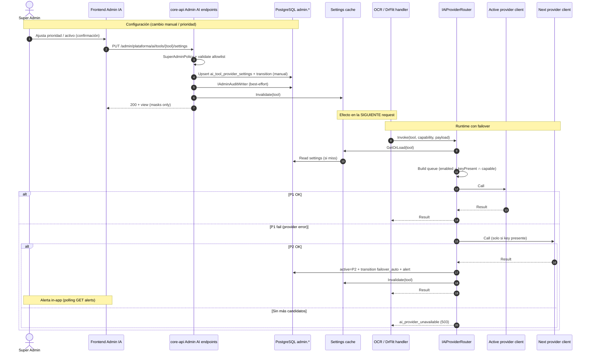

# Diseño técnico — Feature #13508 «[ADMIN-IA] Configuración Multi-Proveedor de Inteligencia Artificial»

> **Épica:** #13272 — Resiliencia Multi-Proveedor de Inteligencia Artificial  
> **Feature:** #13508 — Configuración Multi-Proveedor de IA  
> **Proyecto ADO:** FLIT - EVOLUTION  
> **Branch base:** `feature/AB-13316-consultas-notificaciones`  
> **ADR:** `services/core-api/docs/adr/ADR-0070-multi-proveedor-ia-por-herramienta.md` (**Propuesto**)  
> **Relacionado:** ADR-0060 (Dr. FLIT + Anthropic), patrón `OCR_PROVIDER` / `ANTHROPIC_API_KEY`, `AdminIctJobSettingsEndpoints`, `IAdminAuditWriter`, dock Administradores → Plataforma  
> **Alcance de este artefacto:** diseño únicamente — **sin código de producción** y **sin crear work items ADO**.

---

## 1. Contexto

Hoy OCR y DR. FLIT dependen de un único cableado Anthropic en `AddOcr` / `AnthropicMessagesClient` / `AnthropicDrFlitChatModel`, con secreto `ANTHROPIC_API_KEY` y flag `OCR_PROVIDER` (`mock` | `anthropic`). Un incidente del proveedor deja bloqueadas las herramientas de IA.

El Feature #13508 pide un módulo Super Admin (**Administradores → Plataforma → Configuración de IA**) que:

1. Configura **por herramienta** (OCR, DR. FLIT; extensible) el proveedor activo y el orden de prioridad.
2. Lista proveedores **anthropic** (primario por defecto), **openai**, **kimi**, **deepseek**.
3. Gestiona secretos **solo por env vars** (`ANTHROPIC_API_KEY`, `OPENAI_API_KEY`, `KIMI_API_KEY`, `DEEPSEEK_API_KEY`); el front solo ve presencia + máscara.
4. Hace **failover automático** al siguiente proveedor con key presente; sin alternativas → error estructurado.
5. Permite **cambio manual** sin reinicio; la prioridad/activo aplica en la **siguiente solicitud** (no mid-flight).
6. Audita transiciones y alerta in-app al Super Admin en failover automático.

Esto materializa el **Nivel 2** que ADR-0060 dejó como opcional/futuro, generalizado a multi-proveedor y multi-herramienta.

### Restricciones innegociables (producto + técnico)

| # | Restricción |
|---|-------------|
| R1 | Menú: Administradores → Plataforma → «Configuración de IA»; solo Super Admin (403 + oculto en UI). |
| R2 | Secretos: env vars only; patrón `OCR_PROVIDER` / `Cfg()` env-first; **nunca** valor en claro en API/UI. |
| R3 | Failover solo si la key del candidato está presente (no vacía). |
| R4 | Tools: OCR + DR. FLIT en v1; contrato extensible (`tool_code`). |
| R5 | Alerta in-app (no email obligatorio en v1); prioridad/activo aplica en la **próxima** request. |
| R6 | Branch base: `feature/AB-13316-consultas-notificaciones`. |
| R7 | Reutilizar patrones repo; no gateway externo nuevo ni dependencia nueva sin ADR. |

---

## 2. Alternativas evaluadas

### Opción 1 — Router multi-proveedor en core-api + config persistida en `admin.*` *(recomendada)*

Abstracción `IAiProviderRouter` / invocadores por capacidad (visión OCR vs chat texto). Clientes tipados por proveedor (Anthropic ya existe; OpenAI/Kimi/DeepSeek como adapters OpenAI-compatible donde aplique). Config por herramienta en BD (activo + prioridad + `auto_return_to_primary`). Secretos solo env. Failover en la misma request (reintento al siguiente) y persistencia del nuevo activo. Historial dedicado + `IAdminAuditWriter`. Alertas in-app por tabla/polling.

**Pros:**
- Cumple CF-01…CF-16 sin redeploy.
- Reutiliza `AdminIctJobSettings` (config caliente), `AdminAuthorization.SuperAdminPolicy`, dock Plataforma, `IAdminAuditWriter`, excepciones globales `admin.*` (banners / mandate formats).
- Extensible a nuevas tools con fila + registro de capacidad, sin cambio de menú.
- Secretos siguen 12-factor; front solo máscara/badge.

**Contras:**
- Migración + varios adapters HTTP + UI admin (esfuerzo M).
- Dos fuentes de verdad a documentar: env = keys/defaults; BD = activo/prioridad.
- Diferencias de API entre proveedores (visión OCR vs chat) exigen matriz de capacidades.

**Esfuerzo:** M  
**Riesgos:** Calidad OCR desigual entre proveedores; costo de tokens distinto; necesidad de allowlist de modelos por proveedor.

### Opción 2 — Solo env vars ampliadas (`OCR_PROVIDER` / `DRFLIT_PROVIDER` + listas de prioridad en env)

Sin UI persistida ni tablas. Cambio de proveedor = editar `.env` + reinicio (o reload de configuración).

**Pros:**
- Esfuerzo S; cero schema; alinea con estado actual Anthropic.
- Menos superficie de ataque admin.

**Contras:**
- **No cumple** CF-11 (inmediato sin reinicio), CF-08 (prioridad editable), CF-14/15 (historial DataTable), CF-16 (alerta in-app estructurada).
- Un solo eje `OCR_PROVIDER` no modela prioridad multi-proveedor ni config independiente por tool.

**Esfuerzo:** S  
**Riesgos:** Entrega incompleta frente a Feature/Épica; ops frágil en incidente.

### Opción 3 — Gateway externo (LiteLLM / OpenRouter / proxy dedicado)

Un servicio delante unifica providers; FLIT solo apunta a un endpoint y rota keys allí.

**Pros:**
- Failover/model routing maduro fuera de core-api.
- Menos adapters en C#.

**Contras:**
- Nueva dependencia de infra + secretos fuera del patrón env del VPS FLIT.
- Viola «no dependencias nuevas sin justificación» y aumenta blast radius (otro SPOF).
- Menú admin FLIT seguiría necesitando sync con el gateway (doble config).

**Esfuerzo:** L  
**Riesgos:** Cumplimiento/Habeas Data (PII de OCR/chat sale a otro hop); costo operativo; onboarding.

### Decisión

**Elegir Opción 1.** Es la única que cumple los CF del Feature reutilizando patrones ya aceptados (ICT job settings en caliente, schema `admin` global, Anthropic typed client, SuperAdmin Plataforma). La Opción 2 queda como *fallback degradado* solo si no hay fila en BD (defaults = Anthropic primero si hay key). La Opción 3 se descarta para v1.

---

## 3. Arquitectura de la solución elegida

### 3.1 Bounded context

| Pieza | Ubicación | Rol |
|-------|-----------|-----|
| Contratos de invocación IA | Application (Tramites OCR / DrFlit) | Capacidades: `IDocumentOcrAnalyzer`, `IDrFlitChatModel` (sin cambio de firma hacia handlers) |
| Router + failover | Infrastructure `AiProviders/` | Resuelve proveedor activo, intenta, falla → siguiente con key |
| Config admin | Admin.Application + endpoints Plataforma | GET/PUT settings, historial, alertas |
| Persistencia | schema `admin` | settings por tool, transitions, alerts |
| Secretos | Env / `IConfiguration` vía `Cfg()` | Nunca persistidos ni serializados a DTO |

### 3.2 Catálogos (código, no tabla)

```text
tool_code     ∈ { ocr, dr_flit }          // extensible: añadir código + seed + capacidad
provider_code ∈ { anthropic, openai, kimi, deepseek }
```

Prioridad default (si no hay override): `anthropic=1, openai=2, kimi=3, deepseek=4`.

### 3.3 Reglas de runtime

1. Al inicio de cada invocación IA, el router lee settings vigentes (caché en memoria con invalidación en write; TTL corto opcional ≤30s).
2. Construye la cola: proveedores **habilitados** ∩ **con key presente** ∩ ordenados por `priority_rank` ascendente; el `active_provider` se intenta primero (aunque su rank no sea 1, tras un failover previo).
3. Si la llamada falla por error de proveedor (timeout, 5xx, 429, auth del vendor), se intenta el siguiente de la cola **en la misma request** (máx. N−1 reintentos).
4. Tras failover exitoso: persiste `active_provider`, escribe `ai_provider_transitions` (`reason=failover_auto`), crea alerta in-app, best-effort `IAdminAuditWriter`.
5. Cambio manual / reorder: valida, persiste, invalida caché; **efecto en la siguiente request** (R5). Requests en vuelo no se abortan.
6. Sin candidatos con key → error estructurado (`ai_provider_unavailable`, HTTP 503) al consumidor OCR/DrFlit (mismo estilo de degradación actual).
7. `auto_return_to_primary`: si `true`, un health probe periódico (opcional v1.1) o el próximo éxito de health puede restaurar Anthropic; **v1 mínima:** flag persistido + restauración solo en cambio manual o probe ligero post-failover (documentar en HU; no bloquear MVP).

### 3.4 Capacidades por proveedor (matriz v1)

| Provider | Chat (DR. FLIT) | Visión OCR | Notas |
|----------|-----------------|------------|-------|
| anthropic | Sí (existente) | Sí (existente) | Primario |
| openai | Sí (Chat Completions) | Sí (vision) | Adapter nuevo |
| kimi | Sí (API OpenAI-compatible) | Sí si el endpoint lo soporta; si no, excluir de OCR en allowlist | Base URL env `KIMI_BASE_URL` |
| deepseek | Sí | Evaluar; si no hay visión estable → solo `dr_flit` en v1 | Base URL env `DEEPSEEK_BASE_URL` |

Si un provider no soporta la capacidad de la tool, **no entra en la cola** de esa tool aunque tenga key (badge «no aplica» en UI).

### 3.5 Secretos y máscara

| Env | Uso |
|-----|-----|
| `ANTHROPIC_API_KEY` | Anthropic (ya vigente) |
| `OPENAI_API_KEY` | OpenAI |
| `KIMI_API_KEY` | Kimi |
| `DEEPSEEK_API_KEY` | DeepSeek |
| `OCR_PROVIDER` | Compat: si `mock`, OCR sigue mock y el router de OCR no invoca vendors reales |
| `*_BASE_URL` / `*_MODEL_*` | Opcionales por provider/tool (appsettings + env), allowlist de modelos |

API de estado devuelve por provider: `{ configured: bool, mask: "••••…wxyz" | null }` — máscara solo si `configured`; **nunca** el secreto.

---

## 4. Sequence diagram



---

## 5. Contrato API (OpenAPI — cambios propuestos)

Prefijo: `/api/v1/admin/plataforma/ai`  
Auth: `AdminAuthorization.SuperAdminPolicy` (igual que Notificaciones / ICT job-settings).  
OpenAPI: añadir paths en `contracts/openapi/core-api.v1.yaml`.

### 5.1 Endpoints

| Método | Path | Descripción |
|--------|------|-------------|
| `GET` | `/api/v1/admin/plataforma/ai/tools` | Lista tools + resumen (activo, prioridades, keys máscara) |
| `GET` | `/api/v1/admin/plataforma/ai/tools/{toolCode}` | Detalle de una tool |
| `PUT` | `/api/v1/admin/plataforma/ai/tools/{toolCode}/settings` | Actualiza prioridad, enabled, active, auto_return |
| `POST` | `/api/v1/admin/plataforma/ai/tools/{toolCode}/activate` | Cambio manual de proveedor activo (body `{ providerCode }`) con confirmación en UI |
| `GET` | `/api/v1/admin/plataforma/ai/tools/{toolCode}/transitions` | Historial paginado (`page`, `pageSize` default 20, máx 100) |
| `GET` | `/api/v1/admin/plataforma/ai/alerts` | Alertas in-app no leídas / recientes de failover |
| `POST` | `/api/v1/admin/plataforma/ai/alerts/{id}/ack` | Marca alerta como leída |

### 5.2 Esquemas (borrador)

```yaml
# Fragmento propuesto para contracts/openapi/core-api.v1.yaml
AiToolCode:
  type: string
  enum: [ocr, dr_flit]
AiProviderCode:
  type: string
  enum: [anthropic, openai, kimi, deepseek]

AiProviderKeyStatus:
  type: object
  required: [providerCode, configured, capable, enabled, priorityRank]
  properties:
    providerCode: { $ref: '#/components/schemas/AiProviderCode' }
    configured: { type: boolean, description: Key presente en env (sin revelar valor) }
    mask: { type: string, nullable: true, description: Máscara si configured; nunca el secreto }
    capable: { type: boolean, description: Soporta la capacidad de la tool }
    enabled: { type: boolean }
    priorityRank: { type: integer, minimum: 1 }
    health: { type: string, enum: [unknown, healthy, degraded, down] }

AiToolSettingsView:
  type: object
  required: [toolCode, activeProvider, autoReturnToPrimary, providers, updatedAt]
  properties:
    toolCode: { $ref: '#/components/schemas/AiToolCode' }
    activeProvider: { $ref: '#/components/schemas/AiProviderCode' }
    autoReturnToPrimary: { type: boolean }
    providers:
      type: array
      items: { $ref: '#/components/schemas/AiProviderKeyStatus' }
    updatedAt: { type: string, format: date-time }
    updatedBy: { type: string, format: uuid, nullable: true }

AiToolSettingsPutRequest:
  type: object
  required: [providers, autoReturnToPrimary]
  properties:
    autoReturnToPrimary: { type: boolean }
    providers:
      type: array
      minItems: 1
      items:
        type: object
        required: [providerCode, enabled, priorityRank]
        properties:
          providerCode: { $ref: '#/components/schemas/AiProviderCode' }
          enabled: { type: boolean }
          priorityRank: { type: integer, minimum: 1 }

AiActivateProviderRequest:
  type: object
  required: [providerCode]
  properties:
    providerCode: { $ref: '#/components/schemas/AiProviderCode' }
    reason: { type: string, maxLength: 500 }

AiProviderTransitionView:
  type: object
  required: [id, toolCode, fromProvider, toProvider, reason, occurredAt]
  properties:
    id: { type: string, format: uuid }
    toolCode: { $ref: '#/components/schemas/AiToolCode' }
    fromProvider: { $ref: '#/components/schemas/AiProviderCode', nullable: true }
    toProvider: { $ref: '#/components/schemas/AiProviderCode' }
    reason: { type: string, enum: [manual, failover_auto, auto_return, seed] }
    detail: { type: string, nullable: true }
    actorUserId: { type: string, format: uuid, nullable: true }
    occurredAt: { type: string, format: date-time }

AiFailoverAlertView:
  type: object
  required: [id, toolCode, fromProvider, toProvider, occurredAt, acked]
  properties:
    id: { type: string, format: uuid }
    toolCode: { $ref: '#/components/schemas/AiToolCode' }
    fromProvider: { $ref: '#/components/schemas/AiProviderCode' }
    toProvider: { $ref: '#/components/schemas/AiProviderCode' }
    occurredAt: { type: string, format: date-time }
    acked: { type: boolean }

ProblemAiUnavailable:
  type: object
  properties:
    error: { type: string, example: ai_provider_unavailable }
    toolCode: { $ref: '#/components/schemas/AiToolCode' }
    message: { type: string }
```

**Prohibido en cualquier response:** campos `apiKey`, `secret`, `token` con valores reales.

---

## 6. Modelo de datos (conceptual + DDL de referencia)

### Schema required para Fase 2b: **SÍ**

Motivo: config en caliente por tool, historial CF-15 y alertas CF-16 no caben en solo env/`IAdminAuditWriter` genérico con UX DataTable paginada.

**Excepción checklist A4/A10 (documentar en ADR):** tablas **globales de plataforma** en schema `admin`, **sin `tenant_id`**, **sin RLS** — mismo precedente que `admin.banners` (ADR-0058) y `admin.mandate_format_settings` (DDL 124). Soft delete: **no** en transitions/alerts (append-only / ack); settings: update in place + `row_version`, sin soft delete (como ICT job settings / mandate format settings).

### 6.1 Entidades

```text
AiToolProviderSettings 1 ──* AiToolProviderPriority (o jsonb ordenado)
AiToolProviderSettings 1 ──* AiProviderTransition
AiProviderTransition   1 ──0..1 AiFailoverAlert
```

### 6.2 DDL de referencia (database-agent materializa)

```sql
-- Feature #13508 / Épica #13272 — config multi-proveedor IA (GLOBAL admin, sin tenant_id / sin RLS)
-- Excepción A4/A10: ADR-0070. PK uuidv7. Append-only transitions/alerts.

CREATE TABLE IF NOT EXISTS admin.ai_tool_provider_settings (
    id                      uuid          NOT NULL DEFAULT uuidv7(),
    tool_code               varchar(32)   NOT NULL,
    active_provider         varchar(32)   NOT NULL,
    auto_return_to_primary  boolean       NOT NULL DEFAULT true,
    -- JSON array ordenado: [{"providerCode":"anthropic","enabled":true,"priorityRank":1}, ...]
    providers_json          jsonb         NOT NULL,
    row_version             bigint        NOT NULL DEFAULT 0,
    created_at              timestamptz   NOT NULL DEFAULT now(),
    created_by              uuid,
    updated_at              timestamptz,
    updated_by              uuid,

    CONSTRAINT pk_ai_tool_provider_settings PRIMARY KEY (id),
    CONSTRAINT uq_ai_tool_provider_settings_tool UNIQUE (tool_code),
    CONSTRAINT ck_ai_tool_provider_settings_tool
        CHECK (tool_code IN ('ocr', 'dr_flit')),
    CONSTRAINT ck_ai_tool_provider_settings_active
        CHECK (active_provider IN ('anthropic', 'openai', 'kimi', 'deepseek'))
);

CREATE TABLE IF NOT EXISTS admin.ai_provider_transitions (
    id              uuid          NOT NULL DEFAULT uuidv7(),
    tool_code       varchar(32)   NOT NULL,
    from_provider   varchar(32),
    to_provider     varchar(32)   NOT NULL,
    reason          varchar(32)   NOT NULL,
    detail          varchar(1000),
    actor_user_id   uuid,
    occurred_at     timestamptz   NOT NULL DEFAULT now(),

    CONSTRAINT pk_ai_provider_transitions PRIMARY KEY (id),
    CONSTRAINT ck_ai_provider_transitions_reason
        CHECK (reason IN ('manual', 'failover_auto', 'auto_return', 'seed')),
    CONSTRAINT ck_ai_provider_transitions_tool
        CHECK (tool_code IN ('ocr', 'dr_flit'))
);

CREATE INDEX IF NOT EXISTS ix_ai_provider_transitions_tool_occurred
    ON admin.ai_provider_transitions (tool_code, occurred_at DESC);

CREATE TABLE IF NOT EXISTS admin.ai_failover_alerts (
    id              uuid          NOT NULL DEFAULT uuidv7(),
    transition_id   uuid          NOT NULL,
    tool_code       varchar(32)   NOT NULL,
    from_provider   varchar(32)   NOT NULL,
    to_provider     varchar(32)   NOT NULL,
    occurred_at     timestamptz   NOT NULL DEFAULT now(),
    acked_at        timestamptz,
    acked_by        uuid,

    CONSTRAINT pk_ai_failover_alerts PRIMARY KEY (id),
    CONSTRAINT fk_ai_failover_alerts_transition
        FOREIGN KEY (transition_id) REFERENCES admin.ai_provider_transitions (id)
        ON DELETE RESTRICT ON UPDATE CASCADE,
    CONSTRAINT uq_ai_failover_alerts_transition UNIQUE (transition_id)
);

CREATE INDEX IF NOT EXISTS ix_ai_failover_alerts_acked_occurred
    ON admin.ai_failover_alerts (acked_at NULLS FIRST, occurred_at DESC);

-- Seed: una fila por tool con prioridad default Anthropic→OpenAI→Kimi→DeepSeek
-- Triggers: tr_ai_tool_provider_settings_row_version (BEFORE UPDATE)
-- Auditoría administrativa unificada: IAdminAuditWriter en writes (además de transitions)
```

---

## 7. UX / UI (notas para frontend-agent + flit-design-guardian)

- Ruta: `/admin/plataforma/configuracion-ia` (o `/admin/plataforma/ai`).
- Dock: entrada SuperAdmin en `tramitesNav.ts` bajo Plataforma, p. ej. tras Notificaciones: «Configuración de IA».
- AppShell + PageHeaderCard; secciones por tool (OCR / DR. FLIT); StatusChip por provider; confirmación en cambio manual; DataTable historial ≥20 filas/página.
- AlertCard / banner en la misma pantalla + badge opcional en dock si hay `alerts` no acked (polling GET alerts).
- 4 estados UI: vacío (sin settings seed → skeleton + defaults), cargando, error, lleno.
- Guard: igual que otras rutas SuperAdmin Plataforma (`evaluateAdminAccess`).

---

## 8. Archivos a crear / modificar

### Backend (`services/core-api`)

| Acción | Archivo |
|--------|---------|
| Crear | `docs/adr/ADR-0070-multi-proveedor-ia-por-herramienta.md` |
| Crear | `src/Flit.Infrastructure/Persistence/Sql/Ddl/NNN-F13508-ai-multi-provider.sql` |
| Crear | Migración EF + snapshot (database-agent) |
| Crear | `src/Flit.Admin.Application/Plataforma/Ai/*` (handlers GET/PUT/activate/transitions/alerts) |
| Crear | `src/Flit.Infrastructure/AiProviders/*` (router, key probe, OpenAI/Kimi/DeepSeek clients, cache) |
| Crear | `src/Flit.Api/Endpoints/AdminPlataformaAiEndpoints.cs` |
| Modificar | `src/Flit.Api/Hosting/ApiEndpoints.cs` — map endpoints |
| Modificar | `src/Flit.Infrastructure/InfrastructureExtensions.cs` — registrar router; dejar de fijar OCR solo a Anthropic en DI estático |
| Modificar | `src/Flit.Infrastructure/Ocr/AnthropicDocumentOcrAnalyzer.cs` (y batch/orientation) — invocación vía router o factory |
| Modificar | `src/Flit.Infrastructure/DrFlit/AnthropicDrFlitChatModel.cs` — delegar chat al router / multi-impl |
| Modificar | `src/Flit.Admin.Application/DependencyInjection.cs` / `AdminInfrastructureExtensions.cs` |
| Modificar | `src/Flit.Infrastructure/Security/DevelopmentAuthSeeder.cs` — módulo/permiso si se modela RBAC explícito (o solo SuperAdminPolicy) |
| Crear | Tests: `tests/Flit.Admin.Tests/Plataforma/Ai/*`, `tests/Flit.Infrastructure.Tests/AiProviders/*` |
| Modificar | `.env.anthropic.example` → documentar `OPENAI_API_KEY`, `KIMI_API_KEY`, `DEEPSEEK_API_KEY` |
| Modificar | `docker-compose.prod.yml` — pasar nuevas env vars (sin valores) |

### Contratos

| Acción | Archivo |
|--------|---------|
| Modificar | `contracts/openapi/core-api.v1.yaml` — paths/schemas §5 |

### Frontend (`frontend`)

| Acción | Archivo |
|--------|---------|
| Modificar | `components/atom/dock/tramitesNav.ts` — ítem menú |
| Crear | `app/admin/plataforma/configuracion-ia/page.tsx` (o ruta acordada) |
| Crear | `components/admin/plataforma/ai/*` — paneles tool, priority editor, historial, alertas |
| Crear | `lib/api/admin-plataforma-ai.ts` |
| Modificar | guards/tests dock (`Shell` / `dockGroups` tests) |
| Modificar | `lib/manual/articles/superadmin.ts` — artículo Plataforma menciona Configuración de IA |

### Docs

| Acción | Archivo |
|--------|---------|
| Crear | `docs/ado-drafts/epic-13272-admin-ia/DISENO-TECNICO.md` *(este archivo)* |

---

## 9. Notas operativas por agente

### Database Agent
- Materializar DDL §6.2 con checklist; excepción **sin tenant_id / sin RLS** citada a ADR-0070.
- Seed dos filas (`ocr`, `dr_flit`); triggers `row_version` en settings.
- Migración reversible Up/Down.

### Backend Agent
- No exponer secretos en logs ni DTO.
- Failover solo errores de proveedor; no reintentar errores de validación de input.
- Mantener `OCR_PROVIDER=mock` para CI/dev sin keys.
- Prioridad/activo: leer al inicio de cada request; invalidar caché en writes.
- Encadenar `dev-tester` al cerrar HUs.

### Frontend Agent
- Máscara + badge configurada/no; confirmación cambio manual; DataTable transitions; polling alerts.
- WCAG 2.1 AA; 4 estados UI.
- Skill `flit-design-guardian` en la pantalla.

### QA Agent
- TCs desde CF-01…CF-16: SuperAdmin vs no-SuperAdmin, key ausente excluida, failover, sin alternativas 503, historial ≥20, alerta ack.
- No requiere keys reales en CI si hay fakes del router.

### Security Agent
- Escaneo: no leak de API keys en responses/logs; allowlist de `provider_code` / modelos.
- PII de OCR/chat sigue yendo a vendors externos — mismo marco Habeas Data que Anthropic hoy; documentar vendors adicionales en aviso de privacidad si aplica (escalar a Legal/PO).

### Infra Agent
- Añadir env vars vacías en compose/VPS; rotación de keys sin redeploy de código (sí reinicio si el proceso de secrets del host no hot-reloadea — las keys se leen por request desde env del proceso).
- No introducir LiteLLM en v1.

### Tech Lead / Orquestador
- Descomponer Feature #13508 en HUs (schema+API, router OCR, router DrFlit, UI, alertas/historial) tras aprobación de este diseño.
- Gate humano: ADR-0070 permanece **Propuesto** hasta PR de aceptación del Líder Técnico.

---

## 10. Schema Fase 2b — veredicto

| Pregunta | Respuesta |
|----------|-----------|
| ¿Se requiere schema/migración en Fase 2b? | **SÍ** |
| Schemas/tablas | `admin.ai_tool_provider_settings`, `admin.ai_provider_transitions`, `admin.ai_failover_alerts` |
| ¿tenant_id / RLS? | **No** (global plataforma; ADR-0070) |

---

## 11. Criterios de aceptación de diseño (para el supervisor)

- [ ] Opción 1 aprobada (o alternativa elegida por LT).
- [ ] Endpoints §5 aceptados.
- [ ] DDL conceptual §6 aceptado → database-agent.
- [ ] Lista de archivos §8 aceptada.
- [ ] Schema Fase 2b = **SÍ** confirmado.
- [ ] ADR-0070 revisado; queda **Propuesto** hasta aceptación humana.

---

*Architecture Agent · FLIT · Feature #13508 · Épica #13272 · 2026-10-12*
