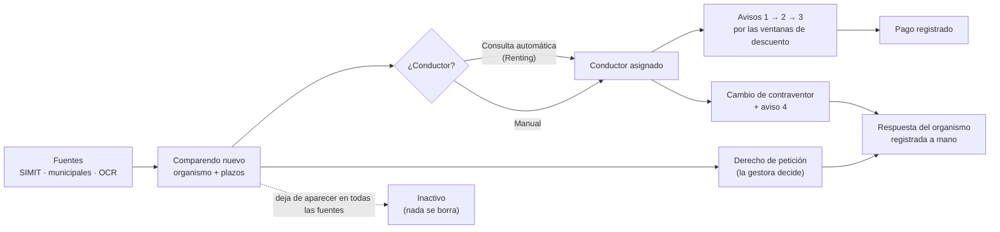

# Comparendos: entrega del producto

*FLIT Suite · Gestión de Comparendos (GDC V2)*

> Versión en Markdown del artifact https://claude.ai/artifact/ToAjb5cGGNUn1pXi1FpPgY (corte: 23 de octubre de 2026). El artifact es la versión de referencia; este archivo conserva el mismo contenido para tenerlo en el repositorio.

Qué hace Comparendos, cómo lo hace y qué está construido a hoy. Es el documento para quien se queda a cargo mientras Samuel está fuera; el manual de uso y de pruebas va en un documento aparte.

Corte: **23 de octubre de 2026** Construido por: **Samuel Cárdenas** Proyecto ADO: **FLIT - GESTION COMPARENDOS**

## 1. En una página

**Comparendos** es el producto de la FLIT Suite con el que una empresa dueña de vehículos (renting, leasing, flotas) se entera de los comparendos de sus vehículos y los gestiona hasta cerrarlos. Hace cinco cosas:

1. **Encuentra los comparendos solo:** consulta todos los días el SIMIT y las secretarías municipales por los NIT y placas de la empresa. También permite cargarlos leyendo el PDF o la foto del comparendo (lectura automática).
2. **Calcula los plazos:** con días hábiles y festivos de Colombia, dice si el comparendo tiene descuento del 50 % o 25 %, si está vencido, caducado o prescrito.
3. **Avisa al conductor:** identifica quién manejaba (a mano o con la consulta automática de Renting) y le envía hasta cuatro avisos por correo para que pague a tiempo.
4. **Ataca el comparendo:** genera y radica ante el organismo de tránsito derechos de petición y solicitudes de cambio de contraventor, firmados por el representante legal de la empresa.
5. **Deja todo trazado:** cada paso queda en la línea de tiempo del comparendo, en el Centro de mensajes y en los reportes.

**Dónde está**

En **DEV** completo y al día. En **QA** está la primera entrega; las mejoras de octubre están pendientes de llevar (sección 9).

**Cómo se entra**

Desde el hub de FLIT, con el mismo usuario de Trámites, en el menú de productos (▦) → Comparendos. Se enciende por empresa.

**Lo más importante**

En DEV y QA **ningún correo debe llegar a un conductor ni a un organismo real**. Todo se desvía al buzón de pruebas (sección 8).

## 2. Para quién y para qué

Una empresa propietaria de vehículos recibe comparendos que no cometió ella: los cometió el conductor que tenía el carro (un cliente de renting, un empleado). Si nadie hace nada, la multa queda a nombre de la empresa, pierde los descuentos por pronto pago y termina en cobro coactivo. Comparendos resuelve ese problema:

- Le dice a la empresa, sin que tenga que buscar, qué comparendos tiene y cuáles vencen primero.
- Le dice al conductor que tiene un comparendo y cuánto se ahorra si paga a tiempo.
- Pide al organismo de tránsito que cambie el infractor por el conductor real (cambio de contraventor) o que revise el comparendo (derecho de petición).

Reemplaza a la versión 1 (V1), que sigue en producción para los clientes actuales. Renting Colombia es el cliente principal y el que más condiciona el diseño: tiene sus propios textos, su imagen en los correos y su consulta automática de contratos.

## 3. Quién usa qué

| Actor | Qué hace en Comparendos | Cómo entra |
|---|---|---|
| **SuperAdmin de FLIT** | Configura cada empresa (qué tiene contratado, agenda de consultas, consulta automática del conductor), administra catálogos globales (organismos, tipologías de DP, plantillas, calendario, horarios) y vigila las integraciones. En la operación de la empresa **solo lee**: elige la empresa y ve su bandeja sin poder actuar. | Hub → Comparendos → menú «Administración FLIT» |
| **Administrador de Comparendos** (rol `admin_comparendos`) | Todo lo de la empresa: operación y configuración (NIT y placas, representantes legales, organismos, correo). | Hub → Comparendos. Lo tiene automáticamente el administrador de la compañía. |
| **Operador de Comparendos** (`operador_comparendos`) | Opera: asigna conductores, envía avisos, DP y cambios de contraventor, registra pagos y respuestas, carga por OCR. No cambia la configuración. | Se asigna en la administración de usuarios de la plataforma. |
| **Consulta de Comparendos** (`consulta_comparendos`) | Solo ve y exporta. | Igual. |
| **Conductor** | Recibe los avisos por correo y abre un portal con su comparendo, el descuento vigente y cómo pagar. No tiene usuario. | Enlace del correo (portal del conductor). |
| **Organismo de tránsito** | Recibe por correo los DP y las solicitudes de cambio. Responde por correo a la empresa; la gestora registra esa respuesta en Comparendos. | No entra al sistema. |

Los permisos son finos (29 en total, del tipo «enviar DP en lote» o «registrar la respuesta del OT»). Los tres roles anteriores son los que vienen por defecto; la empresa puede armar otros. Una empresa nunca ve datos de otra.

## 4. La vida de un comparendo

De punta a punta, sin entrar en excepciones (esas están en las secciones 5 y 6):

Todo lo que pasa queda en la **línea de tiempo** del comparendo. El flujo diario con horas, y las respuestas detalladas a las preguntas de negocio, están en la página [«Un día en Comparendos»](https://claude.ai/artifact/2YjcDVAgD3dMRVKxMoB79M).

## 5. Qué hace cada módulo

En el orden en que se usan. El texto en gris dice dónde se ve en la pantalla.

### Fuentes e ingesta

Configuración → NITs y placas · Administración FLIT → Trabajos e ingesta

La empresa registra los NIT y placas que quiere vigilar (uno a uno o por Excel). El sistema los consulta según la agenda de la empresa en cuatro canales independientes: **SIMIT por NIT**, **SIMIT por placa**, **municipal por NIT** y **municipal por placa**. Cada NIT se consulta con y sin dígito de verificación.

- Si el comparendo es nuevo, se crea; si ya existía, se actualizan los datos de la fuente y cada cambio queda en el historial; si dejó de aparecer en todas las fuentes, queda inactivo.
- Una falla técnica de la fuente nunca toca comparendos: se registra, se alerta a FLIT y se intenta en la siguiente corrida.
- El SuperAdmin define la agenda por empresa y canal (horas fijas o cada cierto tiempo, solo días hábiles si se quiere) y puede «Ejecutar ahora».
- El SuperAdmin elige qué proveedor atiende cada canal; la empresa nunca ve el proveedor, solo la agenda.

### Organismos de tránsito

Configuración → Organismos de tránsito · Administración FLIT → Catálogo de organismos

Cada comparendo se asocia a su organismo, en este orden: el texto de la secretaría contra los **alias**, el código o nombre exacto del catálogo, el código dentro del número del comparendo y, por último, el municipio si tiene un solo organismo. Lo que no se identifica queda «sin mapear» y el SuperAdmin crea el alias una vez.

- El catálogo se copia cada noche (3:00) del catálogo de la plataforma. No toca los correos de radicación, el permiso de cambio de contraventor ni los alias.
- Del organismo dependen: a qué correos se radican los DP y las solicitudes de cambio, y si el organismo acepta cambio de contraventor.
- Los correos de radicación y el permiso de cambio de cada organismo son globales y los define FLIT (SuperAdmin). La empresa solo puede bloquear el cambio ante un organismo (en general o para un representante).

### Plazos y estado legal

Bandeja (tarjetas y columnas) · Detalle del comparendo

Todo se cuenta en días hábiles con el calendario de festivos de Colombia, que el SuperAdmin puede corregir. Estados: **Sin notificación, En tiempo, Vencido, Caducado y Prescrito**. «Próximo a vencer» es a 2 días hábiles o menos del límite. La tabla exacta de descuentos está en la sección 6.

### Bandeja

Operación → Bandeja

La lista de trabajo de la empresa, ordenada por urgencia. Tiene tarjetas de estado legal con conteo, búsqueda por número o placa, «Búsqueda rápida» (próximos a vencer, sin contraventor, rechazados por OT, sin gestión, filtros jurídicos), filtros agrupados con «es / no es» y listas pegadas desde Excel, columnas a gusto y exportación a Excel en partes de 5.000 filas. Permite seleccionar varios para enviar avisos o DP en lote.

### Detalle y línea de tiempo

Bandeja → clic en un comparendo

La ficha completa: datos de la fuente, ventana de descuento con su fecha, estado legal, organismo, conductor, documentos, y las acciones (conductor, avisos, DP, cambio de contraventor, pago, observación, inactivar). La línea de tiempo registra todo lo que pasó, quién lo hizo y el resultado, incluidos los correos y su apertura. Nada se borra ni se edita.

### Conductor (contraventor)

Detalle → Contraventor · Bandeja → «Sin contraventor»

- **Manual:** la gestora digita documento, nombre, correo y teléfono, con la declaración de tratamiento de datos. Si lo reemplaza, debe dar el motivo y queda el historial.
- **Automático (Renting):** si la empresa y el NIT tienen la consulta automática, el sistema busca el contrato por placa y fecha apenas llega el comparendo y asigna el conductor solo. La respuesta de Renting no trae el documento: queda «documento pendiente» y la gestora lo completa.
- Estados de la consulta: no aplica, pendiente, encontrado, no encontrado (pasa a asignación manual) y error (se reintenta a las 6:00, hasta 3 veces).
- Se le cargan la cédula y la licencia, que se necesitan para el cambio de contraventor.

### Avisos al conductor

Detalle → Avisos · Bandeja → Enviar aviso · Administración FLIT → Horario de avisos

Cuatro avisos por correo. Los tres primeros salen solos en días hábiles a las 7:00, según la ventana de descuento; el cuarto sale cuando se radica el cambio de contraventor.

| Aviso | Cuándo | Adjuntos |
|---|---|---|
| 1 · inicial | El primer día hábil en que el comparendo tiene conductor con correo y fecha base. Dice el descuento vigente. | Autorización de cambio de infractor firmada por el representante legal, su poder («Escritura o poder») y el documento del comparendo si se cargó por OCR. |
| 2 · recordatorio | El día en que pasa del 50 % al 25 %, si el 1 salió con 50 %. | |
| 3 · sin descuento | El día en que se acaba el último descuento, si el último aviso salió con descuento. | |
| 4 · cambio de contraventor | Cuando el correo de la solicitud al organismo se entrega. | La autorización que se radicó. |

- **Marca y canal:** los decide el «Enrutamiento de notificaciones» de la empresa en Trámites. Con «API Renting cliente» salen por la cuenta de correo de Renting, con los textos de V1 y su imagen, sin nada de FLIT. Con «Colas FLIT» salen por FLIT con el diseño de los correos de Trámites.
- No salen si el comparendo está pagado, inactivo, notificado en persona o el conductor no tiene correo. Máximo uno automático por día. Nunca son retroactivos. Se pueden enviar a mano.
- Si falta un adjunto (por ejemplo, el representante no tiene firma), el aviso sale sin ese adjunto y la línea de tiempo dice qué faltó.

### Cambio de contraventor

Detalle → Cambio de contraventor

Pide al organismo que cambie el infractor por el conductor real. Antes de solicitar, el sistema muestra la lista de condiciones y cuál falta. Por ejemplo: un organismo que lo permita y tenga correo, un comparendo activo sin pagar, conductor con documento, cédula y licencia, y representante legal con permiso. Con la vista previa del formato y de la carta, al solicitar arma el formato firmado, lo envía al organismo con los anexos y, si se entrega, envía el aviso 4. La respuesta del organismo se registra a mano: aceptado (Exitoso) o rechazado con causal; los rechazados se pueden volver a solicitar.

### Derecho de petición (DP)

Detalle → Derecho de petición · Operación → Envíos masivos de DP

Documento firmado por el representante legal que se radica por correo al organismo. Hay 11 tipologías (petición estándar, audiencia, C-038, caducidad masiva e individual, mala notificación, prescripción, persona jurídica, nulidad C-321, notificación del acto, acto administrativo); cada una aplica a ciertos estados legales y el SuperAdmin decide cuáles tiene cada empresa. Un DP por comparendo, con radicado `PREFIJO-AAMMDDHHMMSS-mmm`. Se envía uno a uno o en lote (omite los que ya tienen DP). No se permite si está pagado, si la tipología no aplica a su estado, o si no hay representante legal (en ese caso alerta a los encargados). La respuesta del organismo se registra a mano (favorable o desfavorable, con soporte). Si el comparendo desaparece de todas las fuentes con un DP enviado, el DP se marca favorable solo.

### Pagos

Detalle → Registrar pago · Operación → Carga de pagos

El pago es una marca informativa (no consulta ningún sistema de pagos). Se registra uno a uno o por plantilla de Excel; el archivo de errores dice qué filas no entraron y por qué. Un comparendo pagado no recibe avisos ni admite DP.

### Carga por OCR (lectura automática)

Operación → Paquetes OCR · Administración FLIT → Prompt OCR

Para lo que no llega por las fuentes, como el comparendo en vía que le entregan al conductor. Se sube un paquete de PDF o fotos (PDF, JPG, PNG, TIFF). La lectura automática extrae número, placa, fechas, infracción, organismo y valor. Cada documento queda completo, incompleto, fallido o duplicado, con marcas donde conviene revisar. Se corrige a mano, se puede reprocesar (conserva lo corregido, hasta 3 veces) y exportar el paquete a Excel. Al registrar se crean los comparendos con fuente OCR y el documento queda adjunto. Las instrucciones de lectura tienen versiones: una versión nueva solo se publica si pasa una evaluación contra documentos ya revisados.

### Correos y Centro de mensajes

Operación → Centro de mensajes · Configuración → Empresa y correo · Configuración → Plantillas

Todo correo que sale (avisos, DP, solicitudes al organismo, alertas, reportes) queda en el Centro de mensajes: destinatario, estado (pendiente, enviado, abierto, rebotado, fallido), cada intento, adjuntos y el correo tal como se vio. Las fallas temporales se reintentan solas a 1, 5 y 25 minutos. La empresa define remitente, correo para respuestas, copias por tipo de envío y destinatarios de reportes. Los textos son plantillas editables con vista previa y versiones.

### Reportes

Reportes → Dashboard · Reportes → Productividad

Dashboard con indicadores del periodo, radar de vencimientos (lo que vence en los próximos 7 días hábiles, con clic a la bandeja), series por mes y tabla por NIT. Productividad: qué gestionó cada usuario, exportable. Reporte semanal (viernes 17:00) y mensual (fin de mes 18:00) por correo.

### Portal del conductor

Enlace dentro de los avisos

Página pública (sin usuario) con el comparendo, el descuento vigente y cómo pagar, con la marca de la empresa (FLIT o Renting). El enlace se revoca si el comparendo queda inactivo.

### Administración FLIT

Menú «Administración FLIT» (solo SuperAdmin)

| Pantalla | Para qué |
|---|---|
| Parametrizador por empresa | Registrar la empresa, capacidades contratadas, consulta automática del conductor (con «Probar conexión»), tipologías de DP, NIT con consulta automática. |
| Tipologías de DP | Catálogo de tesis con su texto, estados a los que aplica y si admiten lote. |
| Editor de plantillas | Textos de correos y documentos de FLIT y de Renting, con versiones y vista previa. |
| Trabajos e ingesta | Agenda de consultas por empresa y canal, ciclos ejecutados, «Ejecutar ahora», respuestas de error de la fuente y trabajos programados (reintento del conductor, réplica de organismos, reportes) con horario en lenguaje normal. |
| Log de migración | Registro de cada consulta a fuente y de la migración desde V1. |
| Catálogo de organismos | Organismos sincronizados y los alias de secretarías. |
| Fuentes municipales | Los municipios que responde la fuente municipal, activables uno a uno. |
| Alertas de integración | Destinatarios y umbral de los correos cuando falla una fuente. |
| Horario de avisos | Hora de los avisos 1, 2 y 3, pausa e historial. |
| Prompt OCR | Versiones de las instrucciones de la lectura automática, evaluación y publicación. |
| Calendario | Festivos; al cambiar uno se recalculan los plazos afectados. |

## 6. Reglas de negocio clave

| Tema | Regla |
|---|---|
| Descuentos | Fotomulta (desde la notificación): 50 % hasta el día hábil 11 y 25 % hasta el 26. Comparendo en vía (desde la imposición): 50 % hasta el día 5 y 25 % hasta el 20. Después, 100 %. |
| Límite de gestión | 11 días hábiles desde la fecha de referencia (notificación; en vía sin notificación, imposición). |
| Caducidad y prescripción | 1 año y 3 años desde la fecha de referencia, corridos al siguiente día hábil. |
| Fecha 01-01-2000 | Algunas fuentes la mandan cuando no tienen el dato. Se trata como vacía. |
| Actualización por la fuente | La fuente sobrescribe lo que trae, un dato vacío no borra uno que ya había, y nunca toca la gestión (conductor, DP, pagos, avisos, cambio de contraventor). |
| Desaparición | Inactivo solo si falta en todas las fuentes donde estaba y la consulta respondió completa. Si reaparece, se reactiva solo, salvo que lo haya inactivado una persona. |
| Unicidad | Un comparendo por número dentro de cada empresa (dos empresas pueden tener el mismo). Un DP por comparendo. |
| Firma | Todo documento lo firma el representante legal de la empresa (o del NIT, si ese NIT tiene uno propio) con permiso para ese tipo de documento. FLIT no firma nada. Comparendos tiene su propio registro de representantes: no reutiliza el de la compañía en Trámites. La «Escritura o poder» no es obligatoria; si falta, los documentos salen sin ese anexo. |
| Lo que ve el cliente | Ningún texto para la empresa menciona «API», «prompt», proveedores, modelos de IA ni costos. Eso solo lo ve el SuperAdmin. |
| SuperAdmin en la empresa | Solo lectura; cada lectura queda en la auditoría. |

## 7. Cómo está armado

Esta parte es técnica a propósito: quien se quede a cargo necesita saber qué servicio hace qué para ubicar un problema.

| Pieza | Qué hace para Comparendos | Dónde en el repositorio |
|---|---|---|
| **core-comparendos** | El servicio del producto: reglas, base de datos (esquema `comparendos`), trabajos programados, documentos PDF, OCR. | `services/core-comparendos` |
| **frontend-comparendos** | La aplicación web (Next.js). | `frontend-comparendos` |
| **core-consultas** | Ejecuta las consultas a las fuentes (SIMIT, municipales) y a la API de contratos de Renting, guarda el consumo. Comparendos decide qué y cuándo; core-consultas ejecuta. | `services/core-consultas` |
| **core-notificaciones** | Envía los correos (correo corporativo de FLIT o API de correo de Renting) y aplica el desvío al buzón de pruebas. | `services/core-notificaciones` |
| **core-identity** | Inicio de sesión, empresas, productos encendidos y el canal de correo de cada empresa. | `services/core-identity` |
| **core-api** (Trámites) | Catálogo de organismos de la plataforma (se copia cada noche). | `services/core-api` |
| **file-manager** | Guarda archivos (documentos OCR, firmas, cédulas, soportes) en MinIO. | Servicio de la plataforma |

### Integraciones externas

| Integración | Uso | Notas |
|---|---|---|
| SmartCloud (servicios oficiales del SIMIT) | SIMIT por NIT y por placa. | Requiere la clave de acceso; ya configurada en DEV y QA. |
| Verifik | Proveedor alterno para SIMIT. | El SuperAdmin elige el proveedor por canal. |
| API municipal (la de V1) | Secretarías que no están en SIMIT: Bello, Cali, Envigado, Itagüí, Manizales, Medellín, Rionegro, Sabaneta. | Máquina propia de V1; a veces hay municipios caídos y Cali falla por certificado. |
| API de Renting | Contratos (quién tenía la placa en una fecha) y canal de correo de Renting. | Renting solo tiene producción: fuera de PDN el contacto y los correos se desvían al buzón de pruebas. |
| Anthropic (Claude) | Lectura automática de los comparendos (OCR). | Modelo `claude-haiku-5-5`, guardado con cada versión de las instrucciones (pantalla Prompt OCR, solo SuperAdmin). La llave va por configuración. |

### Trabajos automáticos

| Trabajo | Cuándo |
|---|---|
| Consultas a las fuentes | Agenda de cada empresa y canal |
| Réplica de organismos | Todos los días, 3:00 |
| Reintento de la consulta del conductor | Todos los días, 6:00 |
| Avisos 1, 2 y 3 | Días hábiles, 7:00 a 7:15 |
| Despacho de correos | Cada 10 segundos |
| Reporte semanal / mensual | Viernes 17:00 / fin de mes 18:00 |

## 8. Seguridad en pruebas: lo que nunca debe pasar

**Regla de Samuel, sin excepciones:** en DEV, QA y local no puede salir ningún DP, solicitud de cambio de contraventor ni aviso a un organismo de tránsito o a un conductor real. Los correos de prueba van solo a **samuel.cardenas@flitsas.com** (o al buzón de pruebas configurado). Tampoco se altera información real.

Cómo está protegido hoy:

- **Organismos en DEV:** los 298 organismos tienen como correo de radicación el buzón de Samuel. Los correos reales están respaldados en `respaldo.gdc_organismo_correos_20261020`. Si alguien los «limpia» dejándolos vacíos, la semilla vuelve a poner los reales al arrancar: se reemplazan, nunca se vacían.
- **Organismos en QA:** [pendiente] falta el mismo reemplazo de correos en la base de QA. Mientras no se haga, **no envíes DP ni cambios de contraventor en QA**.
- **Correos por FLIT:** core-notificaciones desvía al buzón de pruebas fuera de PDN.
- **Correos por Renting:** desde el PR #670 también se desvían (antes, lo que llegaba de Comparendos se saltaba el desvío). Ojo: en DEV la cuenta de Renting tiene encendido el envío a destinatarios reales para Trámites; Comparendos ya no pasa por esa excepción.
- **Contratos de Renting:** el correo del conductor que devuelve Renting se reemplaza por el buzón de pruebas salvo con el interruptor que solo se enciende en PDN.
- **Conductores de prueba:** en local usan correos `@example.test`, que no existen.

Antes de cualquier envío en un ambiente compartido, revisa en el Centro de mensajes a quién va. Si dudas, no envíes.

## 9. Qué está hecho y dónde

El producto completo (los 10 módulos del análisis, 42 HU) se entregó en el PR #607 y se desplegó en DEV el 20 de octubre. Después vinieron mejoras por tandas:

| PR | Qué trae | ADO | DEV | QA |
|---|---|---|---|---|
| #607 | Comparendos completo | Epics #12878 a #12999 | [sí] | [sí] |
| #623 / #634 | Menú de productos (▦) desde Comparendos | HU #13700 | [sí] | [sí] |
| #636 | Consulta automática de contratos de Renting | HU #13712 | [sí] | [pendiente] |
| #641 | Fechas 01-01-2000, orden de la bandeja, ajustes de catálogos | Feature #13783 | [sí] | [pendiente] |
| #652 | Trabajos programados en lenguaje normal y «Ejecutar ahora» | Feature #13813 | [sí] | [pendiente] |
| #653 | OCR: reprocesar, marcas de revisión, exportar el paquete, textos sin tecnología | Feature #13827 | [sí] | [pendiente] |
| #657 | «Probar conexión» de Renting y columna Conductor | Feature #13842 | [sí] | [pendiente] |
| #667 | Filtros nuevos de la bandeja, tarjetas, búsqueda rápida, exportación por partes | Feature #13867 | [sí] | [pendiente] |
| #670 | Avisos reales (textos e imagen de Renting y de FLIT, adjuntos, desvío de pruebas) | Feature #13880 | [fusionado el 23-oct] | [pendiente] |

«DEV: sí» significa fusionado en develop y desplegado. Confirma con Jorman el despliegue del #670 antes de probarlo en DEV.

### Cómo se lleva algo a QA

Una rama `-qa` creada desde `origin/staging` con el cherry-pick del merge, y un PR contra `staging` (patrón del PR #634). Al llevar el #636 a QA hay que configurar Renting en core-consultas de QA, con el desvío al buzón de pruebas.

### Lo que está verificado

- Recorrido completo del producto en navegador (14 bloques) el 15 al 19 de octubre, con consultas reales a SIMIT (unos 5.170 comparendos de un NIT) y a la fuente municipal.
- En DEV: avisos 1 reales a las 7:00 (llegaron al buzón de Samuel), consulta real de contratos de Renting asignando el conductor, SmartCloud conectado, menú de productos.
- Pruebas automáticas: 305 de core-comparendos más las de los demás servicios, todas en verde en el CI del #670.

## 10. Pendientes y decisiones abiertas

### Para hacer

| Pendiente | Quién | Prioridad |
|---|---|---|
| Llevar a QA los PR #636 a #670 (tabla de la sección 9) a medida que se verifican en DEV. | Encargado + Jorman | [alta] |
| Reemplazar los correos de radicación de los organismos en la base de QA por el buzón de pruebas (como en DEV: diagnóstico, respaldo, reemplazo, nunca vaciar). | Encargado (lo corre quien tenga acceso a la base) | [alta, antes de probar DP en QA] |
| Verificar en DEV el #670: aviso con textos de Renting y FLIT, adjuntos, canal en solo lectura. | Encargado / QA | [alta] |
| Marca propia de cada empresa (logo y colores) en los avisos FLIT. Hoy salen con el logo de FLIT. | Samuel lo define al volver | [después] |
| Confirmar con Renting el remitente de su API de correo (hoy usa el del ambiente, el mismo de Trámites). | Samuel / PO | [media] |
| Textos finales de los avisos FLIT (hoy los redactamos nosotros; el PO da la versión final). | PO (Andrés) | [media] |
| Organismos que faltan en el catálogo (Obando, Yalí, Santa Catalina): unos 560 comparendos quedan sin organismo hasta que la plataforma los tenga. | Catálogo de la plataforma | [media] |
| Cali en la fuente municipal falla por el certificado del servidor de V1. | Dueño de la máquina de V1 | [media] |
| Borrar la tabla `comparendos.exportacion`, que quedó sin uso. | Limpieza aparte | [baja] |

### Decisiones de producto abiertas

- Qué nombre se muestra como «quién informa» en el aviso: el que trae la fuente, el titular del NIT o la empresa gestora. Hoy se usa el titular del NIT.
- Foto de la evidencia en el portal: ninguna fuente trae la foto; solo existe el documento si se cargó por OCR.
- Texto exacto de la declaración de datos del conductor (Ley 1581) y su retención.
- Vigencia del enlace del portal del conductor.
- Si un comparendo reactivado debe recuperar el enlace del portal y revertir el DP marcado favorable por desaparición.
- Mover la hora de los avisos después de las consultas del día (hoy salen a las 7:00, antes de las consultas de las 7:30 y 8:00).
- Las preguntas nuevas sobre configuración, OCR y pantallas están respondidas, con propuesta, en «Un día en Comparendos» (sección «Ronda 2»).

### Riesgos conocidos

- Si el servicio se reinicia justo con trabajos en cola, esos trabajos se pierden; se recuperan en la siguiente corrida.
- El estado de correo «entregado» no se usa: ningún proveedor confirma la entrega. El seguimiento llega a «enviado» y «posiblemente abierto».
- Los errores al distribuir correos no generan alerta; hay que mirar el Centro de mensajes.

### Hallazgos de la revisión del 23 de octubre (sin corregir)

- **OCR con letra delante del número** (por ejemplo «D05001…»): no se ubica el organismo por el número, y el código del organismo que lee la lectura automática no se usa.
- **Duplicados con y sin letra:** «D123…» y «123…» no se reconocen como el mismo comparendo.
- **Consumo de consultas:** cada NIT se consulta dos veces por corrida (con y sin dígito de verificación), y si dos empresas vigilan el mismo NIT o placa se consulta dos veces; no hay reutilización entre empresas.
- **Comparendo por OCR de un NIT no vigilado:** se registra igual y luego el DP y el cambio de contraventor quedan bloqueados por «propietario ajeno».
- La agenda de consultas no trae horarios por defecto: cada empresa nueva se configura a mano.

Todos están explicados, con propuesta, en «Un día en Comparendos», sección «Ronda 2».

## 11. Dónde está todo

| Qué | Dónde |
|---|---|
| Código | Repositorio `flitsas/flit`, rama base `develop`. Servicio en `services/core-comparendos`, web en `frontend-comparendos`. |
| Especificación funcional (fuente única) | `context/gdc/especificacion-gdc-v2.md` (en la máquina de Samuel; no está en git) |
| Respuestas del PO a las preguntas del análisis | Excel `Preguntas_pendientes_GDC.xlsx`; resumen en `context/gdc/respuestas-excel.txt` |
| Hallazgos de las pruebas en navegador | `context/gdc/pruebas/hallazgos.md` |
| Despliegue en DEV (k3s) | `docs/suite/despliegue-dev-k3s-comparendos.md`; la configuración vive en `flit-gitops` (la maneja Jorman) |
| Correr todo en local | `docs/suite/local.md` |
| API de contratos de Renting | `docs/integraciones/renting-api-contratos.md` |
| ADO | Proyecto «FLIT - GESTION COMPARENDOS». Producto: Epics #12878 a #12999. Ajustes de octubre: Epic #13779 (Features #13783, #13813, #13827, #13842, #13867, #13880). |
| Flujo diario y respuestas de negocio | [«Un día en Comparendos»](https://claude.ai/artifact/2YjcDVAgD3dMRVKxMoB79M) |
| Ambientes | DEV: `dev.comparendos.flitsas.online` (hub: `dev.flitsas.online`). QA: entrar por el hub `qa.flitsas.online` → ▦ → Comparendos. |

## 12. Personas y cómo se trabaja

| Persona | Rol | Para qué buscarla |
|---|---|---|
| Andrés Jiménez | Product Owner | Decisiones de producto, textos finales, prioridades. |
| Juan Camilo | CTO | Decisiones de fondo; lo que no defina lo delega en Andrés. |
| Jorman Copete | Líder técnico | Fusiona los PR, despliega (flit-gitops), configura secretos de DEV y QA. |
| Samuel Cárdenas | Desarrollador de Comparendos | Ausente una semana. |

### Cómo se ha trabajado (para seguir igual)

- Rama nueva desde `develop` para cada cambio; nunca trabajar sobre `develop`.
- En ADO, al empezar se activan Epic → Feature → HU. Al terminar, la HU queda en **Active** con los campos Commits y Evidences llenos (nunca se pasa a Resolved desde desarrollo; eso lo hacen el líder o QA).
- Commits con el prefijo `HU<id>:`.
- Ningún PR sin los checks verdes: Jorman no fusiona si falta alguno. Algunas pruebas de core-api que miden tiempos fallan a veces sin relación con el cambio; se relanza el job y, si vuelven a fallar, se investiga.
- Lo que se fusiona se prueba en DEV y luego se lleva a QA.

## 13. Glosario

Comparendo

Orden de comparecencia por una infracción de tránsito. Puede ser fotomulta (detectada por cámara, se notifica después) o en vía (la entrega un agente).

Contraventor / infractor

La persona a la que se le atribuye la infracción. Al principio es el propietario (la empresa); el cambio de contraventor la pasa al conductor.

OT

Organismo de tránsito: la secretaría que impone el comparendo y a la que se radican las solicitudes.

DP

Derecho de petición: solicitud formal al organismo, con una tesis jurídica (tipología).

Gestora

La empresa cliente que usa Comparendos (por ejemplo, Renting Colombia).

RL

Representante legal: firma los documentos de la empresa.

Fuente

De dónde llega un comparendo: SIMIT, una secretaría municipal u OCR.

Ciclo

Una corrida de consulta a una fuente para una empresa.

Alias

Texto de secretaría que trae una fuente y que se traduce a un organismo del catálogo.

Ventana de descuento

Periodo en que se puede pagar con 50 % o 25 % de descuento.

SuperAdmin

Usuario de FLIT con acceso a todas las empresas y a la administración global.
