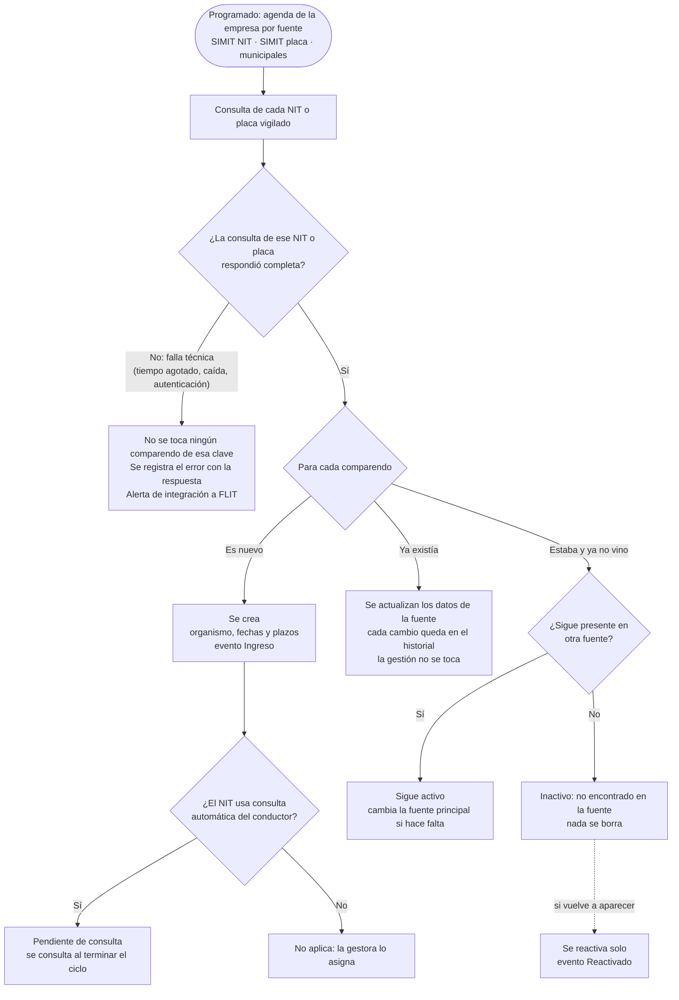
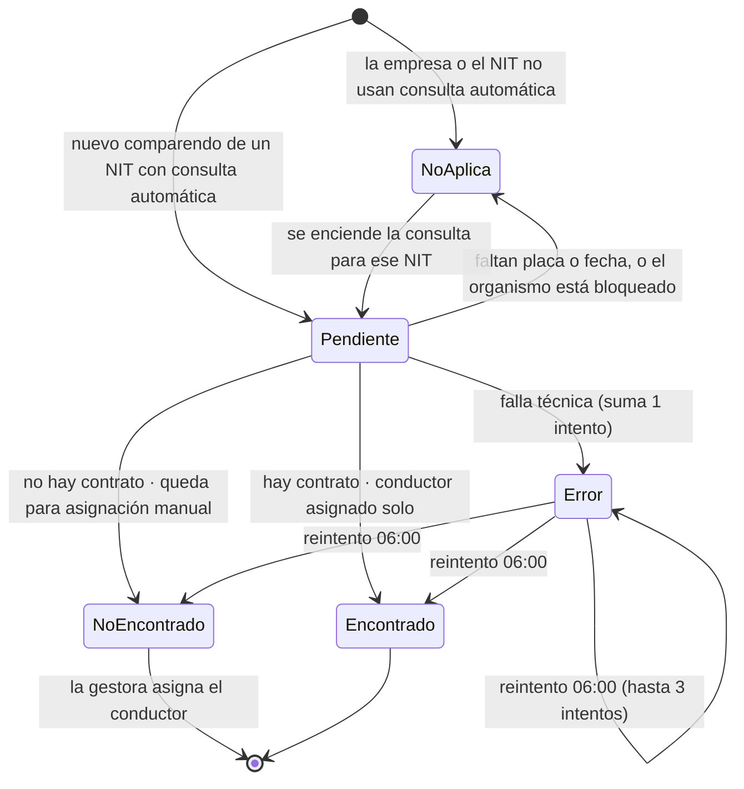
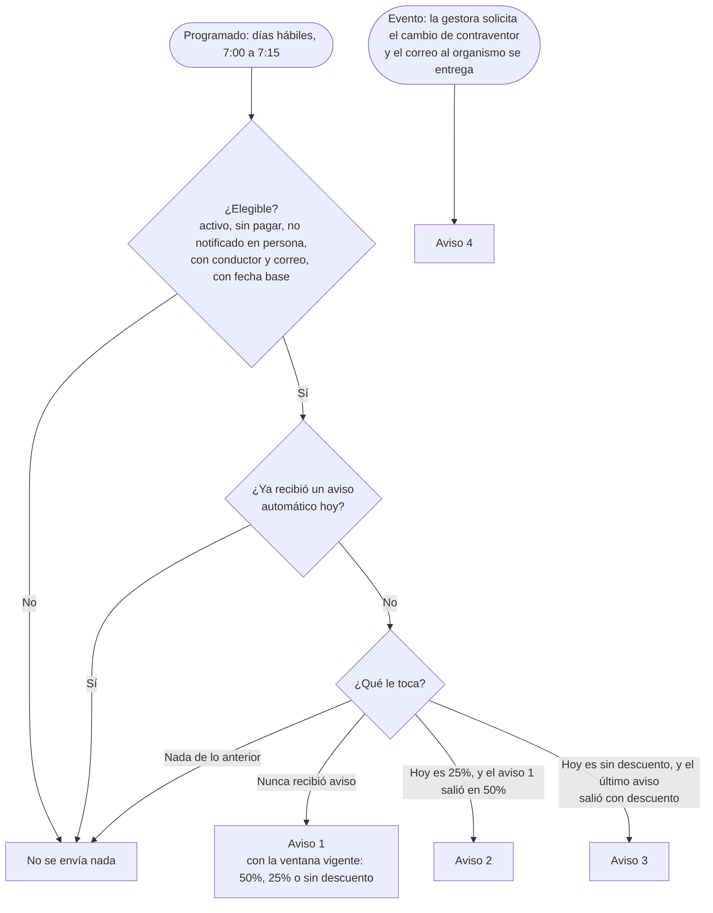
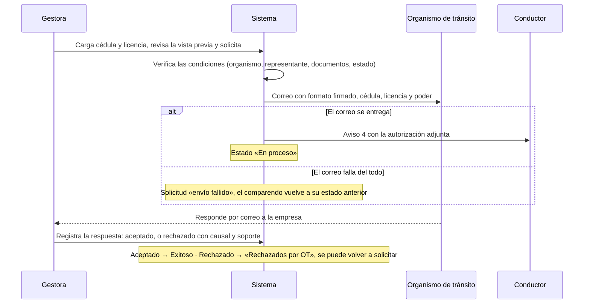

# Un día en Comparendos

*Gestión de Comparendos · flujo diario y reglas de negocio*

> Versión en Markdown del artifact https://claude.ai/artifact/2YjcDVAgD3dMRVKxMoB79M (corte: 23 de octubre de 2026). El artifact es la versión de referencia; este archivo conserva el mismo contenido para tenerlo en el repositorio.

Qué hace el sistema solo, qué lo dispara, a qué hora y qué le queda a la gestora. Las respuestas a las observaciones están al final, con la misma numeración. Todo lo de esta página sale del comportamiento actual del sistema.

[Programado por horario] [Disparado por un evento] [Lo hace la gestora]

## Cómo leer esta página

[Programado]

Hay pocos procesos atados a una hora: las consultas a las fuentes (según la agenda de cada empresa), el envío diario de avisos, el reintento del conductor, la sincronización de organismos y los reportes. **La hora solo dice cuándo se revisa; la regla de negocio decide si se hace algo.** Por ejemplo, a las 7:00 el proceso de avisos revisa todos los comparendos, pero solo envía a los que cumplen la regla del aviso que les toca.

[Evento]

Lo demás lo dispara un cambio de estado: llega un comparendo nuevo, cambia su fecha, se asigna un conductor, la gestora solicita un cambio de contraventor, un correo se entrega o falla. Estas acciones no esperan a ninguna hora.

**Correcciones a la versión anterior de esta página:**

- El reintento del conductor es a las **06:00**, no a las 00:00.
- La **primera** consulta del conductor no espera a las 06:00: se lanza apenas termina la consulta a la fuente que trajo comparendos nuevos.
- El proceso de avisos corre **solo en días hábiles**: ni fines de semana ni festivos.
- No existen estados «control de contrato» ni «consultando». Los estados de la consulta del conductor son cinco (ver la respuesta 5).

## El reloj del día

Horas de la empresa de prueba. Cada empresa tiene su propia agenda de consultas por fuente; los demás horarios son globales y los ajusta el SuperAdmin.

03:00

[Programado] **Sincronización del catálogo de organismos de tránsito** Todos los días. Ver la respuesta 1.

06:00

[Programado] **Reintento de la consulta automática del conductor** Solo los comparendos que quedaron pendientes o con error, con menos de 3 intentos. Ver la respuesta 2.

07:00

[Programado] **Consulta SIMIT por NIT** Si trae comparendos nuevos que usan consulta automática, se lanza en ese momento la consulta del conductor.

07:00 – 07:15

[Programado] **Revisión y envío de avisos 1, 2 y 3** Solo en días hábiles y una vez al día por comparendo. Ver la respuesta 6.

07:30

[Programado] **Consulta SIMIT por placa** Independiente de la de NIT.

08:00

[Programado] **Consulta de las fuentes municipales** Independiente de las anteriores.

Cada 10 s

[Evento] **Despacho de correos pendientes** Todo correo registrado (aviso, DP, solicitud al organismo, alerta) sale en segundos; los que fallan por algo temporal se reintentan a 1, 5 y 25 minutos.

En el día

[Gestora] **Gestión desde la bandeja** Asignar conductores, enviar derechos de petición, solicitar cambios de contraventor, registrar respuestas de los organismos y pagos, y cargar por OCR.

Viernes 17:00

[Programado] **Reporte semanal**

Fin de mes 18:00

[Programado] **Reporte mensual**

**Consecuencia práctica del orden de horas:** el envío de avisos (7:00) va antes que la consulta por placa (7:30) y la municipal (8:00). Un comparendo que llega por esas fuentes, o cuyo conductor se asigna durante el día, recibe su aviso 1 el siguiente día hábil a las 7:00. La gestora puede enviarlo a mano en cualquier momento. Si se quiere el mismo día, basta con mover el horario de avisos después de las consultas (por ejemplo, a las 9:00).

## Diagramas

### 1. Llegada y actualización de un comparendo

### 2. Consulta automática del conductor (estados)

### 3. Avisos al conductor (reglas)

### 4. Cambio de contraventor

## Respuestas a las observaciones

### 1. Reloj operativo y catálogo de organismos

**¿Cómo se actualiza el catálogo de organismos y qué depende de él?**

A las 03:00 el sistema copia el catálogo oficial de organismos de la plataforma FLIT (el mismo de Trámites). Crea los organismos nuevos y actualiza nombre, municipio, departamento y código DIVIPOLA. Los que ya no vienen quedan marcados como inactivos en la plataforma, pero no se borran. No toca lo que configura cada empresa: correos de radicación, si permite el cambio de contraventor y los nombres alternos. Si la plataforma no responde o la lista llega vacía, no cambia nada.

Dependen de él: identificar el organismo de cada comparendo, los correos a los que se radican los DP y las solicitudes de cambio, y el permiso de cambio de contraventor de cada organismo.

**¿El reloj representa la secuencia del proceso o solo actividades por horario?**

Solo actividades por horario. La secuencia real la dan los eventos y las reglas (diagramas 1 a 4). Los procesos programados son independientes entre sí: una fuente no espera a otra.

**¿Los horarios son consecuentes con el flujo real?**

Funcionan, pero tienen una consecuencia: como los avisos salen a las 7:00, antes de las consultas de las 7:30 y las 8:00, lo que llega por esas fuentes recibe su aviso al día hábil siguiente. Si se quiere el mismo día, hay que mover el horario de avisos después de las consultas. Es configurable sin cambiar el sistema.

### 2. Consulta del conductor y de comparendos

**¿Cuándo es la primera consulta del conductor y cuándo el reintento?**

**Primera consulta:** cuando termina una consulta a la fuente que creó comparendos nuevos «pendientes de consulta», el sistema lanza de inmediato la consulta del conductor. También aplica a lo cargado por OCR.

**Reintento:** es a las **06:00** (no a las 00:00). Toma los comparendos activos sin conductor que estén pendientes o con error y tengan menos de 3 intentos, hasta 2.000 por corrida. Solo los errores técnicos suman intento; «no se encontró contrato» es un resultado final y no se reintenta.

**¿A las 07:00 se consulta SIMIT por NIT? ¿Antes se consultan placas y municipales?**

Sí, a las 07:00 corre SIMIT por NIT. No hay orden entre fuentes: cada fuente (SIMIT por NIT, SIMIT por placa, municipal por NIT, municipal por placa) tiene su propia agenda por empresa y corre por separado. Pueden ser horas fijas o cada cierto intervalo dentro de una ventana, y solo en días hábiles si así se configura. Cada NIT se consulta con y sin dígito de verificación.

**¿La secuencia y los horarios corresponden al flujo real?**

Sí: son los horarios configurados hoy para la empresa de prueba. Otra empresa puede tener otros.

### 3. Comparendos inactivos e historial

**¿Se conserva el registro o se elimina?**

Se conserva. El sistema nunca borra comparendos, su historial de cambios ni su línea de tiempo. Cuando un comparendo deja de aparecer en todas las fuentes donde estaba, queda **inactivo** con el motivo «no encontrado en la fuente». Si vuelve a aparecer, se reactiva solo.

Hay dos casos especiales:

- Si lo inactivó un operador a mano, sigue inactivo aunque reaparezca.
- Si tenía un derecho de petición enviado sin respuesta, ese DP se marca como favorable automáticamente, porque la desaparición indica que el organismo lo resolvió.

**¿Cómo se registra la gestión para consultarla después?**

Tres registros, ninguno se borra:

- **Línea de tiempo del comparendo:** cada acción, con fecha, hora, quién la hizo (persona, proceso automático o consulta automática) y su resultado. Ingreso, cambios de datos, consultas del conductor, asignaciones, avisos y su apertura, DP, cambio de contraventor y respuestas, pagos, inactivación y reactivación.
- **Historial de cambios por campo:** por cada dato que cambió la fuente, el valor anterior, el nuevo, la fuente y la consulta que lo trajo.
- **Centro de mensajes:** cada correo con sus intentos, estado y adjuntos.

**¿Qué garantiza que la desaparición no pierda la trazabilidad?**

La desaparición solo cambia el estado a inactivo y agrega un evento; no borra nada. La gestión, el conductor, los DP, los pagos y la línea de tiempo siguen ligados al comparendo y se consultan con el filtro «Activos / inactivos» de la bandeja.

### 4. Comparendo nuevo y qué dispara cada acción

**¿Qué secuencia se dispara con un comparendo nuevo?**

1. Se crea con los datos de la fuente y se identifica su organismo de tránsito.
2. Se calculan sus fechas: límite de gestión, descuentos, caducidad y prescripción (respuesta 9).
3. Se decide la consulta del conductor: «pendiente» si el NIT usa consulta automática; si no, «no aplica».
4. Al terminar la consulta a la fuente, se lanzan las consultas del conductor pendientes.
5. Con conductor y correo, el aviso 1 sale en la siguiente revisión de las 7:00 de un día hábil.

**¿Cuándo se activa la consulta automática y qué relación tiene con el derecho de petición?**

La consulta automática del conductor solo aplica si la empresa la tiene contratada, está encendida y el NIT del propietario está marcado para usarla. **No tiene relación con el derecho de petición.** El DP lo inicia siempre la gestora, uno a uno o en lote; ningún proceso lo envía solo.

**¿El diagrama diferencia eventos de horarios?**

En esta versión sí: cada elemento lleva su marca (programado, evento o gestora), y los diagramas separan el disparo de la regla.

### 5. Contrato del conductor y asignación manual

**¿Cuál es el flujo desde el comparendo hasta la asignación?**

No hay un estado «control de contrato». La consulta del conductor tiene cinco estados (diagrama 2):

- **No aplica:** la empresa o el NIT no usan consulta automática. La gestora asigna.
- **Pendiente:** se va a consultar el contrato.
- **Encontrado:** se encontró el contrato por placa y fecha, y el conductor quedó asignado solo.
- **No encontrado:** no hay contrato para esa placa y fecha, o no trae el nombre. Queda «pendiente de asignación manual».
- **Error:** falla técnica. Se reintenta a las 06:00, hasta 3 intentos.

**¿Qué decide que pase a asignación manual?**

Que no se encuentre el contrato, que se agoten los intentos por error o que no aplique la consulta. También pasa a «no aplica» si al consultar falta la placa o la fecha, o si la empresa bloqueó la consulta para ese organismo. Todos estos casos aparecen en la bandeja con el atajo «Sin contraventor».

**¿Cómo se relaciona con la gestión posterior?**

Sin conductor con correo no salen avisos. Sin conductor con documento no se puede solicitar el cambio de contraventor. Cuando el conductor queda asignado, por consulta o a mano, el siguiente aviso que le toque sale en la revisión de las 7:00. Si se reemplaza el conductor, el nuevo recibe sus propios avisos.

### 6. Reglas de los avisos al conductor

**¿Qué condiciones determinan cada aviso?**

**Condición común:** comparendo activo, sin pagar, no notificado en persona, con conductor con correo y con fecha base (notificación, o imposición si es en vía). Además, que la empresa tenga el producto habilitado.

- **Aviso 1:** nunca ha recibido aviso. Sale con la ventana vigente: 50 %, 25 % o sin descuento.
- **Aviso 2:** hoy está en la ventana del 25 % y el aviso 1 salió cuando estaba en el 50 %.
- **Aviso 3:** hoy ya no hay descuento, y el último aviso salió cuando sí lo había.
- **Aviso 4:** no depende del reloj. Sale cuando se solicita el cambio de contraventor y el correo al organismo se entrega.

**¿El aviso 2 exige el aviso 1? ¿Qué intervalo hay?**

Sí: el 2 solo sale si el 1 salió en la ventana del 50 %. No hay un intervalo fijo en días; lo marca el cambio de ventana. El 2 sale el primer día hábil en que el comparendo pasa al 25 %. Si el aviso 1 salió cuando ya estaba en el 25 %, no hay aviso 2: el 1 ya informó ese descuento.

**¿El aviso 3 depende del 1 y del 2?**

Exige que el último aviso haya salido con descuento, sea el 1 o el 2. No es obligatorio haber recibido los dos. Si el aviso 1 salió cuando ya no había descuento, no hay aviso 3.

**¿Cómo se evita repetir avisos?**

- Máximo un aviso automático por comparendo al día. Si coinciden dos, gana el de número mayor.
- Un mismo aviso automático no se repite para el mismo conductor; uno nuevo sí recibe los suyos.
- Nunca son retroactivos: no se envían avisos de ventanas que ya pasaron.
- Si el correo de un aviso falla del todo, el aviso se descarta para que el proceso lo vuelva a intentar. Si rebota, se conserva y no se insiste.
- El envío a mano no tiene estas restricciones de día.

**¿Días calendario, hábiles o eventos?**

El proceso revisa solo en días hábiles. Las ventanas que deciden el aviso se calculan en días hábiles (respuesta 9). El aviso 4 es por evento.

### 7. Cambio de contraventor y respuesta del organismo

**¿Cuál es el flujo completo?**

El flujo está en el diagrama 4. Antes de solicitar, el sistema muestra la lista de condiciones y cuál falta:

- la capacidad contratada;
- un organismo identificado, que permite el cambio y tiene correo de radicación;
- el comparendo activo, sin pagar, ni caducado ni prescrito, ni en cobro coactivo;
- un propietario que sea la empresa o uno de sus NIT;
- un conductor con documento, y su cédula y licencia cargadas;
- un representante legal con permiso, y un correo para recibir la respuesta.

Al solicitar, el sistema genera el formato firmado y lo envía al organismo con los anexos. Solo si ese correo se entrega sale el aviso 4 al conductor.

**¿Quién recibe, interpreta y clasifica la respuesta?**

La gestora. El organismo responde por correo al buzón de respuestas de la empresa, y la gestora la registra en el comparendo: aceptado, o rechazado con causal (mínimo 10 caracteres), con la fecha y el soporte opcional. El sistema no lee ni clasifica las respuestas de los organismos.

**¿Cómo afecta al comparendo?**

Aceptado queda «Exitoso». Rechazado queda «Rechazado OT», aparece en el atajo «Rechazados por OT» y se puede volver a solicitar. Mientras no hay respuesta queda «En proceso». Cada paso queda en la línea de tiempo.

**¿Qué pasa si no se puede clasificar automáticamente?**

No aplica: hoy toda respuesta se clasifica a mano. Si el correo al organismo no se pudo entregar, la solicitud queda «envío fallido» y el comparendo vuelve a su estado anterior para intentarlo de nuevo.

### 8. Fuentes, organismo, estado legal y actualización

**¿Qué fuentes se consultan y cuándo?**

SIMIT por NIT, SIMIT por placa, municipales por NIT y municipales por placa. Además está la carga por OCR, que hace la gestora. Cada empresa enciende las que contrata y define su agenda (respuesta 2).

**¿Cómo se determina el organismo, la fecha de referencia y el estado legal?**

**Organismo**, en este orden:

1. El texto de la secretaría que trae la fuente, contra los nombres alternos registrados.
2. Coincidencia exacta con el código o el nombre de un organismo del catálogo.
3. El código del organismo dentro del número del comparendo.
4. El municipio, si en ese municipio hay un solo organismo.

Si no se identifica, queda «sin mapear». El SuperAdmin lo asocia una vez y se aplica a todos los comparendos con ese texto.

**Fecha de referencia:** la de notificación. Para un comparendo en vía sin notificación, la de imposición.

**Estado legal:** se calcula cada vez que se consulta, con la fecha de hoy:

- sin notificación;
- en tiempo, hasta el límite de gestión;
- vencido, después de ese límite;
- caducado, después de un año;
- prescrito, después de tres años.

**Cuando ya existe, ¿qué se actualiza y qué se conserva?**

La fuente actualiza sus datos: valor, fechas, infracción, secretaría, estado en la fuente, etc. Un dato vacío nunca borra uno que ya había. No toca nunca la gestión: conductor, DP, pagos, avisos, cambio de contraventor ni inactivación manual. Cada cambio queda en el historial con el valor anterior y el nuevo. Si cambian las fechas, se recalculan los plazos; si cambia la secretaría, se vuelve a identificar el organismo; si el estado de la fuente dice cobro coactivo, se marca.

**¿Y si está activo pero no aparece en alguna fuente?**

Cada fuente lleva su propio registro del comparendo. Si deja de aparecer en una pero sigue en otra, sigue activo, y si la que faltó era la principal, el sistema pasa a usar la otra. Solo queda inactivo cuando no está en ninguna.

**¿Qué alerta se produce ante una inconsistencia o un fallo?**

Cuando una consulta falla, llega un correo de «alerta de integración» a los destinatarios configurados por FLIT. Se puede alertar por cada falla o solo cuando se supera un número de fallas, y filtrar por fuente. Si se cae el proceso completo, la alerta es crítica y siempre se envía. Los comparendos sin organismo se ven en la lista «sin mapear» del SuperAdmin.

**¿Cómo se distingue «no encontró» de «falló»?**

Solo una respuesta correcta de la fuente cuenta como consulta válida, aunque venga vacía. Cualquier otra cosa es falla técnica: tiempo agotado, caída, error de autenticación o respuesta inválida. Una falla técnica **nunca** inactiva comparendos de ese NIT o placa; se registra con su tipo y la respuesta de la fuente, y se intenta en la siguiente corrida. Una respuesta válida sin un comparendo que antes estaba sí cuenta como desaparición.

### 9. Días hábiles y seguimiento

**¿Qué reglas se usan y desde qué evento se cuenta?**

Son días hábiles los que no son sábado, domingo ni festivo según el calendario colombiano (Ley Emiliani y festivos de Pascua), que el SuperAdmin puede corregir. El conteo empieza el día siguiente a la fecha de referencia.

| Plazo | Fotomulta (desde la notificación) | Comparendo en vía (desde la imposición) |
|---|---|---|
| Descuento 50 % | hasta el día hábil 11 | hasta el día hábil 5 |
| Descuento 25 % | hasta el día hábil 26 | hasta el día hábil 20 |
| Límite de gestión | 11 días hábiles desde la fecha de referencia | |
| Caducidad / prescripción | 1 año / 3 años, corridos al siguiente día hábil si caen en uno no hábil | |
| Próximo a vencer | a 2 días hábiles o menos del límite de gestión | |

Las fechas se recalculan cuando la fuente cambia la fecha de notificación o de imposición, y cuando se marca o quita un festivo.

**Si una consulta no encuentra el comparendo, ¿se informa al conductor o se alerta?**

No se informa al conductor: si desaparece de todas las fuentes queda inactivo y deja de recibir avisos. No genera alerta, porque no es un error. Queda en su línea de tiempo y se puede ver con el filtro de inactivos.

**¿Una falla técnica se trata igual que un resultado vacío?**

No (respuesta 8). La falla no toca ningún comparendo, genera alerta y se reintenta en la siguiente corrida de la agenda.

**¿Cómo se registra cada consulta?**

Cada consulta queda registrada con:

- el resultado: exitosa, vacía o con error;
- el tipo de error, la duración y la cantidad de comparendos;
- en caso de error, la respuesta de la fuente.

Cada corrida queda como exitosa, parcial o fallida, y se ve en «Trabajos e ingesta» del SuperAdmin.

No hay una «bandeja de seguimiento por correo» para estos casos. Las fallas llegan como alerta de integración a FLIT. Lo que necesita gestión de la empresa aparece en la bandeja con sus atajos: sin contraventor, próximos a vencer y rechazados por OT.

### 10. Canales de notificación y correo

**¿Por qué canal sale cada aviso y qué lo determina?**

Lo decide la configuración de la empresa en Trámites, «Enrutamiento de notificaciones», y aplica a todos sus correos de Comparendos:

- **«API Renting cliente»:** todo sale por la API de correo de Renting, con su remitente, sus textos y su imagen, sin nada de FLIT.
- **«Colas FLIT» o sin configurar:** sale por el correo de FLIT, con el diseño de FLIT.

**¿Las notificaciones al conductor van por la API de Renting?**

Solo para las empresas configuradas con «API Renting cliente». Las demás salen por FLIT.

**¿Proveedor propio, interno o externo?**

Comparendos no envía directamente: pasa cada correo al servicio de notificaciones de la plataforma FLIT, el mismo de Trámites. Ese servicio usa el correo corporativo de FLIT o la API de Renting, según el canal. En ambientes de prueba, todo se desvía a un buzón de pruebas.

**¿Qué eventos disparan correos y con qué reglas?**

| Correo | Destinatario | Disparo |
|---|---|---|
| Avisos 1, 2 y 3 | Conductor | [Programado] reglas de la respuesta 6, o a mano |
| Aviso 4 | Conductor | [Evento] se entrega la solicitud de cambio al organismo |
| Solicitud de cambio de contraventor | Correos de radicación del organismo | [Gestora] solicita |
| Derecho de petición | Correos de radicación del organismo | [Gestora] envía, uno o en lote |
| Alerta sin representante legal | Encargados de la empresa | [Evento] un DP no puede salir por falta de firmante |
| Alerta de integración | Destinatarios de FLIT | [Evento] falla una consulta a una fuente |
| Reportes semanal y mensual | Destinatarios de la empresa | [Programado] viernes 17:00 y fin de mes 18:00 |

Cada empresa define copias (CC y CCO) por tipo de envío y un correo para respuestas. Los textos son plantillas editables con versiones.

**¿Cómo se registra el resultado y qué pasa si falla?**

Todo queda en el Centro de mensajes. De cada correo se ve el destinatario, el estado (pendiente, enviado, abierto, rebotado o fallido), cada intento con su resultado y duración, los adjuntos y si posiblemente se abrió.

- **Falla temporal:** se reintenta a 1, 5 y 25 minutos; si sigue fallando queda «fallido» y se puede reintentar a mano.
- **Rebote:** no se reintenta; hay que corregir el destinatario.
- **Efecto en el proceso:** un aviso fallido vuelve a intentarse en la siguiente revisión. Un DP se da por enviado si al menos uno de los buzones del organismo lo recibió. Una solicitud de cambio fallida devuelve el comparendo a su estado anterior.

### 11. Reglas de negocio frente al reloj

**¿Cómo se representan las reglas, independientemente del horario?**

El horario solo abre la revisión; la regla decide. Las reglas de cada proceso están en los diagramas 1 a 4 y en las respuestas 2, 5, 6 y 9.

**¿Qué es evento y qué es programado?**

[Programado] consultas a las fuentes, revisión de avisos 1 a 3, reintento del conductor, sincronización de organismos y reportes.

[Evento] creación y actualización del comparendo, cálculo de plazos, primera consulta del conductor, aviso 4, despacho y reintento de correos, alertas, DP favorable por desaparición y reactivación.

[Gestora] asignar conductor, DP, cambio de contraventor, registro de respuestas, pagos, inactivación manual y OCR.

**¿Cómo se garantiza el orden correcto?**

- Cada proceso valida su condición en el momento de actuar, no solo el horario. Por ejemplo, un pago registrado hoy impide el aviso de mañana.
- Solo puede correr una consulta a la vez por fuente y empresa.
- Cada NIT o placa se guarda en su propia transacción, y una falla no deja datos a medias.
- Los avisos no se repiten (respuesta 6), y el aviso 4 espera a que se entregue el correo al organismo.

**¿Qué información adicional se incorporó?**

La distinción entre programado, evento y gestora; los estados de la consulta del conductor; las reglas exactas de cada aviso; la diferencia entre falla técnica y resultado vacío; los plazos en días hábiles; el flujo de respuesta del organismo y el comportamiento de los correos ante fallas.

## Ronda 2: configuración, OCR, pantallas y consumo

Respuestas a la segunda tanda de observaciones, verificadas en el sistema el 23 de octubre. Cada una dice cómo funciona hoy y, cuando la observación pide un cambio, la propuesta. Al final hay una tabla con todos los cambios propuestos para decidir.

### Configuración de la empresa

### R1. ¿Qué servicios se activan y para qué se exige representante legal?

**Hoy** el SuperAdmin enciende por empresa cinco servicios: **derecho de petición, consulta del conductor, cambio de contraventor, carga por OCR y reportes**. La empresa no puede encenderlos ni apagarlos.

**Notificaciones no es un servicio que se active:** toda empresa con Comparendos envía avisos si el comparendo tiene conductor con correo.

**El representante legal se exige solo para el DP y el cambio de contraventor**, porque son documentos que se radican ante el organismo en nombre de la empresa y llevan su firma. Los avisos no lo exigen, pero sin él salen sin la autorización firmada ni el poder.

**Propuesta:** si se quiere vender Comparendos sin avisos, agregar «Avisos al conductor» como sexto servicio. Si no, dejarlo como está.

### R2. ¿Por qué granular tanto la hora de consulta?

**Hoy** la agenda es por empresa y por fuente, con dos modos:

- horas fijas, de 1 a 24 al día;
- cada cierto tiempo, de 30 minutos a 24 horas, dentro de una franja.

Las dos admiten «solo días hábiles».

Se hizo así porque las empresas lo necesitan distinto (Renting dos veces al día, otra cada hora) y porque cada consulta tiene costo: la frecuencia la controla FLIT.

No hay horario por defecto: una empresa nueva queda sin agenda hasta que el SuperAdmin la defina.

**Propuesta:** dejar el motor como está y simplificar la pantalla con opciones listas («una vez al día a las 7:00», «dos veces al día», «cada hora en horario laboral») y la opción «personalizado» para el resto. Además, dar una agenda por defecto al registrar la empresa.

### R3. ¿Por qué reportes se activa aparte, si debería venir con Comparendos?

**Hoy** es un servicio aparte que viene apagado. Así lo pedían los documentos del análisis (reportes como opción por compañía). Sin él, la empresa no ve el Dashboard ni Productividad y no recibe los reportes por correo. El SuperAdmin sí los ve siempre.

**Propuesta:** de acuerdo con la observación. Encender reportes por defecto al registrar la empresa, o quitarlo como servicio. Es un cambio pequeño.

### R4. ¿Por NIT debería saberse qué fuente se usa? (NIT por Verifik o SmartCloud, placa siempre Verifik)

**Hoy** el proveedor se elige por empresa y por fuente, no por NIT: todos los NIT de una empresa usan el proveedor que el SuperAdmin eligió para «SIMIT por NIT». Para SIMIT hay dos proveedores, SmartCloud y Verifik, y **los dos atienden NIT y placa**. Las secretarías municipales tienen su propia fuente.

La empresa no ve el proveedor; el SuperAdmin lo ve en Trabajos e ingesta.

**Propuesta:** si la regla es «placa siempre Verifik», restringir la opción del canal «SIMIT por placa» a Verifik (cambio pequeño). El proveedor por NIT solo vale la pena si hay un caso real de un NIT que necesite otro proveedor. Mientras tanto, mostrar al SuperAdmin una columna «proveedor» en la lista de NIT de cada empresa.

### R5. La administración de la compañía debe ser general: si ya hay un representante legal, ¿por qué crearlo de nuevo? La escritura es fundamental

**Hoy** Comparendos tiene su propio registro de representantes legales y no reutiliza el que la compañía ya tiene en la administración de Trámites. Lleva firma, cédula, certificado y escritura o poder, y además:

- permisos por tipo de documento (firmar DP, firmar cambio de contraventor);
- la posibilidad de un representante distinto por NIT.

La escritura o poder **no es obligatoria**: solo se exigen documento y nombre. Si falta, el DP sale con una advertencia y sin ese anexo, y el aviso sale sin el poder.

**Propuesta:** de acuerdo con la observación.

- Comparendos lee los representantes y escrituras de la administración general de la compañía y deja de tener su propio registro.
- Solo conserva lo propio del producto: qué puede firmar cada uno y a qué NIT aplica.
- La escritura pasa a ser obligatoria para firmar DP y cambios de contraventor.

Es el cambio más grande de esta lista, porque toca la administración de compañías.

### R6. Cambio de contraventor: FLIT define a qué organismos se va; el cliente solo decide si lo quiere

**Hoy** hay tres niveles:

- el servicio contratado por la empresa (lo enciende FLIT);
- si el organismo acepta el cambio (lo define FLIT, para todas las empresas);
- un **bloqueo por organismo que hace la propia empresa** en Configuración → Organismos de tránsito.

La empresa no puede encender ni apagar el servicio.

**Propuesta:** quitar el bloqueo por organismo de la empresa, para que solo FLIT decida a qué organismos se va. A cambio, darle a la empresa un interruptor «usar cambio de contraventor» dentro de lo que tiene contratado. Es un cambio pequeño a mediano.

### R7. ¿Qué nivel de configuración tienen las notificaciones? ¿Y el diseño?

**La empresa configura:**

- el nombre del remitente y el correo para respuestas;
- las copias (CC y CCO) por tipo de envío;
- los destinatarios de reportes y de alertas.

**No configura:**

- **El canal:** sale del «Enrutamiento de notificaciones» de Trámites.
- **Los textos:** hay dos juegos de plantillas, FLIT y Renting, y solo los edita el SuperAdmin.
- **El horario de avisos:** es uno para todas las empresas.
- **El diseño:** es fijo. FLIT usa el diseño de los correos de Trámites con logo de FLIT; Renting usa su imagen.

**Propuesta:** ya está pendiente la marca propia de cada empresa (logo y colores) en los avisos de FLIT. Si además se quieren textos u horario por empresa, hay que decidirlo; hoy no está pedido.

### Lectura automática (OCR)

### R8. OCR y alias: el código del comparendo siempre indica el organismo

**Hoy** el organismo de un comparendo leído se busca en este orden:

1. el texto de la secretaría, contra los alias;
2. el código o nombre exacto del catálogo;
3. los primeros 8 dígitos del número del comparendo;
4. el municipio, si tiene un solo organismo.

La lectura también extrae aparte el código del organismo, pero **ese dato hoy no se usa**.

**Propuesta:** de acuerdo con la observación. Poner primero el código del número (y el código leído) y dejar los alias como respaldo, para cuando el número no trae el código. Es un cambio pequeño.

### R9. ¿Qué pasa si por OCR se carga un comparendo de un NIT no configurado o no permitido?

**Hoy** no se valida. El comparendo se registra igual:

- si coincide con un NIT o una placa vigilados, queda asociado a ellos;
- si no, queda sin asociar, y solo se ofrece vigilar la placa.

Después, el DP y el cambio de contraventor quedan bloqueados por «propietario ajeno».

**Propuesta:** en la revisión del paquete, marcar «propietario no vigilado por la empresa» y no dejar registrarlo sin una confirmación explícita. Otra opción es rechazarlo del todo. Hay que decidir cuál.

### R10. ¿Qué modelo usa el OCR?

**Claude Haiku 5.5, de Anthropic** (`claude-haiku-5-5`). Cada versión de las instrucciones de lectura guarda su modelo, y el SuperAdmin lo puede cambiar en Administración FLIT → Prompt OCR. Una versión nueva solo se publica si su evaluación contra documentos ya revisados no empeora: la versión actual acertó el 95,1 %. Esto no se le muestra al cliente.

### R11. ¿Tiene en cuenta el prefijo de letra (por ejemplo «D») y evita que el comparendo ya exista?

**En parte.**

**Lo que sí hace hoy:**

- La lectura copia la letra y el sistema la conserva («d-123 456» queda «D123456»).
- Detecta como duplicado el mismo número exacto, dentro de la empresa y dentro del paquete.
- Detecta el mismo archivo subido dos veces.

**Lo que falta:**

- **«D123…» y «123…» no se reconocen como el mismo comparendo**: si SIMIT lo trae sin letra y el OCR con letra, quedarían dos.
- Con la letra delante no se ubica el organismo por el número (respuesta R8).

**Propuesta:** comparar los números sin la letra para detectar duplicados y para ubicar el organismo, mostrando siempre el número como viene. Antes hace falta que negocio confirme qué letras existen y qué significan.

### Pantallas

### R12. ¿Qué son los contadores de arriba en Reportes?

| Contador | Qué cuenta |
|---|---|
| Deuda activa total | Suma del valor de los comparendos activos, sin pagar y sin DP favorable. Debajo, cuántos son. |
| Tasa de éxito de DP | DP favorables sobre DP respondidos en el periodo. Debajo: favorables, desfavorables y los que esperan respuesta (este último sin filtro de periodo). |
| Ahorro acumulado | Suma del valor de los comparendos con DP favorable en el periodo, tomado al momento de radicar el DP. |
| Radar de vencimientos | Cuántos comparendos activos, sin pagar y sin DP vencen en los próximos 7 días hábiles, y cuánto suman. Clic: abre la bandeja con esos comparendos. |

**Propuesta:** agregar a cada contador un «¿cómo se calcula?» con este texto, y filtrar «esperando respuesta» por el periodo para que cuadre con los demás.

### R13. ¿El detalle tiene campos duplicados o poco relevantes? La pantalla está sobrecargada

**Sí, hay repetidos:**

- la placa, en el encabezado, en los datos y como «placa monitoreada»;
- el valor total arriba, y el capital y los intereses en los datos;
- la fuente, en el encabezado y en la pestaña Fuentes;
- infractor, NIT consultado y titular, que casi siempre son el mismo;
- etiquetas iguales para cosas distintas: «Dirección» (de la infracción y del conductor), «Tipo» (fotomulta o en vía, y tipo de pago) y «Origen» (del conductor y de la respuesta del DP).

La sección de datos tiene unos 20 campos, varios que el usuario no necesita para decidir.

**Propuesta** (requiere diseño de UX):

- **Encabezado** con lo esencial: número, placa, estado legal, descuento vigente con fecha, valor, organismo, conductor y siguiente paso sugerido.
- **Debajo, pestañas:** Gestión (conductor, avisos, DP, cambio, pago), Datos de la fuente (lo demás, sin repetir y sin campos vacíos) e Historial.
- **Etiquetas renombradas:** «Dirección de la infracción», «Tipo de comparendo», «Tipo de pago».

### R14. ¿Qué llena la línea de tiempo? Cada elemento debe entenderse

La llenan unos 25 tipos de evento. Cada uno muestra el texto y quién lo hizo.

| Grupo | Eventos | Quién |
|---|---|---|
| Llegada y fuente | Ingreso (por fuente u OCR), otra fuente lo reporta, la fuente actualizó datos, cambio de fuente principal, cobro coactivo detectado | Sistema (OCR: el usuario que registró) |
| Plazos | Plazos calculados o recalculados (por cambio de fecha o de festivo), fecha 01-01-2000 quitada | Sistema o quien cambió el calendario |
| Estado | Inactivado por desaparición, inactivado por un usuario, reactivado, reapareció pero sigue inactivo | Sistema o usuario |
| Conductor | Consulta automática (encontró / no encontró / falló), conductor asignado, reemplazado, documento cargado | Sistema o usuario |
| Avisos y correos | Aviso enviado (a mano o automático, con el descuento y lo que faltó adjuntar), correo abierto, rebotado o fallido, portal abierto por el conductor | Usuario, sistema o conductor |
| Cambio de contraventor | Solicitado (con intento), aceptado, rechazado | Usuario |
| DP | Enviado, no enviado, bloqueado por falta de representante, respuesta registrada, favorable automático por desaparición | Usuario o sistema |
| Otros | Pago registrado, observación | Usuario |

**Dos inconsistencias encontradas:**

- Algunos mensajes del sistema (por ejemplo «el aviso 4 no salió: el conductor no tiene correo») se guardan como «Observación», que parece escrita por una persona.
- «Se completó el documento del conductor» aparece como «conductor reemplazado».

**Propuesta:** corregir esas dos clasificaciones y mostrar en cada elemento un ícono y un actor claros («Sistema», «Consulta automática», nombre del usuario, «Conductor»). Son cambios pequeños.

### R15. El cambio de contraventor está sobrecargado de información

**Hoy** es un bloque dentro de la sección Contraventor del detalle. Muestra, todo a la vez:

- la lista completa de condiciones (unas 16), cada una con ✓ o ✗;
- dos botones de vista previa (formato y carta) y el botón Solicitar;
- las acciones de respuesta y de reenviar el aviso 4;
- el historial de intentos.

**Propuesta:**

- **Si todo se cumple:** mostrar solo «Listo para solicitar», con las dos vistas previas y el botón.
- **Si falta algo:** mostrar solo lo que falta, con qué hacer en cada caso.
- **Lo demás:** la lista completa y el historial, plegados.

Es un cambio pequeño, sin tocar las reglas.

### Consumo de consultas

### R16. Si dos NIT están configurados para consultar al mismo tiempo, ¿se hacen dos consultas o una? ¿Hay reúso?

**Hoy cada empresa consulta por su lado:**

- **Dos NIT distintos:** dos consultas, como es natural.
- **El mismo NIT o placa en dos empresas:** también dos consultas. No hay reúso entre empresas ni caché.
- **Un NIT repetido dentro de la misma empresa:** una sola consulta.
- **Cada NIT se consulta dos veces por corrida, con y sin dígito de verificación.** Eso duplica el consumo de las consultas por NIT.

El diseño original contemplaba compartir la consulta entre empresas, pero hoy cada corrida es de una sola empresa, así que no ocurre.

**Propuesta**, en dos pasos:

1. **Variante del NIT:** verificar con cada proveedor cuál variante responde (con o sin DV) y consultar solo esa. Ahorra hasta la mitad de las consultas por NIT y es un cambio pequeño.
2. **Reúso entre empresas:** guardar por unas horas la respuesta de cada NIT o placa y reutilizarla si otra empresa lo consulta en ese lapso. Es un cambio mediano, con un riesgo: datos de hasta unas horas de antigüedad.

### Cambios propuestos para decidir

| # | Cambio | Tamaño | Decide |
|---|---|---|---|
| R3 | Reportes encendido por defecto o sin servicio aparte | Pequeño | PO |
| R4 | «SIMIT por placa» solo con Verifik; proveedor visible por NIT para el SuperAdmin | Pequeño | PO / CTO |
| R2 | Agenda con opciones listas y valor por defecto | Pequeño | PO |
| R5 | Representantes y escrituras desde la administración general de la compañía; escritura obligatoria | Grande | PO / CTO |
| R6 | Quitar el bloqueo por organismo de la empresa; interruptor del servicio para la empresa | Pequeño a mediano | PO |
| R8 y R11 | Organismo por el código del número; duplicados con y sin letra | Pequeño | PO confirma las letras |
| R9 | OCR de un NIT no vigilado: confirmar o rechazar | Pequeño | PO |
| R12, R14 y R15 | Ayuda en contadores, línea de tiempo clara y cambio de contraventor más limpio | Pequeño | Desarrollo |
| R13 | Rediseño del detalle | Mediano, con UX | PO / UX |
| R16 | Una sola variante del NIT; reúso entre empresas | Pequeño / mediano | CTO |
| R1 | «Avisos al conductor» como servicio que se activa | Pequeño | PO |

## Puntos a mejorar encontrados al revisar

- **Hora de los avisos:** está antes de dos de las consultas. Se recomienda moverla después de la última consulta del día, si se quiere el aviso el mismo día.
- **Cola de trabajos:** si el servicio se reinicia justo cuando hay trabajos en cola (por ejemplo, la primera consulta del conductor), esos trabajos se pierden. Igual se recuperan en el reintento de las 06:00 o en la siguiente corrida de la agenda.
- **Reactivación:** un comparendo reactivado no recupera el enlace del portal del conductor ni revierte el DP marcado como favorable por la desaparición. Hay que definir si debe hacerlo.
- **Respuestas de los organismos:** hoy se registran a mano. Leerlas y clasificarlas automáticamente sería una mejora futura.
- **Estado «entregado»:** el estado de correo «entregado» existe pero no se usa, porque ningún proveedor confirma la entrega. Hoy el seguimiento llega hasta «enviado» y «posiblemente abierto».
