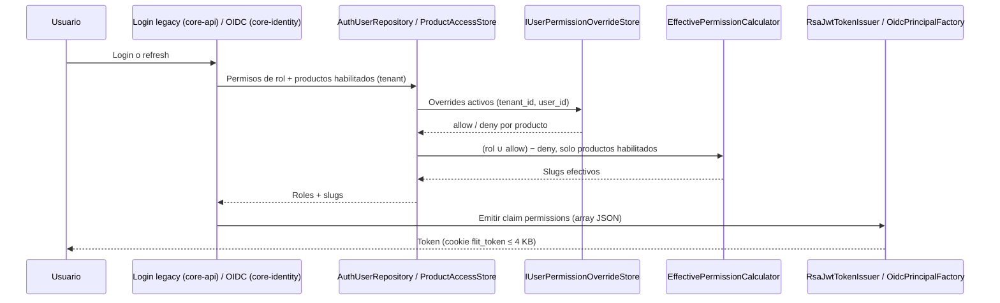

# ADR-0073: Permisos individuales por usuario por debajo del rol

**Fecha**: 2026-10-16
**Status**: Propuesto
**Deciders**: Líder Técnico FLIT (aceptación exclusiva humana — regla FLIT 15), Security, Backend, Frontend
**Tags**: arquitectura, backend, datos, seguridad, rbac, identidad, jwt, epica-12753
**Work items**: Épica #12753 (proyecto FLIT - EVOLUTION) · Feature F-B #13101 (motor de permisos, implementa este ADR) · HU #13637 (Ola 0) · Feature F-C #13102 (navegación, ver ADR-0074)
**Supersedes**: ninguno. **Cumple** el seguimiento que deja abierto [ADR-0023](../../services/core-api/docs/adr/ADR-0023-catalogo-global-roles.md) (catálogo global de roles sin `tenant_id`; los roles de sistema no se personalizan por tenant ni por usuario).
**Numeración**: se toma 0071 por ser el siguiente libre considerando `docs/decisions/` y `services/core-api/docs/adr/` (el máximo vigente es 0070, que ya existe tres veces; hay además duplicados históricos en 0023, 0024, 0029, 0030, 0033, 0036, 0050, 0051, 0053, 0057, 0059, 0060, 0066). Se ubica en `docs/decisions/` por ser transversal (core-api, core-identity, frontend), igual que ADR-0064, 0065 y 0070-grpc.

## Contexto

Hoy el acceso de un usuario sale solo de sus roles. Los roles son un catálogo global (ADR-0023): `security.roles` y `security.role_permissions` no tienen `tenant_id`, y solo SuperAdmin los cura. Un Administrador de Compañía o de OT que quiere darle a una persona "una cosa más" (o quitarle una) no puede: tiene que cambiar el rol, y cambiar el rol afecta a todos los que lo comparten.

La Épica #12753 pide permisos individuales **por debajo del rol**. Reglas ya decididas por el PO (este ADR no las discute; decide el CÓMO):

- Permiso individual = (usuario, tenant, producto del módulo, permiso, efecto `allow` | `deny`). "Módulo completo" = foto de las acciones del módulo al momento de otorgar.
- Efectivos = rol ∪ allow − deny. Precedencia: producto habilitado > usuario > rol.
- Tope de Admin de Compañía / Admin OT = unión de los permisos de sus roles en el tenant, por producto, leída de BD al otorgar, menos sus propios deny. Sus allow individuales no amplían el tope. Nota verificada: la DDL `126-HU12967-admin-por-producto.sql` asigna a todo AdminCompany el rol admin de cada producto (`admin_tramites`, etc.), así que el tope incluye Trámites.
- SuperAdmin puede otorgar cualquier permiso con `enforced=true` y no admite permisos individuales (su bypass es total).
- Los administradores (SuperAdmin, AdminCompany, `ot_admin`, `admin_tramites`) solo los modifica el SuperAdmin; nadie se edita a sí mismo.
- Sin cascada al revocar. Ámbito: AdminCompany sobre su compañía (no hijas); Admin OT sobre su OT.
- Invitación no aceptada: 409. Al cambiar el rol de un usuario se borran sus individuales de ese tenant+producto (con auditoría).
- Excluidos del mecanismo: `usuarios.manage`, `rbac.manage`, `auth.me.read`, `banners.manage`.
- Marcador por permiso `enforced` (true / false / excluded) (FA-6): solo los `enforced=true` son otorgables; los `false` no tienen guarda real en API y otorgarlos sería una promesa vacía.
- Auditoría completa, incluidos los rechazos. El token debe seguir ≤ 4 KB (cookie `flit_token`).

Hechos del código relevantes:

- Token legacy (login propio): lo emite `RsaJwtTokenIssuer` (`services/core-api/src/Flit.Identity.Infrastructure/Security/RsaJwtTokenIssuer.cs`, claim `permissions` como array JSON, líneas ~106-109) con los slugs de **todos** los roles del usuario en el tenant (`AuthUserRepository`, `PermissionSlugs`). Dura 12 h, sin refresh.
- Token OIDC (core-identity): `OidcPrincipalFactory.cs:113` emite `permissions` **por producto** (`access.ResolveAsync` → `ProductAccessResolver` → `ProductAccessStore.GetUserGrantsAsync`), más los de `plataforma` (bloque transitorio hasta B-12). Dura 15 min con refresh de 14 días; está **desactivado por defecto**.
- No hay revocación inmediata: un cambio de permisos se ve cuando el usuario obtiene un token nuevo (hasta 12 h en legacy).
- Existen dos caminos de cálculo de permisos (`AuthUserRepository` y `ProductAccessStore`). Si cada uno aplica los individuales por su cuenta, divergirán.

## Decisión

Se adopta la **Opción A**: tabla `security.user_permission_overrides` (allow/deny) y cálculo de efectivos en cada emisión de token, con un único componente compartido.

1. **Datos**: tabla `security.user_permission_overrides` (tenant-scoped, RLS) y tabla de auditoría append-only `security.user_permission_audit`. El catálogo de permisos gana la columna `enforcement` (`enforced` | `not_enforced` | `excluded`).
2. **Cálculo**: un servicio puro `EffectivePermissionCalculator` (en `Flit.Modules.Security.Domain/Application`, sin EF) recibe permisos del rol, overrides y productos habilitados, y devuelve los efectivos. Un `IUserPermissionOverrideStore` (implementado en `Flit.Identity.Infrastructure`) lee los overrides. **Los dos caminos de emisión lo invocan**: `AuthUserRepository` (legacy) y `ProductAccessStore` (OIDC). Ningún otro sitio reimplementa la fórmula. Core-identity lo consume por la misma librería que ya usa para `IProductAccessResolver`; si core-identity no referencia hoy ese ensamblado, se agrega la referencia al proyecto (no se duplica código) — a verificar por Backend.
3. **Fórmula** (por tenant y producto): `efectivos = (permisos_rol ∪ allow) − deny`, evaluada solo si el producto está habilitado para la cadena de la empresa (regla fail-closed de ADR-0057). Producto apagado ⇒ ni rol ni allow aplican. `deny` siempre gana sobre el rol y sobre un `allow` del mismo permiso (no pueden coexistir: unicidad por permiso).
4. **Token legacy**: como no es por producto, lleva la unión de los efectivos de todos los productos habilitados del tenant. **Token OIDC**: solo los del producto del token (+ plataforma mientras exista el bloque transitorio).
5. **Otorgar** (comando en `Flit.Modules.Security.Application`): valida en una transacción, en este orden: actor autorizado y ámbito (compañía propia / OT propia), objetivo no administrador (salvo actor SuperAdmin), actor ≠ objetivo, usuario activo (invitación pendiente ⇒ 409), permiso `enforcement=enforced` y no excluido, y tope del actor (si no es SuperAdmin) = unión de permisos de sus roles en ese tenant y producto leída de BD en ese momento, menos sus deny. Cada rechazo se audita igual que cada éxito. Se calcula además el **tamaño proyectado del token** y se rechaza con 422 si el usuario superaría el presupuesto (ver Consecuencias).
6. **Cambio de rol**: el handler de asignación de roles borra (soft delete) los overrides del usuario en ese tenant+producto y escribe una fila de auditoría `ROLE_CHANGE_PURGE` en la misma transacción.
7. **Revocar**: soft delete de la fila del override; sin cascada (revocar un allow no toca otros permisos otorgados "dependientes").
8. **Efecto**: el cambio aplica al próximo token. La UI debe avisarlo ("se verá reflejado en el próximo inicio de sesión"). La revocación inmediata queda fuera de alcance; ver Opción C y Dudas abiertas.

### Modelo conceptual y DDL de referencia (borrador; lo materializa database-agent según el checklist §A)

Entidades: `UserPermissionOverride` (hecho por tenant: a quién, qué permiso, qué efecto) y `UserPermissionAudit` (bitácora inmutable). Pertenecen al bounded context Security, junto a `user_role_assignments`.

```sql
-- Catálogo: marcador FA-6 (columna nueva; catálogo global sin tenant_id, excepción ADR-0023/ADR-0019).
ALTER TABLE security.permissions   -- nombre real de la tabla de RbacActions: confirmar con database-agent
  ADD COLUMN enforcement varchar(12) NOT NULL DEFAULT 'not_enforced'
  CONSTRAINT ck_permissions_enforcement CHECK (enforcement IN ('enforced','not_enforced','excluded'));
-- Seed: excluded = usuarios.manage, rbac.manage, auth.me.read, banners.manage.

CREATE TABLE security.user_permission_overrides (
  id             uuid PRIMARY KEY DEFAULT uuidv7(),
  tenant_id      uuid NOT NULL,
  user_id        uuid NOT NULL,
  product_code   varchar(40) NOT NULL,
  permission_id  uuid NOT NULL,
  effect         varchar(5)  NOT NULL,
  source         varchar(16) NOT NULL DEFAULT 'INDIVIDUAL',   -- INDIVIDUAL | MODULE_SNAPSHOT
  batch_id       uuid NULL,                                   -- agrupa la foto de "módulo completo"
  granted_by     uuid NOT NULL,                               -- actor
  created_at timestamptz NOT NULL DEFAULT now(), created_by uuid NOT NULL,
  updated_at timestamptz NULL, updated_by uuid NULL,
  deleted_at timestamptz NULL, deleted_by uuid NULL,
  row_version bigint NOT NULL DEFAULT 1,
  CONSTRAINT fk_upo_tenants     FOREIGN KEY (tenant_id)     REFERENCES identity.tenants(id)      ON DELETE RESTRICT ON UPDATE RESTRICT,
  CONSTRAINT fk_upo_users       FOREIGN KEY (user_id)       REFERENCES identity.users(id)        ON DELETE RESTRICT ON UPDATE RESTRICT,
  CONSTRAINT fk_upo_permissions FOREIGN KEY (permission_id) REFERENCES security.permissions(id)  ON DELETE RESTRICT ON UPDATE RESTRICT,
  CONSTRAINT ck_upo_effect CHECK (effect IN ('allow','deny')),
  CONSTRAINT ck_upo_product CHECK (product_code IN ('plataforma','tramites' /* + los de ProductCodes.All */))
);
CREATE UNIQUE INDEX uq_upo_active ON security.user_permission_overrides (tenant_id, user_id, product_code, permission_id) WHERE deleted_at IS NULL;
CREATE INDEX ix_upo_tenant_user ON security.user_permission_overrides (tenant_id, user_id) WHERE deleted_at IS NULL;  -- ruta caliente: emisión de token
CREATE INDEX ix_upo_permission  ON security.user_permission_overrides (tenant_id, permission_id);                    -- cubre FK
ALTER TABLE security.user_permission_overrides ENABLE ROW LEVEL SECURITY;
CREATE POLICY tenant_isolation ON security.user_permission_overrides
  USING (tenant_id = current_setting('app.current_tenant_id')::uuid);
-- Triggers: row_version (BEFORE UPDATE) y audit_log (AFTER I/U/D) según checklist A16.

-- Auditoría de negocio append-only (incluye rechazos). Sin soft delete: excepción A6 documentada aquí.
CREATE TABLE security.user_permission_audit (
  id uuid PRIMARY KEY DEFAULT uuidv7(),
  tenant_id uuid NOT NULL,
  actor_user_id uuid NOT NULL,
  target_user_id uuid NOT NULL,
  product_code varchar(40) NULL,
  permission_slug varchar(120) NULL,
  action  varchar(24) NOT NULL,   -- GRANT | DENY | REVOKE | MODULE_SNAPSHOT | ROLE_CHANGE_PURGE
  outcome varchar(10) NOT NULL,   -- OK | REJECTED
  reason_code varchar(40) NULL,   -- OUT_OF_CAP, SELF_EDIT, ADMIN_TARGET, INVITATION_PENDING, NOT_ENFORCED, EXCLUDED, TOKEN_BUDGET, OUT_OF_SCOPE
  effective_before int NULL, effective_after int NULL,
  correlation_id uuid NULL, client_ip inet NULL,
  created_at timestamptz NOT NULL DEFAULT now(), created_by uuid NOT NULL,
  CONSTRAINT fk_upa_tenants FOREIGN KEY (tenant_id) REFERENCES identity.tenants(id) ON DELETE RESTRICT ON UPDATE RESTRICT,
  CONSTRAINT ck_upa_outcome CHECK (outcome IN ('OK','REJECTED'))
);
CREATE INDEX ix_upa_tenant_target ON security.user_permission_audit (tenant_id, target_user_id, created_at DESC);
CREATE INDEX ix_upa_tenant_actor  ON security.user_permission_audit (tenant_id, actor_user_id, created_at DESC);
ALTER TABLE security.user_permission_audit ENABLE ROW LEVEL SECURITY;  -- tenant_isolation; REVOKE UPDATE, DELETE al rol de aplicación.
```

Notas: la tabla de auditoría no almacena PII más allá de IDs (A15 N/A). Toda migración EF necesita `Designer.cs` o atributos `[DbContext]/[Migration]` inline, o no corre al arrancar.

### Contrato de API (resumen; el detalle lo escribe backend-agent en `contracts/openapi/core-api.v1.yaml`)

| Método y ruta | Uso |
|---|---|
| `GET /api/v1/security/permission-catalog?product={code}` | Permisos del producto con `enforcement` y agrupación por módulo |
| `GET /api/v1/security/users/{userId}/permissions?product={code}` | Del rol, individuales (allow/deny), efectivos y tope del actor |
| `PUT /api/v1/security/users/{userId}/permission-overrides` | Lote: `{ product, items:[{permission, effect}] }` o `{ product, module, effect }` (foto del módulo) |
| `DELETE /api/v1/security/users/{userId}/permission-overrides/{id}` | Revocar |
| `GET /api/v1/security/users/{userId}/permission-audit` | Historial (paginado) |

Errores (RFC 7807): 403 ámbito/administrador/auto-edición/fuera de tope, 409 invitación pendiente, 422 permiso no `enforced` o excluido o presupuesto de token excedido. Política de autorización: nueva `permissions.delegate` (nombre a confirmar), pedida a AdminCompany, `ot_admin` y SuperAdmin; el filtro de ámbito se aplica en el handler, no solo en la policy.

### Diagrama de secuencia: otorgar

```mermaid
sequenceDiagram
    actor A as Actor (AdminCompany / Admin OT / SuperAdmin)
    participant UI as Frontend (/empresa, /admin)
    participant API as core-api (Security)
    participant CALC as EffectivePermissionCalculator
    participant DB as PostgreSQL (RLS)
    A->>UI: Marca permisos o módulo completo
    UI->>API: PUT /security/users/{id}/permission-overrides
    API->>DB: Cargar objetivo, ámbito, estado (invitación), roles del actor y del objetivo
    alt rechazo (auto-edición, administrador, ámbito, invitación 409)
        API->>DB: INSERT user_permission_audit (REJECTED, reason_code)
        API-->>UI: 403 / 409
    else válido
        API->>DB: Tope del actor = unión permisos de sus roles (tenant+producto) − sus deny
        API->>CALC: Efectivos proyectados del objetivo + tamaño de token
        alt fuera de tope / no enforced / excluido / presupuesto excedido
            API->>DB: INSERT audit (REJECTED, reason_code)
            API-->>UI: 403 / 422
        else dentro de tope
            API->>DB: UPSERT overrides + INSERT audit (OK) (una transacción)
            API-->>UI: 200 (efectivos nuevos; aplica al próximo token)
        end
    end
```

### Diagrama de secuencia: emitir token



## Alternativas consideradas

### Opción A: tabla de overrides + cálculo en la emisión del token (elegida)

**Pros:**
- Una fila por hecho (usuario, permiso, efecto): auditable, revocable y consultable ("¿quién tiene este permiso?").
- Soporta `deny` de forma natural, cosa que un rol no hace.
- No toca el catálogo global de roles (ADR-0023) ni las políticas de API existentes: el claim `permissions` ya es lo que leen API y frontend.
- Cero costo por petición; el cálculo ocurre en login/refresh.
- Reutiliza el patrón existente de tabla tenant-scoped con RLS (`user_role_assignments`).

**Contras:**
- El cambio solo se ve en el próximo token (hasta 12 h en legacy; 15 min si se activa OIDC).
- Hay que tocar dos caminos de emisión (legacy y OIDC), con el riesgo de divergencia.
- Cada override agrega bytes al token.
- Requiere tabla nueva de auditoría y marcador `enforcement` en el catálogo.

**Esfuerzo:** M
**Riesgos:** tokens > 4 KB; divergencia entre caminos (se mitiga con el calculador único y un test de paridad); expectativa de usuarios de efecto inmediato.

### Opción B: rol personal sintético por usuario (rol oculto clonado)

**Pros:**
- Reutiliza `role_permissions` y `user_role_assignments` sin tocar los dos caminos de emisión: el rol oculto sale como un rol más.
- Cero cambios en el calculador de tokens.

**Contras:**
- Contamina el catálogo global (ADR-0023: sin `tenant_id`, curado solo por SuperAdmin) con un rol por usuario; habría que excluirlo de cada pantalla de roles y de la gobernanza HU #10508.
- No expresa `deny`: un rol solo suma. Habría que clonar el rol del usuario y quitarle permisos, y la copia se desactualiza cuando SuperAdmin cura el rol original (la deriva que ADR-0023 eliminó).
- El claim `roles` y `role_code` exponen y multiplican roles ficticios; las policies `RequireRole` y el multi-rol (HU #10506) se llenan de ruido.
- Auditoría pobre: se pierde la distinción entre "viene del rol" y "es individual".

**Esfuerzo:** M
**Riesgos:** deriva silenciosa del clon; fuga de roles ocultos a la UI y a reportes; rompe el modelo mental del PO ("rol ∪ allow − deny").

### Opción C: evaluación en tiempo de petición con caché (no en token)

**Pros:**
- Revocación casi inmediata (invalidación de caché).
- El token no crece con los individuales.

**Contras:**
- El frontend y el dock leen `permissions` del token; habría que añadir un endpoint "mis permisos" y cambiar todo el consumo cliente.
- Cada endpoint de la API pasaría por una resolución por petición: latencia, y dependencia de Redis/caché (el propio `ProductAccessResolver` documenta que Redis y outbox no existen todavía: L-07, C-01).
- Cambia la semántica de autorización de toda la API (policies basadas en claims) de forma transversal.
- Más superficie de fallo: caché obsoleta ⇒ acceso incorrecto, silencioso.

**Esfuerzo:** L
**Riesgos:** regresiones transversales; dependencia de infraestructura inexistente.

## Tradeoff aceptado

Se elige A porque la regla de negocio ya acepta que no haya revocación inmediata (el sistema tampoco la tiene para cambios de rol), y A es la única que cumple "rol ∪ allow − deny" con auditoría fina sin tocar el catálogo global ni reescribir la autorización de la API. Se acepta: (i) latencia de propagación igual a la vida del token; (ii) crecimiento del token, controlado con un presupuesto; (iii) el costo de tocar los dos caminos de emisión, controlado con un único calculador. C queda como evolución posible si el producto exige revocación inmediata y existe Redis.

## Consecuencias

### Lo que se gana
- Delegación fina por usuario sin multiplicar roles.
- `deny` explícito, auditoría completa (incluidos rechazos) y trazabilidad de quién otorgó qué.
- Sin cambios en las policies actuales de la API.

### Lo que se pierde
- Efecto diferido al próximo token (hasta 12 h legacy, hasta 15 min OIDC activo).
- Más bytes por token y una tabla de negocio más.

### Impacto en el tamaño del token
Cálculo orientativo: un slug típico `modulo.accion` ronda 20-30 bytes; en JSON con comillas y coma, ~30. Claims fijos (identidad, tenant, roles, firma RS256 en base64 ~340 caracteres) ocupan alrededor de 1,2-1,5 KB una vez codificados en base64url (factor 4/3). Queda un presupuesto práctico de unas 2,0-2,4 KB de payload para `permissions`, es decir, del orden de 60-70 slugs en el token legacy. **Esto debe medirse con el token real de un AdminCompany antes de aceptar**: el token legacy ya lleva todos los permisos de los roles del tenant, y el de AdminCompany es el más grande. Mitigaciones: (1) el token OIDC es por producto, así que crece menos; (2) el comando de otorgar calcula el tamaño proyectado y rechaza con 422 `TOKEN_BUDGET` (umbral configurable, p. ej. 3,6 KB sobre el tamaño codificado); (3) si no alcanza, evaluar mover los allow individuales a un claim comprimido o a un endpoint de permisos (Opción C parcial) en un ADR posterior.

### Cambios operacionales
- Migraciones DDL nuevas (database-agent) con `Designer.cs`/atributos inline; DDL numerado en `services/core-api/docs/schema/ddl/` (el ámbito de numeración reservado de la épica lo define el Líder Técnico).
- El `enforcement` por permiso se siembra y se mantiene por SuperAdmin; un permiso nuevo nace `not_enforced` hasta que tenga guarda real en API.

## ADRs relacionados

- ADR-0023 (catálogo global de roles): se respeta; este ADR NO lo contradice, añade la capa individual.
- ADR-0057-jerarquia-de-clientes (cadena fail-closed de productos) y ADR-0069 (lectura entre compañías acotada): el ámbito "no hijas" es coherente con ambos.
- ADR-0074 (gate de navegación, Propuesto): consume los permisos efectivos para menú y URL.

## Notas para agentes

- **Database Agent**: materializar DDL; confirmar nombre real de la tabla de acciones (`RbacActions`); índices y RLS según §A; rol de aplicación sin UPDATE/DELETE sobre la auditoría.
- **Backend Agent**: calculador único en `Security.Domain/Application`; invocarlo desde `AuthUserRepository` y `ProductAccessStore`; test de paridad legacy ↔ OIDC; no reimplementar la fórmula en core-identity; purgar overrides en el handler de cambio de rol; auditar rechazos.
- **Frontend Agent**: pantallas en `/empresa` y `/admin`; mostrar tope, rol vs individual, aviso de efecto en el próximo inicio de sesión; mismo patrón de tablas de trámites.
- **QA Agent**: matriz actor × objetivo × ámbito × tope; auto-edición; invitación 409; cambio de rol purga; token en el límite de 4 KB; paridad de efectivos entre ambos tokens.
- **Security Agent**: revisar que el tope se lee de BD en el momento de otorgar, que no hay escalada vía allow de un admin, y que la auditoría es inmutable.
- **Infra Agent**: sin cambio v1; si se activa OIDC por defecto, reevaluar el tiempo de propagación.

## Dudas abiertas para el Líder Técnico

1. Si después de otorgar el rol del actor se reduce, ¿los allow ya otorgados al objetivo se conservan? El texto "tope leído de BD al otorgar" sugiere que sí; este ADR lo asume (no se recorta en la emisión).
2. Umbral de presupuesto de token y si se acepta el rechazo 422 como comportamiento visible.
3. Nombre y reparto de la política `permissions.delegate` frente a `usuarios.manage` (excluido).
4. Mientras exista el bloque transitorio que añade permisos de `plataforma` al token de cada producto, ¿los overrides de `plataforma` aplican a todos los tokens OIDC? (este ADR dice que sí).

## Referencias

- ADR-0023, ADR-0019, ADR-0057, ADR-0069
- `services/core-api/src/Flit.Identity.Infrastructure/Security/RsaJwtTokenIssuer.cs`
- `services/core-identity/src/Flit.Identity.Web/Identity/OidcPrincipalFactory.cs`
- `services/core-api/src/Flit.Modules.Platform/Application/Access/ProductAccessResolver.cs`
- `services/core-api/src/Flit.Identity.Infrastructure/Persistence/Repositories/AuthUserRepository.cs`
- `.cursor/skills/db-schema-validator/checklist-validacion-schema.md`
- DDL `126-HU12967-admin-por-producto.sql`
