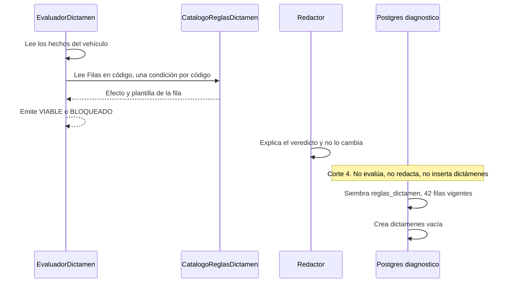

# ADR-0077: El dictamen lo calculan reglas en código; el catálogo es global y el dictamen es de la empresa

**Fecha**: 2026-11-03
**Status**: Propuesto
**Deciders**: Líder Técnico FLIT (aceptación exclusiva humana, regla FLIT 15). La opción A la cerró el plan del corte 4 y el usuario pidió implementarla. Este ADR la registra; no la cambia y no pasa a Aceptado.
**Tags**: arquitectura, backend, datos, diagnostico, dictamen
**Épica**: #12678. Sin historia nueva. No se activa en Azure DevOps.
**Rama**: `feature/AB-12881-diagnostico-d0-d2`
**Plan**: `docs/diagnosticos/plan-corte-4-tablas-dictamen.md`
**Registro de cambios**:
- 2026-11-03 — versión inicial. Propuesto.
- 2026-11-03 — corte 6. `ix_redaccion_pendiente` ya existe (migración `D6_ColaRedaccion`). La excepción A11 está en ADR-0072. Este ADR sigue en Propuesto.
- 2026-11-13 — HU #14563 (B7). Enmendado por [ADR-0086](ADR-0086-diagnostico-ajuste-flit-dictamen-y-notificaciones.md) (Propuesto): el ajuste FLIT del dictamen es una versión nueva con el mecanismo de este ADR (se apaga la vigente y se inserta N+1). La migración `R7_AjusteDictamen` admite `redactado_por = 'MANUAL'`, añade `ajuste_motivo` (`@pii:low`, 10..500) y `ajustado_desde_version` (= `version - 1`) con `ck_dictamenes_override`, `ck_dictamenes_ajuste`, `ck_dictamenes_ajuste_motivo`, `ck_dictamenes_manual` y `ck_dictamenes_version`, y reemplaza `ck_dictamenes_redactado_por` y `ck_redaccion`. Un recálculo automático posterior gana sobre el ajuste (D7). El evaluador y el catálogo no cambian. Este ADR sigue en Propuesto.

## Contexto

El catálogo v1 de la familia TRASPASO ya está en `CatalogoReglasDictamen`
(`services/core-diagnostico/src/Flit.Diagnostico.Domain/Dictamen/CatalogoReglasDictamen.cs`): versión 1, 14 definiciones
repetidas en `TRASPASO_STANDARD`, `TRASPASO_UNILATERAL` y `TRASPASO_TRANSFERENCIA_DE_DOMINIO` (42 filas en `Filas`).
`EvaluadorDictamen` lee los hechos y ese catálogo en código y emite `VIABLE` o `BLOQUEADO`
(`EvaluadorDictamen.cs`: una regla `BLOQUEA` deja el veredicto en `BLOQUEADO`; si solo hay `ADVIERTE`, o ninguna
dispara, el veredicto es `VIABLE`). El redactor explica ese veredicto y no lo cambia. La tabla todavía no existe.

El plan §5 (alrededor de las líneas 839-876) dibuja `diagnostico.reglas_dictamen` y `diagnostico.dictamenes`. La
primera es de FLIT, igual para todas las empresas. La segunda es de la empresa. ADR-0072 (c) exige que la FK interna
sea compuesta con `tenant_id`. El DDL de referencia todavía deja en `dictamenes` claves simples
(`ux_dictamen_version (vehiculo_id, version)` y el índice vigente solo por `vehiculo_id`) y un
`ix_redaccion_pendiente` que cruza empresas. El comentario de `condicion` en ese DDL («declarativa sobre
datos_consolidados») abriría un segundo lenguaje de reglas.

Este corte siembra el catálogo y crea `dictamenes` vacía. No evalúa un vehículo.

## Decisión

**Opción A.** La condición de cada regla vive en `EvaluadorDictamen`, una por código. `condicion` guarda
`{"codigo":"<el mismo de la fila>"}` para que la fila no quede vacía y no pueda divergir del código. El catálogo es de
FLIT (`diagnostico.reglas_dictamen`, sin `tenant_id`). El dictamen de un vehículo es de la empresa
(`diagnostico.dictamenes`, clase (a) de ADR-0072, con `tenant_id`).

1. **Veredicto.** Lo calcula `EvaluadorDictamen`. Toma el efecto de `CatalogoReglasDictamen.Filas` (`Emitir`). El
   redactor redacta el texto de ese veredicto y no lo sustituye.
2. **Catálogo global.** `diagnostico.reglas_dictamen` no lleva `tenant_id`, ni filtro, ni `deleted_*`, ni actor. No se
   edita a mano. La entidad entra en la lista cerrada `CatalogosGlobales` de `EntidadesConTenantTests`. La excepción
   queda escrita en ADR-0072. El único update previsto es `vigente = false` cuando exista otra versión.
3. **`condicion` no es un motor.** `jsonb`, no nulo, `jsonb_typeof` = `object`. La siembra escribe exactamente
   `{"codigo":"<codigo>"}`. El CHECK exige `condicion->>'codigo' = codigo`.
4. **Ids de la siembra.** UUID v5 (RFC 4122), estable, de `catalogo_version`, `tipo_tramite_codigo` y `codigo`.
   `ValueGeneratedNever`. `HasData` no puede cambiar de id entre máquinas. Espacio de nombres: el UUID de nombre DNS
   de la RFC 4122, `6ba7b810-9dad-11d1-80b4-00c04fd430c8`. Nombre, ordinal y sin espacios:
   `flit.diagnostico.reglas_dictamen/{catalogo_version}/{tipo_tramite_codigo}/{codigo}`
   (`catalogo_version` en decimal invariante, sin relleno). Sin paquete nuevo. Los dictámenes que nazcan en el corte 5
   usan uuid v7 de la aplicación.
5. **Unicidad del catálogo.** `(catalogo_version, tipo_tramite_codigo, codigo)`, constraint `ux_regla`.
6. **Siembra.** 42 filas v1, todas `vigente = true`. Un proyector lee `CatalogoReglasDictamen.Filas` y produce las
   filas de `HasData`: la plantilla y el efecto no se copian a mano. `SOAT_NO_VIGENTE` y `RTM_NO_VIGENTE` quedan en
   `BLOQUEA`. El resto, incluidas `PRENDA`, `IMPUESTO` y `FUENTE_PENDIENTE`, en `ADVIERTE`.
7. **`diagnostico.dictamenes`.** Clase (a): `tenant_id`, `IEntidadDeEmpresa`, filtro global, `xmin` con
   `IsRowVersion()`, `creado_en timestamptz`, sin `deleted_*`. Nace vacía, sin `HasData`. PK `id` uuid v7 de la
   aplicación, `ValueGeneratedNever`. `uq_dictamenes_tenant_id (tenant_id, id)`. FK `(tenant_id, vehiculo_id)` →
   `vehiculos (tenant_id, id)` `ON DELETE RESTRICT`, sin `ON UPDATE` emitido. `ux_dictamen_version (tenant_id,
   vehiculo_id, version)`. Índice único parcial `(tenant_id, vehiculo_id) WHERE vigente` (nombre
   `ux_dictamen_vigente`). Veredicto CHECK `VIABLE` o `BLOQUEADO`. `alertamientos` jsonb no nulo, arreglo
   (`jsonb_typeof` = `array`): cada elemento lleva `codigo`, `texto`, `efecto` y `fuente`, sin documentos ni nombres.
   `catalogo_version` int. `redactado_por` CHECK `PLANTILLA` o `LLM`. `estado_redaccion` CHECK `PENDIENTE` o
   `COMPLETADA`. CHECK `ck_redaccion`: `(estado_redaccion = 'COMPLETADA') = (redactado_por = 'LLM')`. Cola:
   `redaccion_intentos` default 0, `redaccion_disponible_desde` y `redaccion_lease_hasta` nulos. El índice
   `ix_redaccion_pendiente` no se crea en el corte 4; el corte 6 lo crea (ver registro de cambios y ADR-0072). Override: `analisis_override` default false,
   `usuario_override_id` y `override_en` nulos; `usuario_override_id` es uuid. Sin PII en claro.
8. **Concurrencia de `dictamenes`.** La columna de negocio `version` (int) y el token `xmin` no comparten la propiedad
   `Version` que el resto del servicio usa para `xmin`. La de negocio se llama `Version` y mapea la columna
   `version`. El token es `uint Xmin` con `IsRowVersion()`. En `reglas_dictamen` no hay columna `version`: el token
   sigue el patrón de la casa, `uint Version` con `IsRowVersion()`.

## Alternativas consideradas

### Opción A: condición en código; `condicion` es `{"codigo":"<el mismo de la fila>"}` (elegida)

**Pros:**
- Una sola definición ejecutable: `EvaluadorDictamen`, una condición por código. El efecto sale de `Filas`.
- El CHECK impide que `condicion.codigo` y `codigo` se separen. La fila no queda con un jsonb vacío.
- La siembra con UUID v5 es la misma en cualquier máquina, que es lo que `HasData` exige.
- Un dictamen futuro puede guardar `catalogo_version` y las filas de esa versión siguen en la base (plantilla y efecto).
- Reutiliza la clase (a) y las FK compuestas de ADR-0072. No añade un paquete ni un intérprete.

**Contras:**
- Cambiar una condición exige desplegar código. Un UPDATE de `condicion` no cambia el veredicto.
- Quien lea solo la fila no ve la lógica (SOAT, RTM a los 5 años, SIMIT, leasing): ve el código, el efecto y la plantilla.
- Hay dos sitios que mantener alineados: `Filas` (efecto y plantilla) y el método del evaluador (cuándo dispara). El CHECK ata el código, no la semántica.
- El CHECK de `condicion->>'codigo'` admite claves de más. La siembra escribe una sola clave; un JSON más ancho igual pasaría el CHECK.
- Publicar la v2 sigue siendo código más una siembra, y el paso a `vigente = false` de la v1.

**Esfuerzo:** M
**Riesgos:**
- Cambiar el nombre v5 o el espacio de nombres después de generar la migración cambia todos los id. El proyector y la prueba de estabilidad lo fijan antes de `migrations add`.
- Tratar `condicion` como motor en un corte posterior y escribir otro JSON. El CHECK frena el código distinto; no frena claves extra.
- `dictamenes` queda vacía hasta el corte 5. Ningún lector de este corte puede asumir filas.

### Opción B: condición declarativa en JSON, evaluada por un intérprete

**Pros:**
- La fila sería la especificación: la condición se leería en la base.
- Un umbral nuevo podría entrar con datos, si el intérprete ya entiende el operador.
- Encaja con el comentario del DDL de referencia («declarativa sobre datos_consolidados»).

**Contras:**
- Abre un segundo lenguaje de reglas al lado de `EvaluadorDictamen`. Las dos semánticas pueden divergir.
- Hay que escribir un intérprete (operadores, errores, pruebas) que este corte no necesita: la condición ya está en C#.
- El CHECK de igualdad de `codigo` deja de bastar. Hace falta un esquema del JSON y una política de quién lo edita.
- Choca con «no se edita a mano». Un JSON editable es una vía para cambiar un veredicto sin el catálogo en código.
- Sigue haciendo falta la siembra, más la superficie nueva.

**Esfuerzo:** L
**Riesgos:** un bug del intérprete cambia un veredicto que el redactor ya explicó; reglas distintas por entorno si alguien actualiza el JSON fuera de la siembra.

### Opción C: sin tabla de reglas; el catálogo sigue solo en código y la base solo guarda dictámenes

**Pros:**
- Menos schema: no hay `reglas_dictamen` ni excepción de catálogo en ADR-0072.
- El evaluador ya usa `Filas`. No hay siembra que pueda separarse del código.
- `EntidadesConTenantTests` no suma una entidad.

**Contras:**
- Obliga a desplegar código para saber qué versión dictaminó un vehículo ya guardado: la plantilla y el efecto de esa versión no están en la base.
- `catalogo_version` en `dictamenes` sería un entero sin filas que lo respalden.
- El plan §5 y la decisión (g) dibujan el catálogo en Postgres. Esta opción los deja sin materializar.
- Un dictamen histórico no se explica cuando el binario que lo calculó ya no está desplegado.

**Esfuerzo:** S
**Riesgos:** no poder reconstruir el texto y el efecto con los que se dictaminó un vehículo después de un cambio de catálogo.

## Tradeoff aceptado

Se elige la opción A porque la condición ya está en `EvaluadorDictamen` y la base solo necesita recordar el código, el
efecto y la plantilla de cada versión. `condicion` repite el código de la fila, con un CHECK, para que no quede vacía
ni pueda apuntar a otra regla. La opción B abre un segundo lenguaje de reglas. La opción C obliga a desplegar código
para saber qué versión dictaminó un vehículo ya guardado.

Se acepta que cambiar una condición es un despliegue y que el JSON de `condicion` no describe la lógica. En el corte 4,
`ix_redaccion_pendiente` se aplazó: crearlo entonces habría sido una lectura entre empresas sin el trabajador que la
justifica (el mismo criterio que la cola del ZIP en ADR-0072). El corte 6 ya creó el índice; la excepción A11 queda
nombrada en ADR-0072.

## Diagrama de secuencia

El evaluador y el redactor describen el reparto de responsabilidades. La persistencia de este corte no los llama: guarda
el catálogo y deja `dictamenes` vacía.



## Modelo de datos

Borrador de referencia. Lo materializa el database-agent en la migración que emita `dotnet ef migrations add`. Corrige
las claves simples del plan §5: `dictamenes` usa las compuestas que ADR-0072 (c) exige. `ix_redaccion_pendiente` no
entra en este DDL.

```sql
CREATE TABLE diagnostico.reglas_dictamen (
  id                  uuid PRIMARY KEY,                 -- uuid v5 del proyector, ValueGeneratedNever
  catalogo_version    int NOT NULL,
  tipo_tramite_codigo varchar(64) NOT NULL,
  codigo              varchar(64) NOT NULL,
  condicion           jsonb NOT NULL,                   -- {"codigo":"<codigo>"}; no es un motor
  efecto              varchar(16) NOT NULL,
  plantilla_texto     text NOT NULL,
  vigente             boolean NOT NULL,
  CONSTRAINT ux_regla UNIQUE (catalogo_version, tipo_tramite_codigo, codigo),
  CONSTRAINT ck_reglas_dictamen_efecto CHECK (efecto IN ('BLOQUEA','ADVIERTE')),
  CONSTRAINT ck_reglas_dictamen_condicion CHECK (
    jsonb_typeof(condicion) = 'object' AND condicion->>'codigo' = codigo)
);  -- sin tenant_id, sin deleted_*, sin actor; concurrencia xmin (IsRowVersion)

CREATE TABLE diagnostico.dictamenes (
  id                          uuid PRIMARY KEY,          -- uuid v7 de la aplicación, ValueGeneratedNever
  tenant_id                   uuid NOT NULL,
  vehiculo_id                 uuid NOT NULL,
  version                     int NOT NULL,
  vigente                     boolean NOT NULL,
  veredicto                   varchar(16) NOT NULL,
  alertamientos               jsonb NOT NULL,           -- arreglo: codigo, texto, efecto, fuente
  catalogo_version            int NOT NULL,
  redactado_por               varchar(16) NOT NULL,
  estado_redaccion            varchar(16) NOT NULL,
  redaccion_intentos          int NOT NULL DEFAULT 0,
  redaccion_disponible_desde  timestamptz NULL,
  redaccion_lease_hasta       timestamptz NULL,
  analisis_override           boolean NOT NULL DEFAULT false,
  usuario_override_id         uuid NULL,                -- seudónimo; sin PII en claro
  override_en                 timestamptz NULL,
  creado_en                   timestamptz NOT NULL,
  CONSTRAINT uq_dictamenes_tenant_id UNIQUE (tenant_id, id),
  CONSTRAINT ux_dictamen_version UNIQUE (tenant_id, vehiculo_id, version),
  CONSTRAINT fk_dictamenes_vehiculos FOREIGN KEY (tenant_id, vehiculo_id)
    REFERENCES diagnostico.vehiculos (tenant_id, id) ON DELETE RESTRICT,
  CONSTRAINT ck_dictamenes_veredicto CHECK (veredicto IN ('VIABLE','BLOQUEADO')),
  CONSTRAINT ck_dictamenes_alertamientos CHECK (jsonb_typeof(alertamientos) = 'array'),
  CONSTRAINT ck_dictamenes_redactado_por CHECK (redactado_por IN ('PLANTILLA','LLM')),
  CONSTRAINT ck_dictamenes_estado_redaccion CHECK (estado_redaccion IN ('PENDIENTE','COMPLETADA')),
  CONSTRAINT ck_redaccion CHECK ((estado_redaccion = 'COMPLETADA') = (redactado_por = 'LLM'))
);  -- clase (a): xmin, sin deleted_*; sin ON UPDATE emitido en la FK
CREATE UNIQUE INDEX ux_dictamen_vigente
  ON diagnostico.dictamenes (tenant_id, vehiculo_id) WHERE vigente;
```

`reglas_dictamen` no referencia a otra tabla. `dictamenes.catalogo_version` es un entero de recuerdo: no es FK, porque
la versión no identifica una sola fila. La forma de cada elemento de `alertamientos` (esas cuatro claves, sin
documentos ni nombres) la cumple quien inserte en el corte 5. Este corte solo deja el CHECK de arreglo y la tabla vacía.

## Consecuencias

### Lo que se gana
- El catálogo v1 queda en Postgres con el mismo efecto y la misma plantilla que `Filas`.
- Un dictamen futuro puede citar `catalogo_version` y las filas de esa versión siguen en la base.
- `dictamenes` nace con la forma de la clase (a) y las FK compuestas, sin una excepción de catálogo.
- La condición ejecutable sigue en un solo sitio.

### Lo que se pierde
- No se puede cambiar una condición con un UPDATE.
- `condicion` no documenta la lógica, solo el código.
- En el corte 4 la cola de redacción no tenía índice. El corte 6 lo agregó: `ix_redaccion_pendiente` ya existe.

### Cambios operacionales
- Una migración nueva, generada por EF, con 42 filas de siembra y `dictamenes` en cero filas.
- `EntidadesConTenantTests` suma la entidad del catálogo a `CatalogosGlobales`. Sin esa línea el test de aislamiento falla.
- Pasar `vigente` a false es una migración futura, cuando exista otra versión. No hay endpoint que edite el catálogo.
- Sin dependencia nueva, sin broker y sin variable de entorno.

## Fuera de alcance

- Enganchar `AvanceVehiculo.Terminado`, el lector, el redactor y la primera fila de `dictamenes`. Corte 5.
- La cola durable y la invalidación del PDF, incluido `ix_redaccion_pendiente`. Hecho en el corte 6: el índice ya existe.
- `GET`, `PUT`, el evento y la pantalla. Corte 7.
- Marcar las fuentes obligatorias en el alta. Corte 8, después de R-17.
- Un intérprete de `condicion`.
- Activar la épica #12678.

## Archivos que crea o toca el database-agent

Este ADR no los crea.

| Archivo | Papel |
| --- | --- |
| `services/core-diagnostico/src/Flit.Diagnostico.Api/Modulos/Dictamen/ReglaDictamen.cs` | Entidad de `reglas_dictamen`. Sin `IEntidadDeEmpresa`, sin `tenant_id`, sin `deleted_*`, sin actor. Token `uint Version` (`IsRowVersion`). |
| `services/core-diagnostico/src/Flit.Diagnostico.Api/Modulos/Dictamen/DictamenVehiculo.cs` | Entidad de `dictamenes`, clase (a), `IEntidadDeEmpresa`. `Version` (int) es la columna `version`. `uint Xmin` es el token. El nombre de clase evita chocar con el namespace `Dictamen`. |
| `services/core-diagnostico/src/Flit.Diagnostico.Api/Persistence/Siembra/ProyectorReglasDictamen.cs` | Lee `CatalogoReglasDictamen.Filas` y produce id v5, `condicion` y el resto de la fila. No copia los textos a mano. |
| `services/core-diagnostico/src/Flit.Diagnostico.Api/Persistence/Configuraciones/ReglaDictamenConfig.cs` | Mapeo EF, CHECK, `ux_regla` y `HasData` desde el proyector. |
| `services/core-diagnostico/src/Flit.Diagnostico.Api/Persistence/Configuraciones/DictamenVehiculoConfig.cs` | Mapeo EF de la clase (a), FK compuesta, índices y CHECK. Sin `HasData`. Sin `ix_redaccion_pendiente`. |
| `services/core-diagnostico/src/Flit.Diagnostico.Api/Persistence/Migrations/<timestamp>_D6_TablasDictamen.cs` y su `.Designer.cs` | Los emite `dotnet ef migrations add D6_TablasDictamen`. No se escriben a mano. |
| `services/core-diagnostico/src/Flit.Diagnostico.Api/Persistence/Migrations/DiagnosticoDbModelSnapshot.cs` | Lo actualiza el mismo comando. No se edita una migración ya aplicada. |
| `services/core-diagnostico/tests/Flit.Diagnostico.Tests/Aislamiento/EntidadesConTenantTests.cs` | `CatalogosGlobales` suma `typeof(ReglaDictamen)`. |
| `services/core-diagnostico/tests/Flit.Diagnostico.Tests/Dictamen/SiembraReglasDictamenTests.cs` | 42 filas coinciden con `CatalogoReglasDictamen.Filas`. |

`DiagnosticoDb` ya aplica `ApplyConfigurationsFromAssembly`: no hace falta registrarlo a mano. No se modifican
`CatalogoReglasDictamen.cs` ni `EvaluadorDictamen.cs`: el proyector los lee. La condición no se mueve a
`FilaReglaDictamen`.

La prueba de siembra, en rojo, antes de la configuración EF, afirma: 42 filas, versión 1, todas vigentes; la clave
`(version, tipo, codigo)` no se repite; efecto y plantilla son los de `Filas`; `condicion` es un objeto cuyo `codigo`
es el de la fila; `SOAT_NO_VIGENTE` y `RTM_NO_VIGENTE` bloquean; `PRENDA`, `IMPUESTO` y `FUENTE_PENDIENTE` advierten;
el id de la misma clave es estable en dos llamadas.

## ADRs relacionados

- [ADR-0072](ADR-0072-diagnostico-aislamiento-por-tenant.md) — `dictamenes` es clase (a) con FK compuesta según (c). `reglas_dictamen` es la excepción de catálogo global que ese ADR pedía al materializarse. Este corte enmienda ADR-0072; no lo reemplaza. Sigue en Propuesto.
- Plan v2 §5 y `docs/diagnosticos/plan-corte-4-tablas-dictamen.md` — el DDL de referencia de `dictamenes` queda corregido aquí en las claves compuestas y en el aplazamiento de `ix_redaccion_pendiente`. El comentario «condicion declarativa» queda sustituido por la opción A.

## Notas para agentes

- **Database Agent**: materializar la tabla de archivos de arriba. Una sola migración, con `dotnet ef migrations add D6_TablasDictamen` desde `services/core-diagnostico`. No editar migraciones ya aplicadas. `dictamenes`: `uq_dictamenes_tenant_id`, FK `(tenant_id, vehiculo_id)` `ON DELETE RESTRICT`, sin cláusula `ON UPDATE`, `ux_dictamen_version (tenant_id, vehiculo_id, version)`, `ux_dictamen_vigente` parcial con `tenant_id`. No crear `ix_redaccion_pendiente`. `reglas_dictamen`: citar la excepción de ADR-0072 (párrafo de este corte). Pasar `db-schema-validator` sobre esa migración. A2 (nombre en inglés) no se reabre: el schema ya nombra en español, ADR-0072 (d) 7.
- **Backend Agent**: no enganchar `AvanceVehiculo`, el lector, el redactor ni un endpoint. No escribir un intérprete de `condicion`. El veredicto sigue saliendo de `EvaluadorDictamen`.
- **Frontend Agent**: sin pantalla en este corte. El corte 7 cubre la UI.
- **QA Agent**: sin historia nueva y sin activación en Azure DevOps. La evidencia de este corte es la prueba de siembra y `EntidadesConTenantTests`, no un TC de producto. El escenario de fuga de un GET de dictamen aparece cuando exista el GET (corte 7).
- **Security Agent**: `reglas_dictamen` no tiene datos de clientes. `dictamenes` no lleva documentos ni nombres; `alertamientos` se limita a código, texto, efecto y fuente; `usuario_override_id` es un uuid. No hay PII en claro que cifrar en este corte.
- **Infra Agent**: sin despliegue, sin dependencia y sin cambio de broker.

## Referencias externas

- RFC 4122, §4.3 (UUID de nombre, versión 5) y el espacio de nombres DNS `6ba7b810-9dad-11d1-80b4-00c04fd430c8`. Apéndice C de la RFC 4122.
- `.cursor/skills/db-schema-validator/checklist-validacion-schema.md` — A3, A4, A5, A16 y A20, cubiertos por la excepción de ADR-0072 para `reglas_dictamen` y por la clase (a) para `dictamenes`.
