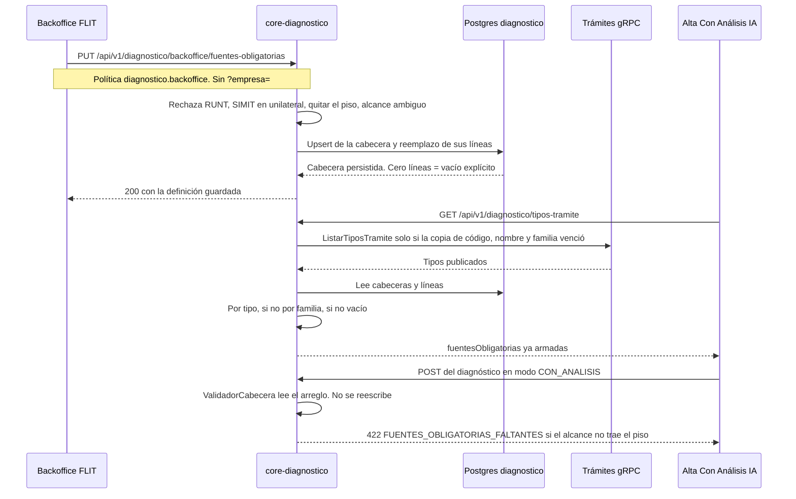

# ADR-0078: Las fuentes obligatorias del trámite son un catálogo global de FLIT, con cabecera y líneas

**Fecha**: 2026-11-04
**Status**: Propuesto
**Deciders**: Líder Técnico FLIT (aceptación exclusiva humana, regla FLIT 15). La tabla la eligió el usuario al cerrar el plan del corte 8. Este ADR la registra; no la cambia y no pasa a Aceptado.
**Tags**: arquitectura, backend, datos, diagnostico, catalogo
**Épica**: #12678. Sin historia nueva. No se activa en Azure DevOps.
**Rama**: `feature/AB-12881-diagnostico-d0-d2`
**Plan**: `docs/diagnosticos/plan-corte-8-fuentes-obligatorias.md`
**Registro de cambios**:
- 2026-11-04 — versión inicial. Propuesto.

## Contexto

El alta de un Con Análisis IA ya exige las fuentes que traiga el tipo. `ValidadorCabecera` compara el alcance con `TipoTramite.FuentesObligatorias` y, si falta alguna, responde 422 `FUENTES_OBLIGATORIAS_FALTANTES`. `SeccionAlcance` marca y bloquea ese arreglo. El catálogo que lo llena sigue en vacío: `CatalogoTiposTramiteGrpc` construye cada tipo con `[]` (`CatalogoTiposTramiteGrpc.cs`, el `Select` de `ListarPublicadosAsync`) y guarda la lista 5 minutos en `IMemoryCache` (`Vigencia`, `ClaveCache`).

La lista es de FLIT, igual para todas las empresas. `fuentes_habilitadas` sigue siendo el contrato de la compañía. El gRPC de Trámites no trae estas fuentes. `RUNT` ya es obligatorio en todo diagnóstico (`ALCANCE_SIN_RUNT`) y no entra en este catálogo.

El piso que se puede sembrar, lectura de producto del art. 5.3.2.1 num. 4 y del art. 5.3.2.2 num. 3, está en el plan del corte 8. `TRASPASO_TRANSFERENCIA_DE_DOMINIO` se trata como el ordinario hasta que alguien diga que es otro procedimiento. Eso es lectura de producto, no cita. `TRASPASO_UNILATERAL` no puede heredar un `SIMIT_*`: si la única fila fuera la familia `TRASPASO` con `SIMIT_PROPIETARIO`, el unilateral publicaría ese SIMIT y el numeral 3 quedaría violado.

## Decisión

**Opción A (la tabla; opción B del plan).** `diagnostico.definiciones_fuentes_obligatorias` guarda la cabecera de una definición. `diagnostico.fuentes_definicion_obligatoria` guarda sus fuentes, una fila por fuente. Las dos son catálogo global de FLIT: sin `tenant_id`, sin filtro de empresa, sin PII de vehículos ni de personas. Las edita el backoffice FLIT. La compañía no.

1. **Resolución al armar `fuentesObligatorias` de `GET /tipos-tramite`.** Para cada tipo publicado:
   1. Si existe cabecera con `tipo_tramite_codigo` igual al código, esa lista gana, aunque no tenga líneas.
   2. Si no, la cabecera cuya `familia` es la del tipo.
   3. Si tampoco, `[]`.
   «Sin fila» es ausencia de cabecera. Una lista vacía explícita es una cabecera con cero líneas. No hay un código de fuente centinela.
2. **Semilla.** Cuatro cabeceras, tres líneas:
   - Familia `TRASPASO`: una línea `SIMIT_PROPIETARIO`. Cubre un tipo de esa familia que todavía no tenga cabecera propia.
   - `TRASPASO_STANDARD`: cabecera propia y línea `SIMIT_PROPIETARIO`. Piso: se puede ampliar, no quitar.
   - `TRASPASO_TRANSFERENCIA_DE_DOMINIO`: igual que el ordinario.
   - `TRASPASO_UNILATERAL`: cabecera propia y cero líneas. Nace así para no heredar el SIMIT de la familia.
   `RUNT` no se inserta.
3. **Rechazos de guardado.** Los aplica el API y, con el mismo criterio, la pantalla. No se guarda nada si uno falla.
   - Incluir `RUNT`.
   - Incluir cualquier `SIMIT_*` en `TRASPASO_UNILATERAL`.
   - Quitar `SIMIT_PROPIETARIO` de `TRASPASO_STANDARD`, de `TRASPASO_TRANSFERENCIA_DE_DOMINIO` o de la familia `TRASPASO`.
   - Una definición con familia y tipo a la vez, o sin ninguno.
   Ampliar el piso (agregar `SIMIT_VEHICULO`, `RUNT_PROPIETARIO`, `AVALUO`, `IMPUESTO_DEPARTAMENTAL` u otra del enum salvo `RUNT`) sí se guarda. El configurador agrega fuentes de producto. No dispensa las del artículo.
4. **Caché.** `ClaveCache` sigue 5 minutos con código, nombre y familia de Trámites. `FuentesObligatorias` no se escribe en esa entrada. Cada `ListarAsync` lee las definiciones en Postgres y devuelve instancias nuevas. Un guardado se ve en el `GET /tipos-tramite` siguiente, en cualquier réplica, sin esperar la vigencia. Invalidar `ClaveCache` al guardar queda descartado: la caché es de proceso y un PUT en otra réplica no la vería, y además volvería a llamar a Trámites.
5. **Si Postgres falla al leer las definiciones,** `GET /tipos-tramite` no publica `[]` en su lugar. Vacío solo cuando no hay cabecera de tipo ni de familia. Un error de base no es «sin fila».
6. **`ValidadorCabecera` y `SeccionAlcance` no se reescriben.** Consumen el arreglo que ya publican. Si el configurador marca una fuente que la compañía no tiene en `fuentes_habilitadas`, la pantalla de alta ya avisa y el alta sigue en 422 `FUENTES_OBLIGATORIAS_FALTANTES`.
7. **Este corte no ofrece DELETE.** Borrar la cabecera de `TRASPASO_UNILATERAL` la convertiría en herencia de la familia. El PUT reemplaza las líneas y conserva la cabecera. `fuentes: []` es el vacío explícito.

El plan del corte 8 llama B a esta tabla y A a la lista en código. Aquí la tabla es la opción A, que es el orden que el propio plan pide para el ADR.

## Alternativas consideradas

### Opción A: tabla global, cabecera más líneas (elegida; opción B del plan)

**Pros:**
- El backoffice FLIT amplía el piso sin un despliegue. La familia cubre un tipo nuevo de `TRASPASO` que todavía no tenga cabecera.
- La cabecera sin líneas persiste el vacío de `TRASPASO_UNILATERAL`. No se confunde con «sin fila» ni hace falta un código de fuente inventado.
- El catálogo es de FLIT. Una compañía no puede quitar el paz y salvo del art. 5.3.2.1 num. 4.
- Reutiliza el grupo `/backoffice` sin empresa explícita que ya tiene `GET /backoffice/empresas`, y el precedente de catálogo global de `reglas_dictamen`.
- `GET /tipos-tramite`, el validador y `SeccionAlcance` siguen el contrato que ya tienen. Cambia el contenido del arreglo, no el nombre del campo.

**Contras:**
- Hace falta una migración, semilla y pantalla. La opción de la lista en código no.
- El piso vive en la aplicación y en la semilla. Un SQL crudo puede borrar la línea `SIMIT_PROPIETARIO`. El CHECK impide guardar `RUNT`; no obliga a que la línea del piso exista.
- La caché del gRPC y las fuentes dejan de compartir vigencia. Cada listado lee Postgres.
- No queda historial de la lista anterior. El rastro del último guardado es `actualizado_por` y `actualizado_en` en la cabecera.
- La pantalla de este corte edita las definiciones que el GET devuelve. No ofrece un formulario de código libre para un tipo que todavía no tiene cabecera.

**Esfuerzo:** M
**Riesgos:**
- Sembrar la familia `TRASPASO` y olvidar la cabecera de `TRASPASO_UNILATERAL`. El unilateral heredaría `SIMIT_PROPIETARIO`.
- Tratar `fuentes: []` como «borrar la definición». El PUT tiene que dejar la cabecera.
- Cachear el `TipoTramite` ya resuelto dentro de `ClaveCache`. El GET siguiente seguiría vacío hasta 5 minutos, y solo en el proceso que guardó se podría invalidar.

### Opción B: lista en código (opción A del plan)

Un mapa fijo en `CatalogoTiposTramiteGrpc`, de código de trámite a fuentes, con el piso de los tres traspasos. El resto de los tipos sigue en vacío. Sin tabla y sin pantalla.

**Pros:**
- Cumple el corte 8 con el diff más chico. No hay migración ni excepción nueva de catálogo.
- El unilateral nace en `[]` en el mismo mapa. No hay herencia que pueda colarse.
- `GET /tipos-tramite` deja de publicar vacío para esos tres códigos en el mismo despliegue que el mapa.
- El validador y la pantalla de alta no cambian de contrato.
- No abre una vía para que alguien quite `SIMIT_PROPIETARIO` en caliente.

**Contras:**
- Cambiar la lista es un despliegue. El plan pide un configurador editable por el backoffice FLIT.
- La familia no existe como dato. Un tipo nuevo de `TRASPASO` sigue en vacío hasta que alguien toque el mapa.
- El piso y el código quedan atados. Ampliar el ordinario con `SIMIT_VEHICULO` no se puede probar en un ambiente sin salir a producción con otro binario.
- No hay dónde persistir, más adelante, una lista vacía explícita distinta de «el mapa no menciona el código».
- El corte 8 se cierra y el configurador queda por hacer igual.

**Esfuerzo:** S
**Riesgos:** el mapa y el artículo se separan en el siguiente cambio de producto y nadie ve la diferencia hasta un alta. Sirve para cumplir el corte y nada más, que es lo que el plan dice de esta opción.

### Opción C: lista por compañía

La misma tabla, con `tenant_id`, editable por cada empresa dentro de su contrato o de su backoffice.

**Pros:**
- Encaja con la clase (a) de ADR-0072: `tenant_id`, filtro global y FK compuesta, sin excepción de catálogo.
- Cada empresa vería solo su lista y el aislamiento ya probado cubriría el GET.
- Se podría colgar del grupo `/backoffice/*` con `?empresa=`, sin un grupo hermano.
- El aviso de «no contratada» coincidiría con la lista de esa empresa.

**Contras:**
- Una empresa podría quitar `SIMIT_PROPIETARIO`. El art. 5.3.2.1 num. 4 pide el paz y salvo del propietario. El configurador no dispensa el artículo.
- Confunde la lista del trámite con `fuentes_habilitadas`. El contrato de la compañía ya dice qué puede consultar. La lista del trámite dice qué exige el procedimiento.
- Hay que sembrar el piso en cada compañía, y una compañía nueva nacería sin él o con una copia que alguien puede apagar.
- `TRASPASO_UNILATERAL` vacío tendría que repetirse por empresa. Un alta en otra compañía podría heredar el SIMIT de la familia de esa misma empresa.
- Multiplica filas y pruebas de fuga para un dato que es igual en todas.

**Esfuerzo:** L
**Riesgos:** un contrato mal editado publica un Con Análisis IA de traspaso ordinario sin el paz y salvo, y el 422 deja de dispararse porque la lista de esa empresa ya no lo trae. Se descarta por eso.

## Tradeoff aceptado

Se elige la opción A porque la lista del trámite es de FLIT y el vacío del unilateral tiene que poder guardarse. La cabecera existe o no existe. Las líneas son las fuentes. Cero líneas con cabecera presente es la lista vacía. Sin cabecera es heredar. La opción B cumple el piso de hoy y deja el cambio siguiente en un despliegue. La opción C deja que una empresa borre el paz y salvo que el numeral 4 pide.

Se acepta que el piso no está en un trigger. El CHECK de la línea excluye `RUNT` y el resto del enum. Quitar `SIMIT_PROPIETARIO` de las tres definiciones del piso, y meter un `SIMIT_*` en el unilateral, lo rechaza el API antes de escribir. La pantalla deshabilita esas casillas con el mismo criterio. Un SQL crudo que borre la línea del piso no lo impide la base: es el mismo hueco que ADR-0072 deja para el SQL crudo, y el único escritor previsto es este PUT.

Se acepta no cachear las fuentes junto con el gRPC. La copia de 5 minutos sigue ahorrando la llamada a Trámites. Las fuentes se leen de Postgres en cada armado. No se invalida `ClaveCache` al guardar.

`vigente` no se modela. El plan lo nombraba en la fila. Aquí una fuente está en la definición o no está. Una línea «no vigente» se parecería a un borrado lógico y volvería a mezclar «no está» con «hereda».

## Diagrama de secuencia



## Excepción frente al checklist y a ADR-0072

Estas dos tablas entran en la lista cerrada `CatalogosGlobales` de `EntidadesConTenantTests` (`services/core-diagnostico/tests/Flit.Diagnostico.Tests/Aislamiento/EntidadesConTenantTests.cs`). Hoy esa lista tiene `Organismo`, `DepartamentoImpuesto` y `ReglaDictamen`. Sumar estas dos es la excepción. No implementan `IEntidadDeEmpresa` y no llevan filtro. `TenantFilter.ValidarEscritura` solo recorre `IEntidadDeEmpresa`, así que el PUT no pasa por `AutorizarEscrituraDe` ni por `EscrituraEntreEmpresas`.

El precedente en Diagnóstico es `diagnostico.reglas_dictamen` (ADR-0077, corte 4): catálogo global de FLIT, sin `tenant_id`, sin filtro, excluido de `CatalogosGlobales`, sin FK a `identity.tenants`. El mismo criterio cubre `organismos` y `departamentos_impuesto` (HU #13723, excepciones de ADR-0072). Este catálogo se edita desde el backoffice. `reglas_dictamen` no. La diferencia es el PUT y las columnas `actualizado_en` / `actualizado_por`. No cambia el motivo de la excepción: el dato es igual para todas las empresas.

Frente al checklist (`.cursor/skills/db-schema-validator/checklist-validacion-schema.md`):

| Regla | Qué pasa aquí |
| --- | --- |
| A1 | Schema `diagnostico`. Se cumple. |
| A2 | Nombres en español, como el resto del schema. ADR-0072 (d) 7 ya no reabre el inglés del checklist. |
| A3 | La cabecera es uuid de la aplicación, `ValueGeneratedNever`, sin `DEFAULT uuidv7()`. La semilla es uuid v5. Un PUT que crea cabecera usa uuid v7. La línea no tiene `id`: su clave es `(definicion_id, fuente)`, el mismo criterio de clave natural que `organismos`. |
| A4 | Sin `tenant_id` y sin FK a `identity.tenants`. Excepción de catálogo global, precedente `reglas_dictamen`. |
| A5, A6, A16 | Sin `created_*`, `updated_*` genéricos, `deleted_*`, trigger de `audit_log` ni `row_version`. La cabecera lleva `actualizado_en` (`timestamptz`) y `actualizado_por` (uuid del claim `sub`). La concurrencia de la cabecera es `xmin` con `IsRowVersion()`, como `reglas_dictamen`. La línea no tiene token: se reemplaza el conjunto. |
| A8 | `ON DELETE CASCADE` en la línea. Es composición: la línea no tiene historia propia. Sin `ON UPDATE` emitido, igual que ADR-0072 (c). |
| A9 | La PK de la línea empieza por `definicion_id` y cubre la FK. |
| A10, A11 | No hay `tenant_id`. No hay RLS ni índice que deba empezar por empresa. ADR-0072 ya deja el schema sin RLS. |
| A20 | Sin `is_active` y sin `external_refs`. La existencia de la cabecera es la definición. Un `is_active = false` se confundiría con «sin fila» y el tipo heredaría la familia. Mismo desvío que `reglas_dictamen`, donde el estado es `vigente` y aquí ni siquiera hace falta esa columna. |

Esta sección enmienda ADR-0072. No lo reemplaza y no lo marca Aceptado. Los dos siguen en Propuesto. No hay línea `Supersedes`.

`actualizado_por` es el uuid del `sub`. Comentario de columna `@pii:low`, el mismo seudónimo que ADR-0072 usa para el actor. No se guarda nombre, correo ni documento. En la semilla queda NULL. El resto de las columnas no es PII.

## Modelo de datos

Borrador de referencia. Lo materializa el database-agent con `dotnet ef migrations add`. No se edita una migración ya aplicada. El `Down` lo emite esa migración: primero la tabla de líneas, después la cabecera.

```sql
CREATE TABLE diagnostico.definiciones_fuentes_obligatorias (
  id                   uuid PRIMARY KEY,             -- v5 en la semilla, v7 si el PUT crea cabecera; ValueGeneratedNever
  familia              varchar(64) NULL,
  tipo_tramite_codigo  varchar(64) NULL,
  actualizado_en       timestamptz NOT NULL,
  actualizado_por      uuid NULL,                    -- claim sub; NULL en la semilla; @pii:low
  CONSTRAINT ck_definicion_un_alcance CHECK (
    (familia IS NOT NULL AND tipo_tramite_codigo IS NULL
      AND familia ~ '^[A-Z][A-Z0-9_]{0,63}$')
    OR
    (familia IS NULL AND tipo_tramite_codigo IS NOT NULL
      AND tipo_tramite_codigo ~ '^[A-Z][A-Z0-9_]{0,63}$'))
);  -- xmin con IsRowVersion. Sin tenant_id, sin deleted_*, sin is_active, sin external_refs.

CREATE UNIQUE INDEX ux_definicion_familia
  ON diagnostico.definiciones_fuentes_obligatorias (familia)
  WHERE familia IS NOT NULL;

CREATE UNIQUE INDEX ux_definicion_tipo
  ON diagnostico.definiciones_fuentes_obligatorias (tipo_tramite_codigo)
  WHERE tipo_tramite_codigo IS NOT NULL;

CREATE TABLE diagnostico.fuentes_definicion_obligatoria (
  definicion_id  uuid NOT NULL,
  fuente         varchar(32) NOT NULL,
  CONSTRAINT pk_fuentes_definicion_obligatoria PRIMARY KEY (definicion_id, fuente),
  CONSTRAINT fk_fuentes_definicion_obligatoria_definicion
    FOREIGN KEY (definicion_id)
    REFERENCES diagnostico.definiciones_fuentes_obligatorias (id)
    ON DELETE CASCADE,
  CONSTRAINT ck_fuentes_definicion_obligatoria_fuente CHECK (fuente IN (
    'RUNT_PROPIETARIO', 'RUNT_LOCATARIO', 'SIMIT_VEHICULO', 'SIMIT_PROPIETARIO',
    'SIMIT_LOCATARIO', 'AVALUO', 'IMPUESTO_DEPARTAMENTAL'))
);  -- sin id sustituto, sin tenant_id, sin xmin. Cero filas de una cabecera = lista vacía explícita.
```

El enum `Fuente` de hoy es `RUNT`, `RUNT_PROPIETARIO`, `RUNT_LOCATARIO`, `SIMIT_VEHICULO`, `SIMIT_PROPIETARIO`, `SIMIT_LOCATARIO`, `AVALUO`, `IMPUESTO_DEPARTAMENTAL` (`services/core-diagnostico/src/Flit.Diagnostico.Domain/Consultas/Fuente.cs`). El CHECK es ese enum menos `RUNT`. Si el enum gana un valor, el CHECK se mueve en la misma migración. Una prueba puede compararlo con el enum, como `EsquemaD2Tests` hace con `ck_consultas_fuente`.

**Identificadores de la semilla.** UUID v5 (RFC 4122), estable, para que `HasData` no cambie de id entre máquinas. Espacio de nombres DNS de la RFC 4122, el mismo de ADR-0077: `6ba7b810-9dad-11d1-80b4-00c04fd430c8`. Nombre, ordinal y sin espacios:

- `flit.diagnostico.definiciones_fuentes_obligatorias/familia/TRASPASO`
- `flit.diagnostico.definiciones_fuentes_obligatorias/tipo/TRASPASO_STANDARD`
- `flit.diagnostico.definiciones_fuentes_obligatorias/tipo/TRASPASO_TRANSFERENCIA_DE_DOMINIO`
- `flit.diagnostico.definiciones_fuentes_obligatorias/tipo/TRASPASO_UNILATERAL`

`actualizado_en` de la semilla es el instante fijo `2026-11-04T00:00:00Z`. `actualizado_por` NULL. Las líneas de la semilla son tres: `SIMIT_PROPIETARIO` en la familia, en `TRASPASO_STANDARD` y en `TRASPASO_TRANSFERENCIA_DE_DOMINIO`. La cabecera del unilateral entra en `HasData`. Sus líneas no. Un proyector lee esas cuatro definiciones desde el dominio y produce las filas. Los códigos no se copian a mano en la configuración de EF.

No hay FK a `reglas_dictamen` ni a `configuracion_empresa`. `catalogo_version` no aplica: esta lista no versiona el dictamen.

## Contrato de los endpoints

Prefijo que ya publica el servicio: `/api/v1/diagnostico` (`Program.Prefijo`). Las dos rutas cuelgan de un grupo hermano de `/backoffice`, con `RequireAuthorization("diagnostico.backoffice")` y sin `ConEmpresaExplicita()`.

Ese grupo ya existe. `BackofficeEndpoints.Map` (`services/core-diagnostico/src/Flit.Diagnostico.Api/Modulos/Backoffice/BackofficeEndpoints.cs`) aplica la política y la empresa explícita al grupo de las rutas de una compañía, y aparte registra la lista de empresas: `EmpresasBackofficeEndpoints.Map(api.MapGroup(Grupo).RequireAuthorization(PoliticaBackoffice.Nombre))`, con el comentario de que esa lista no lee datos de ninguna compañía, no pide empresa explícita y no se audita como lectura entre compañías. La política sí aplica.

`EmpresasBackofficeEndpoints` (`services/core-diagnostico/src/Flit.Diagnostico.Api/Modulos/Backoffice/EmpresasBackofficeEndpoints.cs`) lo repite en el comentario de la clase y en `Map`: la ruta va en un grupo `/backoffice` con la política y sin el filtro de empresa explícita. El catálogo de fuentes es el mismo caso, con una diferencia: también se escribe. No es una compañía, así que no lleva `?empresa=`, no usa `EmpresaExplicita.De`, no inserta en `lecturas_backoffice` y no abre `AutorizarEscrituraDe`. ADR-0073 ata la empresa explícita y la auditoría al grupo que llama `ConEmpresaExplicita()`. Este grupo no lo llama. El filtro de `EmpresaExplicita` responde 400 `EMPRESA_REQUERIDA` antes de leer; colgar aquí el catálogo obligaría a inventar una compañía para un dato que no es de ninguna.

La política es la de `Plataforma/PoliticaBackoffice.cs`: permiso `diagnostico.backoffice.ver` y claim `tenant_type=FLIT`, a la vez. No se suma `diagnostico.configuracion.contrato.editar`: ese permiso edita el contrato de una compañía. No se crea un permiso nuevo: el manifiesto y Identidad quedan fuera de este corte. Quien tiene la política lee y guarda. El rol por defecto `backoffice_diagnostico` ya trae el permiso.

El prefijo pasa por `GuardSuscripcion`, como el resto de `/api/v1/diagnostico`. Si la compañía FLIT del token no tiene Diagnóstico activo, la respuesta es 403 `PRODUCTO_NO_HABILITADO`. No se mira una empresa de la consulta, porque no hay.

Cuerpo en snake_case, con `JsonPropertyName`, como el contrato del backoffice. `GET /tipos-tramite` no cambia de forma: `fuentesObligatorias` sigue en camelCase. Cambia el texto del contrato que hoy dice que el arreglo llega vacío.

### `GET /api/v1/diagnostico/backoffice/fuentes-obligatorias`

Lista las cabeceras guardadas, con sus líneas. Una cabecera con `fuentes: []` va en el arreglo. Una definición que no existe no va: eso, en el alta, es heredar, y esta ruta no resuelve la herencia. Orden: familias por código, después tipos por código. Dentro de `fuentes`, el orden del enum `Fuente` sin `RUNT`.

`200` — `{ "definiciones": [ { "familia", "tipo_tramite_codigo", "fuentes" } ] }`. Las dos claves de alcance vienen siempre; la que no aplica es `null`.

`401` — sin token.

`403` — la política no pasa (sin cuerpo, como el resto del backoffice). También `SIN_EMPRESA`, `SIN_USUARIO` si el token no trae compañía o usuario, y `PRODUCTO_NO_HABILITADO`.

No hay `400` por falta de `?empresa=`. Mandar `?empresa=` no cambia la respuesta: el parámetro se ignora.

### `PUT /api/v1/diagnostico/backoffice/fuentes-obligatorias`

Reemplaza las líneas de una definición. Si la cabecera no existe, la crea (uuid v7). Si existe, la conserva y cambia el conjunto de líneas. El cuerpo es la lista completa, no un parche.

```json
{ "familia": "TRASPASO", "tipo_tramite_codigo": null, "fuentes": ["SIMIT_PROPIETARIO", "SIMIT_VEHICULO"] }
```

```json
{ "familia": null, "tipo_tramite_codigo": "TRASPASO_UNILATERAL", "fuentes": [] }
```

Una fuente repetida en el arreglo cuenta una vez. El `200` devuelve la definición guardada, con `fuentes` en orden del enum. `actualizado_por` toma `UsuarioActual.Id` (`sub`). `actualizado_en` toma el reloj del servicio.

Orden de la respuesta de error, el de ADR-0073: la forma primero, después el negocio. Con un error no se escribe ninguna línea.

| Situación | HTTP | `code` |
| --- | --- | --- |
| El cuerpo no es un objeto JSON | 400 | `CUERPO_INVALIDO` |
| Vienen familia y tipo, o no viene ninguno, o el texto no cumple `^[A-Z][A-Z0-9_]{0,63}$` | 400 | `DEFINICION_AMBIGUA` |
| Una fuente no está en el enum | 422 | `FUENTE_DESCONOCIDA` |
| El arreglo incluye `RUNT` | 422 | `FUENTE_RUNT_NO_CONFIGURABLE` |
| El tipo es `TRASPASO_UNILATERAL` y el arreglo incluye `SIMIT_VEHICULO`, `SIMIT_PROPIETARIO` o `SIMIT_LOCATARIO` | 422 | `SIMIT_PROHIBIDO_EN_UNILATERAL` |
| Falta `SIMIT_PROPIETARIO` y el alcance es la familia `TRASPASO`, `TRASPASO_STANDARD` o `TRASPASO_TRANSFERENCIA_DE_DOMINIO` | 422 | `PISO_NO_DISPENSABLE` |
| El `sub` no es un uuid, ya con el cuerpo aceptado y antes de escribir | 403 | `SIN_USUARIO` |
| Un CHECK de la base se escapa (SQLSTATE 23514) | 422 | `VALOR_INVALIDO` |

El `campo` de los 422 de fuente es `fuentes`. El de `DEFINICION_AMBIGUA` es `familia`. El mensaje lo lee la pantalla. Los códigos los lee el test.

`401` y `403` de política, igual que el GET. No hay `400 EMPRESA_REQUERIDA`.

No hay DELETE. No hay permiso distinto para el GET y el PUT.

`GET /api/v1/diagnostico/tipos-tramite` no cambia de ruta ni de permiso (`diagnostico.diagnosticos.crear`). El arreglo `fuentesObligatorias` sale de la resolución de arriba. La descripción del OpenAPI deja de decir que llega vacío en D1.

## Consecuencias

### Lo que se gana
- Un Con Análisis IA de traspaso ordinario publica `SIMIT_PROPIETARIO` y el alta lo exige. El unilateral publica `[]` y no gana un SIMIT.
- El backoffice FLIT puede ampliar el piso. La familia sigue cubriendo un tipo de `TRASPASO` sin cabecera propia.
- El vacío queda guardado. La semilla del unilateral no depende de recordar un código especial.
- `RUNT` sigue saliendo de `ALCANCE_SIN_RUNT`, no de esta tabla.
- El contrato de la compañía no se toca.

### Lo que se pierde
- No se puede corregir la lista con un despliegue chico y sin pantalla. Esa era la opción B.
- No queda la lista anterior a un guardado. Solo el último actor y el instante, en la cabecera.
- Cada `GET /tipos-tramite` lee Postgres aunque la copia de Trámites siga vigente.
- Un SQL crudo puede dejar el piso incompleto. El API no.

### Cambios operacionales
- Una migración nueva, con cuatro cabeceras y tres líneas. La del unilateral es cabecera sin líneas.
- `EntidadesConTenantTests` suma las dos entidades a `CatalogosGlobales`. Sin eso la suite de aislamiento falla.
- Sin dependencia nueva, sin variable de entorno y sin cola.
- La épica #12678 no se activa. No hay work item nuevo.

## Fuera de alcance

- `EvaluadorDictamen`, `FUENTE_PENDIENTE`, el catálogo de reglas y el redactor.
- La cola, el PDF y regenerar dictámenes ya emitidos. La lista aplica al alta siguiente.
- Publicar la lista en el gRPC de Trámites, o tocar `core-api`.
- Una lista distinta por compañía.
- Elegir la lectura del párrafo del banco en el 5.3.2.1 num. 4, u obligar `SIMIT_LOCATARIO`, `IMPUESTO_DEPARTAMENTAL`, `SIMIT_VEHICULO` o `RUNT_PROPIETARIO` por cita. Si se agregan, es por este PUT.
- Lotes Simple. Siguen sin tipo y sin esta lista.
- Activar la épica #12678 y cualquier escritura en Azure DevOps.
- Reescribir `ValidadorCabecera` o `SeccionAlcance`.

## Archivos que crea o toca este ADR

| Archivo | Papel |
| --- | --- |
| `docs/decisions/ADR-0078-diagnostico-fuentes-obligatorias-por-tramite.md` | Este documento. Status Propuesto. |

## Archivos del database-agent

Este ADR no los crea. Una sola migración, `dotnet ef migrations add D8_FuentesObligatorias` desde `services/core-diagnostico`. No se edita una migración ya aplicada.

| Archivo | Papel |
| --- | --- |
| `services/core-diagnostico/src/Flit.Diagnostico.Api/Modulos/Catalogos/DefinicionFuentesObligatorias.cs` | Cabecera. Sin `IEntidadDeEmpresa`. `uint Xmin` con `IsRowVersion()`. |
| `services/core-diagnostico/src/Flit.Diagnostico.Api/Modulos/Catalogos/FuenteDefinicionObligatoria.cs` | Línea. Clave `(DefinicionId, Fuente)`. Sin token de concurrencia. |
| `services/core-diagnostico/src/Flit.Diagnostico.Api/Persistence/Siembra/ProyectorFuentesObligatorias.cs` | Lee las cuatro definiciones del dominio y produce id v5, cabeceras y líneas. La del unilateral no produce líneas. |
| `services/core-diagnostico/src/Flit.Diagnostico.Api/Persistence/Configuraciones/DefinicionFuentesObligatoriasConfig.cs` | Mapeo, CHECK, índices parciales, `xmin` y `HasData` de las cuatro cabeceras. |
| `services/core-diagnostico/src/Flit.Diagnostico.Api/Persistence/Configuraciones/FuenteDefinicionObligatoriaConfig.cs` | Mapeo, PK compuesta, FK `CASCADE`, CHECK del enum sin `RUNT`, `HasData` de las tres líneas. |
| `services/core-diagnostico/src/Flit.Diagnostico.Api/Persistence/Migrations/<timestamp>_D8_FuentesObligatorias.cs` y su `.Designer.cs` | Los emite `dotnet ef migrations add`. No se escriben a mano. |
| `services/core-diagnostico/src/Flit.Diagnostico.Api/Persistence/Migrations/DiagnosticoDbModelSnapshot.cs` | Lo actualiza el mismo comando. |
| `services/core-diagnostico/tests/Flit.Diagnostico.Tests/Aislamiento/EntidadesConTenantTests.cs` | `CatalogosGlobales` suma las dos entidades. |

`DiagnosticoDb` ya aplica `ApplyConfigurationsFromAssembly`. No hace falta registrarlo a mano. Pasar `db-schema-validator` sobre esa migración, con las excepciones de la tabla de arriba. Al materializar, se puede añadir la fila a la tabla de aplicabilidad de ADR-0072. El texto de la excepción ya está en este ADR. ADR-0072 sigue en Propuesto.

## Archivos del backend-agent

Ninguno es de `core-api`.

| Archivo | Papel |
| --- | --- |
| `services/core-diagnostico/src/Flit.Diagnostico.Domain/Catalogos/ResolucionFuentesObligatorias.cs` | Función pura: tipo, si no familia, si no vacío. También el piso (`SIMIT_PROPIETARIO` inamovible en los tres alcances) y el rechazo de `SIMIT_*` en `TRASPASO_UNILATERAL` y de `RUNT`. El proyector y el PUT la leen. No copia los códigos en dos sitios. |
| `services/core-diagnostico/src/Flit.Diagnostico.Domain/Catalogos/TipoTramite.cs` | El comentario deja de decir que `FuentesObligatorias` llega vacía hasta D6. |
| `services/core-diagnostico/src/Flit.Diagnostico.Api/Modulos/Catalogos/CatalogoTiposTramiteGrpc.cs` | `ClaveCache` guarda código, nombre y familia. Al devolver, lee las definiciones y arma la lista. No muta la entrada cacheada. No usa `IgnoreQueryFilters`: estas entidades no tienen filtro, y la llamada vive en `Modulos/Catalogos`. |
| `services/core-diagnostico/src/Flit.Diagnostico.Api/Modulos/Backoffice/FuentesObligatoriasBackofficeEndpoints.cs` | GET y PUT. Códigos de la tabla de arriba. |
| `services/core-diagnostico/src/Flit.Diagnostico.Api/Modulos/Backoffice/BackofficeEndpoints.cs` | Registra el grupo hermano, con la política y sin `ConEmpresaExplicita()`, antes del `MapFallback`. |
| `contracts/openapi/diagnostico.v1.yaml` | Las dos rutas, los códigos, y la descripción de `fuentesObligatorias` en `GET /tipos-tramite`. |
| `services/core-diagnostico/tests/Flit.Diagnostico.Tests/Dominio/ResolucionFuentesObligatoriasTests.cs` | Vacío explícito gana a la familia. Sin cabecera, hereda. Sin ninguna, `[]`. |
| `services/core-diagnostico/tests/Flit.Diagnostico.Tests/Api/TiposTramiteEndpointsTests.cs` | Deja de afirmar que los tres traspasos llegan con arreglo vacío. |
| `services/core-diagnostico/tests/Flit.Diagnostico.Tests/Api/FuentesObligatoriasBackofficeTests.cs` | Sin `?empresa=` es 200, no `EMPRESA_REQUERIDA`. 403 fuera de FLIT. Rechazos del PUT. Tras guardar `SIMIT_VEHICULO` en el ordinario, el `GET /tipos-tramite` lo incluye además del piso, con la copia de Trámites todavía vigente. El unilateral sigue en `[]`. |

`ValidadorCabecera.cs` no se modifica. Los tests que ya cubren `FUENTES_OBLIGATORIAS_FALTANTES` y el Simple se corren con la lista del piso. `GET /backoffice/*` sigue fuera de `EscenariosDeFuga` (`EscenariosDeFuga.cs`): esta ruta no se agrega ahí. No lee identificadores de una compañía.

## Archivos del frontend-agent

La pantalla vive en el backoffice, no en la pestaña Contrato. El contrato es de una compañía y pide empresa. Esta lista no.

| Archivo | Papel |
| --- | --- |
| `frontend-diagnostico/app/(app)/backoffice/fuentes-obligatorias/page.tsx` | Ruta `/backoffice/fuentes-obligatorias`, sin `?empresa=`. Envuelve con `AccesoBackoffice`. |
| `frontend-diagnostico/components/backoffice/FuentesObligatoriasBackoffice.tsx` | El configurador. Estados vacío, cargando, error y lleno. |
| `frontend-diagnostico/components/backoffice/__tests__/FuentesObligatoriasBackoffice.test.tsx` | Esos cuatro estados, el piso bloqueado, el SIMIT del unilateral bloqueado y `RUNT` fuera de las casillas. |
| `frontend-diagnostico/lib/backoffice/fuentes-obligatorias.ts` | GET y PUT del contrato nuevo. No manda `empresa`. |
| `frontend-diagnostico/components/DiagnosticoShell.tsx` | Una entrada del dock solo en `NAV_BACKOFFICE`. `NAV` de la compañía no la lleva. |

`SeccionAlcance.tsx` no se modifica. El candado de la pantalla nueva es el mismo criterio (enfocable, `aria-disabled`, texto del motivo) y no se extrae un componente compartido en este corte. `RUNT` no tiene casilla. Una línea dice que sigue siendo obligatorio en todo diagnóstico. Las casillas son el resto del enum `Fuente`. En la familia `TRASPASO`, en `TRASPASO_STANDARD` y en `TRASPASO_TRANSFERENCIA_DE_DOMINIO`, `SIMIT_PROPIETARIO` sale marcado y bloqueado. En `TRASPASO_UNILATERAL`, los tres `SIMIT_*` salen bloqueados y sin marcar en la semilla. El resto se puede marcar. Guardar manda el arreglo completo de esa definición. Un `fuentes: []` del unilateral se muestra como definición guardada, no como «hereda de la familia».

La pantalla no llama `GET /tipos-tramite`: el rol `backoffice_diagnostico` no trae `diagnostico.diagnosticos.crear`. Edita lo que devuelve el GET de backoffice. No hay campo de texto para inventar un código.

## ADRs relacionados

- [ADR-0072](ADR-0072-diagnostico-aislamiento-por-tenant.md) — la excepción de catálogo global (`CatalogosGlobales`, sin `tenant_id`) y la regla de schema del servicio. Este ADR la amplía con dos tablas. No lo reemplaza. Sigue en Propuesto.
- [ADR-0073](ADR-0073-diagnostico-acceso-backoffice.md) — la política `diagnostico.backoffice` y el filtro `ConEmpresaExplicita`. La empresa explícita y `lecturas_backoffice` aplican al grupo que lleva el filtro. El precedente de grupo hermano sin empresa es `GET /backoffice/empresas`.
- [ADR-0077](ADR-0077-diagnostico-dictamen-por-reglas.md) — `diagnostico.reglas_dictamen`, el catálogo global de referencia para la excepción, el uuid v5 y el `xmin`. Este corte no edita esas reglas ni el evaluador.

## Notas para agentes

- **Database Agent**: materializar el DDL de arriba en `D8_FuentesObligatorias`. La semilla del unilateral es una cabecera sin líneas. Omitirla hace que herede `SIMIT_PROPIETARIO`. `ON DELETE CASCADE` solo en la línea. Sin trigger de piso y sin columna `vigente`. Citar este ADR en el comentario de las dos tablas. Sumar las entidades a `CatalogosGlobales`. Pasar `db-schema-validator` con las excepciones de la tabla de este ADR. No editar migraciones ya aplicadas. No marcar este ADR ni ADR-0072 como Aceptado.
- **Backend Agent**: el PUT y la resolución leen `ResolucionFuentesObligatorias`. No duplicar los códigos del piso. No cachear las fuentes en `ClaveCache`. No usar `IgnoreQueryFilters` ni `AutorizarEscrituraDe` para estas entidades. No exigir `?empresa=`. No tocar `ValidadorCabecera`. Si la lectura de definiciones falla, no devolver el tipo con `[]`.
- **Frontend Agent**: ruta bajo `/backoffice/fuentes-obligatorias`, puerta `AccesoBackoffice`, sin `?empresa=`. Cuatro estados. El mismo criterio de rechazo que el API, con las casillas bloqueadas antes del POST. No reescribir `SeccionAlcance`. No avisar ahí «no contratada»: eso ya ocurre en el alta, por compañía.
- **QA Agent**: sin historia nueva y sin activación en Azure DevOps. La evidencia de este corte es la prueba de resolución, la de backoffice y la de `GET /tipos-tramite`, no un TC en ADO. Afirman lo que lista el plan: el ordinario y la transferencia de dominio publican `SIMIT_PROPIETARIO` y no publican `SIMIT_VEHICULO` ni `RUNT_PROPIETARIO` con la semilla; el unilateral publica `[]`; un Con Análisis IA ordinario sin esa fuente responde `FUENTES_OBLIGATORIAS_FALTANTES`; el Simple no mira la lista; un tipo de otra familia, sin cabecera, sigue en `[]`; guardar un `SIMIT_*` en el unilateral se rechaza; guardarlo en el ordinario se publica además del piso; quitar el piso se rechaza. Queda el gap de QA certificado: no hay Feature ni HU activas para este corte.
- **Security Agent**: las tablas no tienen documentos, nombres ni placas. `actualizado_por` es un uuid. La ruta exige la política de backoffice FLIT. No lee otra compañía y no debe aceptar `?empresa=` como alcance. `RUNT` no se persiste en este catálogo.
- **Infra Agent**: sin despliegue aparte, sin dependencia y sin variable de entorno. La migración entra por el pipeline que ya aplica las de `core-diagnostico`.

## Referencias externas

- RFC 4122, §4.3 (UUID de nombre, versión 5) y el espacio de nombres DNS `6ba7b810-9dad-11d1-80b4-00c04fd430c8`.
- `.cursor/skills/db-schema-validator/checklist-validacion-schema.md` — A3, A4, A5, A6, A10, A16 y A20, cubiertos por la excepción de catálogo global de este ADR y de ADR-0072.
- Resolución 20233040017145 de 2023, art. 5.3.2.1 num. 4 y art. 5.3.2.2 num. 3, en el dictamen del plan del corte 8. Este ADR no reinterpreta la norma. La lectura de producto de `TRASPASO_TRANSFERENCIA_DE_DOMINIO` queda dicha en el plan.
