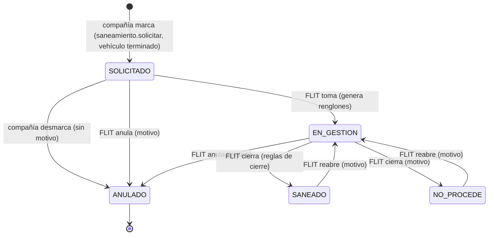
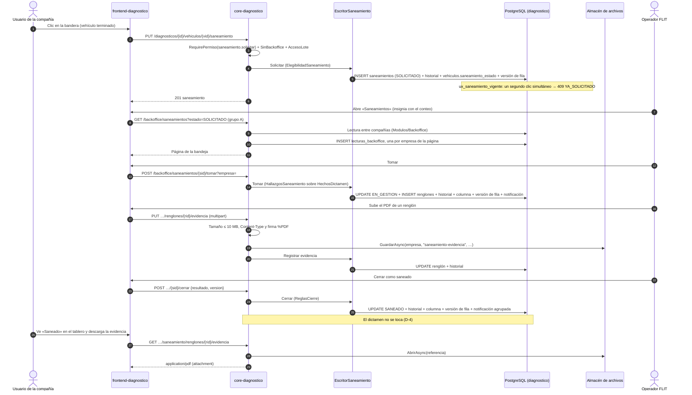

# ADR-0087: Diagnóstico — el saneamiento es un circuito de gestión sin dinero dentro de Diagnóstico, con tablas propias, que no toca el dictamen

**Fecha**: 2026-11-14
**Status**: Propuesto
**Deciders**: Líder Técnico FLIT. La aceptación es exclusiva del Líder Técnico humano, en su propio PR (regla FLIT 15); este ADR no pasa a Aceptado por ningún otro camino. Se apoya en las decisiones de producto del usuario S1–S29 del 2026-11-14, que se citan en línea en «Decisiones de producto que este ADR asume».
**Tags**: arquitectura, backend, frontend, persistencia, backoffice, archivos, auditoría, Habeas Data, diagnostico
**Épica / Feature / HU**: proyecto FLIT - DIAGNOSTICO en Azure DevOps. Épica #12679 (MOD06 Derivación y Accionabilidad), relacionada con #12678 y #12881. El Feature y sus HUs BACKEND y FRONTEND se crean tras aprobar el plan (`docs/diagnosticos/plan-saneamiento-oleada-unica.md` §10).
**Supersedes**: ninguno. D-08 no es un ADR sino una decisión del plan v2 (`plan-implementacion-diagnostico-vehicular-v2.md:27` y §7.4); este ADR la **revierte** (ver «Qué revierte»).
**Enmienda**:
- ADR-0072 (Propuesto): tres tablas nuevas en la tabla de aplicabilidad, una columna nueva en `vehiculos` y las excepciones de la sección «Excepciones a ADR-0072».
- ADR-0073 (`ADR-0073-diagnostico-acceso-backoffice.md`, Propuesto): excepción acotada a la regla de empresa explícita para el grupo A de la bandeja (ver D-5).
- ADR-0084 (Propuesto): el destino `SANEAMIENTO` de `derivaciones` (`ADR-0084:110`) no se usa; el saneamiento no es una derivación.
- ADR-0086 (Propuesto): cuatro tipos nuevos en `ck_notificaciones_tipo`.

**Diseño detallado**: `docs/diagnosticos/plan-saneamiento-oleada-unica.md` (§3 reglas, §4 modelo, §5 permisos, §6 contrato, §8 estructura). Es el contrato técnico; este ADR registra solo las decisiones que sientan precedente.
**Registro de cambios**:
- 2026-11-14: versión inicial. Propuesto.
- 2026-11-14: sincronizado con el DDL final (`.claude/state/saneamiento/schema.md`) y el brief de Fase 0 (C1–C21): renglón con `Remove` físico y FK `RESTRICT` (no `CASCADE`), excepciones a ADR-0072 reordenadas (A11 de la bandeja, `renglon_id` sin FK, `Remove` del renglón, evidencias huérfanas) y filas añadidas a la tabla de aplicabilidad de ADR-0072; `ReferenciaId` de las notificaciones = id del evento del historial (C18); modo `CON_ANALISIS` como en el contrato. Sigue en Propuesto.
- 2026-11-14: se incorporan los requisitos de security-previa: renglón con borrado lógico (SP-2), excepción de «tomar varios» (SP-1), clasificación y retención (SP-14, escalada al LT) y riesgos aceptados de la evidencia (SP-19). Sigue en Propuesto.

## Decisiones de producto que este ADR asume

Decisiones del usuario del 2026-11-14 (`.claude/state/saneamiento/decisiones-usuario.md`). Este ADR no las reabre.

- **S1 = a**: circuito de gestión **sin dinero**. El cliente solicita con una bandera en un clic, sin texto ni adjuntos; FLIT gestiona por fuera y registra el resultado; PDF opcional de evidencia de pago por renglón. Sin cobro, liquidación ni pagos estructurados.
- **S3 = c**: la bandera aparece en los dos modos y con cualquier veredicto. El dictamen orienta, no condiciona.
- **S5 = a**: elegible cuando el vehículo está terminado (todas sus consultas `Completado` o `Na`), sin esperar al lote.
- **S7 / S10**: estados `SOLICITADO` → `EN_GESTION` → `SANEADO` | `NO_PROCEDE`, más `ANULADO`; el cliente desmarca solo en `SOLICITADO`; FLIT anula en `SOLICITADO` o `EN_GESTION` y reabre un cierre con motivo.
- **S11 = c**: un renglón por fuente con hallazgo (SIMIT del vehículo, del propietario y del locatario, impuesto, SOAT, RTM) más renglones «Otro» de FLIT.
- **S12 = b / S13**: bandeja solo para FLIT, entre compañías; gestión con operación FLIT más permiso nuevo `diagnostico.saneamiento.gestionar`.
- **S14 = b / S15 / S16**: `SANEADO` no cambia el dictamen; reprocesar o reemitir el dictamen no cambia el saneamiento; las reglas de «Crear trámite» no cambian (solo un aviso sin bloqueo).
- **S17 = c / S18 = a**: sin total del SIMIT; PDF y Excel con los mismos datos que el usuario ya ve, bajo `diagnostico.reportes.descargar`.
- **S19 = a / S19-bis = a / S29**: campana solo para el cliente, agrupada por acción y diagnóstico; FLIT se entera por una insignia en el menú.
- **S26 a S28**: un saneamiento no anulado por vehículo; reglas de cierre; evidencia PDF de 10 MB como máximo, reemplazable en `EN_GESTION`.

## Contexto

La épica #12679 pedía que «Sanear» redirigiera a un módulo de saneamiento de la plataforma con la deuda detectada, para cobrar o liquidar. Ese módulo no existe en ningún producto. El plan v2 cerró el hueco con **D-08 = S2**: un panel informativo de deuda por fuente, exportable, sin solicitud ni gestión, y dejó reservado el destino `SANEAMIENTO` en `derivaciones` para conectarlo el día que hubiera un módulo. ADR-0084 eliminó luego la derivación al wizard con contexto y dejó ese destino sin diseño (`ADR-0084:110`).

El 2026-11-14 el usuario decidió (S1) que el saneamiento sí se **gestiona**: el cliente lo pide, FLIT lo toma, lo trabaja por fuera del sistema y deja constancia del resultado y de la evidencia de pago. El panel de deuda se mantiene, pero como pieza de un circuito con estados, actores, bandeja y auditoría.

Hechos del repo que condicionan la decisión (reverificar las líneas antes de editar):
- `core-diagnostico` aísla por el filtro global de EF (`TenantFilter.cs:35`), sin RLS; las lecturas entre compañías solo se admiten dentro de `Modulos/Backoffice` (`IgnoreQueryFiltersSoloEnBackofficeTests`).
- El backoffice lee entre compañías con empresa explícita y una fila en `lecturas_backoffice` por lectura (ADR-0073).
- El dictamen es de solo agregación con versión (ADR-0077) y el ajuste FLIT es una versión nueva (ADR-0086 D-2).
- La grilla del tablero es incremental por versión de celda **y de fila** (ADR-0086 D-1, `EscritorCeldas.SubirVersionFilaAsync`).
- El almacén de archivos (`IFabricaAlmacen`, `AlmacenArchivos.cs:30`) guarda y abre, pero **no borra**.
- La campana guarda solo `tipo`, ids y contadores (`ck_notificaciones_datos`, ADR-0086 D-3).

## Qué revierte

| Antes | Después |
|---|---|
| D-08 = S2 (plan v2): «Sanear» abre un panel informativo; no hay solicitud ni gestión | El panel se queda como parte de un circuito con solicitud, gestión FLIT, cierre y auditoría |
| R-10 (plan v2): «Sanear» aparece con Bloqueado (Con Análisis IA) o con deuda > 0 (Simple) | Aparece en cualquier vehículo terminado, en los dos modos y con cualquier veredicto (S3) |
| Reserva `derivaciones.destino = 'SANEAMIENTO'` para un módulo futuro | No se usa. El saneamiento tiene tablas propias (D-2) |
| Rótulo «Bloqueado / Requiere Saneamiento» (#12678) | Se queda «Bloqueado» (S22) |

No cambia: con `BLOQUEADO` no se ofrece «Crear trámite» (#12679, ajustes 2026-10).

## Decisión

**D-1 (alcance).** El saneamiento es un **circuito de gestión sin dinero que vive dentro de Diagnóstico**. Diagnóstico no cobra, no liquida, no registra pagos estructurados y no publica eventos de integración del saneamiento (nada nuevo en el AsyncAPI).

**D-2 (persistencia propia, no derivación).** Tres tablas nuevas en el schema `diagnostico`, todas con `IEntidadDeEmpresa`, ids `Guid.CreateVersion7()` y FK compuestas con `tenant_id` (ADR-0072 (c)):

| Tabla | Clase ADR-0072 | Papel |
|---|---|---|
| `saneamientos` | (a), `xmin` | Una fila por solicitud. Estado, autoría por hecho (`solicitado_*`, `tomado_*`, `cerrado_*`, `anulado_*`), motivos y observación de FLIT. `ux_saneamiento_vigente` único en (`tenant_id`, `vehiculo_id`) `WHERE estado <> 'ANULADO'`: garantiza S26 y resuelve la carrera de dos clics (el segundo recibe 409) |
| `saneamiento_renglones` | (a), `xmin` | Un renglón por fuente con hallazgo (foto al tomar) o `OTRO`. Resultado, nota y metadatos de la evidencia (referencia del almacén, nombre, sha256, tamaño, autor, fecha), con CHECK de todo o nada |
| `saneamiento_historial` | (b), solo inserción | Auditoría del circuito: evento, estados, renglón y fuente copiados, usuario, `es_flit`, motivo, instante |

Más la columna desnormalizada `vehiculos.saneamiento_estado` (estado del saneamiento no anulado, nula si no hay), que necesitan la grilla del lote, la grilla de placas y sus filtros sin un join por fila.

**Único escritor.** `EscritorSaneamiento` hace, en una sola transacción, la transición, el historial, la columna del vehículo, la subida de la versión de fila (`SubirVersionFilaAsync`, ADR-0086 D-1) y los avisos. Ningún otro código escribe esas tablas ni esa columna. El DDL final lo materializa el `database-agent` (`plan §4`).

**D-3 (máquina de estados).** Pura, en `Flit.Diagnostico.Domain/Saneamiento/TransicionesSaneamiento.cs`:

- Cualquier otra transición responde `409 TRANSICION_INVALIDA`. `ANULADO` es final: para volver a sanear, la compañía marca de nuevo y nace otro saneamiento.
- Motivo: 10 a 500 caracteres.
- Los renglones se generan **solo la primera vez** que se toma; reabrir no los regenera.
- Cierre `SANEADO`: al menos un renglón, ninguno `PENDIENTE` y al menos uno `SANEADO` (si no, `422 CIERRE_INCOMPLETO`). `NO_PROCEDE` solo exige motivo.
- La generación de renglones (`HallazgosSaneamiento`) **reutiliza `LectorHechosDictamen` y `HechosDictamen`**, los mismos predicados de las reglas `SIMIT_*`, `IMPUESTO`, `SOAT_NO_VIGENTE` y `RTM_NO_VIGENTE`. No depende del modo ni del tipo de trámite, así que sirve en Simple.

**D-4 (independencia del dictamen).** Ninguna transición del saneamiento emite, ajusta ni recalcula el dictamen, y ninguna emisión del dictamen toca el saneamiento. No se modifican `EmisorDictamen`, `EvaluadorDictamen`, `CatalogoReglasDictamen` ni `ElegibilidadDerivacion`. Para desbloquear, FLIT ajusta el dictamen (ADR-0086 D-2) o el admin de la compañía reprocesa. El cliente puede ver «Saneado» y «Bloqueado» a la vez; la interfaz lo explica con un texto fijo.

**D-5 (bandeja entre compañías sin empresa explícita).** El backoffice de saneamientos tiene dos grupos de endpoints:

- **Grupo A, sin `ConEmpresaExplicita`** (la empresa es un filtro opcional): `GET /backoffice/saneamientos`, `GET …/resumen`, `GET …/excel` y `POST …/tomar` (masivo, con `{empresa, id}` por ítem). Es la **única excepción** a la regla de empresa explícita de ADR-0073 y está acotada a estas cuatro rutas. Condiciones:
  - Política `PoliticaBackoffice` + `RequiereOperacionFlit()` + permiso `diagnostico.saneamiento.gestionar`.
  - La consulta vive en `Modulos/Backoffice/BandejaSaneamientos.cs` (lo exige `IgnoreQueryFiltersSoloEnBackofficeTests`).
  - **Auditoría de lectura por empresa:** `AuditoriaLecturaBackoffice.RegistrarAsync` se invoca **una vez por cada empresa distinta presente en la página devuelta** (o en el Excel), antes de responder. `resumen` no audita: devuelve solo un conteo, sin datos de ninguna compañía.
  - La fila de la bandeja no lleva datos personales: ids, placa, nombre del lote, modo, veredicto, estado, fechas y conteos de renglones.
  - En el `tomar` masivo, cada ítem se escribe con su propia empresa vía `EscrituraEntreEmpresas`, y los ids que no existen o no pertenecen a la empresa declarada salen como `NO_ENCONTRADO`.
- **Grupo B, con `?empresa=`**: detalle, tomar uno, renglones, evidencia, observación, cerrar, reabrir y anular. Siguen ADR-0073 sin cambios (`EmpresaExplicita`, `EscrituraEntreEmpresas`).

La concurrencia de escritura usa `version` = `xmin` del saneamiento o del renglón, con el mismo mecanismo del ajuste del dictamen (`409 VERSION_DESACTUALIZADA`).

**D-6 (evidencia en PDF).** Un PDF opcional por renglón, 10 MB como máximo (config `Diagnostico:Saneamiento:EvidenciaMaximoBytes`). Se valida `Content-Type` **y** la firma `%PDF` (reutilizando `FirmaPdf`); no se abre ni se analiza en el servidor; se sirve como adjunto con nombre `evidencia-{placa}-{fuente}.pdf`, nunca el original. Se guarda con `IFabricaAlmacen.Para(db).GuardarAsync(empresaId, "saneamiento-evidencia", …)`; la respuesta nunca expone la referencia del almacén ni el sha.

**D-7 (permisos y capacidades).** Dos permisos nuevos en el manifiesto: `diagnostico.saneamiento.solicitar` (por defecto a `usuario_diagnostico` y `admin_diagnostico`) y `diagnostico.saneamiento.gestionar` (ningún rol por defecto; el SuperAdmin pasa siempre y una compañía FLIT lo recibe si el hub se lo asigna). Marcar, desmarcar y el masivo llevan además el filtro `SinBackoffice`: el backoffice no marca. Capacidades de sesión `sanear` y `gestionarSaneamiento`, opcionales en el tipo del front.

**D-8 (avisos).** Cuatro tipos nuevos en `notificaciones` (`SANEAMIENTO_TOMADO`, `SANEAMIENTO_CERRADO`, `SANEAMIENTO_REABIERTO`, `SANEAMIENTO_ANULADO`) para quien solicitó, con `datos` que cumplen `ck_notificaciones_datos` (solo `cantidad` y `resultado`: ni placa ni motivo). Un aviso por par (solicitante, diagnóstico) por acción de FLIT (S29). **`ReferenciaId` = id del evento de `saneamiento_historial` de esa acción** (en un aviso agrupado, el evento de menor id del grupo), no el saneamiento ni el lote: con el saneamiento como referencia, `ux_notificaciones_idempotencia (tenant_id, usuario_id, tipo, referencia_id)` descartaría en silencio un segundo «reabierto», el «cerrado» tras una reapertura o dos tomas masivas del mismo lote. El evento es único por acción y sigue siendo idempotente ante reintentos. Es el mismo criterio de `LOTE_TERMINADO` (ADR-0086). `referencia_id` no se expone, así que el front enlaza por `diagnostico_id`. FLIT no recibe campana: una insignia en el menú con el conteo de `SOLICITADO` (`badge?` opcional en `NavItem` de `@flit/shell`).

**D-9 (contrato).** `contracts/openapi/diagnostico.v1.yaml`: `info.version` **1.3.1 → 1.4.0**, cambio **aditivo**. Rutas nuevas del cliente (`/diagnosticos/{id}/vehiculos/{vid}/saneamiento`, `/saneamientos/solicitudes`, `…/deuda`, `…/deuda/pdf`, `…/deuda/excel`, `/vehiculos/deuda/excel`, `/vehiculos`) y del backoffice (`/backoffice/saneamientos…`). En contratos existentes solo se **agregan** campos: `saneamiento` en la fila de la grilla del lote y de la grilla del backoffice, y las capacidades de sesión. Ningún campo existente cambia ni se retira; un consumidor viejo sigue funcionando. El modo se serializa como ya lo expone `diagnostico.v1.yaml`: **`SIMPLE` | `CON_ANALISIS`** (enum `ModoDiagnostico`), nunca `CON_ANALISIS_IA` como escriben §6.5 y §6.6 del plan; el filtro `estado` de `GET /vehiculos` toma `EN_PROCESO` | `TERMINADO`, calculado con `AvanceVehiculo.Terminado` (brief Fase 0, C1 y C2). Detalle en `plan §6`, con las correcciones de `.claude/state/saneamiento/brief-fase0.md`.

## Sequence diagram (recorrido principal)

## Excepciones a ADR-0072 (alcance: solo las tablas de saneamiento)

Este ADR añade a «Excepciones por tabla» de ADR-0072 las siguientes, alineadas con el DDL final del `database-agent` (`.claude/state/saneamiento/schema.md` §1). Ninguna se extiende a otra tabla del schema; las filas de las tres tablas y de `vehiculos` ya están en la tabla de aplicabilidad de ADR-0072.

1. **A11 en `ix_saneamientos_bandeja (estado, solicitado_en, id)`**: no empieza por `tenant_id` porque lo usan exclusivamente la bandeja, el Excel y el resumen (insignia) entre compañías de D-5, solo desde `Modulos/Backoffice`. `id` desempata el orden de la paginación. Mismo criterio que `ix_redaccion_pendiente`. Los demás índices nuevos empiezan por `tenant_id`.
2. **(d)5 en `saneamiento_historial.renglon_id` sin FK**: el renglón se puede quitar (excepción 3) y el historial no se reescribe. La fuente se copia en la fila para que el historial se lea sin el renglón. Mismo criterio que `notificaciones.referencia_id` (ADR-0086).
3. **Renglón quitado con borrado lógico (`quitado_en`) frente a R-18 y A5/A6.** FLIT puede quitar un renglón (automático o `OTRO`) mientras el saneamiento está en `EN_GESTION`. Quitar es fijar `saneamiento_renglones.quitado_en`, nunca un `Remove` físico ni un `ExecuteDelete`, porque el ámbito de escritura autorizado no acepta borrados (`TenantFilter`) y `ExecuteDelete` se salta la validación por empresa (security-previa SP-2). Las lecturas filtran `quitado_en is null`. La FK `saneamiento_renglones` → `saneamientos` es **`RESTRICT`**: `saneamientos` no se borra nunca, porque `ANULADO` es un estado. El historial guarda el evento `RENGLON_QUITADO` con `renglon_id` y la fuente copiados.
4. **Evidencias huérfanas en el almacén**: al reemplazar o quitar una evidencia, el renglón deja de apuntar al archivo anterior, que queda en el almacén sin camino de lectura, porque el almacén no tiene borrado (plan §6.4; ver «Tradeoff aceptado»). No es una tabla del schema: se anota aquí porque contradice R-18 por el lado opuesto (conservación sin dueño).

Además, sin ser excepción: `vehiculos.saneamiento_estado` es una copia desnormalizada del estado (`ck_vehiculos_saneamiento_estado`, `ix_vehiculos_saneamiento` parcial), sin PII, que solo escribe `EscritorSaneamiento` con `ExecuteUpdate` junto con `version_tablero`, sin cargar el vehículo, para no chocar con su `xmin`.

Datos personales: `solicitado_por`, `tomado_por`, `cerrado_por`, `anulado_por`, `evidencia_subida_por` y `usuario_id` son seudónimos (`claim sub`, `@pii:low`). `motivo_*`, `observacion_flit`, `nota` y `descripcion` son texto libre de FLIT (`@pii:low`); la base no garantiza que no traigan PII. `evidencia_nombre` es `@pii:low`. El contenido de la evidencia (un comprobante de pago) puede traer datos personales del pagador: vive solo en el almacén, nunca en logs, eventos ni notificaciones.

## Alternativas consideradas

### Opción S1-a: circuito de gestión sin dinero dentro de Diagnóstico (elegida)

**Pros:**
- Da a la compañía lo que el panel informativo no daba: pedir el saneamiento y seguir su estado sin salir del producto.
- FLIT tiene bandeja, renglones por fuente, evidencia y auditoría completa, sin depender de otro servicio.
- Reutiliza patrones existentes: filtro global de EF, `EmpresaExplicita` y `AuditoriaLecturaBackoffice`, `xmin`, versión de fila del tablero, notificaciones de ADR-0086, almacén de archivos, `PdfVehiculo` y `TabularWorkbookWriter`, `LectorHechosDictamen`.
- Sin dependencias nuevas, sin servicios ni colas nuevas.
- Mantiene el dictamen intacto: no abre un segundo camino de cambio del veredicto.

**Contras:**
- Es la opción más grande: tres tablas, unos 20 endpoints y cinco pantallas (backend ~30 SP, frontend ~35 SP según el plan §10).
- La bandeja entre compañías obliga a una excepción a ADR-0073 (D-5).
- La evidencia en PDF trae subida de archivos, con su superficie de ataque, y deja archivos huérfanos (ver «Tradeoff aceptado»).
- La bandera libre (S3) puede llenar la bandeja de FLIT.

**Esfuerzo:** L
**Riesgos:** fuga entre compañías en la bandeja (mitigación: operación FLIT + permiso, consultas solo en `Modulos/Backoffice`, auditoría por empresa, `AislamientoSaneamientoTests`); subida de archivos (firma, tipo, tope, nombre saneado, sin procesar el contenido); divergencia entre los renglones y las reglas del dictamen (mitigación: mismos lectores de hechos y prueba cruzada).

### Opción S1-b: mantener D-08 = S2, panel informativo de deuda

**Pros:**
- Es lo ya decidido en el plan v2 y lo más barato (≈2 SP).
- Sin estados, sin bandeja, sin subida de archivos y sin excepciones a ADR-0072 ni a ADR-0073.
- Nada que auditar más allá de la descarga.

**Contras:**
- No responde a S1: el cliente no puede pedir el saneamiento ni seguirlo, y FLIT no tiene dónde registrar la gestión ni la evidencia.
- La gestión seguiría por correo o por chat, sin trazabilidad.
- El vehículo bloqueado sin deuda en pesos (SOAT, RTM, SIMIT sin verificar; hueco H1) seguiría sin un camino claro.

**Esfuerzo:** S
**Riesgos:** se construye el panel y luego se reescribe para soportar el circuito.

### Opción S1-c: módulo externo de saneamiento, con Diagnóstico derivando por `derivaciones.destino = 'SANEAMIENTO'`

**Pros:**
- Respeta el texto original de la épica #12679 y la reserva del plan v2.
- Un módulo de la suite podría, a futuro, servir también a Trámites.
- El cobro o la liquidación tendrían un hogar natural si algún día entran.

**Contras:**
- El módulo no existe ni tiene especificación: es un producto en sí mismo (lo descartó ya el plan v2 §7.4).
- Exige otro servicio, otra base, contrato de bus y un canje como el que ADR-0084 retiró.
- `derivaciones` está modelada para crear trámites (borrador encolado, crédito por compañía, revalidación del veredicto en el consumidor); un saneamiento no tiene ninguna de esas propiedades y sí estados de gestión que la derivación no tiene.
- Cobro y liquidación están fuera de alcance por S1.

**Esfuerzo:** L (más el producto externo, sin estimar)
**Riesgos:** alcance transversal sin decisión de suite; bloquea el modo Con Análisis IA (#12881) hasta que exista el módulo.

## Tradeoff aceptado

- **Circuito propio frente a panel.** Se paga el tamaño de S1-a a cambio de que la gestión quede dentro del producto, con estados, evidencia y auditoría. Se descarta S1-b porque no cumple S1, y S1-c porque depende de un producto inexistente y fuerza una abstracción (`derivaciones`) pensada para otra cosa.
- **Tablas propias en lugar de derivación.** El saneamiento tiene su propio ciclo de vida (cinco estados, reapertura, renglones, evidencia) y no comparte nada del ciclo de la derivación (encolado, crédito, revalidación del veredicto). Mezclarlos ensuciaría `ElegibilidadDerivacion` y el consumidor de ADR-0084, que este ADR no toca.
- **Saneamiento independiente del dictamen.** Se acepta que el cliente vea «Saneado» y «Bloqueado» a la vez (riesgo R5 del plan, mitigado con texto fijo) a cambio de no abrir un segundo camino de cambio del veredicto: el dictamen sigue saliendo solo del motor o del ajuste FLIT auditado (ADR-0077, ADR-0086).
- **Bandeja sin empresa explícita.** Se acepta una excepción acotada a ADR-0073 porque FLIT necesita ver las solicitudes de todas las compañías en una sola lista ordenada por antigüedad. La auditoría por empresa de la página mantiene la propiedad que ADR-0073 protege: toda lectura de datos de una compañía queda registrada a nombre de esa compañía.
- **Evidencias huérfanas (deuda aceptada).** El almacén no tiene borrado. Al reemplazar o quitar una evidencia, el renglón deja de apuntar al archivo anterior, que **queda huérfano** en el almacén: sin ningún camino de lectura (solo se sirve por la referencia vigente del renglón), pero conservado. Se acepta en esta oleada porque agregar borrado al almacén afecta a todos sus consumidores y necesita su propia decisión de retención (R-18). El volumen esperado es bajo (10 MB por archivo, uno por renglón). Queda como pendiente: una HU propia para el borrado en el almacén y una purga de las referencias que ningún renglón nombre, o una tabla de evidencias versionada.

## Consecuencias

### Lo que se gana
- La compañía pide el saneamiento en un clic, individual o en bloque, y sigue su estado en el tablero, en la pestaña «Vehículos» y por la campana.
- FLIT gestiona desde una bandeja entre compañías, con renglones por fuente, evidencia descargable por el cliente y un historial completo.
- Un panel de deuda por fuente, nunca vacío (motivos del dictamen primero), exportable a PDF y Excel.
- Se libera el modo Con Análisis IA (#12881) sin esperar un módulo externo.

### Clasificación, retención y riesgos aceptados (security-previa SP-1, SP-14 y SP-19)

- **Excepción a ADR-0073 en «tomar varios» (SP-1).** `POST /backoffice/saneamientos/tomar` es la única ruta donde la empresa viene en el cuerpo (`{empresa, id}` por ítem). Condiciones:
  - Cada ítem se lee con `ParaEditarDeLaEmpresa<Saneamiento>(item.empresa)`. Un par empresa/id que no coincide da `NO_ENCONTRADO`, igual que un id inexistente.
  - Los ítems se agrupan por empresa y se abre un ámbito `AutorizarEscrituraDe` por empresa, en secuencia, dentro de una sola transacción.
  - Los duplicados se quitan antes de procesar. Una empresa inválida o `Guid.Empty` da `400 LISTA_INVALIDA`.
- **Clase ADR-0072 (SP-14).** `saneamientos`, `saneamiento_renglones` y `saneamiento_historial` son de clase (a), con `tenant_id` y escritura solo por la empresa o por el ámbito autorizado del backoffice.
- **Base legal (SP-14).** La misma del encargo de tratamiento del diagnóstico.
- **Retención (SP-14).** Hoy no hay política de retención para los PDF del lote, así que las tres tablas y las evidencias no se purgan. El almacén no cifra en la aplicación, la misma postura que los PDF y ZIP actuales. **Se escala al Líder Técnico antes del PR:** él define el plazo o acepta la falta de purga. Las columnas `evidencia_*`, `nota`, `motivo_*`, `observacion_flit` y `descripcion` llevan `HasComment` con su marca `@pii`.
- **Riesgos aceptados de la evidencia (SP-19).** Responsable: el Líder Técnico al aceptar este ADR.
  - Sin antivirus: FLIT sube comprobantes de pago de terceros y el cliente los descarga. Se mitiga con la firma `%PDF-`/`%%EOF`, con `nosniff`, `CSP sandbox` y `Content-Disposition: attachment`.
  - Huérfanos por reemplazo: se acotan con un tope de 20 reemplazos por renglón (`409 DEMASIADOS_REEMPLAZOS`) y un log estructurado `EvidenciaReemplazada {SaneamientoId, RenglonId, Tamano}`, sin el nombre del archivo.
- **Contenido de la evidencia.** Nunca se registra en logs ni se abre en el servidor. El nombre del archivo lo genera el servidor; el nombre original solo se muestra en la UI.

### Lo que se pierde
- Se deja de lado la integración con un módulo de saneamiento externo; si algún día existe, necesitará su propio ADR.
- Archivos huérfanos en el almacén al reemplazar o quitar evidencias.
- Un vehículo puede estar `SANEADO` y seguir `BLOQUEADO` hasta un reproceso o un ajuste FLIT.

### Cambios operacionales
- Migración única `<AAAAMMDDHHMMSS>_S1_Saneamiento`, posterior a `20261113070402_R9_AjusteConTramite`: las tres tablas, `vehiculos.saneamiento_estado` y `ck_notificaciones_tipo` regenerado con los cuatro tipos nuevos.
- Config nueva `Diagnostico:Saneamiento:EvidenciaMaximoBytes` (por defecto 10 485 760).
- Dos permisos nuevos publicados con el manifiesto (`RegistroManifiesto`).
- OpenAPI de Diagnóstico 1.3.1 → 1.4.0 (aditivo); se actualiza `OpenApiDiagnosticoContratoTests`.
- `@flit/shell`: campo opcional `badge?: number` en `NavItem`; sin el campo, el dock se pinta igual.
- Sin servicios, colas, eventos ni dependencias nuevas.

## ADRs relacionados

- [ADR-0072] — Aislamiento por tenant y clases (a)/(b). Este ADR añade tres tablas, una columna y cuatro excepciones acotadas.
- [ADR-0073] (`ADR-0073-diagnostico-acceso-backoffice.md`) — Backoffice con empresa explícita y auditoría. Excepción acotada al grupo A de la bandeja, con auditoría por empresa.
- [ADR-0077] — Dictamen por reglas. Se reutilizan sus lectores de hechos; el dictamen no cambia.
- [ADR-0084] — Derivación encolada. El destino `SANEAMIENTO` queda sin uso; `ElegibilidadDerivacion` no cambia.
- [ADR-0086] — Versión de fila del tablero, ajuste FLIT y notificaciones. Se reutilizan los tres mecanismos; se agregan cuatro tipos de notificación.

## Notas para agentes

- **Database Agent**: materializa `plan §4` con `.claude/skills/db-schema-validator/checklist-validacion-schema.md` §A y ADR-0072 (d).
  - FK compuestas con `tenant_id`; `saneamientos` y `saneamiento_renglones` exponen `uq_<tabla>_tenant_id`.
  - `ON DELETE RESTRICT` en todas las FK (renglones e historial → saneamientos; saneamientos → `diagnosticos` y `vehiculos`). Ningún `CASCADE`.
  - CHECK de estados, fuentes, hallazgos, resultados, eventos, `descripcion` obligatoria en `OTRO` y `ck_renglon_evidencia` de todo o nada.
  - Comentarios `@pii:low` en autores y textos libres; el historial termina en «Solo inserción.».
  - El DDL que manda es `.claude/state/saneamiento/schema.md`. Las filas de las tres tablas y la columna de `vehiculos` ya están en la tabla de aplicabilidad de ADR-0072, citando las excepciones 1 a 4.
- **Backend Agent**:
  - Toda escritura por `EscritorSaneamiento`, en una transacción, con subida de la versión de fila.
  - Dominio puro en `Flit.Diagnostico.Domain/Saneamiento`, sin EF ni HTTP.
  - `HallazgosSaneamiento` sobre `LectorHechosDictamen`, con una prueba cruzada contra las reglas del catálogo.
  - Ni una línea en `EmisorDictamen`, `EvaluadorDictamen`, `CatalogoReglasDictamen` ni `ElegibilidadDerivacion`.
  - Mapear `xmin` y el 23505 de `ux_saneamiento_vigente` a 409, nunca a 500.
  - Escenarios de fuga de los GET nuevos en `EscenariosDeFuga.Todos`.
  - Logs con ids, estado y evento; nunca placa con documento ni nombres.
- **Frontend Agent**:
  - Bandera con `aria-pressed`, un clic, optimista con reversión.
  - Capacidades `sanear` y `gestionarSaneamiento` opcionales en el tipo.
  - Texto fijo para «Saneado» con «Bloqueado».
  - `badge` opcional en `@flit/shell` sin cambiar el dock cuando no viene.
- **QA Agent**:
  - Cada transición válida e inválida con el actor correcto y el incorrecto.
  - Dos marcas simultáneas: una gana.
  - Aislamiento entre compañías (404, no 403) y visibilidad «propios».
  - Evidencia: no PDF, más de 10 MB, vacía y fuera de `EN_GESTION`.
  - El dictamen no cambia al cerrar y el saneamiento no cambia al reprocesar.
  - Una fila de auditoría por empresa en la bandeja.
- **Security Agent**:
  - Grupo A: operación FLIT + permiso, consulta solo en `Modulos/Backoffice`, auditoría por empresa, fila sin PII.
  - Subida: firma `%PDF`, tipo, tope, nombre saneado, descarga como adjunto, contenido sin procesar.
  - Exportaciones (Ley 1581): los mismos datos que ya ve el usuario, bajo `diagnostico.reportes.descargar` (S18).
  - `datos` de las notificaciones nuevas cumple `ck_notificaciones_datos`.
- **Infra Agent**: sin servicios ni colas nuevas. Solo la variable opcional `Diagnostico:Saneamiento:EvidenciaMaximoBytes` y el espacio del almacén, que crece con las evidencias huérfanas.
