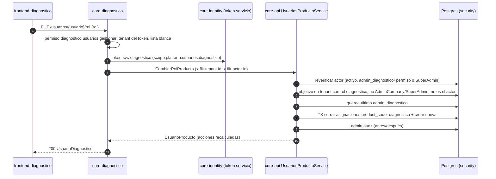

# ADR-0089: Diagnóstico — módulo Usuarios delegado en la plataforma con operaciones por producto (B-12 mínimo)

**Fecha**: 2026-11-16
**Status**: Propuesto
**Deciders**: Líder Técnico FLIT. La aceptación es exclusiva del Líder Técnico humano, en su propio PR (regla FLIT 15). Decisiones de producto del usuario P6=a y P7=a, y de seguridad SP-9=a, SP-11=a y SP-12=a, confirmadas por el usuario el 2026-11-16. Estados visibles del usuario en Diagnóstico: Activo, Invitado y Suspendido (sin acceso a Diagnóstico).
**Épica / Feature / HU**: proyecto FLIT - DIAGNOSTICO, Feature #14586 / HU #14587 (backend) y #14588 (frontend).
**Tags**: arquitectura, backend, seguridad, RBAC, identidad, gRPC, diagnostico, plataforma
**Supersedes**: ninguno.
**Enmienda**: ninguno. Adelanta una parte de ADR-0063 (Propuesto/borrador, «roles por producto»): las operaciones de asignación por producto, sin el resto (habilitación, manifiesto en el token, pantallas del hub).

## Contexto

El requerimiento (punto 4) pide que `admin_diagnostico` y el SuperAdmin gestionen desde Diagnóstico a los usuarios de Diagnóstico de una compañía: listar, invitar, cambiar rol, suspender y reactivar, sin eliminar, y que el SuperAdmin elija primero la compañía. Hoy:

- Los usuarios viven en `identity.users` y `security.user_role_assignments` (por tenant). El CRUD está en core-api, `/api/v1/security/*`. core-diagnostico no tiene endpoints de usuarios. Identidad (core-identity) expone por gRPC solo lectura (`IdentidadService.ListarUsuariosEmpresa`, con filtro por `producto`) y `EmpresasService`.
- Los roles ya llevan `product_code`, pero el hub no asigna un rol por producto (B-12). `AssignRoleHandler` **cierra todas** las asignaciones del usuario en el tenant (B-1). Delegar «cambiar rol» ahí le quitaría el rol de Trámites o el de AdminCompany.
- `admin_diagnostico` es espejo de AdminCompany: lo crea y lo cierra un disparador (DDL 126) (B-2). Las políticas de `/api/v1/security` no reconocen a `admin_diagnostico` (B-3).
- `SuspendUserHandler` suspende la cuenta en toda la plataforma (B-4). Invitar responde `EMAIL_ALREADY_IN_USE` para correos de cualquier tenant (B-5).
- Ya hay un precedente de servicio a servicio: core-api aloja `DerivacionTramitesGrpcService` (ADR-0084). Solo acepta al cliente `svc-diagnostico` con su scope y reverifica en BD al usuario actor (`AutorDerivacion`).

Restricciones: no duplicar el CRUD de usuarios (P7=a), aplicar las reglas en la plataforma y no solo en Diagnóstico (SP-14), Ley 1581 (correo como PII, mínimos en logs) y nada de escalamiento de privilegios.

## Decisión

core-diagnostico expone rutas REST propias (`/usuarios*` para la compañía del token y `/backoffice/empresas/{empresa}/usuarios*` y `/backoffice/usuarios/empresas` solo para el SuperAdmin). Esas rutas **delegan** en un servicio gRPC nuevo **alojado por core-api**, `flit.platform.v1.UsuariosProductoService` (más `UsuariosProductoConteoService`, global). El servicio cumple estas reglas:

1. Solo acepta el token de servicio de `svc-diagnostico` con el scope dedicado `platform.usuarios.diagnostico` (y `.conteos` para el global). El `producto` queda atado al cliente.
2. Recibe `x-flit-tenant-id` (empresa objetivo) y `x-flit-actor-id`, y **reverifica al actor en BD**: activo, sin suspensión, `admin_diagnostico` vigente con `diagnostico.usuarios.gestionar` en ese tenant, o SuperAdmin.
3. Vuelve a aplicar la lista blanca de roles por código (`usuario_diagnostico`, `admin_diagnostico`, con `product_code='diagnostico'`). También aplica la protección de AdminCompany y SuperAdmin como objetivos, la regla de auto-acción, la guarda del último `admin_diagnostico` y la auditoría administrativa.
4. Opera **solo sobre las asignaciones del producto diagnostico** (B-12 mínimo):
   - Cambiar rol cierra y crea únicamente asignaciones de ese producto (SP-9 a).
   - Suspender cierra la asignación de Diagnóstico y deja una marca en una tabla nueva `security.product_role_suspensions`. Reactivar la recrea (SP-12 a).
   - Solo el SuperAdmin da o quita `admin_diagnostico` (SP-11 a).
   - Invitar reutiliza `CreateInvitationHandler` para correos nuevos y responde de forma uniforme (SP-15).

La lectura de la lista también va por este servicio, porque tiene que incluir invitaciones pendientes y usuarios suspendidos en el producto, que `ListarUsuariosEmpresa` no ve.

## Alternativas consideradas

### Opción 1: Reenviar el JWT del usuario a `/api/v1/security/*` y ampliar las políticas de core-api para `admin_diagnostico`

**Pros:**
- Cero servicios nuevos; reutiliza endpoints, auditoría (`AdminAuditFilter`) y correo existentes.
- El actor es el del token, sin metadata nueva.
- Esfuerzo bajo en core-diagnostico (un cliente HTTP).

**Cons:**
- `PUT /users/{id}/role` destruye los roles de otros productos (B-1). Habría que reescribirlo igual.
- Suspender saca al usuario de toda la plataforma (B-4). Invitar enumera correos (B-5).
- Abre las políticas del hub a un rol de producto: `admin_diagnostico` podría llamar al resto de `/security/*` directamente.
- La audiencia del token de Diagnóstico no es la de core-api: obliga a un intercambio de tokens.

**Esfuerzo:** S en apariencia, M real.
**Riesgos:** Escalamiento lateral en el hub, y pérdida de roles de Trámites en producción.

### Opción 2: RPCs de escritura en core-identity (junto a `IdentidadService`)

**Pros:**
- Un solo destino para leer y escribir usuarios. core-diagnostico ya tiene el canal y el cliente de Identidad.
- core-identity ya referencia `Flit.Modules.Security.Application` (handlers) y tiene `IEmailSender`.
- Encaja con ADR-0064 («los servicios consultan a Identidad»).

**Cons:**
- La auditoría administrativa (`AdminAuditFilter`, `admin.audit`), el resolvedor de tema de correo de invitación y las guardas de `SecurityEndpoints` viven en core-api. Habría que portarlas o duplicarlas.
- core-identity hoy es OIDC más lectura. Sumarle escrituras administrativas amplía su superficie crítica (el emisor de tokens).
- Las migraciones del esquema `security` las corre core-api: la tabla nueva quedaría con un dueño en un servicio y su escritor en otro.

**Esfuerzo:** L
**Riesgos:** Duplicar reglas del hub en dos servicios y divergencia de auditoría.

### Opción 3: Servicio gRPC nuevo en core-api, por producto, con actor reverificado — elegida

**Pros:**
- core-api es dueño del esquema `security`, de las invitaciones (correo y tema) y de la auditoría administrativa: reutiliza los handlers sin portarlos.
- Ya hay precedente con la misma forma (`DerivacionTramitesGrpcService`, `svc-diagnostico`, scope dedicado, `AutorDerivacion`).
- Cierra B-1 y B-4 con operaciones acotadas al producto, sin tocar el comportamiento del hub.
- Las reglas se aplican en la plataforma (SP-14); core-diagnostico solo traduce errores y arma la interfaz.
- Genérico en `producto`: Comparendos puede reutilizarlo con su propio cliente y scope.

**Cons:**
- Contrato proto, servicio y tabla nuevos en core-api, y un PR que toca tres módulos (contracts, core-api, core-diagnostico).
- Hace falta una tabla nueva (`security.product_role_suspensions`) para representar «suspendido en el producto».
- Dos caminos de escritura de roles (hub y producto) hasta que ADR-0063 unifique.

**Esfuerzo:** M
**Riesgos:**
- Divergencia de reglas entre el hub y el servicio por producto. Se mitiga reutilizando los mismos handlers de bajo nivel y con tests de lista blanca en core-api.
- Si core-api solo valida `aud=tramites` para gRPC de servicio, la audiencia no sería la de plataforma (hueco H-U1 del contrato).

## Tradeoff aceptado

Se elige la **Opción 3**. Se acepta un contrato y una tabla nuevos en core-api a cambio de cuatro cosas: no destruir roles de otros productos (B-1), no suspender cuentas de la plataforma desde un producto (B-4), aplicar la autorización donde viven los datos (SP-14) y reutilizar correo y auditoría sin duplicarlos. La Opción 1 es más barata solo en apariencia: obliga igual a reescribir `AssignRole` y `Suspend`, y además abre el hub a un rol de producto. La Opción 2 pone escrituras administrativas en el emisor de tokens y separa la tabla de su dueño de migraciones.

## Consecuencias

### Lo que se gana
- Gestión de usuarios de Diagnóstico sin tocar los roles de Trámites o Comparendos del mismo usuario.
- Respuesta de invitación uniforme (sin oráculo de correos) y auditoría con antes y después.
- Primer paso real de B-12, reutilizable por otros productos.

### Lo que se pierde
- Un segundo camino de escritura de roles (producto) junto al del hub hasta ADR-0063.
- Sin revocación inmediata de sesión: el cambio rige en la siguiente emisión de token.
- `admin_diagnostico` deja de ser siempre espejo de AdminCompany: puede existir solo, asignado por el SuperAdmin (SP-11 a).

### Cambios operacionales
- Identidad emite a `svc-diagnostico` los scopes `platform.usuarios.diagnostico` y `platform.usuarios.diagnostico.conteos` (configuración del cliente de servicio en cada ambiente).
- core-diagnostico necesita la dirección gRPC de core-api para este servicio (la de derivación, si es el mismo host). Sin dirección: 503 `PLATAFORMA_NO_CONFIGURADA`.
- Migración nueva en core-api (esquema `security`): tabla `product_role_suspensions`.
- Permiso nuevo del manifiesto de Diagnóstico `diagnostico.usuarios.gestionar` para `admin_diagnostico`. Hay que verificar que llegue a los roles ya asignados.

## Modelo de datos (referencia; lo materializa database-agent)

```sql
-- core-api, esquema security
CREATE TABLE security.product_role_suspensions (
  id              uuid        PRIMARY KEY DEFAULT gen_random_uuid(),
  tenant_id       uuid        NOT NULL REFERENCES identity.tenants(id),
  user_id         uuid        NOT NULL REFERENCES identity.users(id),
  product_code    varchar(32) NOT NULL,
  role_id         uuid        NOT NULL REFERENCES security.roles(id),  -- rol que se recrea al reactivar
  suspended_at    timestamptz NOT NULL DEFAULT now(),
  suspended_by    uuid        NOT NULL,                                -- actor (@pii:low)
  CONSTRAINT uq_product_role_suspensions UNIQUE (tenant_id, user_id, product_code)
);
COMMENT ON TABLE security.product_role_suspensions IS
  'Suspensión de un usuario en un producto (ADR-0089): la asignación del rol del producto se cierra y esta fila permite listarlo como SUSPENDIDO y reactivarlo con el mismo rol. No suspende la cuenta.';
```

## Diagrama de secuencia (cambiar rol)



## Notas de implementación (HU #14587, carril be2a, 2026-11-16)

Lo que la implementación fijó o descubrió. No cambia la decisión. El estado sigue en **Propuesto**.

- **Audiencia del token de servicio (H-U1, cerrado).** El JwtBearer de core-api acepta `aud=plataforma` y `aud=tramites`. El interceptor del SDK exige la audiencia exacta que se le pasa. Los scopes `platform.usuarios.diagnostico` y `platform.usuarios.diagnostico.conteos` se mapean a `aud=tramites` en `OidcDefaults.ServiceScopeAudiences`, igual que `platform.tramites.derivacion`. `tramites` es el código de servicio de core-api, y `plataforma` es la audiencia de Identidad. Si se usara `plataforma`, el mismo token también serviría contra core-identity.
- **Excepción A5/A6/A16 en `security.product_role_suspensions`.** La tabla no lleva `created_*/updated_*`, `row_version` ni soft delete, y no tiene el disparador de `row_version`. Es una marca: suspender la inserta y reactivar la borra. `suspended_at`/`suspended_by` hacen de alta. La historia queda en `audit.audit_logs` (disparador `tr_product_role_suspensions_audit`) y en `admin.audit` (actor, rol antes/después, causa). Sí cumple RLS `tenant_isolation`. `product_code varchar(40)` lleva FK a `platform.products(code)`. Una fila por (empresa, usuario, producto).
- **Invitar (`InviteProductUserHandler`).**
  - Correo nuevo: crea la invitación con `CreateInvitationHandler` y UN rol resuelto por código.
  - Miembro de la empresa sin rol del producto: recibe la asignación y conserva los roles de otros productos.
  - Miembro que ya tiene cualquier rol de Diagnóstico, aunque sea un rol propio de la compañía: no se hace nada.
  - AdminCompany o SuperAdmin: no se hace nada (causa `OBJETIVO_PROTEGIDO`).
  - Invitación pendiente: no se hace nada.
  - Correo de otra empresa: no se hace nada; nunca se mueve a nadie de empresa.
  - La respuesta es la misma en todos los casos. La causa solo va a `admin.audit`.
  - Un rol que no existe o una carrera con otra invitación se traducen a los códigos del contrato (`ROL_NO_PERMITIDO`, `ROL_YA_VIGENTE`).
- **Lista blanca en lectura.** El listado y los conteos solo incluyen `usuario_diagnostico` y `admin_diagnostico` globales. Un rol propio de la compañía con `product_code='diagnostico'` no se ve ni se toca (NOT_FOUND). Un `admin_diagnostico` solo actúa sobre quien tiene `usuario_diagnostico`.
- **Último admin.** La guarda corre dentro de la transacción de la escritura (`SELECT … FOR UPDATE` sobre las asignaciones vigentes del rol admin en la empresa). Cuenta solo cuentas activas y sin suspensión temporal vigente.
- **Empresa objetivo del SuperAdmin.** core-api comprueba que la empresa exista y tenga el producto encendido, también en su cadena de cabezas. Si no, responde NOT_FOUND con `ErrorInfo.reason = EMPRESA_NO_ENCONTRADA`.
- **Casos límite del espejo (H-U6).** Comprobado en 5433:
  - Asignar o cerrar `admin_diagnostico` a quien no es AdminCompany no dispara `trg_ura_mirror_product_admins` (DDL 126), que solo reacciona a filas de AdminCompany.
  - Si el hub luego le da AdminCompany a ese usuario, el espejo no duplica (ya tiene rol del producto).
  - Si después se lo quita, el espejo cierra **todos** sus `admin_<producto>` de sistema, incluido el `admin_diagnostico` que le dio el SuperAdmin desde Diagnóstico.
  - El `AssignRoleHandler` del hub (B-1) sigue cerrando todas las asignaciones del tenant, también las de Diagnóstico.
  - Los dos casos se resuelven con ADR-0063.

## ADRs relacionados

- [ADR-0063] (borrador/Propuesto): roles por producto. Este ADR adelanta solo las operaciones de asignación por producto.
- [ADR-0064]: los servicios consultan a Identidad y no sus tablas. Aquí se escribe a través del dueño del esquema (core-api), no desde Diagnóstico.
- [ADR-0070]: tokens de servicio y scopes.
- [ADR-0084]: precedente `svc-diagnostico` → core-api con actor reverificado.
- [ADR-0088]: `SoloEmpresaHabilitada` y la política del backoffice que se reutilizan para el tenant objetivo del SuperAdmin.

## Notas para agentes

- **Database Agent**: migración core-api de `security.product_role_suspensions`. Confirmar que los disparadores espejo (DDL 120/126) no cierran ni bloquean un `admin_diagnostico` asignado a quien no es AdminCompany (H-U6).
- **Backend Agent (be2)**: proto en `contracts/proto/flit/platform/v1/usuarios_producto.proto`. En core-api: servicio, autorización `DiagnosticoUsuariosServicioAuthorization` (patrón de derivación), actor reverificado y handlers `AssignProductRoleHandler` / `SuspendProductRoleHandler` / `ReactivateProductRoleHandler` en `Flit.Modules.Security.Application`. En core-diagnostico: cliente, endpoints, `PoliticaUsuariosBackoffice`, capacidad `gestionarUsuarios`, rate limit de invitaciones y traducción de errores.
- **Frontend Agent (fe1)**: entrada «Usuarios» del dock con `capacidades.gestionarUsuarios`. Pintar acciones solo desde `acciones` / `roles_asignables` del servidor. Correo solo en la celda visible (SP-20).
- **QA Agent**: casos de B-1 (el rol de Trámites se conserva), B-4 (sigue entrando a Trámites), IDOR entre compañías (404), lista blanca, último admin e invitación uniforme.
- **Security Agent**: revisar SP-9..SP-18 sobre el diff. Confirmar la audiencia del token de servicio (H-U1) y la ventana sin revocación (H-U4).
- **Infra Agent**: scopes nuevos del cliente `svc-diagnostico` en Identidad por ambiente y dirección gRPC de core-api en core-diagnostico.

## Referencias externas

- AIP-158 (paginación) para el estilo de los RPC de lista.
