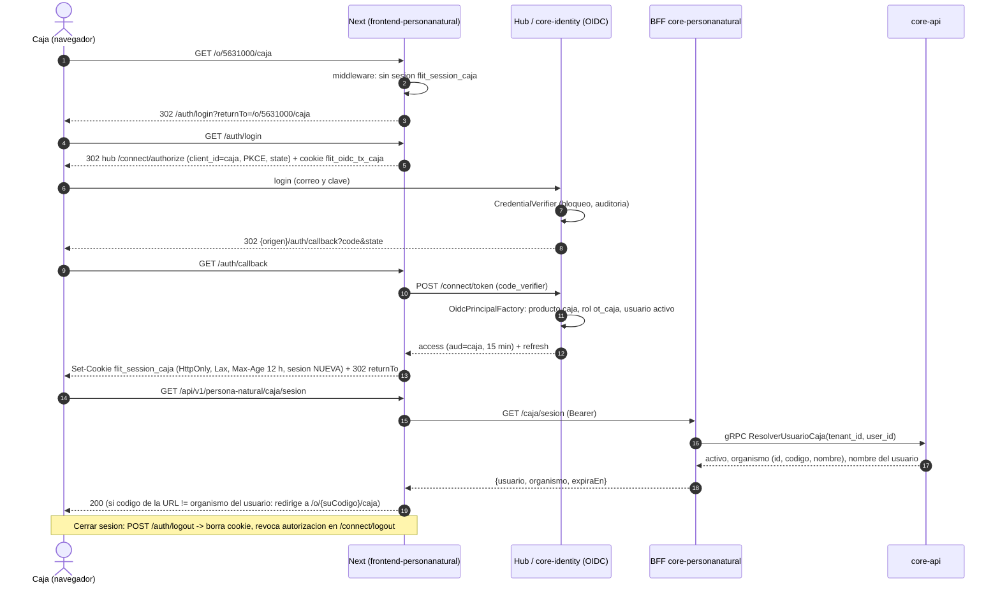

# Diseño: Portal de caja del organismo (Épica #14210, Feature #14453, HU #14454 a #14462)

ADR: `docs/decisions/ADR-0082-portal-de-caja-del-organismo-sesion-oidc-producto-caja.md` (Propuesto). Las alternativas y su tradeoff están en el ADR; aquí van el flujo, los contratos y los archivos. Todo cambio en core-api es aditivo y apagado por defecto.

## 1. Resumen de la solución

- Producto OIDC nuevo `caja` (client_id = aud). Rol `ot_caja` (producto `caja`, `target_entity_type = TRANSIT_OFFICE`), permiso `caja.cobrar`.
- La caja entra a `https://<origen canónico del portal>/o/{codigo}/caja`. Sin sesión, Next la lleva al login del hub (code + PKCE, `@flit/auth`) y vuelve. La sesión (access + refresh cifrados) vive en una cookie HttpOnly del servidor de Next, con tope absoluto de 12 h.
- El navegador llama `/api/v1/persona-natural/caja/*` (mismo origen). El proxy de Next adjunta `Authorization: Bearer <access token>` solo en esa rama. El BFF valida el JWT (audiencia `caja`), exige rol `ot_caja` y pregunta a core-api por RPC quién es, si sigue activo y de qué organismo. El organismo jamás lo envía el cliente.
- El hub del OT (core-api) crea/desactiva usuarios de caja y lista/anula cobros; para los cobros llama al BFF por gRPC (`CajaAdminService`) con `svc-tramites`.

## 2. Secuencias

### 2.1 Inicio de sesión y cierre



### 2.2 Buscar y confirmar el cobro

```mermaid
sequenceDiagram
    autonumber
    actor C as Caja
    participant N as Next (proxy)
    participant B as BFF
    participant A as core-api
    participant DB as schema persona_natural

    C->>N: GET /caja/tramites/PN-2026-000123
    N->>B: Bearer + GET
    B->>B: CajaPolicy (JWT aud=caja, product=caja, rol ot_caja)
    B->>A: ResolverUsuarioCaja (sin cache)
    A-->>B: organismo O, activo
    B->>B: tope de busquedas fallidas por usuario (429)
    B->>DB: cobro por codigo (indice unico)
    alt no existe
        B-->>C: 404 no_encontrado (sin datos)
    else otro organismo
        B-->>C: 403 otro_organismo (sin datos)
    else pagado
        B-->>C: 409 ya_pagado
    else vencido / sin habilitar
        B-->>C: 409 cobro_vencido / no_habilitado
    else vigente
        B->>A: Cotizar (recalcula desglose y total vigente)
        B-->>C: 200 tipo, organismo, lineas, total, versionTarifa
    end
    C->>N: POST /caja/tramites/{codigo}/confirmar (multipart, Idempotency-Key)
    N->>B: Bearer + POST
    B->>DB: BEGIN; SELECT cobro FOR UPDATE; revalida estado/organismo/vigencia
    B->>A: Cotizar (total del momento)
    alt totalVistoCop != total del momento
        B-->>C: 409 total_cambio {totalActualCop} (no se cobra)
    else
        B->>DB: UPDATE cobro pagado (valor, medio, hora, usuario, lineas congeladas); solicitud pagada; outbox
        B->>DB: COMMIT
        B-->>C: 200 "Pago registrado."
    end
```

### 2.3 Administrar usuarios de caja y anular un cobro desde el hub

```mermaid
sequenceDiagram
    autonumber
    actor O as ot_admin / SuperAdmin
    participant F as frontend (hub OT)
    participant A as core-api
    participant I as Identidad (misma BD de seguridad)
    participant B as BFF

    O->>F: Usuarios de caja > Invitar (correo, nombre)
    F->>A: POST /api/v1/admin/ot/portal-caja/users
    A->>A: OtAdminOrSuperAdminPolicy + ResolverAlcance (organismo del token)
    A->>I: CreateInvitationHandler(rol fijo ot_caja) + asegura tenant_products(caja)
    A-->>F: 201
    O->>F: Cobros de caja > Anular (motivo)
    F->>A: POST /api/v1/admin/ot/portal-caja/cobros/{cobroId}/anular
    A->>A: alcance; organismo ajeno => 403
    A->>B: gRPC CajaAdminService.AnularCobro (svc-tramites, scope platform.personanatural.caja)
    B->>B: BEGIN; cobro de ESE organismo; estado pagado; solicitud sin consumir => anulado, solicitud a pendiente_pago; auditoria
    B-->>A: ok | FAILED_PRECONDITION cobro_no_anulable
    A-->>F: 200 | 409 {code, message}
```

## 3. Contratos

### 3.1 BFF REST (nuevo, `PersonaNatural:Caja:Habilitado=true`)

Base: `/api/v1/persona-natural/caja`. Todas: `Cache-Control: no-store`, política `CajaPolicy`, errores `{ code, message }` en español.

| Método | Ruta | Cuerpo | Respuesta |
|---|---|---|---|
| GET | `/sesion` | | `{ usuario:{id,nombre}, organismo:{id,codigo,nombre}, expiraEn }` |
| GET | `/tramites/{codigo}` | | 200 `{ codigo, tipoTramite:{codigo,nombre}, organismo:{codigo,nombre}, lineas:[{concepto,valorCop}], totalCop, versionTarifa, venceEn }` |
| POST | `/tramites/{codigo}/confirmar` | multipart: `medio` (`efectivo\|datafono\|transferencia\|otro`), `medioDetalle` (obligatorio si `otro`, máx. 120), `totalVistoCop` (solo comparación, el servidor no lo usa como valor), `prefactura` (PDF/JPG/PNG ≤ 5 MB, opcional); cabecera `Idempotency-Key` | 200 `{ codigo, valorCop, medio, pagadoEn }` |
| GET | `/cobros/hoy?pagina=&tamano=` | | 200 `{ fecha, totalDiaCop, items:[{codigo,valorCop,medio,medioDetalle,hora,usuario,estado}], total, pagina, tamano }` (hora de Colombia; `anulado` no suma) |

Códigos de error:

| HTTP | code | message |
|---|---|---|
| 401 | `sin_sesion` | Inicie sesión para continuar. |
| 403 | `sin_permiso` | Su usuario no puede cobrar en este organismo. |
| 403 | `otro_organismo` | Este trámite no es de este organismo. |
| 404 | `no_encontrado` | No encontramos ese trámite. |
| 409 | `ya_pagado` | Este trámite ya fue pagado. |
| 409 | `cobro_vencido` | El pago en caja de este trámite venció. |
| 409 | `no_habilitado` | Este trámite no tiene el pago en caja habilitado. |
| 409 | `total_cambio` | El total cambió; revise el nuevo valor. (`totalActualCop`) |
| 400 | `medio_invalido` / `detalle_requerido` / `prefactura_invalida` | motivo exacto |
| 429 | `demasiados_intentos` | Demasiadas búsquedas sin resultado. Espere unos minutos. (`Retry-After`) |

### 3.2 Proto del BFF para core-api: `contracts/proto/flit/personanatural/v1/personanatural.proto` (servicio nuevo, aditivo)

```proto
// Administración del cobro en caja desde el hub del OT. Token de svc-tramites con aud=personanatural y scope
// platform.personanatural.caja. El organismo lo resuelve core-api desde el token del administrador; el BFF no lo discute.
service CajaAdminService {
  rpc ListarCobros(ListarCobrosRequest) returns (ListarCobrosResponse);
  rpc AnularCobro(AnularCobroRequest) returns (AnularCobroResponse); // FAILED_PRECONDITION reason=cobro_no_anulable | NOT_FOUND reason=cobro_no_encontrado
}
message ListarCobrosRequest { string organismo_id = 1; string fecha = 2; /* AAAA-MM-DD Colombia; vacio = hoy */ int32 pagina = 3; int32 tamano = 4; }
message CobroResumen {
  string cobro_id = 1; string codigo = 2; int64 valor_cop = 3; string medio = 4; string medio_detalle = 5;
  string pagado_en = 6; string pagado_por_nombre = 7; string estado = 8; // pagado | anulado
  bool anulable = 9; string motivo_no_anulable = 10; string anulado_en = 11; string anulado_por_nombre = 12; string anulacion_motivo = 13;
  int64 row_version = 14;
}
message ListarCobrosResponse { repeated CobroResumen items = 1; int32 total = 2; int64 total_dia_cop = 3; }
message AnularCobroRequest { string organismo_id = 1; string cobro_id = 2; string motivo = 3; /* 10..300 */ string actor_user_id = 4; string actor_nombre = 5; int64 row_version = 6; }
message AnularCobroResponse { string cobro_id = 1; string estado = 2; }
```

### 3.3 Proto de core-api para el BFF: `contracts/proto/flit/tramites/v1/persona_natural.proto` (RPC nuevo, scope existente `platform.tramites.persona_natural`)

```proto
// Quién es este usuario de caja y de qué organismo. NOT_FOUND/PERMISSION_DENIED si no es ot_caja activo.
rpc ResolverUsuarioCaja(ResolverUsuarioCajaRequest) returns (ResolverUsuarioCajaResponse);
message ResolverUsuarioCajaRequest { string tenant_id = 1; string user_id = 2; }
message ResolverUsuarioCajaResponse { bool activo = 1; string organismo_id = 2; string organismo_codigo = 3; string organismo_nombre = 4; string usuario_nombre = 5; }
```

La respuesta es `activo = true` solo si: usuario `active`, no suspendido, asignación vigente al rol `ot_caja`, tenant con perfil de OT (`admin.transit_office_profiles`) y producto `caja` encendido.

### 3.4 core-api REST (nuevo, `PortalCaja:Habilitado=true`; `OtAdminOrSuperAdminPolicy`; `?transitOfficeId=` obligatorio solo para SuperAdmin; ajeno 403)

Base `/api/v1/admin/ot/portal-caja`:

| Método | Ruta | Cuerpo | Respuesta |
|---|---|---|---|
| GET | `/users` | | `[{ userId, fullName, email, status: invited\|active\|suspended, createdAt, lastLoginAt }]` |
| POST | `/users` | `{ email, fullName }` | 201; 409 `EMAIL_IN_USE` con motivo exacto |
| POST | `/users/{userId}/suspend` | | 204 (desactiva) |
| DELETE | `/users/{userId}/suspend` | | 204 (reactiva) |
| POST | `/invitations/{invitationId}/resend` | | 204 |
| GET | `/cobros?date=&page=&pageSize=` | | `ListarCobrosResponse` en JSON camelCase |
| POST | `/cobros/{cobroId}/anular` | `{ reason, rowVersion }` | 200; 400 `REASON_REQUIRED`; 403 `OTRO_ORGANISMO`; 409 `COBRO_NO_ANULABLE`; 503 `PORTAL_NO_DISPONIBLE` |

`contracts/openapi/core-api.v1.yaml`: agregar esas rutas con los esquemas `CajaUsuario`, `CajaCobro`, `CajaCobroLista`, `CajaInvitarRequest`, `CajaAnularRequest` (descripciones entrecomilladas: el lint del OpenAPI falló antes por eso).

### 3.5 Configuración y secretos

- BFF: `PersonaNatural:Caja:Habilitado=false`, `Caja:BusquedasFallidasMax=10`, `Caja:BusquedasFallidasVentanaMin=5`, `Caja:PrefacturaMaxBytes=5242880`, `Caja:VentanaAnulacionMinutos` (ver pendiente del ADR), `Platform:Auth:ExtraAudiences=["caja"]`.
- core-api: `PortalCaja:Habilitado=false`; en `Suite:Oidc:ServiceClients:svc-tramites:Scopes` sumar `platform.personanatural.caja`; `Suite:Hosts:Overrides:caja`.
- Identidad: sin llave nueva; el cliente OIDC `caja` lo registra `OidcClientSync` desde `ProductCodes.All`.
- frontend-personanatural: `FLIT_HUB_URL`, `FLIT_SESSION_SECRET`, `FLIT_OIDC_INTERNAL_URL`, `FLIT_APP_URL` (origen canónico) y `CAJA_PRODUCT_CODE=caja`.

## 4. Modelo de datos (conceptual y DDL de referencia; lo materializa el database-agent)

### 4.1 core-api (esquemas `platform`, `security`) — DDL `199-HU14454-producto-caja-rol-ot-caja.sql` (develop ya ocupa 187-188 y la rama de pago el 189)

```sql
INSERT INTO platform.products (code, name, icon, status, sort_order)
VALUES ('caja', 'Caja', 'banknote', 'active', 50) ON CONFLICT (code) DO NOTHING;

INSERT INTO security.modules (code, name, product_code) SELECT 'caja', 'Caja del organismo', 'caja'
 WHERE NOT EXISTS (SELECT 1 FROM security.modules WHERE code = 'caja' AND deleted_at IS NULL);
-- permiso caja.cobrar en ese módulo (mismas columnas que 137-HU13638-slugs-ot.sql)
INSERT INTO security.roles (code, name, description, is_system, is_active, target_entity_type, product_code)
SELECT 'ot_caja', 'Caja del organismo', 'Cobra en la caja del portal del punto. No entra a FLIT 2.0.', true, true, 'TRANSIT_OFFICE', 'caja'
 WHERE NOT EXISTS (SELECT 1 FROM security.roles WHERE code = 'ot_caja' AND target_entity_type = 'TRANSIT_OFFICE' AND deleted_at IS NULL);
-- role_permissions: ot_caja -> caja.cobrar (tr_role_permissions_same_product exige el mismo producto)
```

Migración EF `20261117140000_HU14454_RolOtCaja` con `[DbContext]`/`[Migration]` inline o `.Designer.cs` (si no, no corre al arrancar). Down: borra rol, permiso, módulo y producto en ese orden.

### 4.2 BFF (schema `persona_natural`) — migración `20261110120000_CajaOt`

Sobre `CobroSolicitud` (ya existe, Feature #14447):

| Cambio | Detalle |
|---|---|
| `pagado_por_id uuid null`, `pagado_por_nombre varchar(160) null` | quién cobró (hoy `pagado_por` es texto libre; se conserva y se llena con el id) |
| `anulado_por_id uuid null`, `anulado_por_nombre varchar(160) null` | quién anuló |
| `pagado_en_dia date null` | día de Colombia de `pagado_en` (índice para la lista del día) |
| Índice `ix_cobro_organismo_dia (organismo_id, pagado_en_dia)` | lista del día y del hub |
| CHECK `ck_cobro_anulado_motivo`: `estado <> 'anulado' OR (anulacion_motivo IS NOT NULL AND anulado_por_id IS NOT NULL)` | |

Tabla nueva `caja_evento` (auditoría sin datos personales): `id uuid pk`, `organismo_id uuid`, `usuario_id uuid`, `accion varchar(30)` (`busqueda_ok|busqueda_fallida|confirmar|anular|sesion`), `codigo varchar(20) null`, `resultado varchar(30)`, `ip_huella varchar(64)` (HMAC con `PiiHasher`), `creado_en timestamptz`. Índices `(organismo_id, creado_en)` y `(usuario_id, creado_en)`. El conteo de fallidas por usuario para el tope sale de esta tabla (sin estado en memoria: sirve con réplicas).

Una sola confirmación: ya existen los índices únicos parciales «un cobro pagado por solicitud»; la confirmación usa `SELECT ... FOR UPDATE` sobre el cobro y `Idempotency-Key` guardada en el cobro. La carrera de dos cajas pierde en el índice único y responde `ya_pagado`.

## 5. Autorización en el BFF (qué se valida en cada endpoint de caja)

1. `Platform:Auth:ExtraAudiences` acepta aud `caja` además de `personanatural`. Los endpoints de servicio gRPC siguen exigiendo cliente y scope; un token `caja` jamás los pasa.
2. `CajaPolicy` (nueva): `RequireAuthenticatedUser`, claim `product=caja`, claim `role` contiene `ot_caja`, `aud` = `caja`.
3. `ConCajero` (filtro de endpoint): llama `ResolverUsuarioCaja(tenant_id, sub)`; sin caché; si `activo=false` responde 403 `sin_permiso`; deja `Cajero(usuarioId, nombre, organismoId)` en `HttpContext.Items`. Esta es la única fuente del organismo.
4. Cada consulta de cobro filtra `WHERE codigo = @c` y compara `OrganismoId` con el del cajero antes de leer cotización o devolver un campo.
5. `auth_time`/`iat` del token mayor de 12 h: 401 (el tope de 12 h también se impone aquí, no solo en la cookie).

## 6. Garantía «el usuario solo-caja no entra a FLIT 2.0»

Tres capas, todas inertes si no existe un usuario `ot_caja`:

1. **Identidad** (`OidcPrincipalFactory`, `LoginHandler`): si todos los roles activos del usuario son `ot_caja`, solo se emite token para `caja`; para `plataforma`, `tramites` u otros devuelve `CAJA_ONLY`; `POST /api/v1/auth/login` (JWT heredado) también lo niega.
2. **core-api, token ya emitido** (`SoloCajaGuardMiddleware`, antes de autorización): con token cuyos roles sean solo `ot_caja`, todo `/api/*` responde 403 `caja_sin_acceso`, salvo `/api/v1/platform/me/apps`. `OtModuleAuthorizationHandler` agrega `Fail` explícito para el mismo caso (el hueco del tenant OT). Un token `aud=caja` ya queda fuera por `OtherProductAudiences`.
3. **Asignación**: la invitación genérica de usuarios OT (`AdminOtEndpoints.InviteUserAsync`) y el catálogo de roles que ve el hub excluyen `ot_caja`; un usuario `ot_caja` no puede recibir otro rol por las rutas genéricas (400 `CAJA_ROLE_EXCLUSIVE`).

## 7. Archivos por HU

Rutas relativas a `C:\FLIT 2.0\wt-pago-a`. «M» = modificar, «C» = crear. Pruebas: una por AC; xUnit en `services/*/tests`, Vitest en `__tests__`.

### HU #14454 — Backend: perfil Caja limitado a un organismo (5 SP)

- C `services/core-api/src/Flit.Infrastructure/Persistence/Sql/Ddl/199-HU14454-producto-caja-rol-ot-caja.sql`
- C `services/core-api/src/Flit.Infrastructure/Migrations/20261117140000_HU14454_RolOtCaja.cs` (+ `.Designer.cs` o atributos inline); M `FlitDbContextModelSnapshot.cs`
- M `services/core-api/src/Flit.Modules.Security.Application/Products/ProductCodes.cs` (`Caja`, `All`); M `tests/Flit.Modules.Security.Application.Tests/Products/ProductCodesTests.cs` (5 códigos)
- M `services/core-api/src/Flit.Api/Authorization/AdminAuthorization.cs` (`OtCajaRole = "ot_caja"`); M `OtModuleAuthorizationHandler.cs`; C `SoloCajaGuardMiddleware.cs`; M `Flit.Api/Hosting/*` (registro del middleware tras autenticación)
- C `services/core-api/src/Flit.Api/Endpoints/AdminPortalCajaUsuariosEndpoints.cs`; M `Flit.Api/Hosting/ApiEndpoints.cs`
- C `services/core-api/src/Flit.Admin.Application/Plataforma/PersonaNatural/Caja/{InvitarUsuarioCajaHandler,ListarUsuariosCajaHandler,CambiarEstadoUsuarioCajaHandler,CajaErrores}.cs`
- M `services/core-api/src/Flit.Api/Endpoints/AdminPortalCobroEndpoints.cs` → extraer `ResolverAlcanceAsync` a C `Flit.Api/Endpoints/AlcancePortalOt.cs` (compartido, sin cambiar comportamiento)
- M `services/core-api/src/Flit.Api/Endpoints/AdminOtEndpoints.cs` (excluir `ot_caja` en invitar/asignar)
- M `services/core-api/src/Flit.Api/Grpc/PersonaNaturalGrpcService.cs` (`ResolverUsuarioCaja`); M `contracts/proto/flit/tramites/v1/persona_natural.proto`
- M `services/core-identity/src/Flit.Identity.Web/Identity/OidcPrincipalFactory.cs`; M `services/core-identity/src/Flit.Identity.Application/Auth/Login/*` (`CAJA_ONLY`)
- M `services/core-api/src/Flit.Platform.Sdk/Authentication/PlatformAuthentication.cs` (`ExtraAudiences`); M `tests/Flit.Platform.Sdk.Tests/PlatformAuthenticationTests.cs`
- M `services/core-personanatural/src/Flit.PersonaNatural.Api/Program.cs`, C `Caja/CajaEndpoints.cs` (grupo + `CajaPolicy` + `ConCajero`), C `Caja/CajeroDeSesion.cs`, C `Caja/IResolverCajero.cs` (+ `ResolverCajeroGrpc`, `ResolverCajeroNoConfigurado`)
- M `contracts/openapi/core-api.v1.yaml`; M `services/core-api/src/Flit.Api/appsettings.json` (`PortalCaja:Habilitado=false`, scope en `svc-tramites`)
- Pruebas: `Flit.Admin.Application.Tests/.../Caja/*`, `Flit.Api.Tests/.../SoloCajaGuardTests.cs`, `core-identity/tests/.../CajaOnlyTests.cs`, `Flit.PersonaNatural.Tests/CajaAutorizacionTests.cs`

### HU #14455 — Frontend: usuarios de caja en el hub del OT (3 SP)

- C `frontend/lib/api/admin-ot-portal-caja.ts` (+ `__tests__`)
- C `frontend/components/admin/transit-offices/portal-pn/OtCajaUsuariosSection.tsx` (tabla modelo de trámites: `table-styles`, `ActionsMenu` «Acciones», `Pagination` + `usePaginacion`, `TablaFiltrosBar`, `CarLoaderModal`); C `OtCajaUsuarioModal.tsx` (modal normal)
- M `PortalPnTabs.tsx` (pestaña «Usuarios de caja»); M `frontend/components/admin/transit-offices/ot-nav.ts` si la pestaña lleva ruta propia
- Manual: M/C artículo en `frontend/lib/manual/articles/` y `pnpm manual:export` (regla `flit-manual-updater`)
- Pruebas: `portal-pn/__tests__/OtCajaUsuariosSection.test.tsx`

### HU #14456 — Backend: buscar el trámite por ID (5 SP)

- M `services/core-personanatural/.../Caja/CajaEndpoints.cs`; C `Caja/CajaBusquedaService.cs`, `Caja/CajaTopeBusquedas.cs`, `Caja/CajaAuditoria.cs`
- C `Persistence/Migrations/20261110120000_CajaOt.cs` (+ Designer) y M `PersonaNaturalDbModelSnapshot.cs`, M `Persistence/CobroSolicitud.cs` y `PersonaNaturalDb.cs` (tabla `caja_evento` y columnas de §4.2)
- Reutiliza `IFachadaTramites.Cotizar` (Cotizaciones) para el desglose; no devuelve nombres, documentos ni placa
- Pruebas: `Flit.PersonaNatural.Tests/CajaBusquedaTests.cs` (cinco respuestas, tope de intentos, otro organismo sin datos)

### HU #14457 — Backend: confirmar con medio y prefactura (5 SP)

- C `Caja/CajaConfirmacionService.cs`, `Caja/CajaContratos.cs`; M `Caja/CajaEndpoints.cs` (multipart)
- Reutiliza `AdjuntosService`/`IAlmacenAdjuntos`/`FirmaDeArchivo` (PDF/JPG/PNG ≤ 5 MB por firma del archivo, no por extensión) y la outbox de radicación (`RadicacionEvento`); confirma dentro de la misma transacción
- Pruebas: `CajaConfirmacionTests.cs` (medio obligatorio, `otro` sin detalle, prefactura inválida, carrera de dos cajas, `total_cambio`, idempotencia)

### HU #14458 — Frontend: buscar, ver y confirmar (5 SP)

- C `frontend-personanatural/middleware.ts` (matcher solo `/o/:codigo/caja`, `claimsTokenFromCookieHeader(..., "caja")`)
- C `frontend-personanatural/app/auth/[...ruta]/route.ts` (`createAuthRoutes({ productCode: "caja" })`)
- C `frontend-personanatural/app/o/[codigo]/caja/page.tsx`, `loading.tsx`, `error.tsx`; C `components/caja/{BuscadorCaja,DesgloseCobro,ConfirmarCobroForm,MensajeCaja}.tsx`; C `lib/caja/{cliente.ts,tipos.ts,mensajes.ts}`
- M `frontend-personanatural/lib/server/proxy.ts` (rama `caja`: Bearer del access token de `@flit/auth`, jamás `pn_sesion`/`pn_punto`, verificación de `Origin`); M `app/api/v1/persona-natural/[...path]/route.ts`; M `package.json` (dependencia de workspace `@flit/auth`)
- M `frontend-personanatural/lib/config.server.ts` (variables de §3.5); M `lib/seguridad/cabeceras.ts` solo si hace falta (`form-action 'self'` no cambia: el login es navegación, no formulario)
- Colores: éxito `#8CC63F`, ya pagado `#F9AC00`, error `#C10000`; botones Confirmar `#8CC63F`, Volver `#162744` (de los AC). Sin campo de valor editable
- Pruebas: `__tests__` de componentes, `proxy.test.ts` ampliado, `middleware.test.ts`

### HU #14459 — Backend: lista de cobros del día (2 SP)

- C `Caja/CajaListaService.cs`; M `Caja/CajaEndpoints.cs` (`GET /cobros/hoy`); usa `pagado_en_dia` (día de Colombia, `America/Bogota`)
- Pruebas: `CajaListaTests.cs` (hoy vs ayer; anulado marcado y fuera del total del día)

### HU #14460 — Frontend: mostrar cobros del día (2 SP)

- C `frontend-personanatural/components/caja/CobrosDelDia.tsx`; M `app/o/[codigo]/caja/page.tsx` (sección); paginación estándar 10/20/30/50 con `usePaginacion`; vacío «Hoy no hay cobros registrados.»

### HU #14461 — Backend: anular un cobro por el administrador del OT (5 SP)

- C `contracts/proto` cambios de §3.2 en `personanatural.proto`; C `services/core-personanatural/.../Caja/CajaAdminGrpcService.cs` (autoriza `svc-tramites` + scope), M `Program.cs` (`MapCajaAdminGrpc`)
- C `Caja/CajaAnulacionService.cs` (transacción: cobro de ese organismo, `estado = pagado`, solicitud sin consumir; `anulado_*`; solicitud a `pendiente_pago`; evento `caja_evento`)
- C `services/core-api/src/Flit.Api/PersonaNatural/CajaAdminClient.cs` y registro `AddFlitGrpcClient<CajaAdminService.CajaAdminServiceClient>` bajo `PortalCaja:Habilitado` (alias de `PersonaNatural:Portal:Address`)
- C `services/core-api/src/Flit.Api/Endpoints/AdminPortalCajaCobrosEndpoints.cs`; M `ApiEndpoints.cs`
- Pruebas: `CajaAnulacionTests.cs` (anular, 409 ya en FLIT 2.0, sin motivo 400, caja 403), `AdminPortalCajaCobrosTests.cs` (alcance ajeno 403)

### HU #14462 — Frontend: anular desde el hub (3 SP)

- C `frontend/components/admin/transit-offices/portal-pn/OtCajaCobrosSection.tsx`, `OtCajaAnularModal.tsx`; M `frontend/lib/api/admin-ot-portal-caja.ts`; M `PortalPnTabs.tsx` (pestaña «Cobros de caja»)
- «Anular» en `ActionsMenu` deshabilitado con `motivoNoAnulable` cuando `anulable = false`
- Manual y `pnpm manual:export`

## 8. Riesgos de seguridad

| Riesgo | Mitigación |
|---|---|
| Enumeración de IDs `PN-AAAA-NNNNNN` (secuenciales) | Solo usuarios autenticados de caja; tope de 10 búsquedas fallidas por usuario en 5 min (`caja_evento`), `429` con `Retry-After`; `no_encontrado` y `otro_organismo` no devuelven datos; tope por IP existente. `otro_organismo` confirma que el ID existe (lo exige el PO); no devuelve ningún campo. |
| Fijación y robo de sesión | PKCE + `state` + cookie de transacción; sesión nueva en el callback; cookie HttpOnly, Lax, sin `Domain`, `Secure` en HTTPS; access token nunca en JS ni en URL; tope absoluto de 12 h en cookie y en el BFF; logout revoca la autorización de la suite. Equipo compartido: el logout cierra también la sesión del hub. |
| CSRF | Cookie Lax; el proxy de Next exige `Origin` = origen de la app en `POST/PUT/PATCH/DELETE` de `/caja/*` y cuerpo `application/json` o `multipart`; el BFF no acepta cookies, solo `Bearer` (el navegador no lo adjunta solo). |
| CORS/CSP | El BFF no habilita CORS (solo recibe del proxy). CSP del portal sin cambios: `connect-src 'self'`, `frame-ancestors 'none'`. El login es una navegación (302) al hub, no una petición cruzada. Verificar que `form-action 'self'` no rompa el retorno del callback (es GET). |
| Dominio propio del OT | `/caja` en un dominio del OT redirige al origen canónico (el redirect URI OIDC es único). Sin cookie compartida entre hosts. |
| Usuario desactivado con sesión viva | `ResolverUsuarioCaja` por petición, sin caché: pierde el acceso en el siguiente request; el refresh falla en la siguiente emisión. |
| Caja con acceso a FLIT 2.0 | Tres capas de §6. Prueba obligatoria: token `plataforma` del usuario solo-caja no pasa `OtModulePolicy`. |
| Doble cobro / carrera | `FOR UPDATE` + índice único parcial + `Idempotency-Key`; el cliente no envía el valor; `total_cambio` evita cobrar un valor distinto del visto. |
| Anulación fuera de ventana | Solo cuando la solicitud no fue consumida por core-api; ver pendiente de ventana en el ADR (escalar). |
| Habeas Data (Ley 1581) | La caja no ve nombre, documento ni placa; la lista muestra el nombre del cajero (dato del empleado, finalidad de auditoría del cobro). La prefactura puede traer datos personales: mismo almacén y retención que los adjuntos, lectura solo por el administrador del OT, nunca por la caja tras subirla. `caja_evento` sin datos personales; IP en huella HMAC. Los logs no incluyen correo, token ni código completo. |
| Hub: tarjeta de producto `caja` | La tarjeta aparece solo a quienes tengan el producto; el guardián evita que el solo-caja pase del hub. |

## 9. Notas operativas

- **Database Agent**: materializar el DDL 199 y la migración del BFF con `checklist-validacion-schema.md`; la migración EF de core-api necesita `Designer.cs` o atributos `[DbContext]/[Migration]` inline (si no, no corre al arrancar); índices y CHECK de §4.2; el backfill de `pagado_en_dia` no aplica (no hay cobros pagados antes de esta entrega).
- **Backend Agent**: orden sugerido #14454, #14456, #14457, #14459, #14461. Cambios compartidos (`ProductCodes`, SDK, `OtModuleAuthorizationHandler`, Identidad) con su suite completa antes del commit; el guardián y `ExtraAudiences` entran en el primer commit.
- **Frontend Agent**: `frontend-personanatural` suma `@flit/auth` por workspace; `pnpm -r format:check/lint/typecheck/build` antes del push; el hub sigue el modelo de tablas de trámites (sin tarjeta blanca, botón «Acciones», paginación estándar). Textos cortos y accesibles; foco inicial en el campo de ID; Enter busca.
- **QA Agent**: casos por AC más: usuario solo-caja con token `plataforma` y con JWT heredado; caja del organismo A con ID del B (403 sin datos); dos cajas confirmando a la vez; desactivar con sesión abierta; sesión de 12 h (reloj simulado); logout en equipo compartido; dominio propio del OT redirige al canónico.
- **Security Agent**: revisar los tres guardianes, el RPC `ResolverUsuarioCaja` (sin PII en errores), el endpoint multipart de prefactura, los topes y la huella de IP.
- **Infra Agent**: confirmar `Suite:Oidc:Enabled=true` por ambiente; `Suite:Hosts:Overrides:caja`; agregar `platform.personanatural.caja` al cliente `svc-tramites`; variables nuevas del frontend; el despliegue es en este orden: Identidad, core-api, BFF, frontends, con las banderas apagadas y luego encendidas por ambiente.

## 10. Decisiones del usuario (2026-11-10)

1. **Ventana de anulación: 15 minutos.** Un cobro en caja no se radica de inmediato: la solicitud queda `pagada` y se radica cuando vence `Caja:VentanaAnulacionMinutos` (por defecto 15) contados desde `pagado_en`. Mientras tanto el administrador del OT puede anularla desde su hub. El total $0 (`sin_cobro`) se radica de inmediato. Un trabajo en segundo plano del BFF radica las vencidas; `GET /punto/pago` y `GET /punto/pago/cierre` también lo intentan. El cierre muestra «en registro» durante la ventana.
2. **Ingreso de la caja: Opción A** (producto OIDC `caja` con la pantalla de login de FLIT, sin marca del OT).
3. **Piezas compartidas: sí** (Identidad, SDK `ExtraAudiences`, `OtModuleAuthorizationHandler`), con revisión del Líder Técnico en el PR y suites completas de cada pieza.
