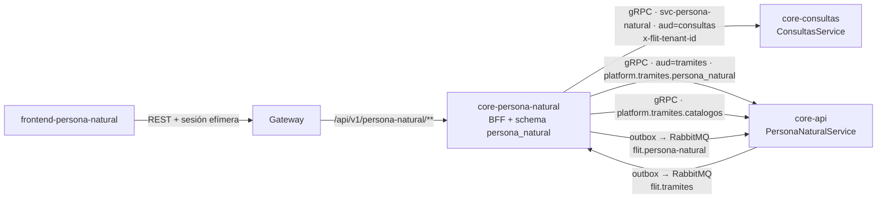
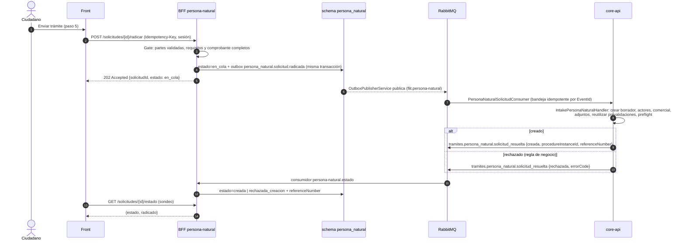
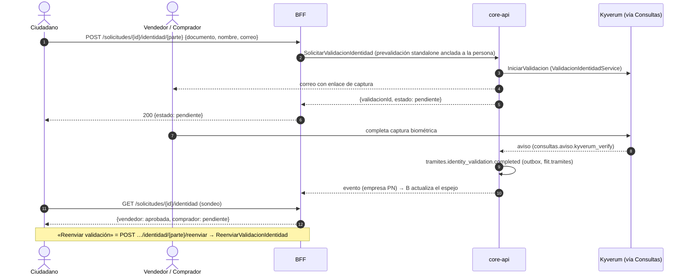

# Portal Persona Natural — arquitectura y contratos

> Estado: **Propuesto** · Fecha: 2026-10-27 · ADR: [ADR-0075](../../services/core-api/docs/adr/ADR-0075-portal-persona-natural-bff-y-fachada-grpc.md)
> Épica y borradores de HU: [`docs/ado-drafts/epic-persona-natural/`](../ado-drafts/epic-persona-natural/README.md)
> Diseño de UI: `docs/design/PERSONA-NATURAL-ui-fiel-al-repo.md`
>
> Todo lo que aquí se cita como existente se verificó en el código de `develop` el 2026-10-27. Lo que **no** existe
> está marcado **(nuevo)**. Lo que no pude verificar está en §12 «Huecos y contradicciones».

## 1. Alcance y decisiones

Un ciudadano (persona natural) radica **cualquier tipo de trámite que FLIT 2 declare disponible para persona natural**
desde un portal propio, **sin cuenta**; el trámite queda **creado en FLIT 2** bajo la empresa «Persona Natural» y el
organismo de tránsito que él eligió. Termina ahí: el ciudadano sigue su estado desde el portal. El **traspaso**
(`TRASPASO_STANDARD`) es el **piloto**: es el único wizard diseñado en el repo de UI. El supuesto S3 «solo traspaso»
queda **anulado** por decisión del PO (2026-10-27).

| # | Decisión | Origen |
|---|---|---|
| D1 | Front y back propios (`frontend-persona-natural` + `core-persona-natural`); el front solo habla con su back | PO |
| D2 | Consultas (vehículo, conductor) e identidad las ejecuta FLIT 2; el BFF las reenvía por **endpoints propios**, no proxy genérico | PO |
| D3 | Consultas con enfoque **mixto**: dato mínimo para cualquiera; detalle solo dentro de un trámite y con actores validados | PO |
| D4 | **Sin cuenta**: identidad por trámite y por persona (enlace de validación); sesión efímera por trámite; reanudar/consultar exige radicado **+** cédula | PO |
| D5 | Escrituras por **cola** (outbox + RabbitMQ, `202`, idempotencia); consultas **en línea** | PO |
| D6 | Supuestos: S1 pago validado por operador FLIT · ~~S2 front en su repo~~ **(anulado: el front va en el monorepo como `frontend-personanatural`)** · ~~S3 solo traspaso~~ **(anulado, ver D7)** · S4 Dr. FLIT simulado | README de la épica |
| D7 | **Cualquier tipo de trámite elegible**: wizard dinámico dirigido por la **definición del tipo** que expone FLIT 2; elegibilidad por **lista blanca explícita** (Feature J); el portal no codifica reglas de un tipo; piloto `TRASPASO_STANDARD` | PO (2026-10-27) |

## 2. Componentes y estructura de carpetas

```text
services/
  core-persona-natural/                          (nuevo; base: services/core-plantilla + estructura de core-ict)
    Flit.PersonaNatural.slnx
    Directory.Build.props · Directory.Packages.props · global.json · Dockerfile
    src/
      Flit.PersonaNatural.Api/                   REST público del BFF, Program.cs, ServicioSettings, health
        Endpoints/                               un archivo por grupo de rutas (Sesiones, Consultas, Cotizaciones,
                                                 Solicitudes, Identidad, Adjuntos, Radicados)
        Seguridad/                               captcha, límites, sesión efímera, cabeceras
      Flit.PersonaNatural.Application/           casos de uso (handlers); no conocen REST ni gRPC
        Tipos/                                   catálogo y definición de tipos (caché por código+organismo+versión);
                                                 sin lógica de ningún tipo concreto
      Flit.PersonaNatural.Domain/                Solicitud, PersonaSolicitante, Adjunto, EstadoSolicitud
      Flit.PersonaNatural.Infrastructure/        PersonaNaturalDb (EF), Migrations, clientes gRPC (Consultas,
                                                 Tramites), almacenamiento de adjuntos, outbox/inbox del SDK
      Flit.PersonaNatural.Grpc.Contracts/        proyecto que genera C# desde contracts/proto (como Flit.Plantilla.Grpc.Contracts)
    tests/
      Flit.PersonaNatural.Tests/                 unitarias + de contrato; ServicioHostTests como en la plantilla

services/core-api/src/                           (se EXTIENDE; no cambia ICT)
  Flit.Api/Grpc/PersonaNaturalGrpcService.cs                     (nuevo) adaptador delgado: identidad, estado, cotización, preflight
  Flit.Api/Hosting/ApiEndpoints.cs                               + app.MapGrpcService<PersonaNaturalGrpcService>()
                                                                   .RequireAuthorization(<política de servicio persona_natural>)
  Flit.Tramites.Application/UseCases/PersonaNatural/             (nuevo) IntakePersonaNaturalHandler (compartido gRPC/consumidor)
                                                                   + ObtenerDefinicionTipoTramiteHandler (compone
                                                                   GetProcedureTypeConfigurationHandler,
                                                                   PreviewDocumentosInformativosHandler,
                                                                   ProcedureTypeGateProfile; sin reglas nuevas)
  Flit.Infrastructure/Messaging/PersonaNaturalSolicitudConsumer.cs (nuevo) AddFlitConsumer sobre la bandeja de FlitDbContext
  Flit.Infrastructure/Migrations/                                (nuevo) vínculo cliente↔empresa (ver §6.2), con Designer.cs
  Flit.Platform.Sdk/Identity/OidcDefaults.cs                     + ["platform.tramites.persona_natural"] = ServiceAudiences.Tramites

contracts/
  proto/flit/tramites/v1/persona_natural.proto                   (nuevo) PersonaNaturalService — lo atiende core-api
  asyncapi/persona-natural-events.v1.yaml                        (nuevo) exchange flit.persona-natural (productor: el BFF)
  asyncapi/tramites-events.v1.yaml                               + tramites.persona_natural.solicitud_resuelta (aditivo)
  openapi/persona-natural.v1.yaml                                (nuevo) REST público del BFF

frontend-personanatural/                                        (app Next.js del portal, patrón de frontend-comparendos; workspace `frontend-*`;
                                                                  el diseño se porta desde el repo de referencia `transfer-step-trail`)
```

Notas de estructura:

- **El `.proto` va en `contracts/proto/flit/tramites/v1/`**, no en `contracts/proto/persona_natural.proto`: la
  convención de `contracts/proto/README.md` es una carpeta por **servicio que atiende** (`core-api` ya atiende
  `flit.tramites.v1.CatalogosService`). `buf lint` STANDARD exige paquete = carpeta.
- Application/Domain/Infrastructure siguen la partición de `core-ict`; `core-plantilla` solo trae `Api` y
  `Grpc.Contracts`.
- Fila nueva en la tabla «Código C#» de `contracts/proto/README.md` y bloque en `docker-compose.prod.yml` con perfil
  propio (`docs/suite/servicio-nuevo.md` §2–§7).
- Puertos propuestos, por confirmar con el líder (`docs/despliegue-y-puertos.md` §2.d): REST interno
  **4029/5029/6029** y gRPC de salud **8087**. 4026–4028 y 4030 están ocupados (consultas, notificaciones,
  comparendos, migración); 8084–8086 también.

### 2.1 Mapa de llamadas



## 3. Autenticación, empresa y vínculo

| Tramo | Mecanismo |
|---|---|
| Ciudadano → BFF | Anónimo + captcha; luego **token de sesión de trámite** (§7). Sin cuentas |
| BFF → Consultas | Token de servicio `svc-persona-natural`, `aud=consultas`, scope `platform.consultas`; `x-flit-tenant-id` = empresa «Persona Natural» |
| BFF → core-api (fachada) | Token de servicio, `aud=tramites`, scope **nuevo** `platform.tramites.persona_natural`; `x-flit-tenant-id` obligatoria |
| BFF → core-api (organismos) | Mismo token con scope `platform.tramites.catalogos` (catálogo global; la empresa no se usa) |
| core-api ↔ BFF (eventos) | Bus: usuario de broker propio por servicio (`deploy/rabbitmq/usuario-de-servicio.sh`) |

- Los tokens salen de `ServiceTokenProvider` (SDK) con `Platform:ServiceClient`; la validación del lado servidor es
  `PlatformServiceCallInterceptor` (`RequireServiceToken<PersonaNaturalGrpcService>(scope, "tramites")`).
- **Empresa «Persona Natural»**: fila real de `admin.companies` (la crea el SuperAdmin; HU H1/H2). Su id llega al BFF
  por `PersonaNatural:TenantId`. **No** usa `PlatformTenants.Plataforma` (`00000000-0000-0000-0000-0000000f1170`):
  esa no existe como fila y es para trabajo de la plataforma, no de una empresa cliente.
- **Vínculo cliente↔empresa**: `PlatformServiceCallInterceptor.Validate` solo comprueba firma, audiencia, scope y
  que `x-flit-tenant-id` sea un UUID; **no** liga el `ClientId` a esa empresa. Por eso la fachada y el consumidor
  deben leer `PlatformServiceCaller.From(context)` y rechazar (`PERMISSION_DENIED`) si
  `ClientId != svc-persona-natural` o `TenantId` no es la empresa registrada para esa integración.

## 4. Secuencias

### 4.1 Crear el trámite por cola (escritura)



Idempotencia en las tres capas: `Idempotency-Key` (BFF), `EventId` (bandeja del SDK en `core-api`) y
`external_ref = solicitud_id` (índice único parcial `(tenant_id, external_ref)` en trámites, como ya hace
`CreateDraftFromIct`).

### 4.2 Consulta en línea (lectura)

```mermaid
sequenceDiagram
  autonumber
  actor C as Ciudadano
  participant F as Front
  participant B as BFF
  participant Q as core-consultas
  C->>F: Diagnóstico: placa + cédula del propietario
  F->>B: POST /consultas/vehiculo {placa, propietario, consentimiento, captcha}
  B->>B: captcha, límite IP/cédula, tope global
  B->>Q: ConsultarVehiculo (x-flit-tenant-id=PN, referencia=solicitudId)
  Q-->>B: ResultadoConsulta (campos + chequeos; desde caché o RUNT)
  B->>B: proyectar a DATO MÍNIMO (lista blanca, §8)
  B-->>F: 200 {existe, clase, marca, ..., restricciones}
  Note over B,Q: Un proveedor caído NO es error gRPC: llega un chequeo en ERROR.<br/>El BFF lo traduce a 503 proveedor_no_disponible.
```

### 4.3 Validación de identidad de una parte



### 4.4 Reanudar con radicado + cédula

```mermaid
sequenceDiagram
  autonumber
  actor C as Ciudadano
  participant B as BFF
  participant DB as persona_natural
  C->>B: POST /sesiones/reanudar {radicado, cedula, captcha}
  B->>B: límite por IP y por radicado; respuesta de tiempo constante
  B->>DB: busca solicitud por radicado y compara hash(cedula) con el de la solicitud
  alt coincide
    B->>DB: crea sesion_tramite (hash del token, expira)
    B-->>C: 200 {token, solicitudId, estado}
  else no coincide o no existe
    B-->>C: 404 solicitud_no_encontrada (mismo cuerpo en ambos casos)
  end
```

El mismo par (radicado + cédula) abre `POST /radicados/consulta` para ver solo el estado sin crear sesión.

### 4.5 Estado de vuelta

```mermaid
sequenceDiagram
  autonumber
  participant A as core-api
  participant MQ as RabbitMQ (flit.tramites)
  participant B as BFF
  participant DB as persona_natural
  A->>MQ: tramites.procedure.state_changed {procedureInstanceId, from, to, reason}
  MQ->>B: cola persona-natural.estado
  B->>B: descarta si envelope.tenantId ≠ empresa PN o si no conoce el trámite
  B->>DB: actualiza estado_tramite + historial; bandeja registra EventId
  opt to = rechazado
    B->>A: ObtenerEstadoTramite (¿subsanación activa? motivo)
    B->>DB: guarda subsanacion_activa y motivo
  end
  Note over B: La subsanación no es un estado: es un indicador sobre «rechazado»<br/>y el evento no lo trae → se lee por gRPC.
```

### 4.6 Definición del tipo y render dinámico del wizard (propuesta; reemplaza al wizard fijo de traspaso)

```mermaid
sequenceDiagram
  autonumber
  actor C as Ciudadano
  participant F as Front (registro de renderers)
  participant B as BFF persona-natural
  participant A as core-api (PersonaNaturalService)
  C->>F: abre la landing / elige «Tipo de trámite»
  F->>B: GET /tipos-tramite
  B->>A: ListarTiposDisponibles (caché corta en el BFF)
  A-->>B: [{code, name, family, version, disponible_pn, motivo_no_disponible}]
  B-->>F: lista; los no disponibles llegan con motivo («Próximamente»)
  C->>F: elige un tipo disponible + organismo
  F->>B: GET /tipos-tramite/{code}/definicion?organismoId=…
  B->>A: ObtenerDefinicionTipoTramite(code, organismo_id)
  A->>A: compone configuración (pasos/secciones/campos), matriz documental<br/>(precedencia OT > Default) y gate_profile; aplica lista blanca (HU-J2)
  A-->>B: DefinicionTipoTramite {version, pasos[], actores[], documentos[], flags}
  B->>B: valida: disponible_pn y TODO section_type conocido; si no → tipo_no_disponible
  B-->>F: definición
  C->>F: Iniciar
  F->>B: POST /sesiones {tipo, organismo, cédula, …}
  B->>B: guarda tipo_tramite_codigo + definicion_version + definicion_snapshot
  loop por cada paso de la definición
    F->>F: registro de renderers: section_type → tarjeta (consulta, actores, documentos, prenda, identidad, genérico)
    C->>F: completa campos / actores / adjuntos
    F->>B: PATCH …/solicitudes/{id}/(campos|actores|comercial|adjuntos) validados contra el snapshot
  end
  C->>F: Pago → Enviar (pasos propios del portal)
  F->>B: POST /solicitudes/{id}/radicar (Idempotency-Key)
  B->>A: (por cola) solicitud.radicada con definicionVersion
  A->>A: revalida contra la versión vigente; si incompatible → resuelta=rechazada, errorCode=definicion_obsoleta
```

Notas: la definición **no** viaja al front con reglas ejecutables, solo con estructura (pasos, campos, roles, documentos,
flags). Toda regla condicional se evalúa en servidor (`EvaluarRequisitos`, preflight y el consumidor).

## 5. Modelo de datos — schema `persona_natural` (referencia, sin número de migración)

Dueño: `core-persona-natural`, usuario de base propio (`deploy/postgres/servicio-con-esquema-propio.sql`). Las
migraciones EF se aplican al arrancar **solo si** cada una trae `Designer.cs` o los atributos `[DbContext]` y
`[Migration]` inline; si no, no corren (causó `gate_profile does not exist`).

```sql
-- DDL de REFERENCIA. El número real de migración lo asigna el líder. Convención de la casa: snake_case,
-- uuid v7 en la aplicación, timestamptz, row_version para concurrencia.
CREATE SCHEMA IF NOT EXISTS persona_natural;

-- Una solicitud = un trámite del ciudadano (borrador local hasta radicar).
CREATE TABLE persona_natural.solicitud_tramite (
  id                       uuid PRIMARY KEY,
  tenant_id                uuid NOT NULL,                 -- empresa «Persona Natural» (config)
  codigo_publico           text NOT NULL UNIQUE,          -- radicado visible antes de FLIT 2 (p. ej. PN-2026-000123)
  tipo_tramite_codigo      text NOT NULL,                 -- code de tramites.procedure_types (p. ej. TRASPASO_STANDARD);
                                                          -- sin CHECK ni lista en la tabla: la elegibilidad la dicta FLIT 2
  definicion_version       integer NOT NULL,              -- tramites.procedure_types.version al abrir la sesión
  definicion_snapshot      jsonb NOT NULL,                -- DefinicionTipoTramite resuelta (pasos, campos, roles, documentos, flags);
                                                          -- el borrador se pinta y valida contra esto, no contra la versión viva
  organismo_id             uuid NOT NULL,                 -- catalogs.transit_offices (vía CatalogosService)
  organismo_nombre         text NOT NULL,
  placa                    text NULL,                     -- NULL cuando entryMode del tipo es VIN (o la placa aún no existe)
  vin                      text NULL,                     -- dato del vehículo, no PII del ciudadano; exige al menos placa o vin
  estado                   text NOT NULL,                 -- ver EstadoSolicitud (§5.1)
  cedula_solicitante_hash  bytea NOT NULL,                -- HMAC(cédula) para reanudar; no es la cédula
  field_values             jsonb NOT NULL DEFAULT '{}',   -- form_fields del tipo por field_key (validados contra el snapshot)
  datos                    jsonb NOT NULL DEFAULT '{}',   -- bloques comerciales si el tipo los pide: comercial, prenda,
                                                          -- transformaciones, observaciones
  procedure_instance_id    uuid NULL,                     -- id del trámite en FLIT 2 una vez creado
  reference_number         text NULL,                     -- radicado de FLIT 2
  estado_tramite           text NULL,                     -- espejo del vocabulario de FLIT 2
  subsanacion_activa       boolean NOT NULL DEFAULT false,
  subsanacion_motivo       text NULL,
  idempotency_key          text NULL,
  correlation_id           uuid NOT NULL,
  expira_borrador_en       timestamptz NULL,              -- retención de borradores abandonados
  created_at               timestamptz NOT NULL DEFAULT now(),
  updated_at               timestamptz NOT NULL DEFAULT now(),
  row_version              bigint NOT NULL DEFAULT 1,
  CONSTRAINT ck_solicitud_estado CHECK (estado IN
    ('borrador','pendiente_validacion','en_cola','creada','rechazada_creacion','cancelada')),
  CONSTRAINT ck_solicitud_vehiculo CHECK (placa IS NOT NULL OR vin IS NOT NULL),
  CONSTRAINT uq_solicitud_idem UNIQUE (tenant_id, idempotency_key)
);
CREATE INDEX ix_solicitud_tipo ON persona_natural.solicitud_tramite (tipo_tramite_codigo, definicion_version);

-- PII del portal, aislada y cifrada a nivel de columna (AES-GCM en la aplicación; llave por entorno).
CREATE TABLE persona_natural.persona_solicitante (
  id                uuid PRIMARY KEY,
  solicitud_id      uuid NOT NULL REFERENCES persona_natural.solicitud_tramite(id),
  parte             text NOT NULL,                        -- rol del actor según la definición del tipo
                                                          -- (vendedor | comprador | titular | propietario | locatario | acreedor…);
                                                          -- sin CHECK: los roles válidos salen del snapshot
  ordinal           smallint NOT NULL DEFAULT 1,          -- copropietarios (hasta 4, ADR-0053; el máximo real lo fija
                                                          -- el rol en la definición)
  tipo_documento    text NOT NULL,
  documento_cifrado bytea NOT NULL,                       -- @pii:high
  documento_hash    bytea NOT NULL,                       -- HMAC para buscar sin descifrar
  nombre_cifrado    bytea NULL,                           -- @pii:high
  correo_cifrado    bytea NULL,                           -- @pii:high
  celular_cifrado   bytea NULL,                           -- @pii:high
  direccion_cifrada bytea NULL,                           -- @pii:high
  validacion_id     uuid NULL,                            -- prevalidación en FLIT 2
  validacion_estado text NOT NULL DEFAULT 'sin_solicitar',-- sin_solicitar|pendiente|aprobada|rechazada|vencida
  validacion_vigente_hasta timestamptz NULL,  -- reservado: el portal no usa vigencia (decisión del PO, 2026-10-27); queda NULL
  created_at timestamptz NOT NULL DEFAULT now(), updated_at timestamptz NOT NULL DEFAULT now(),
  UNIQUE (solicitud_id, parte, ordinal)
);

CREATE TABLE persona_natural.adjunto (
  id uuid PRIMARY KEY,
  solicitud_id uuid NOT NULL REFERENCES persona_natural.solicitud_tramite(id),
  tipo text NOT NULL,                                     -- prenda|impronta|documento|comprobante_pago|paz_salvo
  nombre_archivo text NOT NULL, mime_type text NOT NULL, tamano_bytes bigint NOT NULL,
  sha256 text NOT NULL, storage_path text NOT NULL,       -- referencia opaca al almacenamiento
  created_at timestamptz NOT NULL DEFAULT now()
);

-- Sesión efímera por trámite (sin cuenta). Se guarda solo el hash del token.
CREATE TABLE persona_natural.sesion_tramite (
  id uuid PRIMARY KEY,
  solicitud_id uuid NOT NULL REFERENCES persona_natural.solicitud_tramite(id),
  token_hash bytea NOT NULL UNIQUE,
  ip_hash bytea NULL,
  expira_en timestamptz NOT NULL, revocada boolean NOT NULL DEFAULT false,
  created_at timestamptz NOT NULL DEFAULT now()
);

-- Contador diario para límites por cédula/IP/empresa. Persistente para sobrevivir reinicios.
CREATE TABLE persona_natural.cuota_consulta (
  clave text NOT NULL,            -- 'cedula:<hash>' | 'ip:<hash>' | 'global'
  dia date NOT NULL, usadas int NOT NULL DEFAULT 0,
  PRIMARY KEY (clave, dia)
);

CREATE TABLE persona_natural.consentimiento (
  id uuid PRIMARY KEY, solicitud_id uuid NULL, documento_hash bytea NOT NULL,
  texto_version text NOT NULL, aceptado_en timestamptz NOT NULL, ip_hash bytea NULL
);

CREATE TABLE persona_natural.historial_estado (
  id uuid PRIMARY KEY, solicitud_id uuid NOT NULL REFERENCES persona_natural.solicitud_tramite(id),
  desde text NULL, hasta text NOT NULL, origen text NOT NULL,  -- bff | flit2
  motivo text NULL, event_id uuid NULL, ocurrio_en timestamptz NOT NULL
);

-- Auditoría de acceso a PII (solo inserción, sin FK ni triggers, como integrations.external_access_log, ADR-0067).
CREATE TABLE persona_natural.acceso_pii_log (
  id bigserial PRIMARY KEY, ocurrio_en timestamptz NOT NULL DEFAULT now(),
  actor text NOT NULL, accion text NOT NULL, solicitud_id uuid NULL, ip_hash bytea NULL
);

-- SDK de plataforma: outbox + bandeja (AddFlitOutbox / AddFlitInbox("persona_natural")).
```

### 5.1 Estados

`EstadoSolicitud` (BFF): `borrador → pendiente_validacion → en_cola → creada | rechazada_creacion`; `cancelada` desde
cualquier estado previo a `en_cola`. `estado_tramite` copia el vocabulario de FLIT 2 (`borrador`, `preparado`,
`preasignacion`, `asignado`, `entregado`, `aprobado`, `rechazado`, `anulado`, `revocado`).

Mapa a los macro-estados del front (`MACRO_ESTADOS` en `src/lib/b2c-demo.ts`; **propuesta**, el PO debe confirmarla):

| Macro-estado del front | Condición |
|---|---|
| Pendiente de Validación | `estado` ∈ {borrador, pendiente_validacion, en_cola} o `estado_tramite` ∈ {borrador, preparado} |
| En Revisión OT | `estado_tramite` ∈ {preasignacion, asignado, entregado} |
| Subsanación | `estado_tramite = rechazado` (la subsanación reabre la edición sin cambiar el estado) |
| Finalizado | `estado_tramite` ∈ {aprobado, anulado, revocado}; `aprobado` puede pasar a `revocado` |

## 6. Contratos

### 6.1 REST del BFF — `contracts/openapi/persona-natural.v1.yaml` (catálogo cerrado)

Base `/api/v1/persona-natural` por el Gateway. JSON camelCase. Errores `application/problem+json` (§9). Ningún
endpoint reenvía a FLIT 2 de forma genérica.

**Públicos (sin sesión; captcha + límites):**

| Método y ruta | Para qué | Notas |
|---|---|---|
| `GET /organismos` | Organismos de tránsito (select con buscador) | `CatalogosService.ListarOrganismosTransito`; caché en el BFF |
| `GET /tipos-tramite` | Tipos de trámite del portal: `code`, `name`, `family`, `version`, `disponible`, `motivoNoDisponible` | **Propuesta.** Sale de `ListarTiposDisponibles`; los no disponibles viajan con motivo para mostrarse «Próximamente». Sustituye al catálogo fijo de siete nombres; mapeo de nombres en §6.5 |
| `GET /tipos-tramite/{code}/definicion` | Estructura del wizard del tipo: `pasos[]`, `actores[]`, `documentos[]`, `flags`, `version` | **Propuesta.** Query `organismoId` (la matriz documental depende del organismo). `404 tipo_no_disponible` si no es elegible o tiene un `section_type` que el portal no pinta. Caché por `(code, organismoId, version)` |
| `POST /cotizaciones` | Cotización: organismo + tipo → tabla de 2 líneas | Tarifas: ver §12 hueco 4 |
| `POST /cotizaciones/enviar-correo` | Envía la cotización por correo | Límite estricto por correo |
| `POST /consultas/vehiculo` | Diagnóstico por placa + cédula del propietario | Dato mínimo (§8) |
| `POST /consultas/persona` | Existencia de una persona por documento | Dato mínimo; nombre enmascarado |
| `POST /radicados/consulta` | Estado por radicado + cédula | Sin sesión; solo estado |
| `POST /sesiones` | Inicia un trámite: cédula, placa o VIN (según `entryMode` del tipo), `tipo` (code), organismo, consentimiento | Crea solicitud en `borrador`, guarda `definicion_version` + snapshot, devuelve token. `tipo_no_disponible` si el tipo ya no es elegible |
| `POST /sesiones/reanudar` | «Iniciar más tarde»: radicado + cédula | §4.4 |

**Con sesión de trámite (`Authorization: Bearer <token de sesión>`, ligado a una solicitud):**

| Método y ruta | Para qué |
|---|---|
| `GET /solicitudes/{id}` | Estado completo del borrador (para rehidratar el wizard) |
| `PATCH /solicitudes/{id}/actores` | Actores **por rol** según la definición (`rol`, `ordinal`, documento, contacto, dirección); rechaza roles o cantidades fuera de `min`/`max` |
| `PUT /solicitudes/{id}/campos` | **(nuevo)** `field_values` de los campos del tipo por `field_key`, validados contra el snapshot |
| `PUT /solicitudes/{id}/comercial` | Valor comercial, prenda, acreedor — solo si los `flags` del tipo lo piden |
| `PUT /solicitudes/{id}/requisitos` | Transformaciones y observaciones — transformaciones solo si `permite_transformaciones` |
| `POST /solicitudes/{id}/diagnostico` | Preflight de requisitos previos |
| `POST /solicitudes/{id}/adjuntos` | Sube un adjunto (multipart, ≤ 20 MB; PDF/JPG/PNG/WEBP) |
| `DELETE /solicitudes/{id}/adjuntos/{adjuntoId}` | Quita un adjunto mientras no esté `en_cola` |
| `POST /solicitudes/{id}/identidad/{parte}` | Pide la validación de identidad de un actor (`parte` = rol del actor con `biometria=true` en la definición) |
| `POST /solicitudes/{id}/identidad/{parte}/reenviar` | Reenvía el enlace |
| `GET /solicitudes/{id}/identidad` | Estado de las validaciones |
| `GET /solicitudes/{id}/resumen-cobro` | Facturación y totales del paso Pago |
| `POST /solicitudes/{id}/pago/comprobante` | Comprobante de transferencia (S1) |
| `POST /solicitudes/{id}/radicar` | Escritura por cola; exige `Idempotency-Key`; responde `202` |
| `GET /solicitudes/{id}/estado` | Sondeo del estado y del radicado |
| `POST /solicitudes/{id}/subsanar` | Reenvía los cambios de una subsanación (por cola) |
| `DELETE /solicitudes/{id}` | Cancela el trámite antes de `en_cola` |

Cabeceras: `X-Captcha-Token` (públicos), `Idempotency-Key` (radicar, subsanar, enviar-correo), `X-Correlation-Id`
(opcional; el BFF genera uno y lo propaga a gRPC y eventos).

### 6.2 gRPC de la fachada — `contracts/proto/flit/tramites/v1/persona_natural.proto`

La empresa va en `x-flit-tenant-id` y la correlación en `x-correlation-id`/`traceparent` (ADR-0070); **no** en los
mensajes. **No hay `CrearTramite`**: las escrituras de trámite van solo por cola (D5). La fachada cubre lo que
debe ser síncrono.

```proto
syntax = "proto3";

package flit.tramites.v1;

import "google/protobuf/timestamp.proto";

option csharp_namespace = "Flit.Tramites.Grpc.V1";

// Fachada para el portal de persona natural (ADR-0075). Adaptador delgado sobre los casos de uso de Trámites.
// Autenticación: token de servicio `aud=tramites`, scope `platform.tramites.persona_natural`; empresa en
// `x-flit-tenant-id`. core-api rechaza si el cliente o la empresa no son los de la integración registrada.
service PersonaNaturalService {
  // Prevalidación de identidad anclada a la persona y a ESTA solicitud, usada al radicar. Nunca reutiliza una validación de
  // otro trámite ni tiene vigencia en días (decisión del PO, 2026-10-27): cada trámite pide una nueva. Idempotente por
  // (solicitud_id, parte, documento).
  rpc SolicitarValidacionIdentidad(SolicitarValidacionIdentidadRequest) returns (SolicitarValidacionIdentidadResponse);
  rpc ReenviarValidacionIdentidad(ReenviarValidacionIdentidadRequest) returns (ReenviarValidacionIdentidadResponse);
  rpc ObtenerEstadoValidacionIdentidad(ObtenerEstadoValidacionIdentidadRequest) returns (ObtenerEstadoValidacionIdentidadResponse);

  // Tipos de trámite que el portal puede ofrecer hoy (lista blanca de la HU-J2 ∧ publicado ∧ wizard_enabled).
  rpc ListarTiposDisponibles(ListarTiposDisponiblesRequest) returns (ListarTiposDisponiblesResponse);

  // Estructura del wizard de un tipo: pasos, campos, roles de actor, documentos y flags. Solo estructura, sin
  // reglas ejecutables. Compone GetProcedureTypeConfigurationHandler + PreviewDocumentosInformativosHandler +
  // ProcedureTypeGateProfile (sin reglas nuevas).
  rpc ObtenerDefinicionTipoTramite(ObtenerDefinicionTipoTramiteRequest) returns (DefinicionTipoTramite);

  // Requisitos previos del tipo (preflight) sin crear el trámite.
  rpc EvaluarRequisitos(EvaluarRequisitosRequest) returns (EvaluarRequisitosResponse);

  // Tarifas del organismo y del servicio FLIT para el tipo de trámite (cotización y resumen de cobro).
  rpc Cotizar(CotizarRequest) returns (CotizarResponse);

  // Estado actual del trámite creado a partir de la solicitud (conciliación y subsanación).
  rpc ObtenerEstadoTramite(ObtenerEstadoTramiteRequest) returns (ObtenerEstadoTramiteResponse);
}

message PersonaIdentidad {
  string tipo_documento = 1;     // CC, CE, PAS...
  string numero_documento = 2;
  string nombre = 3;
  string correo = 4;
  string celular = 5;
}

message SolicitarValidacionIdentidadRequest {
  string solicitud_id = 1;       // external_ref; correlaciona el aviso del proveedor
  string parte = 2;              // vendedor | comprador
  PersonaIdentidad persona = 3;
}
message SolicitarValidacionIdentidadResponse {
  string validacion_id = 1;
  string estado = 2;             // pendiente | aprobada (vigente reutilizada) | rechazada
  google.protobuf.Timestamp vigente_hasta = 3;
}

message ReenviarValidacionIdentidadRequest { string validacion_id = 1; string correo = 2; }   // correo nuevo opcional
message ReenviarValidacionIdentidadResponse { string estado = 1; google.protobuf.Timestamp expira = 2; }

message ObtenerEstadoValidacionIdentidadRequest { string validacion_id = 1; }
message ObtenerEstadoValidacionIdentidadResponse {
  string estado = 1;             // pendiente | aprobada | rechazada | vencida
  google.protobuf.Timestamp vigente_hasta = 2;
}

message ListarTiposDisponiblesRequest {}
message ListarTiposDisponiblesResponse { repeated TipoTramiteResumen tipos = 1; }
message TipoTramiteResumen {
  string codigo = 1;                       // tramites.procedure_types.code
  string nombre = 2;
  string familia = 3;                      // MATRICULAS | TRASPASO | OTROS
  int32 version = 4;                       // tramites.procedure_types.version
  bool disponible_pn = 5;
  string motivo_no_disponible = 6;         // vacío si disponible; p. ej. «requiere Cámara de Comercio», «sin tarifa vigente»
}

message ObtenerDefinicionTipoTramiteRequest {
  string codigo = 1;
  string organismo_id = 2;                 // la matriz documental se resuelve con precedencia OT > Default
}

// Solo estructura. El `gate_profile` no sale entero: se proyectan los flags que el portal necesita.
message DefinicionTipoTramite {
  string codigo = 1;
  string nombre = 2;
  string familia = 3;
  int32 version = 4;
  bool disponible_pn = 5;
  string motivo_no_disponible = 6;
  repeated Paso pasos = 7;
  repeated ActorRol actores = 8;
  repeated DocumentoRequerido documentos = 9;
  FlagsTipo flags = 10;
}
message Paso {
  string clave = 1;                        // procedure_steps.key
  string titulo = 2;
  repeated string section_types = 3;       // consulta | documentos | actores | prenda | identidad | fur | generico (ver UI §12)
  repeated Campo campos = 4;               // form_fields de las secciones de tipo generico
}
message Campo {
  string field_key = 1;
  string etiqueta = 2;
  string tipo = 3;                         // text | number | select | date | textarea | checkbox …
  bool obligatorio = 4;
  repeated string opciones = 5;
  string validation_schema = 6;            // JSON del esquema de validación existente, tal cual
}
message ActorRol {
  string rol = 1;                          // vendedor | comprador | titular | propietario | locatario | acreedor …
  string etiqueta = 2;
  int32 min = 3;                           // DERIVADO de requiresX (1) / ausente (0) — la definición no trae min/max
  int32 max = 4;                           // DERIVADO de allowsMultipleX (tope ADR-0053) — propuesta, ver §12 hueco 16
  bool biometria = 5;                      // biometricActors
  bool firma = 6;                          // signatureActors
  bool persona_natural_permitida = 7;
}
message DocumentoRequerido {
  string doc_code = 1;
  string nombre = 2;
  bool obligatorio = 3;
  int32 orden = 4;
  string instruccion_cargue = 5;
  string condicion = 6;                    // texto de la regla condicional ya resuelta en servidor (p. ej. «si hay prenda»); no ejecutable
}
message FlagsTipo {
  string entry_mode = 1;                   // VIN | PLATE | BOTH
  bool requiere_comercial = 2;
  bool requiere_prenda = 3;                // hasPrendaGate
  bool permite_transformaciones = 4;       // allowsComplementaryTransformations
  bool permite_prenda_complementaria = 5;  // allowsComplementaryPrenda
  bool requiere_biometria = 6;
  bool requiere_solicitud_placa = 7;       // requiresPlateRequest (la placa sale después de la entrega)
}

message EvaluarRequisitosRequest {
  string tipo_tramite_codigo = 1;
  string placa = 2;
  string organismo_id = 3;
}
message EvaluarRequisitosResponse {
  repeated Requisito requisitos = 1;
  bool puede_continuar = 2;
}
message Requisito { string codigo = 1; string descripcion = 2; string estado = 3; /* cumple | falta | no_aplica */ }

message CotizarRequest { string tipo_tramite_codigo = 1; string organismo_id = 2; }
message CotizarResponse {
  repeated LineaCobro lineas = 1;     // «Servicio de tránsito», «Servicio FLIT» (+ subtítulo)
  int64 total_cop = 2;
}
message LineaCobro { string codigo = 1; string nombre = 2; string subtitulo = 3; int64 valor_cop = 4; }

message ObtenerEstadoTramiteRequest { string solicitud_id = 1; }   // external_ref
message ObtenerEstadoTramiteResponse {
  bool encontrado = 1;
  string procedure_instance_id = 2;
  string reference_number = 3;
  string estado = 4;                 // vocabulario TramiteEstado
  bool subsanacion_activa = 5;
  string motivo_subsanacion = 6;
}
```

Errores: estado gRPC + `google.rpc.ErrorInfo` (`domain = "flitsas.com"`, `reason` = código estable del contrato §10
de plataforma, p. ej. `TOKEN_AUDIENCE_MISMATCH`, o de negocio como `VALIDACION_NO_ENCONTRADA`). Deadline de 3 s
propagado; reintentos solo en `UNAVAILABLE` y solo en métodos de lectura o idempotentes.

> La fachada **no** copia `IctOrchestrationService`: ese servicio usa el esquema HMAC `IctService`, `tenant_id` en el
> mensaje y vive en `core-ict/.../Protos`. El nuevo sigue ADR-0070.

### 6.3 Eventos — `contracts/asyncapi/persona-natural-events.v1.yaml`

Sobre común `contracts/asyncapi/comun/sobre.v1.yaml` (`eventId` UUIDv7, `type`, `version`, `occurredAt`, `tenantId`,
`producer`, `correlationId`, `data`). Exchange del productor `flit.<producer>`; cola `<consumidor>.<propósito>`.

| Evento (`type`) | Productor / exchange | Consumidor / cola | `data` |
|---|---|---|---|
| `persona-natural.solicitud.radicada` v1 | BFF / `flit.persona-natural` | core-api / `tramites.persona-natural` | `solicitudId`, `codigoPublico`, `tipoTramiteCodigo`, `definicionVersion`, `organismoId`, `placa`/`vin`, `fieldValues`, `actores[]` (`rol`, `ordinal`, tipo, documento, nombre, correo, celular, dirección, `validacionId`), `comercial`, `datos`, `adjuntos[]` (`tipo`, `nombre`, `mimeType`, `sizeBytes`, `sha256`, `storagePath`), `pago` (S1) |
| `persona-natural.solicitud.subsanada` v1 | BFF / `flit.persona-natural` | core-api / `tramites.persona-natural` | `solicitudId`, `procedureInstanceId`, cambios (mismas estructuras) |
| `tramites.persona_natural.solicitud_resuelta` v1 **(aditivo en `tramites-events.v1.yaml`)** | core-api / `flit.tramites` | BFF / `persona-natural.estado` | `solicitudId`, `resultado` (`creada`\|`rechazada`), `procedureInstanceId`, `referenceNumber`, `errorCode`, `errorDetalle` |
| `tramites.procedure.state_changed` v1 **(existe)** | core-api / `flit.tramites` | BFF / `persona-natural.estado` | `procedureInstanceId`, `fromStatus`, `toStatus`, `reason` |
| `tramites.identity_validation.completed` v1 **(existe)** | core-api / `flit.tramites` | BFF / `persona-natural.estado` | `validationId`, `provider`, resultado |

Reglas del consumidor del BFF: ignora todo mensaje cuyo `tenantId` no sea la empresa «Persona Natural»; ignora
trámites que no conoce (`procedure_instance_id` ausente en `solicitud_tramite`); la bandeja (`AddFlitInbox`)
descarta duplicados por `EventId`. Reintentos del SDK 10 s / 1 min / 10 min y luego `<cola>.dlq`.

`Tramites:Bus:Habilitado` debe estar activo en el ambiente: es lo que publica al broker (si no, el outbox de trámites
no sale).

### 6.4 Definición dinámica y regla de elegibilidad

**Hecho verificado (investigación 2026-10-27).** FLIT 2 ya modela cada tipo así: `procedure_steps` → `procedure_sections`
(con `section_type`) → `form_fields`; `procedure_document_requirements` (matriz con precedencia OT > Default);
`conformation_rules`; y `gate_profile` (flags de actores, comercial, biometría, prenda, transformaciones, entrada por
VIN/placa, origen del organismo). Hoy lo exponen `GET /api/v1/procedure-types/{code}/configuration` (**sin**
`gate_profile` ni documentos, y sin `AllowAnonymous` declarado), `wizard-preview` y
`document-requirements/preview` (por organismo). **No hay RPC de definición** en `CatalogosGrpcService`.

**Propuesta.** `ObtenerDefinicionTipoTramite` (§6.2) compone esos handlers en un solo DTO de estructura. Un tipo es
`disponible_pn = true` **si y solo si** se cumplen todas estas condiciones; la primera que falla se devuelve en
`motivo_no_disponible`:

| # | Condición | Quién la dicta |
|---|---|---|
| E1 | Publicado y con `wizard_enabled = true` | FLIT 2 (`tramites.procedure_types`) |
| E2 | Está en la **lista blanca de Persona Natural** | Superadministrador (HU-J2); la lista no se deduce |
| E3 | Todos los roles de actor admiten persona natural: sin NIT, sin Cámara de Comercio, sin mandato/tramitador, sin entidad financiera obligatoria (leasing) | Revisión al habilitar + `EvaluarRequisitos` en servidor |
| E4 | Sin verificación física de improntas, sin documentos externos por causal, sin dependencia de un operador (`transitOfficeSource = OPERATOR`) | Revisión al habilitar |
| E5 | Todo `section_type` de la definición tiene renderer en el portal | El BFF (registro de `section_type` conocidos) |
| E6 | Hay tarifa vigente para `(organismo, tipo)` | HU-J1 |

E3 y E4 **no se pueden verificar leyendo la definición** (viven en código, ver §12 hueco 15): por eso E2 es una lista
blanca humana y no una regla automática. Cada tipo que se habilite necesita una prueba de contrato (flujo completo con
sus documentos) antes de entrar en la lista.

### 6.5 Tipos reales de FLIT 2 y viabilidad para persona natural

> Columnas «Actores», «Documentos clave» y «`wizard_enabled` en el repo» son **hechos verificados** en los DDL del
> repo (`04`, `24`, `38`, `78`, `79`, `82`, `85`, `92`, `98` y `gate_profile`). «Viabilidad PN» es una **inferencia mía a
> partir de esas reglas**: **no existe un indicador «disponible para PN» declarado** y no se ha validado con el PO.
> `*` = documento obligatorio.

| Código | Familia | Actores | Documentos clave | `wizard_enabled` (repo) | Viabilidad PN (inferida) |
|---|---|---|---|---|---|
| `TRASPASO_STANDARD` | TRASPASO | vendedor + comprador (múltiples); biometría OWNER + BUYER | compraventa\*, soat\*, rtm\*, paz_salvo\*, cédulas\*, cert_tradicion | sí | **Piloto** (ADR-0075 y prototipo) |
| `TRASPASO_UNILATERAL` | TRASPASO | solo comprador/locatario | tarjeta_propiedad\*, doc_identidad\*, compraventa\* | sí | Condicionada: exige leasing (`contrato_leasing`, `declaracion_arrendadora`) |
| `TRASPASO_TRANSFERENCIA_DE_DOMINIO` | TRASPASO | vendedor y comprador | transferencia_dominio\* + identidades | no | Probable, por evaluar |
| `MATRICULA_NUEVA` | MATRICULAS | comprador; biometría BUYER; VIN; solicita placa | factura\*, aduana\*, impronta, soat, cert. ambiental | sí | **No viable** (aduana/factura de importador; placa después de la entrega) |
| `MATRICULA_LEASING` | MATRICULAS | comprador (entidad financiera) | contrato_leasing\*, factura\*, doc_identidad\* | no | **No viable** (el comprador es una entidad financiera) |
| `CANCELACION_MATRICULA` | MATRICULAS | titular (se persiste como comprador) | cert_tradicion\* + los de la causal | no | Condicionada: documentos por causal (DIJIN, aseguradora, juez) |
| `REMATRICULA` | MATRICULAS | titular | cert_tradicion\* | no (inactivo) | Sin evaluar (inactivo) |
| `CAMBIO_COLOR`, `CONVERSION_COMBUSTIBLE`, `CAMBIO_CARROCERIA`, `BLINDAJE` | OTROS | un titular (ActorType `comprador`) | tarjeta_propiedad\*, doc_identidad\*, soat, paz_salvo + propio del trámite | no | Probable (un titular persona natural); revisar transformaciones/improntas |
| `DUPLICADO_PLACA`, `DUPLICADO_TARJETA` | OTROS | un titular | tarjeta_propiedad\*, doc_identidad\* + propio | no | **Probable** (el más simple) |
| `REGRABAR_MOTOR_CHASIS` | OTROS | un titular | + impronta | no | Condicionada: verificación física de improntas |
| `RADICADO_CUENTA`, `TRASLADO_CUENTA` | OTROS | un titular | + propio | no | Condicionada: `transitOfficeSource = OPERATOR` |
| `LEVANTAMIENTO_PRENDA`, `PRENDA_INSCRIPCION`, `LEVANTAR_INSCRIBIR_PRENDA`, `CAMBIO_ACREEDOR` | OTROS | titular; `hasPrendaGate` | paz_salvo_prenda\*, inscripcion_prenda\* | no | Condicionada: acreedor suele ser entidad jurídica; gate de prenda en código |
| `CAMBIO_LOCATARIO` | OTROS | propietario + locatario (`requiresLessee`) | (seed 38) | no | Condicionada: locatario/leasing |

Lectura: en el repo **solo tres tipos tienen el wizard encendido** (`MATRICULA_NUEVA`, `TRASPASO_STANDARD`,
`TRASPASO_UNILATERAL`); en runtime puede haber más (ver ADR). Mapeo **propuesto** de los siete nombres del catálogo del
prototipo (`B2C_TRAMITES`) a códigos reales: Traspaso de vehículo usado → `TRASPASO_STANDARD`; Levantamiento de prenda →
`LEVANTAMIENTO_PRENDA`; Inscripción de prenda → `PRENDA_INSCRIPCION`; Conversión de combustible →
`CONVERSION_COMBUSTIBLE`; Duplicado de licencia de tránsito → `DUPLICADO_TARJETA`; Duplicado de placas →
`DUPLICADO_PLACA`; Cambio de color → `CAMBIO_COLOR`. El catálogo del portal deja de ser fijo: lo manda `GET /tipos-tramite`.

## 7. Sesión efímera por trámite (sin cuenta)

- **Emisión**: `POST /sesiones` (cédula, placa, tipo, organismo, consentimiento, captcha) crea la solicitud en
  `borrador` y un token opaco de 256 bits; se guarda `SHA-256(token)` en `sesion_tramite`. El token vive en memoria
  del front o en `sessionStorage`, no en `localStorage` ni en la URL.
- **Alcance**: el token solo abre **su** solicitud (`solicitud_id` fijo); rutas con otro id → `403`.
- **Vida**: expira a las 2 h sin actividad (renovación deslizante, tope absoluto 24 h); se revoca al cancelar o al
  radicar. Un borrador abandonado expira a los 30 días (`expira_borrador_en`) y un job periódico (estándar de jobs
  periódicos de FLIT) lo purga.
- **Reanudar** (`/sesiones/reanudar`) y consultar un radicado exigen **radicado + cédula**. Comparación contra
  `HMAC(cédula)`; respuesta idéntica y de tiempo constante si no existe o no coincide.
- **Recomendación (pendiente de decidir)**: un OTP al correo del solicitante en `/sesiones/reanudar`. La cédula es un
  dato semi-público y el radicado se comparte; un solo factor de conocimiento es débil para devolver un trámite con
  PII. Si no se adopta, el riesgo R4 de §11 queda aceptado explícitamente.

## 8. Política de dato mínimo

Aplica en el BFF, **después** de recibir el resultado de `core-consultas` (los `ResultadoConsulta` llegan como
`campos` genéricos por clave). La lista blanca vive en configuración versionada; todo lo que no esté en ella no sale.

| Nivel | Cuándo | Qué devuelve |
|---|---|---|
| **N0 — sin sesión** | `/consultas/vehiculo`, `/consultas/persona`, `/radicados/consulta` | Vehículo: `existe`, `clase`, `marca`, `linea`, `modeloAno`, `tipoServicio`, `estadoRegistro` (matriculado/otro), `tienePrenda` (bool), `tieneLimitacion` (bool). Persona: `encontrada`, `tipoDocumento`, `nombreEnmascarado`. Radicado: macro-estado, fechas, tracking por pasos |
| **N1 — con sesión, sin identidad validada** | Dentro de su solicitud | N0 + datos que el ciudadano ya escribió. **Nada** de terceros |
| **N2 — con sesión e identidad validada** | La parte validada es la que corresponde | Además: `vin`, `numeroMotor`, `numeroSerie`, `color`, `combustible`, `cilindraje`, detalle de prenda (acreedor), datos del trámite necesarios para el expediente |

**Nunca** sin validación: nombre completo, documento, dirección o contacto del propietario o de terceros;
comparendos; SOAT; valores de avalúo. Las solicitudes de consulta llevan `OpcionesConsulta.referencia =
solicitud_id` (trazabilidad) y `consentimiento_datos_personales = true` solo si el consentimiento quedó registrado.

Hechos del código real que limitan el diseño: `ConsultarVehiculo` por **placa exige el documento del propietario**
(`propietario` obligatorio); sin él solo se puede consultar por **VIN**. Eso ya frena la consulta libre de placas
ajenas: el comprador necesita los datos del vendedor, no la placa suelta. Con varios tipos, el diagnóstico por
documento del propietario aplica solo a tipos cuyo `entryMode` es `PLATE` o `BOTH`; los de entrada `VIN` consultan por
VIN (§6.5, hueco 22).

## 9. Errores — RFC 7807

`application/problem+json`, mismo formato que `/api/v1/external/*` (código estable en la extensión `code`):

```json
{ "type": "about:blank", "title": "solicitud_no_encontrada", "status": 404,
  "detail": "No encontramos un trámite con esos datos.", "code": "solicitud_no_encontrada",
  "correlationId": "…" }
```

| `code` | HTTP | Cuándo |
|---|---|---|
| `captcha_invalido` | 400 | Captcha ausente, vencido o inválido |
| `rate_limited` | 429 | Límite por IP/cédula/correo; `Retry-After` |
| `cuota_diaria_agotada` | 429 | Tope por cédula o global de consultas |
| `sesion_invalida` / `sesion_expirada` | 401 | Token ausente, desconocido o vencido |
| `solicitud_ajena` | 403 | El token no pertenece a esa solicitud |
| `solicitud_no_encontrada` | 404 | Radicado/cédula no coinciden (mismo cuerpo en ambos casos) |
| `estado_no_permite_cambio` | 409 | Editar o cancelar una solicitud `en_cola` o posterior |
| `identidad_pendiente` | 409 | Radicar sin ambas partes validadas |
| `tipo_no_disponible` | 404 | El tipo no es elegible, ya no lo es, o su definición tiene un `section_type` que el portal no pinta; el cuerpo incluye `motivo` |
| `definicion_obsoleta` | 409 | La definición del tipo cambió de forma incompatible entre abrir el borrador y radicar (también llega como `errorCode` de `solicitud_resuelta`) |
| `requisitos_incompletos` | 422 | Faltan datos o adjuntos; lista en `errors[]` |
| `adjunto_no_permitido` | 415 / 413 | Tipo no permitido o > 20 MB |
| `idempotency_key_requerida` | 400 | Falta la cabecera |
| `idempotency_conflicto` | 409 | Misma clave con otro cuerpo |
| `proveedor_no_disponible` | 503 | Chequeo en ERROR o `UNAVAILABLE` hacia FLIT 2; `Retry-After` |

## 10. Anti-abuso, Habeas Data e idempotencia

### 10.1 Anti-abuso
- **Captcha** en los endpoints públicos de consulta, `POST /sesiones`, `POST /sesiones/reanudar` y
  `POST /cotizaciones/enviar-correo`. Proveedor **por decidir** (Cloudflare Turnstile o hCaptcha); el BFF verifica
  el token en el servidor.
- **Límites** (valores iniciales, configurables por ambiente; los ajusta el líder):

| Clave | Límite inicial | Dónde |
|---|---|---|
| IP, consultas | 10/min · 100/día | Gateway (`RateLimitOptions`) y BFF |
| Cédula del propietario, consultas | 5/día | `cuota_consulta` (`cedula:<hash>`) |
| IP, `POST /sesiones/reanudar` | 5/min · 20/día | BFF |
| Radicado, intentos de reanudar | 5 fallidos → bloqueo 15 min | BFF |
| Correo, envíos de cotización | 3/día | BFF |
| **Tope global de consultas RUNT** de la empresa | `N`/día (según presupuesto) → `cuota_diaria_agotada` | `cuota_consulta` (`global`) + medición de Consultas |

- La **caché y la medición** son de Consultas (por empresa y por producto, según el token). `forzar_actualizacion`
  **nunca** se expone al ciudadano.
- Alerta cuando el consumo diario supere el 80 % del tope global.

### 10.2 Habeas Data (Ley 1581 de 2012)
- **Clasificación**: documento, nombre, correo, celular, dirección = `@pii:high`; IP = `@pii:medium` (solo hash).
- **Cifrado** a nivel de columna (AES-GCM, llave por entorno fuera de la base) + hash HMAC para buscar sin descifrar.
- **Minimización**: el BFF guarda solo lo que el wizard captura; no persiste el `ResultadoConsulta` crudo.
- **Consentimiento** registrado (`consentimiento`: versión del texto, fecha, IP hasheada) antes de la primera consulta
  de persona y antes de pedir identidad.
- **Retención (propuesta; pendiente de validación legal)**: borradores abandonados, 30 días; solicitudes resueltas,
  PII purgada a los 90 días de un estado final conservando hashes y trazas; adjuntos purgados con la PII.
- **Acceso a PII** (soporte, DBA) auditado en `acceso_pii_log`; los logs de aplicación nunca llevan documento, correo
  ni nombre (solo hashes).
- **Texto de consentimiento y política**: el repo del front dice «nunca inventar contenido legal»; el texto oficial
  lo provee el equipo legal. Bloqueante para PDN, como en la Épica #13202.

### 10.3 Idempotencia
- **BFF**: `Idempotency-Key` obligatoria en `radicar`, `subsanar` y `enviar-correo`; se guarda con huella del cuerpo
  (`uq_solicitud_idem`). Repetida con el mismo cuerpo → misma respuesta; con otro cuerpo → `idempotency_conflicto`.
- **Bus**: bandeja del SDK por `EventId` (UUIDv7) y por consumidor (`InboxMessage`).
- **FLIT 2**: `external_ref = solicitud_id` con índice único parcial `(tenant_id, external_ref)`; el consumidor
  responde con el mismo trámite si ya existe (patrón de `CreateDraftFromIct`).
- **Prevalidaciones**: idempotentes por `(solicitud_id, parte, documento)` dentro de la misma solicitud; **no se reutilizan entre trámites ni tienen vigencia** (decisión del PO, 2026-10-27): cada trámite vuelve a validar a cada parte.

## 11. Matriz de riesgos

| ID | Riesgo | Prob. | Impacto | Mitigación |
|---|---|---|---|---|
| R1 | Abuso de consultas RUNT (costo y enumeración) | Alta | Alto | Captcha, límites por IP/cédula, tope global, alerta al 80 %; `forzar_actualizacion` no expuesto |
| R2 | Fuga de PII por una consulta pública | Media | Alto | Dato mínimo con lista blanca en el BFF; nombre enmascarado; pruebas de contrato que rompen si salen campos nuevos |
| R3 | Token de servicio con el scope actúa por otra empresa | Media | Alto | Vínculo cliente↔empresa verificado en fachada y consumidor (§3) |
| R4 | Reanudar con radicado + cédula ajenos | Media | Medio | Respuesta uniforme, bloqueo por radicado, OTP por correo (recomendado) |
| R5 | Mensaje duplicado o perdido en la cola | Media | Medio | Outbox transaccional, bandeja idempotente, `external_ref` único, DLQ con reintento manual |
| R6 | Deriva entre la fachada y las reglas de FLIT 2 | Media | Medio | Handlers compartidos (`IntakePersonaNaturalHandler`), sin lógica en el servicio gRPC; pruebas de contrato |
| R7 | Subsanación no visible en el evento de estado | Alta | Bajo | Lectura por `ObtenerEstadoTramite` al recibir `rechazado` |
| R8 | Adjuntos del portal no legibles por `core-api` | Media | Alto | Verificar almacenamiento compartido y prefijo (§12 hueco 5) antes de construir D2 |
| R9 | Texto legal y retención sin aprobar | Alta | Alto | Bloqueo de PDN hasta validación legal; retención parametrizable |
| R10 | Migración EF sin `Designer.cs` no corre al arrancar | Media | Alto | Checklist de HU de migración; verificación con `ef database update` en base nueva (CI `build-test`) |
| R11 | Proveedor de captcha o de consultas caído | Media | Medio | Degradar con `503`+`Retry-After`; el wizard conserva el borrador |
| R12 | Cola caída: el `202` queda `en_cola` mucho tiempo | Baja | Medio | Sondeo con mensaje claro, alerta por antigüedad en `en_cola`, reintento del outbox |
| R13 | Se expone un tipo cuya regla condicional vive solo en código (jurídica/NIT, mandato, leasing, causales, improntas) y FLIT 2 lo rechaza al crear | Media | Alto | Lista blanca humana (E2), `EvaluarRequisitos` en servidor, prueba de contrato por tipo antes de habilitarlo (§6.4) |
| R14 | La definición del tipo cambia con el borrador abierto | Media | Medio | Snapshot + `definicion_version`; `definicion_obsoleta` al radicar; aviso claro en la UI |
| R15 | Un `section_type` sin pantalla en el portal (p. ej. `fur`) llega al front | Media | Medio | El BFF no entrega tipos con `section_type` desconocido (E5); defensa en el front con estado «tipo no disponible» |
| R16 | El RPC de definición queda atado a la forma interna de varios handlers | Media | Medio | Pruebas de contrato; DTO propio de estructura; sin reglas dentro del RPC |
| R17 | `min`/`max` de actores derivados mal (la definición solo trae flags) | Media | Medio | Derivación documentada (§12 hueco 16) y validada por `PutActorsHandler` en el consumidor |

## 12. Huecos y contradicciones encontrados en el código real

1. **ICT no es el modelo a copiar tal cual.** Usa HMAC `IctService`, `tenant_id` en el mensaje y su `.proto` vive en
   `services/core-ict/.../Protos`, no en `contracts/proto`. ADR-0070 manda token de servicio y empresa en metadata.
   Existe el scope `platform.tramites.ict`, lo que indica que ICT migrará; esta fachada nace ya con el estándar.
2. **Con cola, las escrituras de la «fachada» desaparecen.** El borrador README de la épica (HU A3) habla de una
   fachada con «borrador, actores, comercial, adjuntos, preflight, transición». Con D5 esas escrituras las hace el
   **consumidor** en `core-api` vía un handler compartido; la fachada gRPC solo cubre identidad, requisitos,
   cotización, estado y —desde el alcance «cualquier tipo»— la **definición del tipo**. Hay que reescribir A3 (y
   ajustar B1/B2).
3. **Consultas no necesitan fachada en `core-api`.** `core-consultas` ya atiende `ConsultasService`
   (`ConsultarVehiculo`, `ConsultarConductor`) con medición por producto; el BFF puede llamarlo directo. Las HU B1/B2
   («fachada de consulta en FLIT 2») se reducen a la proyección a dato mínimo y a configurar la cadena de la empresa.
4. **Tarifas: resuelto con el Feature J.** Verificado el 2026-10-27: FLIT 2 no guarda tarifas por organismo ni por tipo (`catalogs.transit_offices` y `tramites.procedure_types` no tienen columnas de valor; el prototipo usa constantes en `traspaso-costs.ts`). La fuente única pasa a ser una tabla nueva en el schema `admin` (HU-J1), administrada desde Plataforma > Persona Natural. `Cotizar` la lee; la fachada suma `ObtenerConfiguracionPortal` (HU-J2 y HU-J3) para parámetros y contenido públicos. Los datos bancarios completos solo viajan al paso de pago de una solicitud con sesión válida.
5. **Almacenamiento de adjuntos.** ICT pasa `AttachmentRef.storage_path` como «referencia opaca del File Manager». No
   verifiqué que el BFF pueda escribir en el mismo almacenamiento ni que `core-api` lea el prefijo; ADR-0057 describe
   el bucket por ambiente. Sin eso, los adjuntos tendrían que viajar como bytes (no recomendable en el evento).
6. **Identidad antes del trámite.** El handler `EnsureIdentityAndNotifyHandler` pide `instanceId`: valida **dentro de
   un trámite**. La prevalidación standalone existe (migración HU10865, persona a nivel tenant), pero su caso de uso
   y su endpoint están en `BiometricaEndpoints`/`NetworkIdentityValidationEndpoints` y no confirmé que se pueda
   invocar sin usuario. `SolicitarValidacionIdentidad` supone que sí; **verificar en la HU C1** (si no, hay que crear
   el borrador en FLIT 2 en el paso 2, lo que rompe «escrituras por cola»).
7. **`Tramites:Bus:Habilitado`** controla si el outbox de trámites se publica al broker; el estado de vuelta depende
   de él en cada ambiente (hoy puede estar apagado).
8. **El evento de estado no trae la subsanación** (`procedureInstanceId`, `from`, `to`, `reason`); de ahí
   `ObtenerEstadoTramite`.
9. **El interceptor no liga el cliente a la empresa** (§3). Es un riesgo de diseño en la plataforma, no solo de esta
   épica.
10. **Prototipo vs. dato mínimo.** El wizard (`tramite-traspaso.tsx`) muestra el nombre completo del comprador tras
    consultar su documento y datos fijos del vendedor. Con el enfoque mixto, un nombre completo devuelto a un
    anónimo es PII: la UI debe mostrar el nombre enmascarado o pedir que lo escriba el ciudadano y verificarlo con
    la identidad.
11. **Numeración de ADR**: `0072` no existe y `0073/0074` están en `docs/decisions/` mientras `0067–0071` están en
    `services/core-api/docs/adr/`. Este ADR toma `0075`; el líder decide en qué carpeta vive al aceptarlo.
12. **Puertos**: 4026–4028 y 4030 ocupados (más 8084–8086); se proponen 4029/5029/6029 y 8087.
13. **Scope y audiencia nuevos** exigen tocar `OidcDefaults`, `Suite:Oidc:ServiceClients`, el compose, `.env.prod.example`
    y el contrato de plataforma §3 (rama propia revisada por el líder).

**Huecos nuevos por el alcance «cualquier tipo de trámite»** (investigación del 2026-10-27; hechos verificados salvo
donde diga «propuesta»):

14. **La definición del tipo está repartida y es parcial.** `gate_profile` no está en el DTO público;
    `GET /api/v1/procedure-types/{code}/configuration` (`ProcedureConfigurationEndpoints.cs`) devuelve pasos, secciones,
    campos y reglas de conformación pero **no** `gate_profile` ni documentos, y ese archivo no declara `AllowAnonymous`
    (un fallback global no se verificó). Los documentos salen de `document-requirements/preview` y dependen del
    organismo. `CatalogosGrpcService` solo tiene `ListarOrganismosTransito`. `ObtenerDefinicionTipoTramite` hay que
    **construirlo** componiendo handlers existentes (§6.2).
15. **Las reglas condicionales viven en código, no en datos**: `ConditionalDocumentRules` (solo aplica a
    `MATRICULA_NUEVA`, `TRASPASO_STANDARD` y cancelación), `CancelacionCausales`, `PrendaGate`, `ImprontaPolicyEvaluator`,
    `VehicleTransformationsCard`, `CamaraComercioRequirementResolver` y `ExigeMandato`. La definición no las trae, así
    que la elegibilidad **no se puede deducir** y se decide con lista blanca humana (§6.4). Para ampliar más allá del
    piloto conviene volver dato esas reglas antes de exponer más tipos.
16. **Cantidades de actores**: la definición solo tiene flags (`requiresSeller/Buyer/Lessee`,
    `allowsMultipleSeller/Buyer`), no `min`/`max`. El RPC los **deriva** (requiere → `min = 1`; permite múltiples →
    `max` = tope de copropietarios, ADR-0053) — **propuesta**, a validar con el Líder Técnico.
17. **`TramiteTipologiaCatalog.cs` solo tiene 2 tipologías** (`MATRICULA_NUEVA`, `TRASPASO_STANDARD`) con checklist en
    código; ADR-0050 propone retirarlo, pero sigue vivo y afecta el checklist por instancia.
18. **El wizard de FLIT 2 tiene 7 renderers fijos** (`sectionRendererRegistry.ts`: consulta, documentos, actores,
    prenda, identidad, fur, genérico, con la tabla `LEGACY_KEYS` de respaldo). El portal necesita un registro
    equivalente; sin pantalla para un `section_type` (en el repo de UI no existe `fur` ni un renderer de campos
    genéricos) el tipo queda no disponible (UI §12).
19. **ICT no es referencia de cobertura**: `ict.procedure_type_mapping` tiene publicados solo `MATRICULA_NUEVA` y
    `TRASPASO_STANDARD`; el resto con `is_published = false`.
20. **No existe «disponible para persona natural» como dato**: hay que crearlo (lista blanca, HU-J2) y no hay un tipo
    «PN» en el modelo; solo `natural`/`juridical` por actor (`ActorPersonTypes.cs`). La tabla de §6.5 es inferencia.
21. **Estado real de `wizard_enabled`**: solo 3 tipos lo tienen en los seeds; el estado en cada ambiente puede ser
    distinto y no es visible desde el repo. Hay que consultarlo en el ambiente antes de planificar tipos.
22. **Entrada por VIN o placa**: `gate_profile.entryMode` puede ser `VIN`, `PLATE` o `BOTH`, y hay tipos que solicitan la
    placa al final (`requiresPlateRequest`). Por eso `solicitud_tramite.placa` pasa a ser nullable (con `vin`).
23. **Catálogo del front ≠ códigos reales**: los siete nombres de `B2C_TRAMITES` no coinciden con los códigos de
    `procedure_types`; el mapeo de §6.5 es propuesta.

## 15. Estado de implementación y desviaciones respecto de este diseño (2026-10-27)

El código de las ramas del portal se apartó de este documento en lo siguiente; manda lo implementado y el ADR-0075 (decisiones 14 a 18):

- **Nombres de base de datos:** el DDL de §5 está en español; lo implementado usa inglés, snake_case y singular (`procedure_request`,
  `requester_person`, `attachment`, `procedure_session`, `query_quota`, `consent`, `status_history`, `pii_access_log`, `resume_attempt`,
  `retention_config`, `identity_audit`) en el esquema `personanatural`.
- **Rutas REST:** las de §6.1 con el prefijo `/api/v1/persona-natural` (no `/pn`); la consulta de vehículo exige propietario o VIN
  (core-consultas no consulta una placa sola) y el consentimiento viaja en el cuerpo.
- **Eventos (§6.3):** no hay exchange propio `flit.persona-natural`: el evento de radicación está en `tramites-events.v1.yaml` (v1.2.0),
  sin datos personales; los datos se piden por el RPC `ObtenerSolicitudParaRadicar` del BFF (decisión 14).
- **Identidad:** sin vigencia ni reutilización; el espejo del estado usa el evento `tramites.identity_validation.completed` ya
  existente con sondeo de respaldo; el campo `validacion_vigente_hasta` queda sin uso.
- **Definición del tipo (§6.2):** los `section_type` son los del catálogo cerrado de FLIT 2 y la respuesta lleva `huella`.
- **Cotización:** tarifas en `admin.persona_natural_tariffs` (J1 mínimo, nace vacía); error `tarifa_no_vigente`; `ListarOrganismos`
  vive en `PersonaNaturalService` y no en `CatalogosGrpcService`.
- **Front:** vive en el monorepo como `frontend-personanatural` (decisión del PO), no en el repo de referencia.
