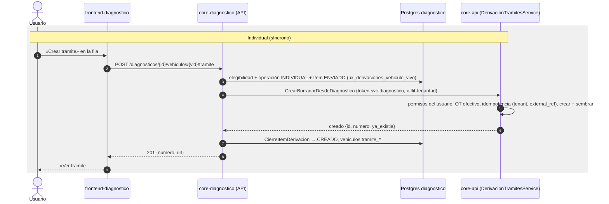

# Diseño: Crear trámite desde el diagnóstico (individual y masivo)

> Generado: 2026-11-11 · Estado: **Propuesto** (lo valida el Líder Técnico junto con ADR-0084) · Autor: architecture-agent
> Fuente: Punto 4 de `docs/diagnosticos/plan-ajustes-diagnostico-2026-11-11.md` (decisiones 4.1–4.6 y RNF de carga).
> Decisión: `docs/decisions/ADR-0084-diagnostico-crear-tramite-borrador-encolado-con-credito-por-compania.md`, que **sustituye** a la decisión (h) / H1 (token + canje + wizard) de `plan-implementacion-diagnostico-vehicular-v2.md` §4 y de `plan-pendientes-dictamen-a-flito.md` §2.
> Anclas `archivo:línea` verificadas el 2026-11-11 en `feature/ajustes-diagnostico-2026-11-11` (base `develop` 8ade059e4). Reverificar antes de citarlas en HUs.

## 1. Contexto y hechos del código

| Hecho | Dónde |
|---|---|
| core-api ya crea borradores idempotentes por referencia externa con `Origin` + `ExternalRef` en el mismo INSERT | `services/core-api/src/Flit.Api/Grpc/IctOrchestrationService.cs:51` (`CreateDraftFromIct`), `services/core-api/src/Flit.Api/PersonaNatural/PersonaNaturalRadicacionHandler.cs` (`PersonaNaturalCreador`) |
| `CreateProcedureInstanceRequest(TenantId, ProcedureTypeId, CreatedByUserId, TransitOfficeId, Modalidad, ProcedureTypeCode, Origin, ExternalRef, Channel, ChannelTransitOfficeId)` | `services/core-api/src/Flit.Tramites.Application/UseCases/ProcedureInstances/CreateProcedureInstanceCommand.cs:13` |
| Índice único `uq_procedure_instances_tenant_external_ref (tenant_id, external_ref) WHERE external_ref IS NOT NULL AND deleted_at IS NULL`; `origin varchar(20)` sin CHECK | `services/core-api/src/Flit.Infrastructure/Persistence/Sql/Ddl/40-ICT-procedure-external-ref.sql` |
| Canal: CHECK `ck_procedure_instances_channel` (`tramites`, `pn_web`, `pn_punto`, `integracion`, `aplicacion`) | `Sql/Ddl/*HU14317*`, `Flit.Tramites.Domain/Tramites/Enums/TramiteCanal.cs` |
| OT habilitado por nombre RUNT o por id, contra la **lista efectiva** (`IEffectiveTransitOfficeListResolver`) | `Flit.Tramites.Domain/Integration/ITransitOfficeResolver.cs`, `Flit.Infrastructure/OtRules/TransitOfficeResolver.cs` |
| Códigos de error de creación: `family_permission_denied`, `procedure_family_blocked`, `procedure_type_not_enabled`, `COMPANY_RULE_VIOLATION`, `OT_NOT_AUTHORIZED_FOR_TYPE`, `DUPLICATE_ACTIVE_PROCEDURE`, `ot_not_permitted`, `tenant_inactive`, `network_inactive` | `Flit.Api/Endpoints/Tramites/ProcedureInstanceEndpoints.cs:103-114` |
| Permiso de creación en REST: `tramites.create` + Crear de la familia (`IProcedureFamilyPermissionGate`, atado al `HttpContext`) | `ProcedureInstanceEndpoints.cs:119`, `Flit.Api/Authorization/FamilyPermissions.cs`, `Flit.Modules.Security.Domain/PermissionOverrides/EffectivePermissionsCalculator.cs` |
| Patrón de policy por cliente de servicio (`sub`, `aud=tramites`, scope) | `Flit.Api/Authorization/PersonaNaturalServicioAuthorization.cs`, `CatalogoTiposTramiteAuthorization.cs`; mapeo en `Flit.Api/Hosting/ApiEndpoints.cs:20-31` |
| Diagnóstico → core-api por gRPC con token `svc-diagnostico` (`AddFlitGrpcClient`, `Diagnostico:Tramites:Address`) | `services/core-diagnostico/src/Flit.Diagnostico.Api/Modulos/Catalogos/TiposTramiteEndpoints.cs:26-41`, `docker-compose.prod.yml:550` |
| `Flit.Tramites.Grpc.Contracts` compila `contracts/proto/flit/tramites/v1/*.proto` (Both) y Diagnóstico lo referencia | `services/core-api/src/Flit.Tramites.Grpc.Contracts/*.csproj`, `Flit.Diagnostico.Api.csproj:22` |
| SDK: `AddFlitConsumer` con `Concurrencia`, `Prefetch`, `RetryDelays`, `ProductoresPermitidos`; `EnqueueJob` prohíbe trabajos a sí mismo (hacia la propia cola se usa `Enqueue` = evento) | `services/core-api/src/Flit.Platform.Sdk/Messaging/PlatformConsumer.cs:36-46`, `PlatformOutbox.cs:38-47` |
| Reintento programado en scope propio + excepción para el SDK (el handler no recibe el nº de intento) | `Modulos/Consultas/Bus/ProgramadorReintentos.cs` |
| Permiso `diagnostico.derivacion.crear` y capacidad `derivar`; el rol de backoffice no lo tiene | `Plataforma/Permisos.cs:14`, `Plataforma/Capacidades.cs`, `tests/.../Plataforma/PermisosTests.cs` |
| Vehículo: `placa`, `vin`, `organismo_nombre` (RUNT), `propietario_doc_tipo`, `propietario_doc_cifrado` (@pii:high), `locatario_doc_*`, `datos_consolidados`, `runt_consultado_en`; clave alterna `(tenant_id, id)` | `Persistence/Configuraciones/VehiculoDiagnosticoConfig.cs:39-88` |
| Réplica global de organismos con `codigo` y `nombre_norm` (emparejar por nombre es frágil) | `Modulos/Catalogos/Organismo.cs`, `DerivacionDepartamento.cs` |
| Dictamen vigente por vehículo, `veredicto` `VIABLE`/`BLOQUEADO` | `Persistence/Configuraciones/DictamenVehiculoConfig.cs:36`, `Flit.Diagnostico.Domain/Dictamen/EvaluadorDictamen.cs:59` |
| Grilla: `FilaVehiculoDto` sin datos de trámite | `Modulos/Tablero/GrillaDto.cs:37` |
| Lote: `modo` (SIMPLE / CON_ANALISIS) y `tipo_tramite_codigo` (obligatorio en CON_ANALISIS) | `Persistence/Configuraciones/CabeceraDiagnosticoConfig.cs:26,43` |
| SQL crudo entre compañías solo en archivos autorizados | `tests/Flit.Diagnostico.Tests/Aislamiento/TomaEntreEmpresasSoloEnColaTests.cs` |
| Detalle del trámite en Trámites: `/tramites/{id}?t={tenantId}` | `frontend/components/atom/modules/LogQx.tsx:800` |

**No existe**: rpc de creación para Diagnóstico, tabla `diagnostico.derivaciones` (el DDL del plan v2 §5 no se migró), cola de derivación ni UI de selección.

## 2. Alternativas y decisión

Resumen (detalle completo en ADR-0084):

| | Opción 1 (elegida) | Opción 2 | Opción 3 |
|---|---|---|---|
| Mecanismo | Evento `diagnostico.derivacion.solicitada` → consumidor propio en Diagnóstico (concurrencia acotada) → rpc síncrono idempotente en core-api; crédito por compañía al liberar ítems | Trabajo `tramites.diagnostico.crear_borrador` → consumidor en core-api que lee datos por gRPC a Diagnóstico → evento de resultado | Tabla + trabajador `FOR UPDATE SKIP LOCKED` en Diagnóstico → mismo rpc |
| Individual síncrono | Mismo rpc | Requiere un rpc aparte | Mismo rpc |
| Equidad por compañía | Exacta (crédito en la transacción de cierre) | Hay que añadirla | SQL por ventana |
| Contrapresión | Freno + reintentos del SDK + limitador en el rpc | Natural (pull) | Intervalo de polling |
| PII en broker | No | No | No (sin broker) |
| Acople | Diagnóstico → core-api | Bidireccional | Diagnóstico → core-api |
| Esfuerzo | M (≈ 21 SP) | L (≈ 29 SP) | M (≈ 19 SP) |

## 3. Contrato servidor a servidor en core-api (gRPC, ADR-0070)

Archivo nuevo `contracts/proto/flit/tramites/v1/derivacion.proto` (lo compila `Flit.Tramites.Grpc.Contracts`, sin tocar su csproj).

```proto
syntax = "proto3";

package flit.tramites.v1;

option csharp_namespace = "Flit.Tramites.Grpc.V1";

import "google/protobuf/timestamp.proto";

// Creación de borradores de trámite desde Diagnóstico Vehicular (ADR-0084). Servidor a servidor, sin wizard.
// Autenticación: token de servicio del cliente `svc-diagnostico` con `aud=tramites` y scope
// `platform.tramites.derivacion`. Otro cliente recibe PERMISSION_DENIED. La empresa va en la metadata
// `x-flit-tenant-id` (contrato v1.3 §3). Habeas Data: nada del request se escribe en logs.
service DerivacionTramitesService {
  // Idempotente por (empresa, external_ref): si ya existe un trámite con esa referencia y origin = diagnostico,
  // devuelve el MISMO con ya_existia = true (y completa los datos faltantes si sigue en borrador). Nunca crea dos.
  // Errores técnicos como status gRPC (UNAVAILABLE, RESOURCE_EXHAUSTED si el limitador está lleno,
  // DEADLINE_EXCEEDED, INTERNAL); los de negocio como `rechazo` con código estable.
  rpc CrearBorradorDesdeDiagnostico(CrearBorradorDesdeDiagnosticoRequest) returns (CrearBorradorDesdeDiagnosticoResponse);

  // Trámites por referencia externa (reconciliación y vehículos derivados antes de una caída). Máximo 500 referencias.
  rpc ObtenerTramitesPorReferencia(ObtenerTramitesPorReferenciaRequest) returns (ObtenerTramitesPorReferenciaResponse);
}

message CrearBorradorDesdeDiagnosticoRequest {
  string external_ref = 1;                         // vehiculo_id (uuid v7). Obligatorio.
  string usuario_id = 2;                           // `sub` del usuario que lanzó la acción (autor del borrador, 4.6)
  string tipo_tramite_codigo = 3;                  // código de tramites.procedure_types
  string placa = 4;                                // uno de placa o vin
  string vin = 5;
  string organismo_nombre_runt = 6;                // transit_office_name tal como lo dio el RUNT
  string organismo_codigo = 7;                     // código de la réplica de Diagnóstico si el nombre casó con uno solo; vacío si no
  DocumentoPersona propietario = 8;                // propietario actual según RUNT (solo tipo y número)
  DocumentoPersona locatario = 9;                  // opcional (leasing)
  VehiculoBorrador vehiculo = 10;                  // precarga; la hidratación RUNT de Trámites prevalece
  string diagnostico_id = 11;                      // trazabilidad
  google.protobuf.Timestamp runt_consultado_en = 12;
  string intento_id = 13;                          // id del ítem de Diagnóstico; solo correlación en logs
}

message DocumentoPersona {
  string tipo_documento = 1;                       // CC, CE, NIT, PAS, PPT…
  string numero_documento = 2;
}

message VehiculoBorrador {
  string clase = 1;
  string servicio = 2;
  string marca = 3;
  string linea = 4;
  string modelo = 5;                               // año modelo
  string combustible = 6;
  string cilindraje = 7;
  string color = 8;
}

message CrearBorradorDesdeDiagnosticoResponse {
  oneof resultado {
    BorradorCreado creado = 1;
    RechazoBorrador rechazo = 2;
  }
}

message BorradorCreado {
  string procedure_instance_id = 1;
  string numero = 2;                               // reference_number
  string estado = 3;                               // borrador | … (estado real si ya existía)
  bool ya_existia = 4;
  repeated string advertencias = 5;                // p. ej. seed_warning:<codigo>; sin datos personales
}

message RechazoBorrador {
  string codigo = 1;                               // ver tabla de códigos
  string motivo = 2;                               // lenguaje claro, sin datos personales
}

message ObtenerTramitesPorReferenciaRequest { repeated string external_refs = 1; }
message ObtenerTramitesPorReferenciaResponse { repeated TramitePorReferencia tramites = 1; }
message TramitePorReferencia {
  string external_ref = 1;
  string procedure_instance_id = 2;
  string numero = 3;
  string estado = 4;
}
```

**Códigos de rechazo** (estables; Diagnóstico los traduce a motivos de omisión):

| `codigo` | Origen en core-api | Reintentable |
|---|---|---|
| `TIPO_NO_DISPONIBLE` | tipo inexistente, no publicado o `procedure_type_not_enabled` | No (omitida) |
| `FAMILIA_BLOQUEADA` | `procedure_family_blocked` | No |
| `USUARIO_SIN_PERMISO` | usuario inactivo, de otra compañía, sin `tramites.create` o sin Crear de la familia (`family_permission_denied`) | No |
| `OT_NO_HABILITADO` | el OT de matrícula no está en la lista efectiva, `ot_not_permitted`, `OT_NOT_AUTHORIZED_FOR_TYPE` | No (4.4) |
| `REGLA_COMPANIA` | `COMPANY_RULE_VIOLATION` | No |
| `TRAMITE_ACTIVO_DUPLICADO` | `DUPLICATE_ACTIVE_PROCEDURE` (otro trámite activo del mismo tipo y placa, de otro origen) | No |
| `EMPRESA_INACTIVA` | `tenant_inactive`, `network_inactive` | No |
| `REFERENCIA_DE_OTRO_ORIGEN` | existe `(tenant, external_ref)` con `origin <> 'diagnostico'` | No |
| `DATOS_INVALIDOS` | sin placa ni vin, `external_ref` no uuid, `usuario_id` vacío | No |

**Reglas de implementación en core-api:**

1. Policy `DiagnosticoDerivacionServicio` (patrón `PersonaNaturalServicioAuthorization`): `sub = svc-diagnostico`, `aud=tramites`, scope `platform.tramites.derivacion`. Mapeo condicionado a `Tramites:Derivacion:Habilitada` (apagado por defecto).
2. **Autoría** = `usuario_id`. Se valida: activo, miembro de la compañía de la metadata, con `tramites.create` y Crear de la familia del tipo, usando el cálculo de permisos efectivos por usuario (`EffectivePermissionsCalculator` + overrides). No se usa usuario de servicio (diferencia con ICT).
3. **OT**: `ResolveEnabledByNameAsync(tenant, organismo_nombre_runt)`; si no casa y viene `organismo_codigo`, método nuevo `ResolveEnabledByCodeAsync` (mismo criterio: grant de la lista efectiva + catálogo activo). Null → `OT_NO_HABILITADO`; **nunca** se crea sin OT. Con OT resuelto se siembran los `field_values` del organismo como en ICT (Bug #13109).
4. **Creación**: `CreateProcedureInstanceHandler` con `Origin="diagnostico"`, `ExternalRef=external_ref`, `Channel=TramiteCanal.Tramites` (sin DDL nuevo; ver ADR-0084 «Pendientes»). Una violación `23505` de `uq_procedure_instances_tenant_external_ref` (carrera de dos llamadas) se captura y se responde como `ya_existia`.
5. **Siembra** (`PatchFieldValuesHandler`, idempotente): `plate`, `vin`, `owner_document_type`, `owner_document_number` (como ICT), locatario con el mismo mapeo de ICT para tipos no traspaso, y `vehicle_*` de `VehiculoBorrador` (`vehicle_line`, `vehicle_model`, `vehicle_fuel`, `vehicle_service`, `vehicle_engine_displacement`, `vehicle_color`…; la tabla exacta de claves la confirma backend-agent contra las del tipo). Un fallo de siembra va a `advertencias`, no deshace el borrador.
6. **Limitador**: `ConcurrencyLimiter` (BCL `System.Threading.RateLimiting`) con `Tramites:Derivacion:ConcurrenciaMaxima` (por defecto 8) y cola 0: sin permiso → `RESOURCE_EXHAUSTED` inmediato.
7. **Logs**: ids, código de rechazo y duración; nunca placa, VIN ni documento.

## 4. Modelo de datos en core-diagnostico

Conceptual: una **operación** (cabecera de un «Crear trámite», individual o masivo, de un lote y un usuario) tiene **ítems** (uno por vehículo). Un vehículo tiene a lo sumo un ítem vivo o exitoso; el vehículo guarda la referencia al trámite creado. Bounded context Diagnóstico; el trámite es de Trámites y solo se referencia por id y número.

DDL de referencia (lo materializa `database-agent` como migración EF `P4_DerivacionTramite` según `checklist-validacion-schema.md` §A):

```sql
CREATE TABLE diagnostico.derivacion_operaciones (
  id                  uuid        PRIMARY KEY,                 -- uuid v7 de la aplicación
  tenant_id           uuid        NOT NULL,
  diagnostico_id      uuid        NOT NULL,
  tipo                varchar(16) NOT NULL CONSTRAINT ck_derivacion_operaciones_tipo CHECK (tipo IN ('INDIVIDUAL','MASIVA')),
  tipo_tramite_codigo varchar(64) NOT NULL,
  usuario_id          uuid        NOT NULL,                    -- autor de los borradores (4.6)
  estado              varchar(16) NOT NULL CONSTRAINT ck_derivacion_operaciones_estado CHECK (estado IN ('EN_CURSO','TERMINADA')),
  total               integer     NOT NULL CHECK (total > 0),
  creadas             integer     NOT NULL DEFAULT 0,
  omitidas            integer     NOT NULL DEFAULT 0,
  fallidas            integer     NOT NULL DEFAULT 0,
  creada_en           timestamptz NOT NULL,
  terminada_en        timestamptz NULL,
  CONSTRAINT uq_derivacion_operaciones_tenant_id UNIQUE (tenant_id, id),
  CONSTRAINT fk_derivacion_operaciones_diagnostico FOREIGN KEY (tenant_id, diagnostico_id)
    REFERENCES diagnostico.diagnosticos (tenant_id, id) ON DELETE RESTRICT,
  CONSTRAINT ck_derivacion_operaciones_contadores CHECK (creadas >= 0 AND omitidas >= 0 AND fallidas >= 0
    AND creadas + omitidas + fallidas <= total),
  CONSTRAINT ck_derivacion_operaciones_terminada CHECK ((estado = 'TERMINADA') = (terminada_en IS NOT NULL))
);
CREATE INDEX ix_derivacion_operaciones_lote ON diagnostico.derivacion_operaciones (tenant_id, diagnostico_id, creada_en DESC);

CREATE TABLE diagnostico.derivaciones (
  id                  uuid        PRIMARY KEY,
  tenant_id           uuid        NOT NULL,
  operacion_id        uuid        NOT NULL,
  vehiculo_id         uuid        NOT NULL,
  orden               integer     NOT NULL,                    -- orden de liberación dentro de la operación
  estado              varchar(16) NOT NULL CONSTRAINT ck_derivaciones_estado
                        CHECK (estado IN ('PENDIENTE','ENVIADO','CREADO','OMITIDO','FALLIDO')),
  motivo_codigo       varchar(40) NULL,                        -- NO_VIABLE, YA_TIENE_TRAMITE, OT_NO_HABILITADO, … (§5.4)
  intentos            smallint    NOT NULL DEFAULT 0,
  disponible_desde    timestamptz NULL,                        -- espera del reintento programado
  enviado_en          timestamptz NULL,                        -- liberado al bus (crédito ocupado)
  tramite_id          uuid        NULL,
  tramite_numero      varchar(32) NULL,
  actualizado_en      timestamptz NOT NULL,
  CONSTRAINT uq_derivaciones_tenant_id UNIQUE (tenant_id, id),
  CONSTRAINT fk_derivaciones_operacion FOREIGN KEY (tenant_id, operacion_id)
    REFERENCES diagnostico.derivacion_operaciones (tenant_id, id) ON DELETE RESTRICT,
  CONSTRAINT fk_derivaciones_vehiculo FOREIGN KEY (tenant_id, vehiculo_id)
    REFERENCES diagnostico.vehiculos (tenant_id, id) ON DELETE RESTRICT,
  CONSTRAINT ck_derivaciones_creado CHECK ((estado = 'CREADO') = (tramite_id IS NOT NULL)),
  CONSTRAINT ck_derivaciones_motivo CHECK (estado NOT IN ('OMITIDO','FALLIDO') OR motivo_codigo IS NOT NULL)
);
-- Un ítem vivo o exitoso por vehículo (R-16): reintentos y doble clic nunca crean dos ítems en curso.
CREATE UNIQUE INDEX ux_derivaciones_vehiculo_vivo ON diagnostico.derivaciones (tenant_id, vehiculo_id)
  WHERE estado IN ('PENDIENTE','ENVIADO','CREADO');
-- Liberación del siguiente ítem de la compañía (crédito) y progreso.
CREATE INDEX ix_derivaciones_pendientes ON diagnostico.derivaciones (tenant_id, operacion_id, orden) WHERE estado = 'PENDIENTE';
CREATE INDEX ix_derivaciones_en_vuelo   ON diagnostico.derivaciones (tenant_id, enviado_en)       WHERE estado = 'ENVIADO';
CREATE INDEX ix_derivaciones_operacion  ON diagnostico.derivaciones (tenant_id, operacion_id, estado);

ALTER TABLE diagnostico.vehiculos
  ADD COLUMN tramite_id        uuid        NULL,
  ADD COLUMN tramite_numero    varchar(32) NULL,
  ADD COLUMN tramite_creado_en timestamptz NULL;
COMMENT ON COLUMN diagnostico.vehiculos.tramite_id IS 'Borrador creado en Trámites (origin=diagnostico, external_ref=id). Se fija una vez (R-16).';
```

Notas: clase (a) de ADR-0072 (sin borrado; `xmin` como versión). `OMITIDO`/`FALLIDO` no ocupan el índice: la placa se puede volver a seleccionar (omitida) o reintentar (fallida, reabre el **mismo** ítem a `PENDIENTE`). `vehiculos.tramite_id` es la fuente de «Ver trámite #N» y de la elegibilidad.

## 5. core-diagnostico

### 5.1 Endpoints REST (`contracts/openapi/diagnostico.v1.yaml`)

| Método y ruta | Permiso | Respuesta |
|---|---|---|
| `POST /api/v1/diagnostico/diagnosticos/{id}/vehiculos/{vid}/tramite` — individual, síncrono. Cuerpo `{ "tipo_tramite_codigo"?: string }` (obligatorio si el lote es Simple; ignorado en Con análisis) | `diagnostico.derivacion.crear` | `201 { tramite_id, numero, url, ya_existia }` · `409 YA_TIENE_TRAMITE {tramite_id, numero}` · `422 NO_ELEGIBLE {motivo_codigo, motivo}` (NO_VIABLE, NO_TERMINADO, EN_CURSO, rechazos de §3) · `503 TRAMITES_NO_DISPONIBLE` + `Retry-After` · `403` |
| `POST /api/v1/diagnostico/diagnosticos/{id}/tramites` — masivo, encolado. Cuerpo `{ "vehiculo_ids": [uuid], "tipo_tramite_codigo"?: string }` (1..`MaxItemsPorOperacion`) | `diagnostico.derivacion.crear` | `202 { operacion_id, total, encolados, no_elegibles: [{vehiculo_id, motivo_codigo}] }` + `Location` · `400` (lista vacía o mayor al máximo, tipo faltante en Simple) · `403` |
| `GET /api/v1/diagnostico/diagnosticos/{id}/tramites/operaciones?ultima=true` | `diagnostico.diagnosticos.ver` | `200 [ProgresoOperacion]` (para retomar al volver a la pantalla) |
| `GET /api/v1/diagnostico/diagnosticos/{id}/tramites/operaciones/{opId}?estado=OMITIDO&pagina=1` | `diagnostico.diagnosticos.ver` | `200 { estado, total, creadas, omitidas, fallidas, pendientes, items: [{vehiculo_id, placa, estado, motivo_codigo, motivo, tramite_numero}] }` (lee solo tablas de Diagnóstico) |
| `POST /api/v1/diagnostico/diagnosticos/{id}/tramites/operaciones/{opId}/reintentar-fallidas` | `diagnostico.derivacion.crear` | `202 { reencolados }` · `409` si la operación sigue con ítems en vuelo |
| `GET …/grilla` (existente) | `diagnostico.diagnosticos.ver` | `FilaVehiculoDto` gana `derivacion: { elegible, motivo_no_elegible, estado, tramite: { id, numero, url } \| null }` |

Todas pasan por `AccesoLote` (el lote es de la compañía del usuario). El **backoffice no deriva**: el rol no tiene el permiso y, además, el endpoint rechaza con 403 cuando la petición viene del contexto de backoffice (lectura de otra compañía, Punto 1), aunque un SuperAdmin tenga el permiso.

### 5.2 Elegibilidad y revalidación (4.2, 4.6)

`ElegibilidadDerivacion` (una sola regla para la grilla, el encolado y la ejecución): vehículo `terminado`, dictamen vigente `VIABLE`, `vehiculos.tramite_id IS NULL` y sin ítem vivo. Se evalúa al pintar, al encolar y **otra vez al ejecutar** cada ítem (AC7). Motivos: `NO_TERMINADO`, `NO_VIABLE`, `YA_TIENE_TRAMITE`, `EN_CURSO`.

### 5.3 Ejecución masiva, límites y contrapresión

1. **Encolar** (una transacción): valida elegibilidad, inserta operación e ítems `PENDIENTE` (`orden` = orden de la selección) y llama a `DespachadorCredito.LiberarAsync(tenant)`.
2. **Despachador de crédito** (en la empresa fijada, sin SQL entre compañías): toma `pg_advisory_xact_lock(hashtextextended('derivacion:' || tenant_id, 0))`, cuenta `ENVIADO` de la compañía y libera hasta `CreditoPorCompania − en_vuelo` ítems `PENDIENTE` (operación más antigua primero, luego `orden`): `estado = ENVIADO`, `enviado_en = now` y `outbox.Enqueue("diagnostico.derivacion.solicitada", 1, tenant, { operacionId, itemId, vehiculoId })`. Sin PII.
3. **Consumidor** `diagnostico.derivaciones` (`Concurrencia` 4, `Prefetch` 8, `ProductoresPermitidos = ["diagnostico"]`, `EmpresaDelTrabajo` fija la compañía del sobre): carga el ítem; si ya no está `ENVIADO`, confirma sin efecto (re-entrega). Revalida; si no es elegible → `OMITIDO`. Pasa por el **freno**; arma la solicitud con `MapeoBorradorTramite` (descifra el documento aquí) y llama al rpc con `PlazoRpcSegundos` (15 s).
4. **Cierre** (`CierreItemDerivacion`, único punto): `CREADO` (fija `vehiculos.tramite_*`) / `OMITIDO` (motivo) / `FALLIDO`; actualiza contadores de la operación, la pasa a `TERMINADA` si `creadas + omitidas + fallidas = total`, y **en la misma transacción** llama a `LiberarAsync(tenant)` → siguiente ítem de la compañía.
5. **Transitorio** (`UNAVAILABLE`, `RESOURCE_EXHAUSTED`, `DEADLINE_EXCEEDED`, `INTERNAL`): patrón `ProgramadorReintentos` — en scope propio `intentos + 1`, `disponible_desde = now + espera(n)` y excepción de reintento; el SDK lleva el mensaje a `.retry.n` (`RetryDelays` 30 s, 2 min, 10 min). El ítem **conserva su crédito** (la compañía no inunda mientras core-api sufre). Agotado `MaxIntentos` (3) → `FALLIDO` con `TRAMITES_NO_DISPONIBLE`, reintentable a mano.
6. **Freno** (`FrenoTramites`, singleton): `TokenBucketRateLimiter` con `TasaPorSegundo` (10) y ráfaga = `Concurrencia`; tras `PausaTrasFallos` (5) transitorios seguidos abre una pausa de `PausaSegundos` (30) en la que el consumidor espera antes de llamar y el individual responde 503 con `Retry-After`. Un éxito cierra la pausa.
7. **Reconciliador** (`ReconciliadorDerivacion`, 60 s): ítems `ENVIADO` con `enviado_en` > 15 min (y sin `disponible_desde` futuro) → re-publica una vez; a la segunda, `FALLIDO`. Antes de re-publicar consulta `ObtenerTramitesPorReferencia` para cerrar como `CREADO` los que sí se crearon. Es la única lectura entre compañías: SQL crudo parametrizado que solo devuelve ids y empresa, añadido a la lista de `TomaEntreEmpresasSoloEnColaTests`. Se pausa si el freno está abierto.

**Configuración** `Diagnostico:Derivacion` (se valida al arrancar, como `OpcionesBus`):

| Clave | Defecto | Nota |
|---|---|---|
| `Habilitada` | `false` | Sin ella no se registran consumidor, reconciliador ni endpoints masivos |
| `Concurrencia` / `Prefetch` | 4 / 8 | Por réplica; techo global = réplicas × Concurrencia |
| `CreditoPorCompania` | 2 | Ítems en vuelo por compañía; `≤ Concurrencia` |
| `TasaPorSegundo` | 10 | Tope de llamadas al rpc por réplica |
| `PausaTrasFallos` / `PausaSegundos` | 5 / 30 | Freno |
| `PlazoRpcSegundos` | 15 | Deadline gRPC |
| `MaxIntentos` | 3 | Reintentos automáticos por ítem |
| `MaxItemsPorOperacion` | 5000 | Tope de selección por envío |
| `Reconciliador:{Intervalo, Margen}` | 60 s / 15 min | |
| core-api `Tramites:Derivacion:ConcurrenciaMaxima` | 8 | ≥ suma de Concurrencia de las réplicas de Diagnóstico |

Pool de base de Diagnóstico: el consumidor mantiene la conexión durante el rpc (transacción del SDK abierta antes del handler); sumar `Concurrencia` al pool actual.

### 5.4 Mapeo de datos

| Dato | Origen en Diagnóstico | Campo del rpc | Destino en Trámites |
|---|---|---|---|
| Placa / VIN | `vehiculos.placa`, `vehiculos.vin` | `placa`, `vin` | `field_values` `plate`, `vin` |
| Tipo | Con análisis: `diagnosticos.tipo_tramite_codigo`; Simple: el del modal (validado contra `ListarTiposTramite`) | `tipo_tramite_codigo` | `procedure_type_code` |
| OT de matrícula | `vehiculos.organismo_nombre` (RUNT) + `organismos.codigo` si `nombre_norm` casa con uno solo | `organismo_nombre_runt`, `organismo_codigo` | `transit_office_id` + `field_values` del organismo; si no está en la lista efectiva → `OT_NO_HABILITADO` |
| Propietario | `propietario_doc_tipo` + `propietario_doc_cifrado` descifrado en `MapeoBorradorTramite` (ADR-0076) | `propietario` | `owner_document_type`, `owner_document_number` |
| Locatario | `locatario_doc_tipo` + `locatario_doc_cifrado` | `locatario` | mapeo de locatario de ICT |
| Vehículo | `datos_consolidados` (clase, servicio, marca, línea, modelo, combustible, cilindraje, color) | `vehiculo` | `vehicle_*` (precarga; la hidratación RUNT de Trámites prevalece) |
| RUNT | `vehiculos.runt_consultado_en` | `runt_consultado_en` | trazabilidad; reutilización R-14 pendiente (ADR-0084) |
| Trazabilidad | `vehiculos.id`, `diagnosticos.id` | `external_ref`, `diagnostico_id` | `origin='diagnostico'`, `external_ref` |
| Autor | `operacion.usuario_id` (el `sub` de quien lanzó) | `usuario_id` | `created_by_user_id` |

El nombre del propietario no se guarda en Diagnóstico y no viaja; lo completa Trámites con su consulta.

## 6. Front (`frontend-diagnostico`)

- **Grilla** (`components/tablero/GrillaSemaforos.tsx`): columna de casilla visible solo con `capacidades.derivar`. Fila elegible → casilla activa; no elegible → deshabilitada con `title`/tooltip del motivo (rótulos del Punto 5). Fila con trámite → enlace «Ver trámite #N» a `${tramitesUrl}/tramites/{id}?t={tenant}` en pestaña nueva; acción por fila «Crear trámite».
- **Barra de selección** (`BarraSeleccionDerivacion.tsx`): sin preselección; «Seleccionar todas las elegibles» (del lote completo y de la página/filtro actual), «Quitar selección», contador y botón «Crear trámites (N)». La selección vive en estado del cliente por id de vehículo y sobrevive al refresco incremental (`useGrillaIncremental`).
- **Modal de tipo** (`ModalTipoTramite.tsx`): solo en lote Simple; una vez para todas; reutiliza `GET /tipos-tramite`.
- **Progreso** (`ProgresoDerivacion.tsx`): panel con barra y contadores; polling cada 3 s mientras `EN_CURSO` (con backoff a 10 s si no cambia), solo a Diagnóstico. Al volver a la pantalla retoma con `?ultima=true`. Al terminar: resumen creadas / omitidas por motivo (lista paginada) y «Reintentar fallidas».
- Sin cambios en `frontend/`.

## 7. Diagramas de secuencia



```mermaid
sequenceDiagram
    autonumber
    actor U as Usuario
    participant FD as frontend-diagnostico
    participant D as core-diagnostico (API)
    participant DB as Postgres diagnostico (+outbox)
    participant MQ as RabbitMQ flit.diagnostico
    participant C as Consumidor diagnostico.derivaciones
    participant API as core-api

    U->>FD: selecciona N placas + «Crear trámites (N)» (+ tipo si es Simple)
    FD->>D: POST /diagnosticos/{id}/tramites
    D->>DB: operación MASIVA + N ítems PENDIENTE
    D->>DB: DespachadorCredito: lock por compañía, libera ≤ crédito → ENVIADO + outbox
    D-->>FD: 202 {operacion_id}
    DB-->>MQ: OutboxPublisher: diagnostico.derivacion.solicitada (solo ids)
    loop por mensaje (Concurrencia global)
        MQ->>C: entrega
        C->>DB: fija empresa, carga ítem, revalida VIABLE y sin trámite
        C->>C: freno (tasa + pausa)
        C->>API: CrearBorradorDesdeDiagnostico
        alt creado / ya existía
            API-->>C: creado
            C->>DB: CierreItemDerivacion CREADO + contadores + libera siguiente de la compañía (outbox)
        else rechazo de negocio
            API-->>C: rechazo {codigo}
            C->>DB: OMITIDO + motivo + libera siguiente
        else UNAVAILABLE / RESOURCE_EXHAUSTED / DEADLINE
            API-->>C: status transitorio
            C->>DB: (scope propio) intentos+1, disponible_desde
            C-->>MQ: excepción → .retry.n (30 s, 2 min, 10 min); conserva crédito
        end
    end
    loop cada 3 s mientras EN_CURSO
        FD->>D: GET …/operaciones/{opId}
        D->>DB: contadores (sin llamar a core-api)
        D-->>FD: progreso
    end
```

## 8. Seguridad y Habeas Data

- El evento y la outbox llevan solo ids: sin enmienda a U1 (ADR-0075) ni a R-2 (ADR-0072). Prueba de contrato que falla si `DerivacionSolicitada` gana un campo que no sea id.
- El documento se descifra solo en `MapeoBorradorTramite` y viaja por gRPC interno; nunca en logs (ids, códigos, duración).
- core-api: cliente y scope exactos; la empresa de la metadata debe coincidir con la del usuario autor; el usuario necesita los permisos de creación de Trámites (sin escalada de privilegios desde Diagnóstico).
- El backoffice no deriva (rol sin permiso + rechazo explícito en contexto de backoffice).

## 9. Plan de pruebas

**Unitarias / integración (core-diagnostico, `tests/Flit.Diagnostico.Tests/Derivacion/`)**: elegibilidad (4 motivos); encolar con no elegibles; despachador nunca supera el crédito con encolados concurrentes de la misma compañía; liberación al cerrar; re-entrega de un ítem ya cerrado sin efecto; transitorio → reintento programado y crédito conservado; agotado → FALLIDO; reintentar fallidas reabre el mismo ítem; individual 201/409/422/503; 403 sin permiso y en backoffice; `ux_derivaciones_vehiculo_vivo` ante doble clic; reconciliador con `ObtenerTramitesPorReferencia`; `TomaEntreEmpresasSoloEnColaTests` actualizado; contrato del evento sin PII.

**core-api (`tests/Flit.Admin.Tests/Identity/`, `tests/Flit.Integration.Tests/`)**: policy (solo `svc-diagnostico` con el scope); idempotencia (dos llamadas, una creación; carrera 23505 → `ya_existia`); `REFERENCIA_DE_OTRO_ORIGEN`; OT por nombre, por código y no habilitado; usuario sin `tramites.create` / sin Crear de la familia / de otra compañía; limitador → `RESOURCE_EXHAUSTED`; siembra de campos; autoría = usuario.

**Front (Vitest)**: casillas y motivos; «seleccionar todas» (lote y página); contador; modal solo en Simple; progreso y resumen; «Ver trámite #N»; acciones ocultas sin `derivar`.

**Carga (QA, objetivo propuesto; lo ratifica el LT)** — script `tests/load/diagnostico-derivacion.js` (k6 como binario de la máquina de pruebas, no dependencia del repo), en QA con datos sintéticos sin PII real y core-api real:

| Escenario | Carga |
|---|---|
| E1 base | 10 compañías × 2 lotes × 1.000 placas encolados en el mismo minuto (20.000 borradores) |
| E2 ballena | E1 + 1 compañía con 5.000 placas; en paralelo, 3 compañías pequeñas encolan 20 placas cada 2 min |
| E3 caída | E1 con core-api detenido 5 min a mitad de corrida |
| E4 ruido | Durante E1, 30 usuarios virtuales navegando Trámites (`GET /api/v1/tramites/instances`, detalle) |

| Umbral (aceptación AC9) | Objetivo |
|---|---|
| Latencia del rpc | p95 ≤ 1,5 s, p99 ≤ 3 s |
| Resto de core-api (E4) | p95 no empeora más de 20 % frente a la línea base sin carga |
| Errores | 5xx / `INTERNAL` < 0,5 %; **0 borradores duplicados** por `external_ref` |
| Rendimiento | ≥ 8 borradores/s sostenidos con la configuración por defecto (≈ 42 min para E1) |
| Equidad (E2) | cada lote de 20 placas termina en ≤ 3 min mientras corre la ballena |
| Cola | `diagnostico.derivaciones` ≤ `CreditoPorCompania × compañías activas` mensajes listos |
| Caída (E3) | ningún ítem `FALLIDO` antes de agotar reintentos; al volver core-api, se retoma sin intervención |

## 10. Archivos a crear o modificar, por incremento

Cada incremento compila, pasa sus pruebas y se puede commitear solo. Estimación de líneas incluyendo pruebas.

### Incremento 1 — core-api: rpc de creación (≈ 650 líneas) · HU BE core-api (5 SP)

Crear:
- `contracts/proto/flit/tramites/v1/derivacion.proto`
- `services/core-api/src/Flit.Api/Grpc/DerivacionTramitesGrpcService.cs`
- `services/core-api/src/Flit.Api/Derivacion/CreadorBorradorDiagnostico.cs` (orquesta create + siembra; patrón `PersonaNaturalCreador`)
- `services/core-api/src/Flit.Api/Derivacion/AutorDerivacion.cs` (usuario activo, compañía, `tramites.create` + familia)
- `services/core-api/src/Flit.Api/Derivacion/DerivacionExtensions.cs` (config `Tramites:Derivacion`, limitador)
- `services/core-api/src/Flit.Api/Authorization/DiagnosticoDerivacionServicioAuthorization.cs`
- `services/core-api/tests/Flit.Admin.Tests/Identity/DiagnosticoDerivacionServicioAuthorizationTests.cs`
- `services/core-api/tests/Flit.Integration.Tests/Derivacion/CrearBorradorDesdeDiagnosticoTests.cs`

Modificar:
- `services/core-api/src/Flit.Api/Hosting/ApiEndpoints.cs` (mapeo condicionado)
- `services/core-api/src/Flit.Api/Authorization/ApiSecurityExtensions.cs` (policy)
- `services/core-api/src/Flit.Tramites.Domain/Integration/ITransitOfficeResolver.cs` y `services/core-api/src/Flit.Infrastructure/OtRules/TransitOfficeResolver.cs` (`ResolveEnabledByCodeAsync`; también en `NullTransitOfficeResolver`)
- `services/core-api/src/Flit.Api/appsettings.json` (`Tramites:Derivacion`, apagado)
- `services/core-identity` — registro del scope `platform.tramites.derivacion` para `svc-diagnostico` (archivo de clientes de servicio que lo declara; lo ubica backend-agent)
- `services/core-api/README.md` (sección del rpc)

### Incremento 2 — core-diagnostico + front: modelo de datos e individual (≈ 800 líneas) · HU BE diagnóstico (3 SP) + HU FE (2 SP)

Crear:
- `services/core-diagnostico/src/Flit.Diagnostico.Domain/Derivacion/OperacionDerivacion.cs`, `ItemDerivacion.cs`, `EstadoItemDerivacion.cs`, `MotivoDerivacion.cs`
- `services/core-diagnostico/src/Flit.Diagnostico.Api/Persistence/Configuraciones/OperacionDerivacionConfig.cs`, `ItemDerivacionConfig.cs`
- `services/core-diagnostico/src/Flit.Diagnostico.Api/Persistence/Migrations/<timestamp>_P4_DerivacionTramite.cs` (+ `.Designer.cs`)
- `services/core-diagnostico/src/Flit.Diagnostico.Api/Modulos/Derivacion/DerivacionEndpoints.cs` (individual)
- `.../Modulos/Derivacion/ElegibilidadDerivacion.cs`
- `.../Modulos/Derivacion/MapeoBorradorTramite.cs`
- `.../Modulos/Derivacion/ClienteDerivacionTramites.cs` (gRPC + traducción de status/rechazos; `NoConectado` como `CatalogoTiposTramiteNoConectado`)
- `.../Modulos/Derivacion/CierreItemDerivacion.cs`
- `.../Modulos/Derivacion/OpcionesDerivacion.cs`
- `services/core-diagnostico/tests/Flit.Diagnostico.Tests/Derivacion/ElegibilidadDerivacionTests.cs`, `DerivacionIndividualTests.cs`, `MapeoBorradorTramiteTests.cs`
- `frontend-diagnostico/lib/tablero/derivacion.ts`
- `frontend-diagnostico/components/tablero/BotonCrearTramite.tsx` (+ `__tests__/BotonCrearTramite.test.tsx`)

Modificar:
- `services/core-diagnostico/src/Flit.Diagnostico.Api/Modulos/Vehiculos/VehiculoDiagnostico.cs` y `Persistence/Configuraciones/VehiculoDiagnosticoConfig.cs` (`tramite_*`)
- `services/core-diagnostico/src/Flit.Diagnostico.Api/Persistence/DiagnosticoDb.cs` y `Persistence/Migrations/DiagnosticoDbModelSnapshot.cs`
- `services/core-diagnostico/src/Flit.Diagnostico.Api/Modulos/Tablero/GrillaDto.cs` y `ConsultaGrilla.cs` (`derivacion`)
- `services/core-diagnostico/src/Flit.Diagnostico.Api/Modulos/Modulos.cs` (`AddDerivacion`) y `Program.cs` (mapeo)
- `services/core-diagnostico/src/Flit.Diagnostico.Api/appsettings.json` (`Diagnostico:Derivacion`)
- `contracts/openapi/diagnostico.v1.yaml` (individual + `derivacion` en la fila)
- `frontend-diagnostico/components/tablero/GrillaSemaforos.tsx` (columna, motivo, «Ver trámite #N»)
- `frontend-diagnostico/lib/tablero/api.ts` (tipos de la fila)

### Incremento 3 — masivo: cola, crédito, progreso y carga (≈ 800 líneas) · HU BE diagnóstico (5 SP) + HU FE (3 SP) + HU QA carga (3 SP)

Crear:
- `services/core-diagnostico/src/Flit.Diagnostico.Api/Modulos/Derivacion/Bus/DerivacionSolicitada.cs` (evento v1, solo ids)
- `.../Modulos/Derivacion/Bus/ConsumidorDerivacion.cs`
- `.../Modulos/Derivacion/DespachadorCredito.cs`
- `.../Modulos/Derivacion/FrenoTramites.cs`
- `.../Modulos/Derivacion/ReintentoDerivacion.cs` (patrón `ProgramadorReintentos`)
- `.../Modulos/Trabajos/ReconciliadorDerivacion.cs`
- `.../Modulos/Derivacion/ProgresoOperacion.cs` (lecturas + reintentar fallidas)
- `services/core-diagnostico/tests/Flit.Diagnostico.Tests/Derivacion/DespachadorCreditoTests.cs`, `ConsumidorDerivacionTests.cs`, `ReconciliadorDerivacionTests.cs`, `DerivacionSolicitadaContratoTests.cs`
- `frontend-diagnostico/components/tablero/BarraSeleccionDerivacion.tsx`, `ModalTipoTramite.tsx`, `ProgresoDerivacion.tsx` (+ pruebas en `components/tablero/__tests__/`)
- `tests/load/diagnostico-derivacion.js` y `tests/load/README.md`

Modificar:
- `services/core-diagnostico/src/Flit.Diagnostico.Api/Modulos/Derivacion/DerivacionEndpoints.cs` (masivo, progreso, reintentar)
- `services/core-diagnostico/src/Flit.Diagnostico.Api/Modulos/Modulos.cs` (consumidor y reconciliador)
- `services/core-diagnostico/tests/Flit.Diagnostico.Tests/Aislamiento/TomaEntreEmpresasSoloEnColaTests.cs` (autorizar el reconciliador)
- `deploy/rabbitmq/definitions.json` (las pruebas de Diagnóstico lo enlazan tal cual, `Flit.Diagnostico.Tests.csproj:41`)
- `contracts/fixtures/bus/diagnostico.derivacion.solicitada.v1.json` (crear; fixture de contrato del evento, enlazado por `Flit.Diagnostico.Tests.csproj:36`)
- `contracts/asyncapi/diagnostico-events.v1.yaml` (`diagnostico.derivacion.solicitada`)
- `contracts/openapi/diagnostico.v1.yaml` (masivo, progreso, reintentar)
- `docker-compose.prod.yml` (`Diagnostico__Derivacion__*`, `Tramites__Derivacion__*`, apagados)
- `frontend-diagnostico/components/tablero/TableroLote.tsx` y `GrillaSemaforos.tsx` (selección y panel)
- `services/core-diagnostico/README.md`

## 11. Notas operativas por agente

- **database-agent**: migración `P4_DerivacionTramite` con el DDL de §4; FK compuestas RESTRICT; índices parciales con literales; comentarios `@pii` (ninguna columna nueva es PII).
- **backend-agent**: incremento 1 en core-api primero (frente T1: confirmar quién lo implementa); en Diagnóstico, un único `CierreItemDerivacion`. Confirmar la tabla de claves `vehicle_*` y el archivo de scopes de `svc-diagnostico` en core-identity.
- **frontend-agent**: rótulos del Punto 5; selección por id; polling con backoff.
- **qa-agent**: §9; el objetivo de carga queda a ratificar por el LT antes de correrlo.
- **security-agent**: §8; revisar el scope nuevo y el cálculo de permisos del autor.
- **infra-agent**: `definitions.json`, variables apagadas por defecto, scope en core-identity, pool de conexiones de Diagnóstico.

## 12. Fuera de alcance y pendientes

- R-14 (reutilizar el RUNT de Diagnóstico en Trámites): `PrecomputedVehicleConsultation` existe en ICT, pero Diagnóstico no guarda `vehicle_snapshot_json`. HU aparte.
- Lotes Express: fuera de esta entrega salvo que producto lo pida.
- Canal `diagnostico` en `ck_procedure_instances_channel`: no se crea; `origin` distingue.
- Destino `SANEAMIENTO` del plan previo: sin diseño.
- Dependencias del plan: Punto 2 (multas bloqueantes) antes de encender en QA/PDN; Punto 3 (reintentos) para que el VIABLE sea estable.
