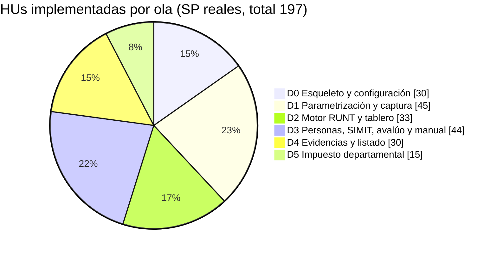
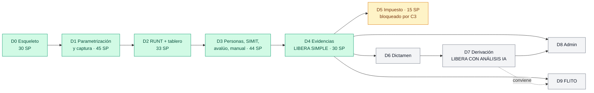
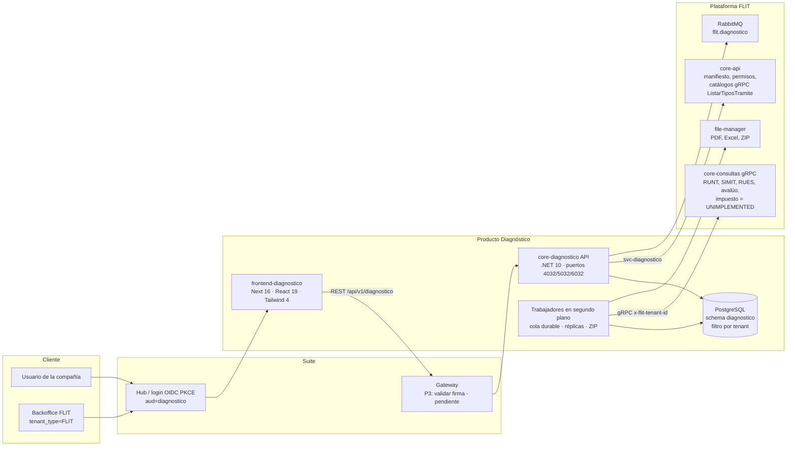
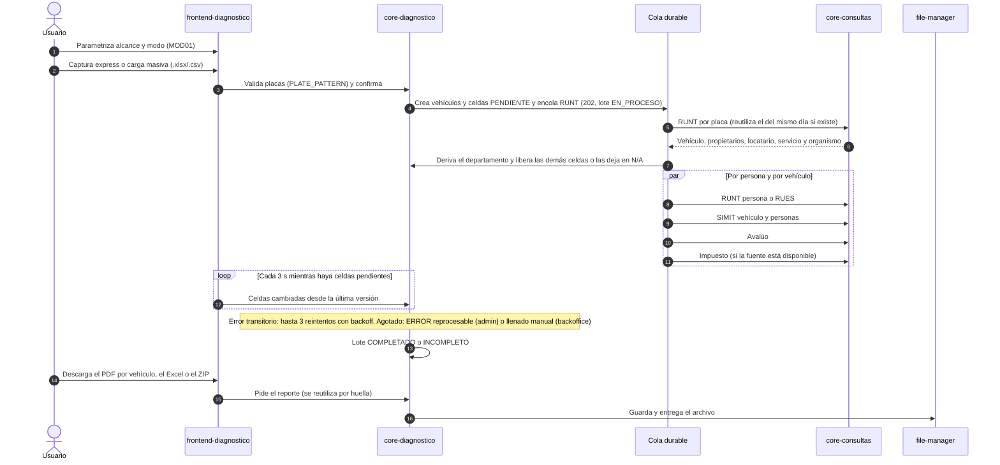
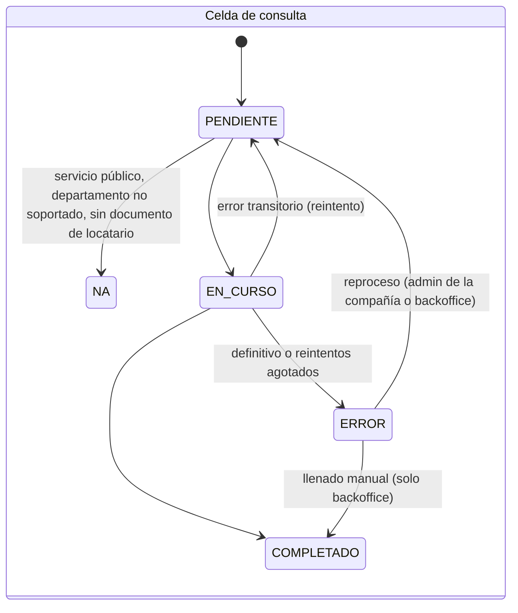
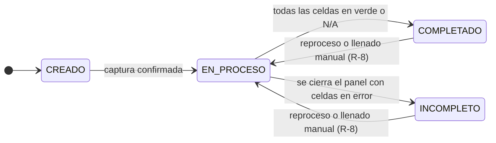
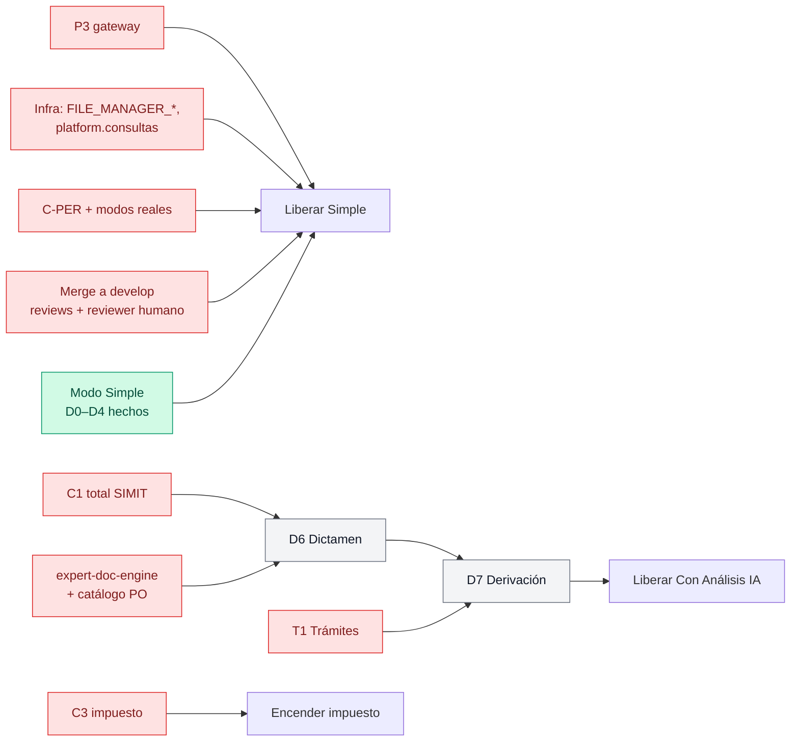

# Diagnóstico Vehicular — estado global de la implementación

> Generado: 2026-10-23. Fuentes: inventario de ADO (proyecto `FLIT - DIAGNOSTICO`, 86 work items, leído el 2026-10-23), git de la rama `feature/AB-12881-diagnostico-d0-d2`, plan `plan-implementacion-diagnostico-vehicular-v2.md` y las notas de cada ola. Las cifras de pruebas son las de los builds completos de cierre de cada ola.

## 1. Resumen

| Indicador | Valor |
|---|---|
| Olas de producto terminadas | **D0, D1, D2, D3, D4 y D5** (6 de 10) |
| Olas pendientes | D6 Dictamen, D7 Derivación, D8 Admin, D9 Integración FLITO |
| Modo **Simple** | **Funcionalmente completo** (se cerró con D4). No se puede liberar: faltan la plataforma (P3) y la infra (§7) |
| Modo **Con Análisis IA** | No empezado: necesita D6 y D7 |
| Épicas en ADO | 11: 9 Active, 2 New (#12678 D6 y #12679 D7) |
| Features | 11, todas Active, todas con sus HUs implementadas |
| HUs | **64 implementadas, 197 SP**; todas en Active. Ninguna en Resolved, porque no hay merge |
| Commits | 80 en la rama (1 por HU o corrección), +83.430 / −138 líneas en 595 archivos |
| Pruebas | Backend **697/697** (0 omitidas, Postgres real) · Frontend **497/497** en 41 archivos · `tsc` 0 · `next build` 0 |
| Push / PR | **Ninguno.** La rama es local. `develop` va 127 commits por delante |

## 2. Avance por ola (D0–D9)

| Ola | Qué entrega | Estado | Features ADO | HUs | SP plan | SP real | Pruebas al cierre (back / front) |
|---|---|---|---|---|---|---|---|
| **D0** | Esqueleto: servicio, sesión del hub, aislamiento por compañía, roles, backoffice, compose y CD; configuración en dos niveles | ✅ Terminada | #13715, #13716 | 12 | 21 | 30 | 469 / 270 (cierre conjunto de D0–D2) |
| **D1** | Parametrización (alcance, modo, estimado de consultas), captura express y carga masiva con validación | ✅ Terminada | #13717, #13718 | 14 | 26–27 | 45 | (igual) |
| **D2** | Cola durable, celda RUNT por placa vía Intempo **simulado**, locatario declarado, reutilización del mismo día, tablero con semáforos y polling | ✅ Terminada | #13719, #13720 | 10 | 27 | 33 | (igual) |
| **D3** | RUNT persona o RUES, SIMIT vehículo/propietario/locatario, avalúo, reproceso, llenado manual del backoffice, detalle de celda enmascarado | ✅ Terminada | #13788, #13789 | 13 | 22 | 44 | 557 / 401 |
| **D4** | PDF por vehículo, Excel del lote, ZIP en segundo plano con huella, listado con filtros y visibilidad — **libera el modo Simple** | ✅ Terminada | #13840, #13841 | 8 | 14 | 30 | 649 / 474 |
| **D5** | Impuesto departamental «solo producto»: contrato gRPC, réplica de departamentos, N/A, adaptador, disponibilidad, detalle/PDF/Excel | ✅ Terminada (fuente bloqueada hasta C3) | #13859 | 7 | 6 | 15 | 697 / 497 |
| **D6** | Dictamen TRASPASO: catálogo de reglas, motor determinista, recálculo, override, redactor LLM obligatorio con plantilla de respaldo, fuentes obligatorias por familia | ⏳ Sin descomponer | — (épica #12678, New) | — | 28 | — | — |
| **D7** | Derivación: handoff de un solo uso, *Crear trámite* por vehículo, *Sanear* informativo — **libera Con Análisis IA** | ⏳ Sin descomponer | — (épica #12679, New) | — | 12 | — | — |
| **D8** | Volumetría y fallos por proveedor, conversión, la empresa padre ve a sus hijas en solo lectura, SSE opcional | ⏳ Sin descomponer | — (sin épica asignada) | — | 13–18 | — | — |
| **D9** | API de integración para FLITO (cliente externo, webhook firmado) | ⏳ Sin descomponer | — (Feature o épica nueva, diferida) | — | 15 | — | — |

La HU #13826 (prueba intermitente de `RegistroManifiestoTests` resuelta con `TimeProvider`) se hizo durante la D3, pero cuelga de la Feature #13715 de D0. Por eso aparece en D0.

```mermaid
xychart-beta
  title "SP plan vs SP real por ola"
  x-axis ["D0", "D1", "D2", "D3", "D4", "D5", "D6", "D7", "D8", "D9"]
  y-axis "Story Points" 0 --> 50
  bar [21, 27, 27, 22, 14, 6, 28, 12, 18, 15]
  bar [30, 45, 33, 44, 30, 15, 0, 0, 0, 0]
```

*Primera serie: plan §8.2 (valor alto del rango). Segunda: SP reales en ADO.* Lo real sale ≈ 1,7 veces el plan en D0–D5 (197 frente a ≈ 117). La diferencia viene de separar las HUs por capa (BD, backend y frontend) y de partidas que el plan no estimó: pantallas, contratos y el ZIP con cola. Si D6–D9 siguen la misma proporción, faltan ≈ 115–125 SP reales, frente a los 68–73 del plan **[estimación]**.

### Línea de tiempo

D0, D1 y D2 se implementaron el 2026-10-21 (49 commits). D3, D4 y D5 se implementaron entre el 2026-10-22 y el 2026-10-23 (31 commits).

## 3. Épicas, Features y HUs

```mermaid
flowchart TB
  classDef epA fill:#dbeafe,stroke:#2563eb,color:#1e3a8a
  classDef epN fill:#f3f4f6,stroke:#6b7280,color:#111827
  classDef feat fill:#d1fae5,stroke:#059669,color:#064e3b
  E12881["#12881 Aplicativo Diagnóstico Vehicular<br/>(paraguas narrativo)"]:::epA
  E13714["#13714 [0] Habilitación en la Suite"]:::epA
  E12637["#12637 Visión general y arquitectura"]:::epA
  E12638["#12638 Diseño y experiencia visual"]:::epA
  E12640["#12640 [1] Parametrización y reglas"]:::epA
  E12641["#12641 [2] Captura e ingesta"]:::epA
  E12659["#12659 [3] Motor de consultas"]:::epA
  E12669["#12669 [4] Dashboard y monitoreo"]:::epA
  E12678["#12678 [5] IA y dictamen · New"]:::epN
  E12679["#12679 [6] Derivación · New"]:::epN
  E12680["#12680 [7] Reportes y trazabilidad"]:::epA
  E13714 --> F13715["#13715 Esqueleto · 9 HUs · 24 SP"]:::feat
  E13714 --> F13716["#13716 Config. dos niveles · 3 · 6"]:::feat
  E12640 --> F13717["#13717 Parametrización · 6 · 19"]:::feat
  E12641 --> F13718["#13718 Captura express y masiva · 8 · 26"]:::feat
  E12659 --> F13719["#13719 Cola + RUNT Intempo · 8 · 25"]:::feat
  E12659 --> F13788["#13788 Personas, SIMIT, avalúo · 8 · 25"]:::feat
  E12659 --> F13859["#13859 Impuesto departamental · 7 · 15"]:::feat
  E12669 --> F13720["#13720 Grilla de semáforos · 2 · 8"]:::feat
  E12669 --> F13789["#13789 Detalle enmascarado + manual · 5 · 19"]:::feat
  E12680 --> F13840["#13840 PDF, Excel y ZIP · 6 · 24"]:::feat
  E12680 --> F13841["#13841 Listado con filtros · 2 · 6"]:::feat
```

Las épicas #12637, #12638 y #12881 son transversales y no tienen Features: sus criterios se cubren dentro de las demás. #12881 tiene 10 enlaces Related al resto.

| Épica | Estado | Ola | Features (HUs · SP) |
|---|---|---|---|
| #12881 Aplicativo Diagnóstico Vehicular | Active | Transversal | — |
| #12637 Visión general y arquitectura | Active | Transversal | — |
| #12638 Diseño y experiencia visual | Active | Transversal (UI kit como referencia, R-15) | — |
| #13714 [0] Habilitación en la Suite FLIT | Active | D0 | #13715 (9 · 24), #13716 (3 · 6) |
| #12640 [1] Parametrización y reglas | Active | D1 | #13717 (6 · 19) |
| #12641 [2] Captura e ingesta | Active | D1 | #13718 (8 · 26) |
| #12659 [3] Motor de consultas y orquestación | Active | D2, D3, D5 | #13719 (8 · 25), #13788 (8 · 25), #13859 (7 · 15) |
| #12669 [4] Dashboard y monitoreo | Active | D2, D3 | #13720 (2 · 8), #13789 (5 · 19) |
| #12680 [7] Reportes y trazabilidad | Active | D4 | #13840 (6 · 24), #13841 (2 · 6) |
| #12678 [5] Motor de IA y dictamen | **New** | D6 | — |
| #12679 [6] Derivación y accionabilidad | **New** | D7 | — |

### HUs por Feature

| Feature | HUs (ID:SP) |
|---|---|
| #13715 Esqueleto | 13721:3 · 13722:3 · 13724:3 · 13726:3 · 13728:3 · 13729:2 · 13732:3 · 13734:3 · 13826:1 |
| #13716 Configuración dos niveles | 13736:1 · 13741:3 · 13744:2 |
| #13717 Parametrización | 13731:3 · 13738:2 · 13742:2 · 13747:2 · 13750:5 · 13752:5 |
| #13718 Captura | 13735:2 · 13740:3 · 13745:1 · 13749:5 · 13751:5 · 13753:2 · 13754:5 · 13755:3 |
| #13719 Cola + RUNT | 13723:3 · 13725:2 · 13727:5 · 13730:3 · 13733:3 · 13737:3 · 13739:3 · 13746:3 |
| #13720 Grilla | 13743:5 · 13748:3 |
| #13788 Personas, SIMIT, avalúo | 13790:5 · 13791:3 · 13792:5 · 13793:3 · 13794:3 · 13795:3 · 13796:2 · 13797:1 |
| #13789 Detalle + manual | 13798:3 · 13799:3 · 13800:5 · 13801:3 · 13802:5 |
| #13840 Evidencias | 13846:5 · 13847:3 · 13848:5 · 13849:3 · 13850:5 · 13851:3 |
| #13841 Listado | 13845:3 · 13852:3 |
| #13859 Impuesto | 13860:1 · 13861:3 · 13862:3 · 13863:2 · 13864:2 · 13865:2 · 13866:2 |

Todas las HUs tienen sus evidencias (rojo → verde) publicadas en `Custom.Evidences` y un comentario de trazabilidad con su commit.

## 4. Componentes

**Módulos de core-diagnostico** (`src/Flit.Diagnostico.Api/Modulos/`): Sesión, Configuración (contrato y operación), Diagnósticos, Carga (masiva), Express, Vehículos, Consultas (motor, ejecutores por fuente, adaptadores Real/Simulada/NoConectada), Catálogos (organismos y departamentos con impuesto), Tablero (grilla y detalle de celda), Reportes (PDF QuestPDF, Excel, ZIP), Trabajos (cola), Backoffice y Común.

**Contratos:** `contracts/openapi/diagnostico.v1.yaml` (nuevo), `contracts/proto/flit/diagnostico/v1/diagnostico.proto` (nuevo), `consultas.proto` (rpcs del impuesto, solo agregados) y `catalogos.proto` (`ListarTiposTramite`).

**Base de datos:** 15 migraciones EF, de `D0_Inicial` a `D4_ArchivoLocalSoloInsercion`; D5 no necesitó migración. Están validadas con db-schema-validator contra ADR-0072.

**ADRs en la rama, todos en Propuesto:** ADR-0072 aislamiento por tenant, ADR-0073 acceso del backoffice y ADR-0074 puerta mínima de plataforma. Faltan por versionar como ADR las decisiones (a) cola durable, (c) polling, (e) RUNT vía Intempo y celdas de persona, (f) impuesto solo por rpc, (g) motor de dictamen, para D6, y (h) handoff, para D7.

**Fuentes de consulta y su estado:**

| Fuente | Ola | Adaptador en DEV | Real en QA/PDN |
|---|---|---|---|
| RUNT vehículo (por placa vía Intempo o por VIN) | D2 | Simulado con fixtures anonimizados | Falta **C-PER** (cadena placa sin documento en core-consultas) |
| RUNT propietario / locatario (o RUES si es NIT) | D3 | Simulado | Faltan los modos reales de core-consultas y el scope `platform.consultas` |
| SIMIT vehículo / propietario / locatario | D3 | Simulado | Igual |
| Avalúo (Fasecolda) | D3 | Simulado | Igual |
| Impuesto departamental | D5 | Simulado (departamentos 05 y 25) | **Bloqueado**: bandera en false y C3 sin construir |

## 5. Proceso de un diagnóstico

### Estados de la celda y del lote

## 6. Lo que falta

### 6.1 Para llevar lo hecho a `develop` (gates de proceso)

| # | Pendiente | Responsable |
|---|---|---|
| 1 | Traer `develop` a la rama: va 127 commits por delante | Orquestador |
| 2 | Lint scoped al diff de la rama | Orquestador / agentes |
| 3 | Revisión de seguridad pendiente. D3: #13790, #13792, #13794, #13798 y #13800. D4: #13845, #13847, #13848 y #13850, este último por la cola entre compañías. D5: #13862 y #13864 | security-agent |
| 4 | Revisión de arquitectura del contrato del impuesto (#13860) | architecture-agent |
| 5 | Partir en PRs ≤ 800 líneas o ratificar la excepción. La rama suma +83 mil líneas; la excepción de un solo PR se aceptó para D0–D2, no para D3–D5 | Usuario / LT |
| 6 | Code review + security succeeded + build del pipeline + reviewer humano real | Equipo |
| 7 | Ratificar los ADR 0072–0074 y las decisiones a, b, c, e, f, D-16, D-P y R-22 a R-24 | Líder Técnico |
| 8 | Pasar las HUs a Resolved después del merge en DEV. El Closed de las Features es del PO | Orquestador / PO |
| 9 | El tag `DOR` no existe en el proyecto y el PAT no puede crearlo. Las Features y HUs se activaron por autorización explícita del usuario | Administrador de ADO |

### 6.2 Infra (sin esto el servicio no arranca o no consulta nada real)

- `FILE_MANAGER_BASE_URL`, `FILE_MANAGER_AUTH_TOKEN`, `FILE_MANAGER_CATEGORY` y la categoría `diagnostico` en el compose de los tres ambientes y en `cd.yml`. **Sin ellas core-diagnostico no arranca.**
- El scope `platform.consultas` para `svc-diagnostico` en core-api y `Diagnostico__Consultas__Address` en los compose.
- Verificar el render de QuestPDF en la imagen alpine, el streaming contra el file-manager real y el espacio en `/tmp` para el ZIP.

### 6.3 Plataforma y frentes externos

| Frente | Qué es | Bloquea | Estado |
|---|---|---|---|
| **P3** | El gateway valida la firma del token | Exponer en QA y liberar Simple (**condición dura**) | Pendiente |
| P2 | Guard de suscripción del SDK | Nada (hoy hay un guard propio) | Pendiente |
| P5 | Quitar «Próximamente» del hub | Liberación | Pendiente |
| **C-PER** | RUNT por placa sin documento vía Intempo real en core-consultas, con propietarios y locatarios | QA con datos reales | Pendiente (DEV usa simulación) |
| Modos reales | SIMIT, conductor, RUES y Fasecolda en `real` en QA | QA con datos reales | Pendiente |
| **C1** | Total adeudado del SIMIT en pesos tipados en `ConsultarMultas` | D6 (reglas por monto) y D7 (*Sanear*) | Abierto; la forma la decide el LT |
| **C3** | rpc real del impuesto, proveedor, departamento piloto, términos de uso validados por Legal y Seguridad | Encender el impuesto | Pendiente; el lado del producto ya está |
| **T1** | Canje del handoff en el wizard de Trámites y reutilización del RUNT de menos de 24 h | D7 | Pendiente (equipo de Trámites) |
| T2 | Reporte de trámites por origen | D8 (conversión) | Pendiente |

### 6.4 QA y pruebas

- **No se ha corrido ningún E2E.** Están escritos los del tablero (D2), las descargas (D4) y el impuesto (D5). Necesitan credenciales E2E y la suite local con simulación. En el caso del impuesto, además, la bandera encendida solo en ese entorno.
- Casos de prueba formales de QA (qa-agent), pendientes para todas las olas.

### 6.5 Decisiones abiertas

| Decisión | Quién | Para |
|---|---|---|
| Textos de error de las descargas (#13851) | PO | D4 |
| Subir `PdfVehiculo.VersionPlantilla`; se recomienda no hacerlo mientras el impuesto siga bloqueado | Usuario | D5 |
| Fuentes obligatorias de TRASPASO (se proponen RUNT vehículo, SIMIT vehículo, RUNT propietario y SIMIT propietario): validar con `expert-doc-engine` | Orquestador + PO | D6 |
| Reglas del catálogo TRASPASO y precio con el costo del LLM | PO | D6 |
| Proveedor LLM y su llave | LT | D6 |
| D-14: liberar Con Análisis IA sin derivación si T1 se demora | PO | D6/D7 |
| D-17: contrato de integración con FLITO | PO + equipo FLITO | D9 |

### 6.6 Olas restantes

| Ola | SP plan | Dependencias | Lista para descomponer |
|---|---|---|---|
| D6 Dictamen | 28 | ADR g, C1, `expert-doc-engine`, catálogo con el PO, proveedor LLM | Parcial: conviene cerrar C1 y las fuentes obligatorias antes |
| D7 Derivación | 12 | D6, T1, C1, ADR h | No |
| D8 Admin | 13–18 | D4 (volumetría), D7 + T2 (conversión), D0 (vista padre) | Sí, la volumetría y la vista padre → hijas |
| D9 FLITO | 15 | D4 como mínimo (conviene después de D7), D-17 | No, falta el contrato con FLITO |

## 7. Ruta recomendada

1. **Cerrar la ronda D0–D5 hacia develop.** Traer develop, correr el lint scoped y las revisiones de seguridad y arquitectura pendientes, y partir en PRs por ola. Así sale lo que ya libera el modo Simple, mientras la plataforma resuelve P3 y la infra.
2. Mientras tanto, preparar la D6: cerrar C1 con el LT, validar las fuentes obligatorias de TRASPASO con `expert-doc-engine` y definir el catálogo con el PO.
3. D8, con la volumetría y la vista padre → hijas, puede avanzar en paralelo porque no depende de D6/D7. D9 espera el contrato con FLITO.
