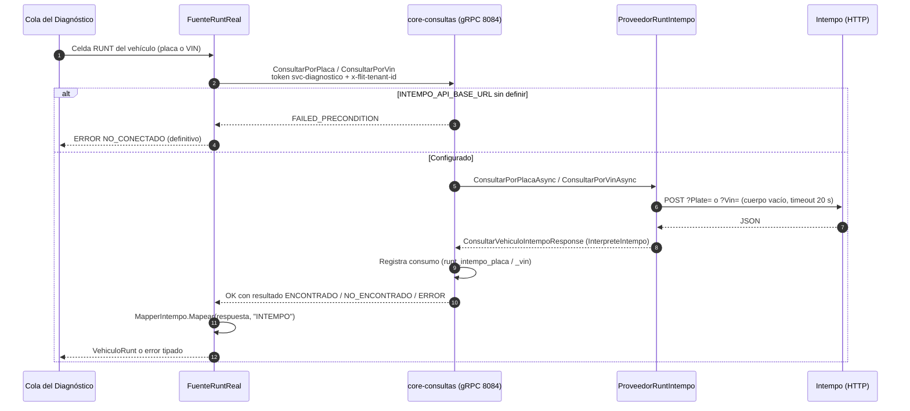
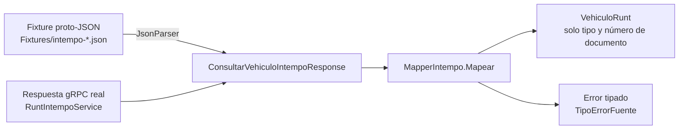

# RUNT por Intempo y entorno local del Diagnóstico — qué se hizo y cómo funciona

> Generado: 2026-10-26. Rama `feature/AB-12881-diagnostico-d0-d2` (local, sin push). Complementa el estado global en
> [estado-implementacion-diagnostico-2026-10-23.md](estado-implementacion-diagnostico-2026-10-23.md) y el set de pruebas en
> [pruebas-validacion-diagnostico-local.md](pruebas-validacion-diagnostico-local.md).

## 1. Resumen

| Qué | Resultado |
|---|---|
| Hueco que se cerró | El RUNT del vehículo del Diagnóstico solo existía **simulado**. Ahora hay una consulta **real** a Intempo como API nativa de `core-consultas`, y el Diagnóstico la usa por gRPC. |
| Work items | Feature **#13872** (épica #12659, proyecto FLIT - DIAGNOSTICO) con 6 HUs **#13873–#13878** (19 SP), activadas por autorización explícita del usuario sin tag DOR. |
| Commits | 6, uno por HU: `fadc67a4e` → `bf2be295b` → `c90f762b0` → `0df00f51d` → `afe8bb966` → `2f2cccf6f`. |
| Pruebas al cierre | core-diagnostico **741/741**, core-consultas **165/165**, 0 omitidas, contra PostgreSQL real. Evidencias rojo → verde publicadas en `Custom.Evidences` de cada HU. |
| Estado de las HUs | Active. Pasan a Resolved después del merge a `develop`. El Closed del Feature es del PO. |
| Entorno local | La suite completa corre en Windows **sin Docker**: RabbitMQ nativo, 6 servicios .NET y 2 frontends, con un script de arranque. |

## 2. Qué se construyó, HU por HU

| HU | Pieza | Dónde | Qué hace |
|---|---|---|---|
| #13873 (H1) | Contrato gRPC | `contracts/proto/flit/consultas/v1/runt_intempo.proto` | Servicio propio `RuntIntempoService` con dos rpcs, `ConsultarPorPlaca` y `ConsultarPorVin`, que devuelven la misma `ConsultarVehiculoIntempoResponse`. La respuesta trae `resultado` (ENCONTRADO / NO_ENCONTRADO / ERROR), `tipo_error`, `http_status`, `duracion_ms`, `errores[{code, description}]` y `VehiculoIntempo`, que es el espejo tipado de las 22 claves del objeto normalizado de la especificación. |
| #13874 (H2) | Intérprete | `services/core-consultas/.../RuntIntempo/InterpreteIntempo.cs`, `MapaTipoDocumentoIntempo.cs`, `PartidoNombre.cs` | Convierte la respuesta cruda de Intempo al objeto normalizado. Es puro, sin logs, y nunca lanza excepciones. Porta del sistema heredado el mapa de tipos de documento y el partido de nombres, con **dos defectos corregidos** por decisión del usuario: el nombre de pila se perdía con prefijos encadenados y se anteponía un «0» al segundo apellido. |
| #13875 (H3) | Cliente HTTP | `.../RuntIntempo/ProveedorRuntIntempo.cs` | Hace un `POST` con `?Plate=` o `?Vin=` y cuerpo vacío. Lee la configuración de las variables `INTEMPO_API_*`. Convierte cada desenlace en un resultado tipado: 404 → no encontrado, arreglo de errores → error del proveedor, y timeout, red, 401/403, 5xx y JSON inválido según corresponda. |
| #13876 (H4) | Servicio gRPC | `.../RuntIntempo/RuntIntempoGrpcService.cs`, `Program.cs`, `docker-compose.prod.yml`, `.env.intempo.example`, `scripts/smoke/` | Expone el servicio con token de servicio (scope `platform.consultas`) y `x-flit-tenant-id`. Registra el consumo como `runt_intempo_placa` / `runt_intempo_vin`. Trae una prueba de humo que solo imprime status, duración y árbol de claves. |
| #13877 (H5) | Mapper del Diagnóstico | `services/core-diagnostico/.../Consultas/Fuentes/MapperIntempo.cs`, `ResultadoRunt.cs`, `FuenteRuntIntempoSimulada.cs`, 8 fixtures | Una **sola ruta** de mapeo para la fuente simulada y la real. Corrige cinco defectos del mapper anterior y suma tres tipos de error: `HTTP_5XX`, `AUTENTICACION` y `ESTADO_NO_OK`. |
| #13878 (H6) | Fuente real | `.../Fuentes/FuenteRuntReal.cs`, `ClienteConsultas.cs`, `SeleccionAdaptadores.cs`, `Modulos.cs`, compose | La celda RUNT consulta por core-consultas con un segundo cliente gRPC y elige el rpc según el identificador. Declara la dirección de core-consultas en el compose del Diagnóstico. |

### Defectos del mapper anterior que se corrigieron (H5)

Con datos reales, el mapper de la ola D2 habría devuelto «respuesta inválida» en **toda** consulta. Estaba escrito contra una forma supuesta, no contra la que entrega Intempo. Se contrastó con la **estructura** (solo claves y tipos, nunca valores) de 7 respuestas reales:

| Antes | Ahora |
|---|---|
| Exigía `codigoResultado`, que no existe en la respuesta real | No lo exige; el resultado viene del contrato gRPC |
| Leía `codigoUUID` como id de transacción | `IdTransaccion` queda nulo |
| Buscaba `cilindraje` y los pasajeros en `informacionGeneral` | Lee `cilidraje` (con la errata de origen) y `datosTecnicos.pasajerosSentados` |
| Tomaba el tipo de documento del texto `tipoDocumento` | Usa `idTipoDocumento`; el texto queda como respaldo |
| Duplicaba locatarios | Une `lessee[]` y `locatarios[]` sin repetir |

## 3. Cómo funciona

### 3.1 Recorrido de una consulta RUNT real



El error del proveedor viaja **dentro** del mensaje, nunca como excepción gRPC. Solo los fallos de la llamada misma (no conectado, red, autenticación) llegan como `RpcException`, y el Diagnóstico los traduce igual que en las demás fuentes de core-consultas.

### 3.2 Simulada y real comparten el mapper



Como los fixtures tienen la misma forma que la respuesta real, lo que se prueba en simulado ejercita el mismo código que corre en producción.

### 3.3 Qué fuente usa la celda RUNT

| `Diagnostico__Simulacion__Habilitada` | `Diagnostico__Consultas__Address` | Fuente RUNT | Resto de fuentes de core-consultas |
|---|---|---|---|
| `true` (solo con `Diagnostico__Ambiente` LOCAL o DEV) | cualquiera | Simulada (fixtures) | Simuladas |
| `false` | vacía | No conectada → `NO_CONECTADO` | No conectadas, no se ofrecen (422) |
| `false` | URL de core-consultas | **Real** | **Reales, todas a la vez** |

> **Ojo al encender un ambiente:** definir `DIAGNOSTICO_CONSULTAS_ADDRESS` enciende **juntas** todas las fuentes reales del Diagnóstico: RUNT, RUNT persona, RUES, SIMIT, avalúo e impuesto. No hay un interruptor por fuente.

### 3.4 Errores de la celda RUNT

| Situación | Código en la celda | ¿Se reintenta? |
|---|---|---|
| Timeout o red | `TIMEOUT` / `RED` | Sí, hasta `Diagnostico:Consultas:MaxReintentos` |
| Intempo responde 5xx | `HTTP_5XX` | Sí |
| 401/403 de Intempo o token de servicio rechazado | `AUTENTICACION` | No |
| Vehículo no registrado (404) | `ESTADO_NO_OK` con «El RUNT no registra el vehículo consultado.» | No |
| Error de negocio del proveedor u otro estado | `ESTADO_NO_OK` | No |
| JSON inválido | `RESPUESTA_INVALIDA` | No |
| Intempo sin configurar o core-consultas sin el rpc | `NO_CONECTADO` | No |

Un error definitivo deja la celda en ERROR, que el administrador puede reprocesar o el backoffice llenar a mano.

### 3.5 Datos personales (Ley 1581)

- El mensaje gRPC lleva nombres, direcciones, teléfonos y correos, porque es el espejo completo de la especificación. Por eso **core-consultas no registra logs ni guarda caché** de esta consulta.
- El Diagnóstico **solo toma el tipo y el número de documento** de propietarios y locatarios, y los cifra con Data Protection como en el resto del producto. Nombres y direcciones nunca llegan a `VehiculoRunt`, a la base ni a los logs.
- Los logs de error llevan solo el código y el tipo de error: nunca la placa, el VIN, documentos ni `ex.Message`.
- Los fixtures y las pruebas usan solo datos inventados: placas `TST###`, VIN `9ZZPRUEBA…`, documentos `99999…`.

## 4. Configuración

### 4.1 core-consultas

| Variable | Defecto | Uso |
|---|---|---|
| `INTEMPO_API_BASE_URL` | **sin defecto** | Base de Intempo, la misma en DEV, QA y PDN. Vacía: el servicio arranca y responde `FAILED_PRECONDITION`. |
| `INTEMPO_API_VEHICLE_PLATE_PATH` | `/api/RuntConsulta/consultar-vehiculo` | Ruta por placa |
| `INTEMPO_API_VEHICLE_VIN_PATH` | `/api/RuntConsulta/consultar-vin` | Ruta por VIN |
| `INTEMPO_API_SECONDS_TIMEOUT` | `20` | Timeout HTTP |

Plantilla en `.env.intempo.example`. `INTEMPO_MODE` e `INTEMPO_BASE_URL` son del proveedor heredado de core-api y no se cruzan con estas.

### 4.2 core-diagnostico

| Variable | Defecto | Uso |
|---|---|---|
| `Diagnostico__Consultas__Address` | **sin defecto** (`DIAGNOSTICO_CONSULTAS_ADDRESS` en el compose) | gRPC de core-consultas, p. ej. `http://core-consultas:8084` |
| `Diagnostico__Ambiente` | **sin defecto** (`DIAGNOSTICO_AMBIENTE`) | `LOCAL`, `DEV`, `QA` o `PDN`. Solo se valida si la simulación está encendida. |
| `Diagnostico__Simulacion__Habilitada` | `false` | No se declara en el compose: QA y PDN nunca la encienden. |
| `Diagnostico__Consultas__DeadlineSegundos` | `90` | Deadline de cada llamada gRPC |

### 4.3 Requisitos para encender la fuente real en un ambiente

1. **Prueba de humo real** con Intempo encendido (estaba apagado el 2026-10-23), desde local y con una placa que da el usuario por argumento:
   `INTEMPO_API_BASE_URL=<url> python -I scripts/smoke/humo-intempo.py <placa>`. La salida no se pega en ADO, ni en logs ni en commits.
2. **Scope `platform.consultas` para `svc-diagnostico` en core-api.** Hoy `services/core-api/src/Flit.Api/appsettings.json` no lo incluye, y sin él la ruta real falla por autorización. En local se agrega por variable de entorno (ver §5). Hay que corregirlo en el repo antes del paso 3.
3. Definir `INTEMPO_API_BASE_URL` en el `.env` de core-consultas y `DIAGNOSTICO_CONSULTAS_ADDRESS` en el del Diagnóstico, sabiendo que esto enciende todas las fuentes (§3.3).
4. Revisiones pendientes: architecture-agent sobre las excepciones de `buf lint` del proto (dos rpcs con una respuesta compartida), y security-agent sobre H1 y H3–H6.

## 5. Entorno local (Windows, sin Docker)

### 5.1 Qué se instaló y configuró

| Pieza | Detalle |
|---|---|
| Erlang OTP 27.3.4.18 | Con winget, en `C:\Program Files\Erlang OTP` |
| RabbitMQ 4.2.9 | Zip oficial de GitHub (sha256 verificado contra el digest publicado) en `~/.flit/rabbitmq/servidor`, datos en `~/.flit/rabbitmq/datos`. Vhost `flit` y exchanges desde `deploy/rabbitmq/definitions.json`. Usuarios `tramites`, `consultas`, `notificaciones` y `diagnostico` con los mismos permisos mínimos de `deploy/rabbitmq/usuario-de-servicio.sh`, más `flit-admin` para la consola. |
| Claves locales | `~/.flit/local.env`, fuera del repo: secretos de los clientes de servicio y de RabbitMQ, generados al azar. |
| Script | `scripts/dev/levantar-diagnostico-local.sh` (ignorado por git, como todo `scripts/dev/`). |
| `frontend-diagnostico/.env.local` | Copia de `.env.example` (sin secretos) |

Los `appsettings.Development.json` que ya existían (core-api, core-consultas, gateway) **no se leyeron ni se modificaron**: lo que faltaba se pasa por variables de entorno, que mandan sobre el archivo. Entre otras: los secretos de los clientes de servicio de ambos lados, el `svc-diagnostico` con `platform.consultas`, las cadenas AMQP, los proveedores de core-consultas en `mock`, el override del host `diagnostico` (quita el «Próximamente» del hub) y la dirección del gateway para el manifiesto.

### 5.2 Uso

```bash
bash scripts/dev/levantar-diagnostico-local.sh simulado               # primera vez: compila todo
bash scripts/dev/levantar-diagnostico-local.sh simulado --sin-build   # siguientes veces
bash scripts/dev/levantar-diagnostico-local.sh real                   # RUNT por core-consultas
bash scripts/dev/levantar-diagnostico-local.sh parar
```

Para cambiar de modo hay que `parar` primero: los servicios que ya corren no se reinician. Los logs quedan en `~/.flit/logs/<servicio>.log`.

| App | Puerto |
|---|---|
| Hub (login) | http://127.0.0.1:4022 |
| frontend-diagnostico | http://127.0.0.1:4024 |
| Gateway | 4002 |
| core-api | 4003, gRPC 8082 |
| core-consultas | 4026, gRPC 8084 |
| core-notificaciones | 4027, gRPC 8085 (correo solo al log) |
| core-diagnostico | 4029, gRPC 8087 |
| RabbitMQ | 5672, consola http://127.0.0.1:15672 (usuario `flit-admin`) |

Base de datos: `flit_local` en el PostgreSQL nativo (`127.0.0.1:5432`).

### 5.3 Primer ingreso

1. Abre http://127.0.0.1:4022, **nunca** `localhost`: las cookies de otras apps hacen fallar las peticiones.
2. Enciende **Diagnóstico** para la compañía de `admin@empresa.local`, que viene apagado en la base local. La pantalla de productos de la compañía vive en **Trámites** (`frontend`, puerto 3000), y el script no la levanta. Arráncala aparte, como en `docs/suite/local.md` §3 (`FLIT_SESSION_MODE=oidc`). Entra como `demo@flit.local` (SuperAdmin) y enciende el producto en la configuración de la compañía. Al terminar puedes apagar Trámites para liberar memoria.
3. Entra como `admin@empresa.local`, que tiene el rol «Administrador de Diagnóstico», y abre Diagnóstico.

Las contraseñas de los usuarios de semilla están en `services/core-api/src/Flit.Infrastructure/Security/DevelopmentAuthSeeder.cs`.

### 5.4 Problemas conocidos

| Síntoma | Causa y arreglo |
|---|---|
| `NOT_ALLOWED - access to vhost 'flit' refused` en los logs | Faltan los permisos de RabbitMQ. El script los aplica por la API de la consola, porque `cmd.exe` parte las expresiones regulares en cada `\|`. |
| «Manifiesto de Diagnóstico sin registrar» | Falta `Diagnostico__Plataforma__GatewayUrl`. El script ya la pasa, y el servicio reintenta solo. |
| El equipo se pone lento | La pila completa consume bastante memoria. `parar` y volver a levantar con `--sin-build`. |
| core-api, core-consultas, core-notificaciones y core-diagnostico escuchan en `0.0.0.0` | Viene de la configuración local de cada servicio; quedan visibles en la red local. |

## 6. Pendientes

| # | Pendiente | Quién |
|---|---|---|
| 1 | Prueba de humo real cuando Intempo vuelva | Usuario |
| 2 | Agregar `platform.consultas` a `svc-diagnostico` en `services/core-api/src/Flit.Api/appsettings.json` | Por decidir (fuera del alcance de F10) |
| 3 | Revisión de arquitectura de las excepciones de `buf lint` y de seguridad de H1, H3–H6 | architecture-agent / security-agent |
| 4 | Texto para `AUTENTICACION` en `frontend-diagnostico/lib/tablero/detalle.ts` | Frontend |
| 5 | Listar `RuntIntempoService` en `contracts/proto/README.md` y actualizar el comentario de `FuenteRuntNoConectada.cs` (todavía dice «hasta C-PER») | Por decidir |
| 6 | Push, PR a `develop`, reviews y reviewer humano; luego HUs a Resolved | Equipo |
