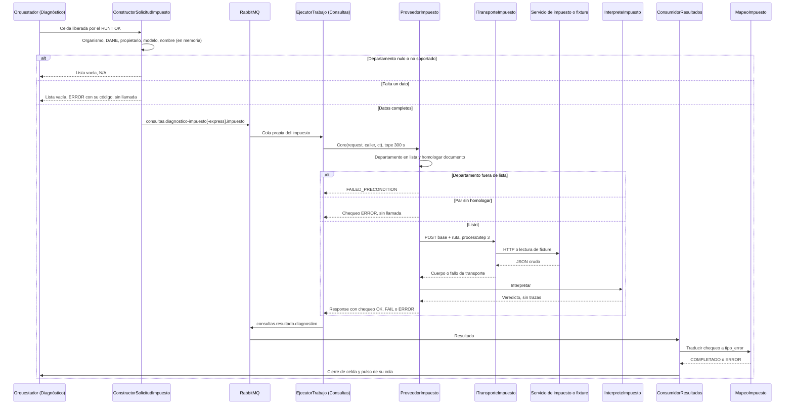

# Plan C3 — consulta de impuesto vehicular de Diagnóstico

Fecha: 2026-11-04. Estado: propuesta, sin implementar. No hay work item: la sección Trazabilidad propone el Feature. Todas las decisiones P1 a P9 están cerradas. Las marcas como `[P8=a]` señalan lo que depende de la opción elegida.

Pedido: dejar montados los modelos, las estructuras, las colas y la URL de las API reales, con un modo simulado porque esas API están apagadas. Los JSON de ejemplo salen del perfil agregado de la BD local.

Este plan no enciende nada real. Lo que se puede terminar ya es el modo simulado. El encendido real depende de la enmienda de ADR-0075, de la revisión de Seguridad y Habeas Data, de la constancia de Legal (plan v2 :522) y de los huecos de la sección Huecos.

## Lo que dicen los datos

Fuentes:

- `public.vehicle_fleet_detail_json_log`, `type_query='taxes'`: 3.050 filas, 2025-04-25 a 2026-03-12.
- `vehicle_fleet_detail_json.response_data_taxes`: 3.029 con HTTP 200, de las cuales 805 traen error.
- `D:\FLIT\BackCrudTransfer_master\docs\flotas-consulta-impuesto-vehicular.md` y el código de ese backend.

Solo perfil agregado. Ningún fixture ni ejemplo de este plan copia valores de esas tablas.

**La línea base es el paso 3.** El paso no depende del departamento, sino de la fecha: paso 2 de 2025-04 a 2025-12 y paso 3 de 2025-12 a 2026-03, sin solape posterior. El código antiguo fija el 3 desde el commit 427b6752 del 2025-12-03 (`vehicleFleetTaxesService.ts:106`, BUG-6787). Los departamentos «solo paso 3» son simplemente los que se agregaron después.

| Clase | Definición | Paso 2 (histórico) | **Paso 3 (vigente)** | % del paso 3 |
| --- | --- | --- | --- | --- |
| `deuda` | debt=true, typeError=0 | 46 | **33** | 4,8 |
| `sin_deuda_con_datos` | debt=false, typeError=0, algún campo con dato | 224 | **106** | 15,5 |
| `sin_deuda_en_blanco` | debt=false, typeError=0, sin datos | 774 | **16** | 2,3 |
| `error_con_bandera` | trae los campos y typeError≠0 | 283 | **136** | 19,8 |
| `solo_error` | solo `observationError` | 338 | **308** | 44,9 |
| `vacia` | `{}` | 699 | **87** | 12,7 |

### Resultado por departamento, paso 3

| Departamento | Filas | Con typeError=0 | Lectura |
| --- | --- | --- | --- |
| 13 Bolívar | 87 | 78 | Limpio |
| 41 Huila | 25 | 19 | Limpio |
| 68 Santander | 46 | 26 | Aceptable |
| 76 Valle | 24 | 19 | Los 16 en blanco son todos de aquí |
| 63 Quindío | 14 | 5 | Débil |
| 05 Antioquia | 147 | 6 | 87 `{}` y 54 errores |
| 25 Cundinamarca | 326 | 1 | Casi todo error, con timeouts de página |
| 17 Caldas | 14 | 1 | Casi todo error |
| 08 Atlántico | 2 | 0 | Credenciales faltantes |
| 44 La Guajira | 1 | 0 | Error |

Los datos terminan en 2026-03. No dicen nada del estado actual de los portales.

### Formas de respuesta

| Forma | Llaves | Filas | Dónde se vio | Trato |
| --- | --- | --- | --- | --- |
| Completa | 16 con `observationError` | 1.618 en el log | Log | Normal |
| Solo error | `observationError` | 646 en el log | Log | Por contenido |
| Vacía | `{}` | 786 en el log | Log | `NO_CONFIRMADO` |
| **Corta** | `pendingDebtTaxes`, `pendingDetailTax`, `pendingTotalToPay` | 823 | Solo `response_data_taxes`. 814 de 2025-07/08 y 4 de 2026-02 | **Sin `typeError`: no confirma** |
| Corta con error | Corta + `observationError` | 1 | `response_data_taxes` | Según `observationError` |
| Extendida | 16 + `descriptionError`, `descriptionErrorDevelopment`, `typeError` en la raíz, vacíos | 39, de 2025-09 a 2026-02 | `response_data_taxes` | Normal. La raíz vacía no cuenta |
| Sin detalle | Completa sin `pendingDetailTax`, con error | 26 | `response_data_taxes` | Por contenido |

Variantes de la corta: false/cero 559, true/cero 187, true/monto 70, true/con detalle 4, false/monto 3.

### Consecuencias para el diseño

- HTTP 200 no dice nada. El resultado está en el cuerpo. El antiguo cierra todo 200 aunque traiga error, y no reintenta. **No es referencia:** se mantienen la clasificación de este plan y D-12.
- `pendingDebtTaxes=false` no es paz y salvo sin `typeError=0` explícito. Son 409 de 1.529 con error en el log, y 562 respuestas cortas sin `typeError` que dirían «sin deuda».
- **`pendingDebtTaxes=true` tampoco trae monto siempre.** Con typeError=0 y debt=true: 50 con monto y **29 sin monto** (total vacío o «0»). `monto_total=0` silenciaría la regla IMPUESTO (`EvaluadorDictamen.cs:55-56` solo dispara con monto>0) y el PDF diría $0. Por eso existe `tiene_deuda`.
- `typeError` no alcanza para clasificar: el mismo código mezcla errores definitivos y transitorios.
- Con solo paso 3 y P2 cerrada, COMPLETADO es el 23 %: 155 de 686. Casi el 65 % son errores, sobre todo de Cundinamarca.

**Correlación retirada.** La versión anterior de este plan leía «Cédula Ciudadanía» como un valor malo asociado al blanco. Es el valor correcto de Valle (`documentMappings.ts`). El blanco del paso 2 se explica por Valle y Antioquia, no por el tipo de documento.

## Decisiones cerradas

| Id | Decisión | Evidencia o quién |
| --- | --- | --- |
| P1 | Siempre `processStep=3`. La lista de departamentos no lleva paso | Código y log, arriba |
| P2 | **Decidida por el usuario, opción a.** `typeError=0` explícito con debt=false, incluso sin datos, es COMPLETADO sin deuda, sin inventar valores ni fechas. Sin regla especial por departamento. Una respuesta sin `typeError` explícito igual a 0 sigue sin confirmar | El documento del usuario: `typeError=0` significa «el organismo respondió». Ver riesgo aceptado abajo |
| P3 | Sin autenticación: sin cabecera ni `credentials` en el cuerpo. `credentials` es interno del servicio | `scrapingServiceApiProxy.ts:55-58,102-110`. Seguridad valida esto en el checklist |
| P4 | Primer propietario de `personas_vehiculo` por orden, también en leasing, como `ConstructorSolicitudSimitVehiculo` | La captura de Diagnóstico no pide documento de propietario (`ExpressDtos.cs:29-36`, `PlantillaCarga.cs:21-32`), a diferencia del antiguo. Las filas de rol propietario solo tienen origen PROVEEDOR |
| P5 | **Decidida por el usuario, opción a.** La celda con deuda deja de verse verde, también la deuda sin monto. `FUENTE_PENDIENTE` incluye el impuesto solo si la fuente está en el alcance. Va después del corte 8 | Corte C3-9 |
| P9 | **Decidida por el usuario, opción a.** Descifrar en memoria la respuesta RUNT al armar la solicitud. Sin columnas nuevas para el nombre. Viaja solo en el mensaje de la cola | Ver abajo |

**Riesgo aceptado de P2.** En Valle, 16 de las 19 respuestas sin error del paso 3 vienen en blanco. Si en ese departamento el blanco significara «no se pudo consultar», esas celdas se verían como sin deuda sin serlo. El usuario lo acepta y no se crea una regla por departamento. **El humo debe observarlo:** si Valle se enciende, se compara una placa con deuda conocida antes de darlo por bueno (checklist, paso 9).

**Lo independiente de P5.** El dictamen dispara con `tiene_deuda` (C3-9), también sin monto. Queda por resolver si cambiar lo que evalúa una regla sube la versión del catálogo de reglas de ADR-0077 (H-19).

**Lo que condiciona P9.** La enmienda de ADR-0075 y la revisión de Seguridad y Habeas Data son condición del **encendido real**, no del modo simulado. Razón: el constructor documenta «nunca nombres ni direcciones (U1 = b)» (`ConstructoresSolicitud.cs:16-17`, AsyncAPI `:182`), y el riesgo H2 de datos en claro en outbox, colas y DLQ sigue abierto. La DLQ retiene 7 días. En modo simulado el nombre es sintético.

`OwnerName` está en las 686 filas del paso 3 y viene de `owner[0].name` del RUNT. En Diagnóstico se descarta al normalizar (`MapperIntempo.cs:28-30`), y sobrevive solo en la respuesta cifrada de la celda RUNT (`ConsumidorResultados.cs:122-127`, `RespuestaFuenteCelda.cs:36-43`). No hay evidencia de que el servicio funcione con el nombre vacío. **Fallback:** si la celda RUNT no tiene respuesta completa o no se puede descifrar, ERROR `SIN_NOMBRE_PROPIETARIO`, sin llamada, visible.

Hay una trampa en ese fallback: `ReutilizacionMismoDia.cs:111` arma el resultado sin copiar la respuesta cifrada, y **el RUNT solo vuelve a correr desde ERROR**. Un vehículo con RUNT reutilizado quedaría en ese error sin salida. C3-6 hace que la reutilización del RUNT copie también la respuesta cifrada (H-17).

## Qué ya está

### core-consultas

| Pieza | Dónde | Estado |
| --- | --- | --- |
| Rpcs de impuesto y capacidad | `contracts/proto/flit/consultas/v1/consultas.proto:56-65,248-276` | Definidos. El request no lleva documento |
| Servicio gRPC | `ConsultasGrpcService.cs:42-60` | No los sobrescribe: UNIMPLEMENTED |
| Ejecutor del bus | `Bus/EjecutorTrabajo.cs:96-113` | Simula antes de llamar. El impuesto real cae en el default Unimplemented |
| Parser del bus | `EjecutorTrabajo.cs:54` | **Estricto:** una clave desconocida es InvalidArgument. Define el orden de despliegue |
| Colas | `deploy/rabbitmq/definitions.json:12-19`, `contracts/asyncapi/consultas-events.v1.yaml:102,175` | `consultas.diagnostico.*` y `-express.*` absorben `impuesto`. P8 lo cambia |
| Publicación | `Bus/PublicadorResultado.cs:27-44` | Genérica sobre `IMessage`. Sin cambios |
| Patrón HTTP | `RuntIntempo/ProveedorRuntIntempo.cs`, `InterpreteIntempo`, `Program.cs:124-126`, `.env.intempo.example`, `docker-compose.prod.yml:620-623`, `scripts/smoke/humo-intempo.py` | A copiar, salvo su enum propio de errores |
| Simulador | `Simulacion/SimuladorConsultas.cs:72,209-225`, `OpcionesSimulacion.cs` | Por último carácter de placa, ignora departamento y documento, y salta el mapeo real. Solo afecta al bus. Falla el arranque fuera de LOCAL y DEV |
| Tope por trabajo | `Bus/OpcionesConsumidoresDiagnostico.cs:42,47,59`, `EjecutorTrabajo.cs:61-63` | 90 s, uno solo para todas las fuentes |

### core-diagnostico y pantalla

| Pieza | Dónde | Estado |
| --- | --- | --- |
| Compuerta | `Modulos/Consultas/FuentesDisponibles.cs:27-29` | adaptador ∧ no marcada ∧ `Diagnostico:Fuentes:ImpuestoDisponible` ∧ HaySoportados |
| Réplica de departamentos | `Catalogos/DepartamentoImpuesto.cs`, `SincronizacionDepartamentosImpuesto.cs`, `CapacidadImpuestoPlataforma.cs:29-38` | Vacía, porque el rpc no responde. Este es el bloqueo de fondo |
| Constructor | `Bus/ConstructoresSolicitud.cs:157-175` | Placa y departamento. Nada más |
| Ejecutor | `EjecutorCeldaImpuesto.cs:46-87` | Lista vacía sin placa = ERROR. Cualquier otra lista vacía = N/A. **Con las precondiciones nuevas se vuelve una trampa:** ver C3-6 |
| Mapeo | `Mapeos/MapeoImpuesto.cs:24-38`, `Fuentes/TraductorErroresConsultas.cs:90-97` | Chequeo en ERROR = `HTTP_5XX`, transitorio |
| Motivo por el bus | `IEjecutorCelda.cs:82`, `TraductorErroresConsultas.cs:106-121` | `motivoFallo` cambia el `HTTP_5XX`. **Un motivo desconocido sigue siendo `HTTP_5XX`, o sea transitorio** |
| Clasificación | `Domain/Consultas/ClasificadorErrores.cs:28-37` | TIMEOUT, RED, HTTP_5XX, LIMITE_PROVEEDOR son transitorios. Lo demás es definitivo |
| Columna de error | `Persistence/Configuraciones/ConsultaConfig.cs:59-61`, `IntentoConsultaConfig.cs:50` | `tipo_error` máximo 32. Texto libre: un código nuevo no pide migración |
| Reutilización | `ReutilizacionMismoDia.cs:74` | Solo COMPLETADO con origen API. Un ERROR no se reutiliza, sin tocar nada |
| Reconciliador | `Modulos/Trabajos/ReconciliadorConsultas.cs:28-38,75` | Cierra a las 24 h + margen. Declara perdida con marca de agua por cola, solo lote o Express. Ver P8 |
| Aplicabilidad | `Domain/Consultas/ReglasAplicabilidad.cs:37-38` | Público = N/A. Departamento nulo o no soportado = N/A |
| Semáforo | `components/tablero/CeldaSemaforo.tsx:28-46` | COMPLETADO es verde aunque haya deuda |
| Dictamen | `Dictamen/LectorHechosDictamen.cs:152-153`, `Domain/Dictamen/EvaluadorDictamen.cs:55-56,124-135` | Monto>0 dispara IMPUESTO. `FUENTE_PENDIENTE` no incluye impuesto: un ERROR no avisa |

### Disponibilidad de cada dato al publicar

| Dato del cuerpo | De dónde sale | ¿Disponible? |
| --- | --- | --- |
| `plateNumber` | `vehiculos.placa` | Sí |
| `documentNumber` | `personas_vehiculo.DocCifrado`, primer propietario, normalizado. NIT sin dígito de verificación (2.166 de 9 dígitos, 19 de 10) | Sí, descifrado en memoria |
| `documentType` | `DocTipo`, homologado en core-consultas | Sí, según tabla |
| `processStep` | 3 | Constante |
| `detail.secretaryDepartmentCode` | `vehiculos.departamento_codigo` (DANE) | Sí |
| `detail.secretaryName` | `vehiculos.organismo_nombre`, texto del RUNT | Sí |
| `detail.secretaryDepartmentDescription` | `organismos.DepartamentoNombre`, relectura por nombre (`Organismo.cs:8-21`) | Puede ir vacío |
| `detail.secretaryCity` | `municipality` del organismo | **No.** `catalogos.proto:35-39` lo expone y `CatalogoOrganismosGrpc.cs:20` lo descarta. **Requiere migración** |
| `detail.vehicleModel` | `datos_consolidados.vehiculo.modelo`, entero o null (`MapperIntempo.cs:150,216-222`) | Puede ser null |
| `detail.OwnerName` | Respuesta cifrada de la celda RUNT (P9) | Sí, si la celda tiene respuesta completa |
| `detail.Owner*` de contacto y dirección, `ownerAddressComplete` | Constantes de FLIT: `IMPUESTO_CONTACTO_*` | Sí, por configuración |
| `detail.vehicleFuelType`, `vehicleServiceType`, `vehicleType` | Siempre vacíos | Constante |

### Homologación de documento

Vive en core-consultas, que es quien conoce al proveedor (`documentMappings.ts:3-41`). Par no mapeado: no se consulta.

| Código en Diagnóstico | Grupo común (05, 25, 13, 68, 08, 11, 81, 18, 41, 44, 17, 94, 50, 52, 63) | Valle (76) |
| --- | --- | --- |
| CC | `CC` | `Cédula Ciudadanía` |
| NIT | `NIT` | `NIT` |
| CE | `CE` | `Cédula Extranjería` |
| TI | `TI` | `Tarjeta de Identidad` |
| **PAS** | **`PASAP`** | `Pasaporte` |
| RC | `RC` | No mapeado |
| CD | No mapeado | `Carnet Diplomático` |
| Cualquier otro | No mapeado | No mapeado |

Trampa: la tabla antigua usa `PS` y Diagnóstico usa `PAS` (`ValidadorDocumentoPersona.cs:24-27`). Se escribe con `PAS`; una copia literal nunca lo encontraría. Un código desconocido de Intempo pasa tal cual (`DocumentosVehiculo.cs:211-217`, `MapperIntempo.cs:90-123`): cae en no mapeado.

Departamentos candidatos: esos 16, solo 10 con tráfico observado. `IMPUESTO_DEPARTAMENTOS` con un código fuera de la tabla impide arrancar.

## Opciones de arquitectura

### Dónde vive la consulta

Conflicto vigente: plan v2 :520 pone el scraper dentro de core-consultas; acta `acta-reunion-consultas-colas-y-servicios.md:81-83` pide servicio independiente y usar el actual; ADR-0075:325-326 propone core-consultas como fachada.

| Opción | Pros | Contras | Esfuerzo | Riesgo |
| --- | --- | --- | --- | --- |
| **A — fachada: core-consultas llama al servicio actual por HTTP** | Coincide con el pedido, el acta y el ADR-0075. Copia un patrón existente. Sin Playwright en core-consultas. El servicio se puede reemplazar sin tocar Diagnóstico | Dependemos de un servicio que no está en el repo | M | Dueño por confirmar (H-3) |
| B — scraper dentro de core-consultas (plan v2) | Código propio y versionado. Sin servicio aparte | Reescribe 16 portales. Lleva un navegador al servicio de consultas | L | Mantener portales |
| C — Diagnóstico llama directo al servicio | Menos saltos | Rompe R-23 y ADR-0075. Sin bus, sin consumo medido. Homologación del proveedor en Diagnóstico | S | Contradice decisiones vigentes |

Recomendada: **A**. El plan la asume y **la marca para ratificación del Líder Técnico**, porque descarta lo escrito en plan v2 :520. Va al ADR de C3-1, en Propuesto.

### Cómo se simula

La regla del encargo: el simulador sirve JSON crudo sintético y pasa por el mismo intérprete que la API real.

| Opción | Pros | Contras | Esfuerzo | Riesgo |
| --- | --- | --- | --- | --- |
| **A — transporte simulado: `ITransporteImpuesto` con versión HTTP y versión de fixtures** | Corre todo el camino real: lista de departamentos, homologación, armado del cuerpo, intérprete, clasificación, mapeo. Cubre bus y gRPC, incluido `ListarDepartamentosImpuesto`. Se puede afirmar el cuerpo enviado. Pasar a real es solo cambiar el transporte | El impuesto sale del atajo de `EjecutorTrabajo:96`: hay una excepción en esa línea | M | Bajo |
| B — extender `SimuladorConsultas.Impuesto` para leer el fixture y llamar al intérprete | Menos cambio. Conserva el atajo | No ejercita homologación ni armado del cuerpo. `ListarDepartamentosImpuesto` necesita una rama aparte | S | Modo simulado y real divergen |
| C — stub HTTP aparte, como el de Kyverum en local | Sin código de simulación en el servicio. HTTP de verdad | Otro proceso en LOCAL y DEV. Sin guardia de arranque en QA o PDN | M | Se olvida o se desalinea |

Recomendada: **A**. `Consultas__Simulacion__Fuentes=impuesto` y `Habilitada=true` eligen el transporte al componer servicios. La guardia de arranque de `OpcionesSimulacion` no cambia.

### Dónde se guarda lo nuevo

| Opción | Pros | Contras | Esfuerzo |
| --- | --- | --- | --- |
| **A — campos aditivos en proto y en `ResultadoImpuesto`, en el payload existente** | Sin tabla nueva. Tipado. Fuera `descriptionErrorDevelopment` por construcción | Hay que repetir la forma en cinco sitios | M |
| B — `incluir_respuesta_cruda` y pintado genérico | Casi sin código | Expone trazas internas y placas. Sin tipos para PDF ni Excel. Obliga a ampliar ADR-0076:271 | S |
| C — tabla propia | Consultable por columna | Migración adicional, sin una consulta que la pida | L |

Recomendada: **A**. `ConstructoresSolicitud.cs:170` sigue sin respuesta cruda, así que **ADR-0076:271 no necesita ampliarse**.

## Solución



### Precondiciones

Orden: RUNT OK → organismo → DANE → homologar documento → POST. El antiguo salta en silencio. Este plan da un resultado visible, **sin llamada**, en cada falta.

| Falta | Dónde se detecta | Resultado |
| --- | --- | --- |
| RUNT no OK | Orquestador | Bloqueada por RUNT, como hoy |
| Servicio público | `ReglasAplicabilidad` | N/A `SERVICIO_PUBLICO` |
| Sin placa | Constructor | ERROR `SIN_PLACA` |
| Organismo fuera de la réplica o ambiguo: departamento nulo | Constructor | N/A `DEPARTAMENTO_NO_SOPORTADO` |
| Departamento fuera de la réplica | Constructor | N/A `DEPARTAMENTO_NO_SOPORTADO` |
| Sin propietario con documento | Constructor | ERROR `SIN_DOCUMENTO` |
| Modelo null | Constructor | ERROR `SIN_MODELO` |
| Municipio o nombre de departamento vacíos | Constructor | ERROR `ORGANISMO_INCOMPLETO` |
| Respuesta RUNT sin nombre o ilegible | Constructor | ERROR `SIN_NOMBRE_PROPIETARIO` |
| Departamento fuera de la lista: carrera con la réplica | Proveedor | ERROR `ESTADO_NO_OK` (`FAILED_PRECONDITION`) |
| Par departamento y tipo sin homologar | Proveedor | ERROR `DOCUMENTO_NO_HOMOLOGADO` |

Todos son definitivos, y reprocesables desde el tablero. **Modelo null:** el log trae «Error seleccionando modelo», que indica que el servicio lo usa. Sin modelo no se gasta una llamada de minutos en un error anunciado.

### Contrato gRPC, aditivo

Se comprueba con `pnpm dlx @bufbuild/buf@1.73.0 breaking`, desde `contracts/proto`. `optional` distingue vacío de cero.

```proto
message ConsultarImpuestoVehicularRequest {
  OpcionesConsulta opciones = 1;
  flit.platform.v1.Placa placa = 2;
  string departamento_codigo = 3;
  // Numero y tipo, con el mismo mensaje de ConsultarMultasRequest. El tipo va sin homologar.
  DocumentoIdentidad documento = 4;
  optional string organismo_nombre = 5;
  optional string municipio = 6;
  optional string departamento_nombre = 7;
  optional int32 modelo = 8;
  // P9: descifrado en memoria de la respuesta RUNT. Solo en este mensaje; no se persiste en Diagnóstico.
  optional string propietario_nombre = 9;
}

message ConsultarImpuestoVehicularResponse {
  ResultadoConsulta resultado = 1;
  // Suma de lo no pagado o total informado. Significativo solo con monto_informado.
  int64 monto_total = 2;
  repeated VigenciaImpuesto vigencias = 3;
  // El servicio confirma deuda con typeError=0, tenga o no valor.
  bool tiene_deuda = 4;
  bool monto_informado = 5;
  optional int64 intereses_mora = 6;
  optional int64 sanciones = 7;
  optional int64 avaluo_comercial = 8;
  optional UltimoPagoImpuesto ultimo_pago = 9;
  optional string liquidacion_consolidada_id = 10;
  optional string periodo_certificacion = 11;
  optional string fecha_consulta_proveedor = 12; // AAAA-MM-DD
  // Con chequeo en ERROR: lo informado es parcial y no confirma.
  bool dato_parcial = 13;
}

message VigenciaImpuesto {
  int32 anio = 1;
  int64 valor = 2;
  bool pagada = 3;
  optional string liquidacion_id = 4;
  optional int64 avaluo = 5;
}

message UltimoPagoImpuesto {
  optional int32 anio = 1;
  optional int64 valor = 2;
  optional string fecha = 3; // AAAA-MM-DD
}
```

`monto_total` sigue siendo no `optional` para no tocar la forma del campo 2. En el payload, `ResultadoImpuesto.MontoTotal` pasa a anulable: null si `monto_informado=false`.

Nunca en el proto: `descriptionErrorDevelopment`, `descriptionError`, `pendingValidity`. Los dos primeros traen trazas y a veces la placa. El tercero es texto libre. Sirven para clasificar en memoria. No se guardan ni se registran.

**Orden de despliegue**, por el parser estricto:

1. `definitions.json` con las colas nuevas `[P8=a]`.
2. core-consultas: admite el request nuevo y consume las colas.
3. core-diagnostico: migración, constructor y llave de ruteo.
4. Configuración de encendido.

Al revés, Consultas respondería InvalidArgument a cada trabajo. Como la fuente sigue apagada hasta el paso 4, no hay tráfico en la ventana. Para revertir: vaciar la lista, dejar drenar las colas, y luego desplegar a la inversa.

### Modelo de datos

Una columna en un catálogo global, sin entidades nuevas. `ResultadoImpuesto` crece dentro del `payload` existente, con todos sus campos nuevos anulables. El nombre del propietario **no** se persiste como columna (P9).

DDL de referencia. Lo materializa `database-agent`, por `checklist-validacion-schema.md`:

```sql
ALTER TABLE diagnostico.organismos ADD COLUMN municipio text NULL;
COMMENT ON COLUMN diagnostico.organismos.municipio IS 'Municipio del organismo, de catalogos.proto. Lo exige la consulta de impuesto.';
```

Las filas existentes quedan en null hasta la siguiente sincronización: hasta entonces la celda da `ORGANISMO_INCOMPLETO`, que es visible.

### Configuración

Patrón `IMPUESTO_API_*`, análogo a `INTEMPO_API_*`. Sin URL en código ni defecto en la base.

| Variable | Dónde | Para qué |
| --- | --- | --- |
| `IMPUESTO_API_BASE_URL` | core-consultas | Sin defecto. Antes: `SCRAPING_SERVICE_API_BASE_URL` |
| `IMPUESTO_API_PATH` | core-consultas | Antes: `SCRAPING_SERVICE_QUERY_TAX_API_PATH`. Ruta observada `api/v1/tax/detail` |
| `IMPUESTO_API_TIMEOUT_SECONDS` | core-consultas | Por debajo del tope por fuente: 280. Antes: `SCRAPING_SERVICE_QUERY_TAX_API_SECONDS_TIMEOUT`, valor no leído (H-16) |
| `IMPUESTO_DEPARTAMENTOS` | core-consultas | `13,41`. **El interruptor** |
| `IMPUESTO_CONTACTO_*` | core-consultas | Contacto y dirección fijos del paso 3. No se versionan los valores |
| `Consultas__Diagnostico__TiempoMaximoPorFuente__impuesto` | core-consultas | `[P8=a]` 300 |
| `Consultas__Diagnostico__ImpuestoLote__*`, `ImpuestoExpress__*` | core-consultas | `[P8=a]` Concurrencia y prefetch |
| `Consultas__Simulacion__Fuentes` | core-consultas | `impuesto`, solo LOCAL y DEV |
| `DIAGNOSTICO_IMPUESTO_DISPONIBLE` | compose de diagnóstico | Reemplaza el `false` fijo de `docker-compose.prod.yml:494`. Por defecto `false` |

**Unión de la URL.** `POST {base}{path}`. El `:3901api` del log sale de concatenar sin barra. El cliente recorta y une con exactamente una barra: el test cubre base con y sin barra, y ruta con y sin barra. El host de PDN no se versiona aquí.

**Regla de capacidad.** `ListarDepartamentosImpuesto` responde `IMPUESTO_DEPARTAMENTOS` solo si hay transporte listo: simulado o con base y ruta. Si no, lista vacía. Sigue la D5-Q2: lista vacía con OK apaga todo y la réplica conserva las filas.

**Un solo cambio por ambiente.** La URL, el contacto y `DIAGNOSTICO_IMPUESTO_DISPONIBLE=true` se dejan puestos por adelantado. No hacen nada mientras la lista esté vacía: `FuentesDisponibles` también exige HaySoportados.

| Ambiente | De | A | Cambio único |
| --- | --- | --- | --- |
| LOCAL, DEV | Simulado | Real | Quitar `impuesto` de `Consultas__Simulacion__Fuentes`. La lista es la misma en los dos modos |
| QA, PDN | Apagado | Real | Llenar `IMPUESTO_DEPARTAMENTOS`. La simulación no se admite ahí |
| Cualquiera | Encendido | Apagado | Vaciar `IMPUESTO_DEPARTAMENTOS` |

## Clasificación

El intérprete lee en este orden, y lo primero que aplique gana. La bandera `pendingDebtTaxes` va de última a propósito.

1. Cuerpo no JSON, o JSON que no es objeto.
2. `{}`.
3. Sin `observationError.typeError` explícito: nunca confirma. Cubre la forma corta. Un `typeError` de raíz vacío no cuenta.
4. `typeError` distinto de 0, o `pendingValidity` con un mensaje de error conocido.
5. `pendingDebtTaxes`, con `typeError=0`.

### Por combinación

La columna de filas es del paso 3 cuando existe la clase.

| Combinación | Filas paso 3 | Celda | `tipo_error` | Reintento | Reutilizable | Se ve como |
| --- | --- | --- | --- | --- | --- | --- |
| Deuda con detalle y total iguales | 33 | COMPLETADO, `tiene_deuda`, monto = suma | | | Sí | Deuda, por vigencia |
| Deuda con detalle sin total | | COMPLETADO, `tiene_deuda`, monto = suma | | | Sí | Deuda, por vigencia |
| Deuda con total sin detalle | Paso 2 | COMPLETADO, `tiene_deuda`, monto = total, `vigencias=[]` | | | Sí | Deuda, sin desglose |
| **Deuda sin monto** (vacío, «0» o ilegible) | 29 en el log, sobre todo paso 2 | COMPLETADO, `tiene_deuda`, monto null | | | Sí | **Deuda sin valor informado** |
| Deuda con total distinto de la suma | 0 de 50 medidas | COMPLETADO, `tiene_deuda`, monto null, vigencias conservadas | | | Sí | Deuda sin valor informado |
| `sin_deuda_con_datos` | 106 | COMPLETADO, sin deuda | | | Sí | Sin deuda |
| `sin_deuda_en_blanco` (P2) | 16 | COMPLETADO, sin deuda, resto null | | | Sí | Sin deuda, sin más datos |
| debt=false con monto>0 o `pendingValidity` que dice que hay vigencias | Sin medir (H-8) | ERROR | `NO_CONFIRMADO` | No | No | No confirmado |
| Forma corta, cualquier variante | 823 fuera del log | ERROR | `NO_CONFIRMADO` | No | No | No confirmado |
| `error_con_bandera`, sin monto | Parte de 136 | ERROR | Por contenido | Por contenido | No | No confirmado |
| **`error_con_bandera`, debt=true con monto** | 7 en el log | ERROR, `dato_parcial` | Por contenido | Por contenido | No | No confirmado, con «dato parcial» en el detalle |
| `solo_error` | 308 | ERROR | Por contenido | Por contenido | No | No confirmado |
| `vacia` | 87 | ERROR | `NO_CONFIRMADO` | No: causa desconocida (H-10) | No | No confirmado |
| Cuerpo ilegible | | ERROR | `RESPUESTA_INVALIDA` | No | No | No confirmado |
| HTTP no 200 | Nunca observado | ERROR | Motivo del bus: `LIMITE`, `RECHAZO`, `CAIDA` | Según motivo | No | No confirmado |
| Sin red o sin respuesta | | ERROR | `RED`, `TIMEOUT` | Sí | No | No confirmado |
| Precondiciones | | Tabla de Precondiciones | | No | No | |

**El dato parcial** viaja en el `*Response` con chequeo en ERROR. La respuesta del bus sigue en estado OK, así que `RespuestaFuenteCelda.Cruda` la conserva cifrada. Lo ve solo el detalle, rotulado. No llega a PDF, Excel ni dictamen como monto, y la celda no sale de ERROR.

**Sin inventar.** En «sin deuda», `monto_total=0` deriva de D5, no del vacío. Las demás cantidades y fechas quedan null. PDF y detalle no imprimen fechas ni valores que el servicio no trajo.

### Por contenido

`ClasificadorRespuestaImpuesto` normaliza mayúsculas y tildes, y busca frases en `descriptionError`, `descriptionErrorDevelopment` y `pendingValidity`, en memoria.

| Contenido observado | `tipo_error` | Clase |
| --- | --- | --- |
| Tiempo de espera de la página (`page.goto`, `timeout`) | `TIMEOUT` | Transitorio |
| `typeError=2`, fallo de automatización sin frase mejor | `HTTP_5XX` | Transitorio |
| «Error procesando la solicitud» | `HTTP_5XX` | Transitorio |
| «Error seleccionando modelo» | `MODELO_NO_ACEPTADO` | Definitivo |
| Documento no corresponde al propietario | `DOCUMENTO_NO_COINCIDE` | Definitivo |
| «Datos o vehículo No Encontrado», no registrado, placa no encontrada | `VEHICULO_NO_ENCONTRADO` | Definitivo |
| Vehículo CANCELADO, TRASLADO DE CUENTA | `VEHICULO_NO_CONSULTABLE` | Definitivo |
| `REQUIERE_ACTUALIZACION`, «Actualice sus datos» | `REQUIERE_ACTUALIZACION` | Definitivo |
| Credenciales faltantes, `TaxRequestDto.credentials` | `AUTENTICACION` | Definitivo, con alerta: falla interna del servicio |
| Cualquier otra cosa | `NO_CONFIRMADO` | Definitivo |

Definitivo aquí es el de `ClasificadorErrores`: sin reintento automático. Sigue siendo reprocesable desde el tablero (`esReprocesable`, `CeldaSemaforo.tsx:79`). Una frase nueva cae en `NO_CONFIRMADO`, y se ve.

**Cómo viaja el código.** En la clave del chequeo: `impuesto_no_confirmado`, `impuesto_documento_no_coincide`, y así con cada uno. `MapeoImpuesto` traduce esa clave a su `tipo_error` antes de caer en `TraductorErroresConsultas`. No se usa `motivoFallo` para esto porque `ConMotivo` convierte un motivo desconocido en `HTTP_5XX` transitorio, y solo llega por el bus. El mensaje del chequeo es fijo y nunca copia texto del proveedor. Los fallos de HTTP sí usan `motivoFallo`, con un `Anotar(FalloProveedor)` nuevo en `RegistroFallosProveedor`, sin tocar core-api.

## Montos y fechas

### Montos

Medido: en los 404 montos con separador, el último grupo siempre tiene 3 dígitos, y no hay decimales. Tanto `.` como `,` son separadores de miles. Tratar `1.234` como decimal daría 1, no 1.234.

| Entrada | Salida |
| --- | --- |
| `$ 1.234.567 COP`, `$ 1,234,567` | 1234567 |
| `1.234`, `$ 1.234`, `1234` | 1234 |
| `0` | 0, explícito |
| vacío, espacios, ausente | sin dato |
| `1.234,56`, `12.34`, `1.234,567`, `-1.234`, `N/A`, desbordamiento | sin dato |

Patrón: `$` opcional, luego `\d+` o `\d{1,3}` con grupos de 3 y un solo tipo de separador, luego `COP` opcional. Lo demás es sin dato. El negativo se rechaza aquí porque `ResultadoImpuesto.Normalizar` lo convertiría en 0.

**Por qué el vacío nunca es cero.** Un monto es una afirmación: cuánto se debe. El vacío no afirma nada, y en un parser es muy fácil convertirlo en 0. Medido: 29 de 79 deudas confirmadas traen el total vacío o «0». Si el 0 se tomara como valor, esas deudas tendrían monto 0, la regla IMPUESTO callaría y el PDF diría $0 a quien sí debe. Por eso la confirmación de deuda viene de `tiene_deuda`, el monto es opcional y con debt=true el «0» es «sin valor informado». Que no haya deuda se afirma con `typeError=0` y debt=false, nunca con un vacío ni con un monto en cero.

### Fechas

| Entrada | Salida |
| --- | --- |
| `09/02/2025`, `09-02-2025` | 2025-02-09 |
| `Febrero 9 de 2025` | 2025-02-09 |
| `31/02/2025`, texto libre | sin dato |

El orden día/mes se asume (H-9). Las fechas son informativas: nunca cambian la clasificación. Los años de `lastPaymentMadeYear`, `validaty` y `validity` se leen como entero o quedan sin dato. Se leen `validaty` y `validity`, el que traiga valor.

Si una vigencia no se puede leer: `vigencias=[]`, y monto = total si es válido, o monto null.

## Modo simulado

Fixtures en `Simulacion/Fixtures/proveedor-impuesto-*.json`, embebidos por el glob que ya existe (`Flit.Consultas.Api.csproj:44`). Son JSON crudo del servicio, sintéticos: placas `TST`, documentos `9999…`, `PROPIETARIO DE PRUEBA`.

**El escenario sale del penúltimo carácter de la placa.** El último ya lo usa el RUNT: 5 es servicio público, 6 sin departamento, 7 y 8 son error. Con esos finales el impuesto nunca llega a consultarse.

**El último carácter debe ser `Z`.** Los fixtures del RUNT traen el organismo «SECRETARIA DE TRANSITO DE PRUEBA». La réplica de organismos sale del catálogo de core-api, y ese nombre no se encontró fuera de fixtures, pruebas y documentos. Con él, el departamento queda nulo y toda celda queda N/A antes de consultar. Se agrega `intempo-impuesto.json`, con `['Z']` en `EscenariosRunt`: un organismo que exista en el catálogo local y tenga municipio (H-11), modelo y nombre sintético de propietario. `TST20Z` es válida como placa de moto (`ValidadorIdentificador.cs:82`).

| Penúltimo | Fixture | Forma | Resultado esperado |
| --- | --- | --- | --- |
| 0 | `deuda-completa` | Con `validaty` y `validity` e id consolidado | COMPLETADO, deuda por vigencia |
| 1 | `deuda-sin-monto` | debt=true, total «0» | COMPLETADO, deuda sin valor informado |
| 2 | `sin-deuda-con-datos` | | COMPLETADO, sin deuda |
| 3 | `sin-deuda-en-blanco` | debt=false, typeError=0 | COMPLETADO, sin deuda, sin más datos (P2) |
| 4 | `bandera-falsa-con-timeout` | debt=false, typeError≠0 | ERROR `TIMEOUT`, se reintenta |
| 5 | `error-con-monto` | debt=true, typeError=1, con monto | ERROR, dato parcial |
| 6 | `documento-no-coincide` | Solo error | ERROR `DOCUMENTO_NO_COINCIDE` |
| 7 | `vehiculo-no-encontrado` | Solo error | ERROR `VEHICULO_NO_ENCONTRADO` |
| 8 | `vacia` | `{}` | ERROR `NO_CONFIRMADO` |
| 9 | `corta-sin-typeerror` | 3 llaves, false/cero | ERROR `NO_CONFIRMADO`, **nunca sin deuda** |
| Letra | Igual que 2 | | COMPLETADO, sin deuda |

Fixtures que solo cubren las pruebas del intérprete: `deuda-solo-total`, `corta-con-error`, `extendida-19-llaves`, `sin-detalle-15-llaves`, `requiere-actualizacion`, `vehiculo-cancelado`, `credenciales-faltantes`, `error-seleccionando-modelo`, `documento-no-coincide-en-validity` y `cuerpo-ilegible`.

**Departamento no soportado.** Dos caminos reales, sin rama nueva:

- Placa terminada en 6: el organismo no deriva departamento. N/A en Diagnóstico.
- Departamento fuera de `IMPUESTO_DEPARTAMENTOS`: `FAILED_PRECONDITION` en el proveedor.

**`ListarDepartamentosImpuesto` en simulación.** Hoy queda fuera, porque la simulación solo actúa en el bus. Con el transporte simulado, el override gRPC es el mismo código en los dos modos: lee `IMPUESTO_DEPARTAMENTOS` y la regla de capacidad. La réplica se llena, `FuentesDisponibles` enciende y el alta ofrece la fuente. Hace falta `Consultas__Ambiente=LOCAL` o `DEV`.

`SimuladorConsultas.Impuesto` y su caso `:72` se retiran, y `EjecutorTrabajo` deja de atajar esta fuente. El consumo se sigue midiendo, con proveedor `impuesto_simulado`. Cambia la tabla de escenarios (`0` pagado, `7` tiempo agotado): se actualizan las pruebas que la fijen y `docs/diagnosticos/pruebas-validacion-diagnostico-local.md`.

## Últimas decisiones

Cerradas el 2026-11-04. P7 y P8 las eligió el usuario. P6 queda en la opción a por defecto, avisado al usuario. Se conservan las opciones descartadas para saber qué cambiaría.

### P6 — PDF de liquidación por id

| | Opción | Qué cambia |
| --- | --- | --- |
| **a (elegida)** | Guardar los ids. Sin descarga | Campos del contrato de arriba. Sin endpoint |
| b | Descargar y mostrar | No hay endpoint conocido. Bloqueada hasta que exista. Almacenamiento y otra migración |
| c | No guardar nada | Quita `liquidacion_id` y `liquidacion_consolidada_id`. Si luego se quiere, hay que reconsultar |

### P7 — Departamentos del primer encendido real

Ya no hay razón para evitar el paso 3.

| | Opción | Qué cambia |
| --- | --- | --- |
| **a (elegida)** | Bolívar (13) y Huila (41). Luego Santander (68). Cada uno solo si pasa el humo | Los que mejor respondieron: 78 de 87, 19 de 25, 26 de 46. Volumen bajo |
| b | Agregar Antioquia desde el principio | Es el de más tráfico histórico, pero 6 de 147 con typeError=0. La celda daría casi siempre ERROR |
| c | Los 16 candidatos | Cundinamarca 1 de 326, Caldas 1 de 14, seis sin tráfico observado. No |

Los datos terminan en 2026-03. El humo decide, no esta tabla.

### P8 — Tiempo, concurrencia y cola

Antiguo: lotes de 5 en paralelo y serie entre lotes (`vehicleFleetTaxesService.ts:36-55`). Con las colas actuales: 8 lote + 4 express = **hasta 12 simultáneos frente a 5 observados en producción**, y ocupando los consumidores de las demás fuentes.

Intervalos entre filas del paso 3, con huecos menores a 15 minutos. **Es indicio, no latencia**, porque los lotes son paralelos:

| Departamento | p50 | p90 | Máximo |
| --- | --- | --- | --- |
| Antioquia | 56 s | 154 s | 282 s |
| Valle | | 110 s | |
| Quindío | | 117 s | |
| Bolívar | | 35 s | |

150 s no alcanza con holgura. Se propone tope por fuente de 300 s en las tres opciones.

| | Opción | Efecto en scraper y otras fuentes | Costo |
| --- | --- | --- | --- |
| **a (elegida)** | Dos colas propias: `consultas.diagnostico-impuesto` (concurrencia 4) y `consultas.diagnostico-impuesto-express` (concurrencia 1). Total 5 | No pasa de lo observado. RUNT y SIMIT no esperan al scraper. Express no espera detrás de lotes | C3-10, 5 SP. Toca reconciliador |
| b | Colas actuales, tope 300 s y semáforo de ≤5 en el proveedor | Protege al scraper. Un trabajo esperando el semáforo **ocupa igual su consumidor**: 12 mensajes de impuesto seguidos frenan todo, hasta 5 minutos cada uno | 2 SP. Sin tocar reconciliador |
| c | Una sola cola propia para lote y Express, concurrencia 5 | Más simple que a. Un Express espera detrás de un lote entero, y eso contradice la razón de ser del Express | 3 SP. Toca reconciliador |

**Binding.** La llave es `{prefijo}.{fuente}` (`TrabajoConsultaDiagnostico.cs:79` en los dos servicios). Si conserva el prefijo, `consultas.diagnostico.impuesto` la capta `consultas.diagnostico.*` (`definitions.json:17`) y un binding adicional la **duplicaría**. Un topic no permite exclusiones. Por eso el prefijo cambia: en un topic `diagnostico-impuesto` es otra palabra, igual que `diagnostico-express` hoy (`TrabajoConsultaDiagnostico.cs:65-66`).

| Cola | Llave | Binding | Concurrencia / Prefetch |
| --- | --- | --- | --- |
| `consultas.diagnostico-impuesto` | `consultas.diagnostico-impuesto.impuesto` | `consultas.diagnostico-impuesto.*` | 4 / 8 |
| `consultas.diagnostico-impuesto-express` | `consultas.diagnostico-impuesto-express.impuesto` | `consultas.diagnostico-impuesto-express.*` | 1 / 2 |

Hay que agregar las políticas de TTL y el patrón de `dlq-7d` (`definitions.json:24-55`), que está anclado a nombres exactos. También los permisos de escritura del usuario `diagnostico` en el broker. El AsyncAPI gana dos canales, y `impuesto` sale del enum de las colas actuales.

**Efecto en el reconciliador. Con cola propia y sin este cambio, se rompe:**

- **Marca de agua.** `PulsoConsultas.UltimoAtendido(esExpress)` lleva una marca por lote o Express (`ReconciliadorConsultas.cs:32-34,75`). Una celda de impuesto esperando en su cola lenta vería que el lote general ya devolvió trabajos publicados 15 minutos después que el suyo. Tras 30 minutos se declararía **perdida**, se republicaría con trabajo nuevo y a la segunda se cerraría en ERROR, con su mensaje todavía en la cola. `CeldaHuerfana`, `UmbralesHuerfanas` y el pulso deben llevar la cola, no solo `esExpress`.
- **TTL de 24 h.** `TtlTrabajo` y la política del broker asumen 24 h. Con concurrencia 4 y la mediana a p90 de Antioquia caben unos **2.200 a 6.200 impuestos por día**. Un lote mayor vence: `MensajeVencido`, ERROR reprocesable. Es visible y se acepta como límite conocido en esta primera versión. Subir el TTL exige alinear broker y reconciliador, y queda fuera. El comentario de `ReconciliadorConsultas.cs:33` cuenta con 30.000 trabajos en la cola: eso no vale para el impuesto.

Por eso H-15 queda cerrado: un trabajo de 300 s no dispara el reconciliador, cuyo margen es de 30 minutos. El riesgo real es la espera en cola, no la ejecución.

Los reintentos siguen D-12 y usan la misma llave.

## Cortes

C3-1 a C3-8 dejan todo funcionando en simulación. C3-9 aplica `tiene_deuda` al dictamen y P5. C3-10 aplica P8. C3-11 deja listo el encendido, y no enciende.

| Corte | Título | SP | Servicio | Depende de | Archivos |
| --- | --- | --- | --- | --- | --- |
| C3-1 | Contrato aditivo y ADR | 3 | proto | | ~5 |
| C3-2 | Intérprete, montos, fechas y clasificación | 5 | core-consultas | C3-1 | ~30 |
| C3-3 | Proveedor HTTP, homologación, rpcs y tope por fuente | 5 | core-consultas | C3-2 | ~14 |
| C3-4 | Modo simulado | 3 | core-consultas, deploy | C3-3 | ~12 |
| C3-5 | Municipio en la réplica de organismos | 2 | core-diagnostico | Commit del corte 8 | ~6 |
| C3-6 | Solicitud con precondiciones y nombre | 5 | core-diagnostico | C3-1, C3-5 | ~10 |
| C3-7 | Resultado: `tiene_deuda`, parcial y códigos | 3 | core-diagnostico | C3-6 | ~8 |
| C3-8 | Pantalla, PDF, Excel y OpenAPI | 3 | core-diagnostico, front | C3-7 | ~14 |
| C3-9 | Dictamen con `tiene_deuda`, semáforo y `FUENTE_PENDIENTE` | 3 | core-diagnostico, front | C3-8 | ~8 |
| C3-10 | Colas propias y reconciliador `[P8=a]` | 5 | deploy, core-consultas, core-diagnostico | C3-3, C3-6 | ~14 |
| C3-11 | Humo, checklist y documentos | 2 | scripts, docs | C3-4, C3-8 | ~9 |
| | **Total** | **39** | | | |

Todos quedan por debajo de 35 archivos y 3 módulos. Máximo un backend-agent a la vez en cada servicio: C3-2, C3-3 y C3-4 van seguidos, igual que de C3-5 a C3-9. C3-10 ocupa los dos servicios, así que corre sin otro carril abierto.

**Tamaño de PR.** Con fixtures, el total supera 800 líneas. Un PR por corte, o por par de cortes, hacia `develop`.

### C3-1 — Contrato

Rojos: `ContratoImpuestoTests` (el request lleva `documento`; un `optional` ausente no es 0; el JSON proto no tiene claves de error del servicio).

| Archivo | Papel |
| --- | --- |
| `contracts/proto/flit/consultas/v1/consultas.proto` | Campos de arriba y comentarios |
| `docs/decisions/ADR-NNNN-diagnostico-impuesto-por-fachada.md` | Propuesto. Número al crearlo (ADR-0078 sigue sin commit y hay duplicados previos). Tres opciones de fachada. Marca plan v2 :520 para ratificación |
| `services/core-consultas/tests/.../Impuesto/ContratoImpuestoTests.cs` | Nuevo |

Puerta: `pnpm dlx @bufbuild/buf@1.73.0 lint` y `breaking`, desde `contracts/proto`.

### C3-2 — Intérprete

Parser puro: sin HTTP ni estado. Rojos:

- Un `[Theory]` por cada uno de los 20 fixtures con su resultado esperado.
- Forma corta false/cero: `NO_CONFIRMADO`, no sin deuda.
- debt=false con typeError≠0: no es COMPLETADO.
- debt=true y typeError=0 con total «0»: `tiene_deuda`, monto null.
- debt=true y typeError=1 con monto: ERROR y `dato_parcial`.
- `1.234` es 1234. Vacío es sin dato y `0` es 0. `-1.234` es sin dato.
- `validaty` y `validity` se leen iguales.
- La raíz de 19 llaves vacía no cuenta como error ni como `typeError=0`.
- Frase desconocida va a `NO_CONFIRMADO`.
- Ningún resultado contiene el texto de `descriptionErrorDevelopment`.
- Los fixtures solo usan placas `TST`.

| Archivo | Papel |
| --- | --- |
| `services/core-consultas/src/Flit.Consultas.Api/Impuesto/RespuestaServicioImpuesto.cs` | DTO tolerante a las 7 formas |
| `.../Impuesto/LectorMontoImpuesto.cs`, `LectorFechaImpuesto.cs` | Formatos medidos |
| `.../Impuesto/ClasificadorRespuestaImpuesto.cs` | Frases y código |
| `.../Impuesto/InterpreteImpuesto.cs` | Orden de lectura y veredicto |
| `.../Simulacion/Fixtures/proveedor-impuesto-*.json` | 20 |
| `services/core-consultas/tests/.../Impuesto/*Tests.cs` | 4 |

### C3-3 — Proveedor

Rojos:

- Sin base o sin ruta: `ListarDepartamentosImpuesto` da lista vacía.
- Base y ruta se unen con una barra, en las cuatro combinaciones.
- Departamento fuera de la lista: `FAILED_PRECONDITION`.
- Código fuera de los 16 en `IMPUESTO_DEPARTAMENTOS`: no arranca.
- `processStep` siempre 3, en el cuerpo. Sin cabecera de autenticación ni `credentials`.
- Homologación: CC en Valle es `Cédula Ciudadanía`, PAS común es `PASAP`, RC en Valle y un código desconocido dan `DOCUMENTO_NO_HOMOLOGADO` **sin llamada**.
- Contacto de variables, y `detail.vehicle*` de tipo, combustible y servicio vacíos.
- 401/403: chequeo ERROR y motivo `CREDENCIALES`. Timeout de `HttpClient`: `TIMEOUT`.
- El log no lleva URL, placa, documento, nombre ni `ex.Message`.
- El tope de impuesto es 300 s y el de las demás sigue en 90.
- `TrabajosDiagnosticoTests.cs:93`: deja de afirmar Unimplemented.

| Archivo | Papel |
| --- | --- |
| `.../Impuesto/OpcionesImpuesto.cs` | Variables y lista |
| `.../Impuesto/HomologacionDocumentoImpuesto.cs` | Tabla por departamento |
| `.../Impuesto/SolicitudServicioImpuesto.cs` | Cuerpo |
| `.../Impuesto/ITransporteImpuesto.cs`, `TransporteImpuestoHttp.cs` | Transporte real |
| `.../Impuesto/ProveedorImpuesto.cs` | Validación, llamada, intérprete, proto |
| `.../Grpc/ConsultasGrpcService.cs` | Dos overrides y `Core(request, caller, ct)` como `ConsultarRues` (`:57,77`) |
| `.../Bus/EjecutorTrabajo.cs` | Caso impuesto, y tope por fuente |
| `.../Bus/OpcionesConsumidoresDiagnostico.cs` | `TiempoMaximoPorFuente` |
| `.../Bus/RegistroFallosProveedor.cs` | `Anotar(FalloProveedor)` |
| `.../Program.cs` | `HttpClient` nombrado y transporte |
| Tests | `ProveedorImpuestoTests`, `HomologacionDocumentoImpuestoTests`, `OpcionesImpuestoTests`, `TrabajosDiagnosticoTests` |

### C3-4 — Modo simulado

Rojos:

- Con la fuente simulada, cada penúltimo carácter da el resultado de la tabla, por el bus y por gRPC.
- `ListarDepartamentosImpuesto` responde la lista en simulación.
- Sin `Consultas__Ambiente` o con QA: no arranca.
- Sin la fuente simulada y sin URL: no se llama a fixtures.
- El trabajo simulado pasa por `InterpreteImpuesto` y por la homologación.

| Archivo | Papel |
| --- | --- |
| `.../Impuesto/TransporteImpuestoSimulado.cs` | Fixture por penúltimo carácter |
| `.../Simulacion/SimuladorConsultas.cs` | Retira impuesto y agrega `['Z']` |
| `.../Simulacion/Fixtures/intempo-impuesto.json` | RUNT con organismo, modelo y nombre sintético |
| `.../Bus/EjecutorTrabajo.cs`, `Program.cs` | Excepción del atajo y elección de transporte |
| `.env.impuesto.example` | Sin valores reales |
| `docker-compose.prod.yml` | Variables pasantes, y `:494` parametrizado |
| `scripts/dev/levantar-diagnostico-local.sh` | Fuente simulada y lista |
| `docs/diagnosticos/pruebas-validacion-diagnostico-local.md`, `guia-entorno-local-suite.md:197,405` | Escenarios y entorno |
| Tests | `TransporteImpuestoSimuladoTests`, simulador |

### C3-5 — Municipio en la réplica

Con `database-agent`. Rojos: la sincronización guarda `municipio`; `EntidadesConTenantTests` sigue en verde; un organismo sin municipio queda null, no vacío.

| Archivo | Papel |
| --- | --- |
| `.../Domain/Catalogos/Organismo.cs` | Propiedad |
| `.../Persistence/Configuraciones/OrganismoConfig` | Columna con comentario |
| Migración nueva y `DiagnosticoDbModelSnapshot.cs` | **Solo después del commit del corte 8** |
| `.../Modulos/Catalogos/CatalogoOrganismosGrpc.cs:20`, `SincronizacionOrganismos.cs` | Deja de descartar el dato |
| Tests | `OrganismosTests` |

### C3-6 — Solicitud

**Trampa a cubrir.** `SinConsultaAsync` trata cualquier lista vacía con placa como N/A. Con las precondiciones nuevas, cada falta quedaría N/A sin aviso. Debe volver a evaluar el orden y dar el código de la tabla.

Rojos:

- Una prueba por cada fila de la tabla de Precondiciones: su resultado y ningún trabajo publicado.
- El request lleva el primer propietario normalizado, CC en mayúsculas y NIT sin dígito, y el tipo sin homologar.
- Propietario recién registrado en el contexto: se ve.
- El nombre es el del mismo propietario de orden 1, no otro.
- RUNT sin respuesta cifrada: `SIN_NOMBRE_PROPIETARIO`.
- RUNT reutilizado el mismo día: la respuesta cifrada se copia y el impuesto se consulta.
- `municipio` y `departamento_nombre` salen de la réplica.
- El log no lleva documento ni nombre.

| Archivo | Papel |
| --- | --- |
| `.../Modulos/Consultas/Bus/ConstructoresSolicitud.cs` | `ConstructorSolicitudImpuesto`, con protectores. Reescribe el comentario `:16-17` |
| `.../Modulos/Consultas/EjecutorCeldaImpuesto.cs` | Precondiciones en `SinConsultaAsync` |
| `.../Modulos/Consultas/ReutilizacionMismoDia.cs` | Copia la respuesta cifrada del RUNT |
| Lector de nombre desde `RespuestaFuenteCelda` | Nuevo, en memoria |
| Tests | `ConstructoresSolicitudTests`, `EjecutorCeldaImpuesto`, reutilización |

### C3-7 — Resultado

Rojos:

- Cada clave de chequeo produce su `tipo_error` y su clase.
- `NO_CONFIRMADO` no se reintenta y `TIMEOUT` sí.
- `tiene_deuda` con `monto_informado=false` da `monto_total` null en el payload, no 0.
- ERROR con `dato_parcial` conserva la respuesta cifrada y deja el payload sin monto.
- `ReutilizacionMismoDia` no copia un ERROR de impuesto y sí un COMPLETADO.
- `ResultadoImpuesto` conserva vacío como null.

| Archivo | Papel |
| --- | --- |
| `.../Modulos/Consultas/Mapeos/MapeoImpuesto.cs` | Claves de chequeo |
| `.../Modulos/Consultas/Fuentes/ResultadoImpuesto.cs` | Campos nuevos, monto anulable |
| `.../Domain/Consultas/ClasificadorErrores.cs` | Códigos definitivos nuevos |
| Tests | `MapeoImpuesto`, clasificador, reutilización |

Sin migración: `tipo_error` tiene 32 de largo y el código más largo (`VEHICULO_NO_CONSULTABLE`, `DOCUMENTO_NO_HOMOLOGADO`) cabe.

### C3-8 — Superficies

Rojos:

- ERROR de impuesto en PDF y Excel no imprime `$ 0` ni «sin deuda».
- Deuda sin monto dice «deuda sin valor informado» en detalle, PDF y Excel.
- Sin deuda no imprime fechas ni valores que no vinieron.
- El dato parcial sale solo en el detalle, rotulado.
- Cada `tipo_error` nuevo tiene texto.
- El alta ofrece la fuente en simulación (E2E).

| Archivo | Papel |
| --- | --- |
| `.../Modulos/Tablero/DetalleCeldaDto.cs:250-258`, `DetalleCelda.cs` | Forma nueva |
| `.../Modulos/Reportes/PdfVehiculo.cs:494-495,620-633` | Detalle y «No confirmado» |
| `.../Modulos/Reportes/ExcelLote.cs:190-191`, `ColumnasExcel.cs` | Sin columnas nuevas. Ni ERROR ni monto null dan cero |
| `contracts/openapi/diagnostico.v1.yaml:330-332,1809-1810,2671-2673` | Texto y esquema. **Corte 8 lo tiene modificado sin commit** |
| `frontend-diagnostico/lib/tablero/detalle.ts:61-73`, `components/tablero/DetalleCelda.tsx:276-286` | Forma y textos |
| `frontend-diagnostico/e2e/impuesto.spec.ts` | Reescrito: `:7-10` describe configuración que ya no existe |
| `tests/.../Consultas/Simulacion/IFuenteImpuesto.cs`, `FuenteImpuestoSimulada.cs` | Se retiran si nada los referencia |

### C3-9 — Dictamen y semáforo

Rojos:

- **`tiene_deuda` con monto null dispara IMPUESTO.** Sin deuda, no.
- COMPLETADO con `tiene_deuda` no es verde, tenga o no monto. Sin deuda sí. Otras fuentes no cambian.
- Impuesto en ERROR y en el alcance: `FUENTE_PENDIENTE` dispara.
- Impuesto N/A o fuera del alcance: no dispara.

| Archivo | Papel |
| --- | --- |
| `.../Modulos/Dictamen/LectorHechosDictamen.cs:152-153` | Lee `tiene_deuda` |
| `.../Domain/Dictamen/HechosDictamen.cs`, `EvaluadorDictamen.cs:55-56,124-135` | Regla IMPUESTO y `FUENTE_PENDIENTE` |
| `frontend-diagnostico/components/tablero/CeldaSemaforo.tsx:28-46` | Estado de deuda |
| Tests de los tres | |

Si el catálogo de reglas exige versión nueva, hace falta migración y aplica la nota de colisión.

### C3-10 — Colas propias `[P8=a]`

Rojos:

- `TrabajoConsultaDiagnostico.Llave` lleva `impuesto` a su prefijo, en lote y en Express, y las demás fuentes no cambian.
- `consultas.diagnostico.*` no recibe un trabajo de impuesto (prueba de broker).
- Concurrencia de impuesto suma 5.
- **Reconciliador:** una celda de impuesto en espera no se declara perdida porque el lote general avance. Sí, si su propia cola avanzó.
- TTL y DLQ de las colas nuevas (`DefinicionesBroker`).

| Archivo | Papel |
| --- | --- |
| `deploy/rabbitmq/definitions.json` | Colas, bindings, políticas |
| `contracts/asyncapi/consultas-events.v1.yaml` | Canales |
| `services/core-consultas/.../Bus/TrabajoConsultaDiagnostico.cs`, `ConsumidorTrabajosDiagnostico.cs`, `OpcionesConsumidoresDiagnostico.cs` | Colas y consumidores |
| `services/core-diagnostico/.../Consultas/Bus/TrabajoConsultaDiagnostico.cs` | Llave |
| `.../Trabajos/ReconciliadorConsultas.cs`, `ColaConsultas.cs`, `PulsoConsultas` | Marca por cola |
| Tests | `ContratoBusTests:92-93`, `ConsumidoresDiagnosticoBrokerTests:191-192`, `ConfiguracionConsumidoresTests`, `ConsultasDiagnosticoBrokerTests` de los dos servicios, reconciliador |
| Permisos de broker del usuario `diagnostico` | Script de arranque local y handoff |

### C3-11 — Encendido y documentos

| Archivo | Papel |
| --- | --- |
| `scripts/smoke/humo-impuesto.py` | Como `humo-intempo.py`. Solo imprime clase y tiempo, nunca cuerpo |
| `docs/decisions/ADR-0075-diagnostico-consultas-por-rabbitmq.md:92,225,235,325` | **Enmienda de U1=b para el nombre (P9)**, fachada y colas, en Propuesto |
| `docs/suite/handoff-vps-diagnostico.md:273` | Variables y checklist |
| Plan v2 | C3 y fachada |

## Checklist de encendido

No se ejecuta en este plan. Por ambiente:

1. **Enmienda de ADR-0075 aprobada por el Líder Técnico, y revisión de Seguridad y Habeas Data hecha**, incluido el riesgo H2 de nombre y documento en claro en outbox, colas y DLQ. Condición de P9.
2. Hay constancia de Legal para el scraping (plan v2 :522).
3. **Seguridad valida que el servicio no autentica** (P3) y decide si eso se acepta en esa red.
4. El Líder Técnico ratificó la fachada. El ADR no se marca Aceptado aquí.
5. H-2 y H-3 cerrados.
6. Puestas `IMPUESTO_API_*`, `IMPUESTO_CONTACTO_*` y `DIAGNOSTICO_IMPUESTO_DISPONIBLE=true`. Con la lista vacía la fuente sigue sin ofrecerse: compruébalo.
7. Migración aplicada y sincronización de organismos corrida: los organismos candidatos tienen municipio.
8. Orden de despliegue de arriba, cumplido.
9. `humo-impuesto.py` contra un vehículo de prueba autorizado, por departamento a encender. Espera una clase, no un valor. **Si incluye Valle:** usa además un vehículo autorizado con deuda conocida, para observar el riesgo aceptado de P2: si devuelve sin deuda en blanco, Valle no se enciende y se avisa al usuario.
10. Cambio único de la tabla de Configuración.
11. La réplica se llena en la siguiente sincronización. Reiniciar core-diagnostico la adelanta: los dos trabajadores sincronizan antes de su primera espera (`TrabajadorSincronizacionOrganismos` y `TrabajadorSincronizacionDepartamentosImpuesto`, revisados en C3-11).
12. Un diagnóstico real de un vehículo, por departamento. Mira celda, detalle, PDF y Excel. Revisa logs: sin URL, placa, documento ni nombre.
13. Regla de salida: vaciar la lista. La réplica conserva las filas y deja de ofrecer.
14. Tras el primer lote, mide `{}`, `NO_CONFIRMADO`, sin deuda en blanco y duración por departamento. Reporta el blanco al usuario, y re-evalúa P7 y P8.

## Huecos

### Abiertos

| Id | Falta | Bloquea | Quién lo cierra |
| --- | --- | --- | --- |
| H-2 | Host de DEV y QA. Solo se conoce el de PDN (no se versiona aquí) | Encendido | Infra |
| H-3 | Dueño del servicio, su repo y su SLA. **Se escala al Líder Técnico**, no lo decide este plan | Encendido | Líder Técnico |
| H-4 | Si el servicio acepta `OwnerName` vacío. No se usará: P9 lo envía. Solo importa si se quisiera retirar el fallback | Nada | Humo |
| H-5 | Si el paso 3 genera recibos en el portal («PDF generado», «recibo generado»). Es el comportamiento vigente en producción desde 2025-12. Ya no decide el paso | Dato a confirmar | Dueño |
| H-8 | Cruce de `pendingValidity` con debt. Sin perfilar | Ajuste de C3-2, antes de congelar frases | Consulta agregada, sin valores |
| H-9 | Si el primer grupo de `d/m/a` es siempre el día | Solo presentación | Consulta agregada |
| H-10 | Causa del `{}`: 87 en paso 3, en Antioquia | Antioquia, fuera de P7 | Dueño o humo |
| H-11 | Nombre de un organismo con municipio en el catálogo LOCAL y DEV. Si no es estable, el script local inserta uno en la réplica | C3-4 | Implementador |
| H-13 | Remolques y semirremolques: exentos por Ley 488 (`plan-corte-8` lo cita). `ReglasAplicabilidad` no los deja N/A | Producto | `expert-doc-engine` y PO |
| H-14 | Límite real de concurrencia y duración del servicio. Solo hay 5 observados e intervalos como indicio | Ajuste de P8 | Dueño o primer lote |
| H-16 | Valor del timeout antiguo. No se leyó. El documento muestra un error `timeout of 3600000ms` | Ajuste de `IMPUESTO_API_TIMEOUT_SECONDS` | Dueño o configuración antigua |
| H-17 | Campo exacto del nombre en la respuesta de Intempo, y confirmar que la reutilización no copia hoy la respuesta cifrada | C3-6 | Implementador |
| H-18 | Estado actual de los portales. Los datos terminan en 2026-03 | P7 | Humo |
| H-19 | Si disparar con `tiene_deuda` e incluir impuesto en `FUENTE_PENDIENTE` sube la versión del catálogo de reglas (ADR-0077). Si la sube, puede pedir migración | C3-9 | Líder Técnico |

### Cerrados con esta versión

| Id | Cierre |
| --- | --- |
| H-1 | `POST {base}{path}`. Base y ruta van en variables separadas, con unión segura |
| H-6 | NIT sin dígito de verificación en lo observado: 2.166 de 9 dígitos, 19 de 10 |
| H-7 | `secretaryCity` = `municipality`, `secretaryDepartmentDescription` = `department`, `secretaryName` = texto del RUNT, `secretaryDepartmentCode` = DANE |
| H-12 | El paso no depende del departamento |
| H-15 | Reconciliador revisado, ver P8 |

## Qué queda fuera

- Encender en real. Este plan deja el interruptor, no lo acciona.
- Escribir, alojar o modificar el servicio de scraping.
- Descargar el PDF de liquidación `[P6=a]`.
- Guardar el nombre del propietario en una columna (P9).
- Captura manual: `ValidadorResultadoManual.cs:52` sigue excluyendo impuesto (R-9).
- Reintentar con otro propietario (P4).
- Consultar por el locatario (P4).
- Pedir el documento del propietario en la captura.
- Subir el TTL de 24 h de las colas `[P8=a]`.
- Tabla propia para el resultado, o columnas nuevas de Excel.
- Editar departamentos a mano. R-23: los decide core-consultas.
- Cambiar cómo se deriva el departamento (`DerivacionDepartamento.cs`).
- Reprocesar o regenerar dictámenes emitidos.
- Tocar los archivos del corte 8.

## Cuándo arranca y colisiones

**El corte 8 quedó commiteado el 2026-11-04 (`2d7bf46c2`).** C3 arranca en el mismo árbol, sobre ese commit.

**`DiagnosticoDbModelSnapshot.cs`.** C3-5 agrega una columna a `diagnostico.organismos` y reescribe ese archivo. Su migración se genera sobre el commit del corte 8, nunca desde un worktree anterior: el snapshot quedaría sin esa migración y el siguiente `migrations add` la borraría o la duplicaría. Lo mismo vale para una versión de catálogo en C3-9.

## Trazabilidad

Sin work item registrado no hay merge. Se propone para `/decompose-feature`:

**Feature** bajo la épica #12659: «Diagnóstico: consulta de impuesto vehicular por fachada, con modo simulado». 39 SP.

| HU | Corte | SP | Tipo |
| --- | --- | --- | --- |
| Contrato aditivo de impuesto y ADR de fachada | C3-1 | 3 | BACKEND |
| Intérprete de la respuesta del servicio | C3-2 | 5 | BACKEND |
| Proveedor HTTP, homologación y rpcs de impuesto | C3-3 | 5 | BACKEND |
| Modo simulado de impuesto | C3-4 | 3 | BACKEND |
| Municipio en la réplica de organismos | C3-5 | 2 | BACKEND |
| Solicitud de impuesto con precondiciones visibles | C3-6 | 5 | BACKEND |
| Resultado con deuda sin monto y dato parcial | C3-7 | 3 | BACKEND |
| Detalle, PDF, Excel y OpenAPI del impuesto | C3-8 | 3 | FULLSTACK |
| Dictamen con deuda sin monto, semáforo y fuente pendiente | C3-9 | 3 | FULLSTACK |
| Colas propias de impuesto y reconciliador por cola | C3-10 | 5 | BACKEND |
| Humo, checklist de encendido y documentos | C3-11 | 2 | BACKEND |

Reglas: sprint siguiente al activo, responsable humano y tag `DOR` antes de Active. **Gate de activación:** confirmación explícita antes de implementar cada HU. El orquestador registra con los sistemas externos habilitados. Este plan no toca Azure DevOps.

## Notas por agente

| Agente | Nota |
| --- | --- |
| Database | C3-5: una columna en un catálogo global. Después del commit del corte 8. `db-schema-validator` aplica |
| Backend | Rojo primero. Pruebas filtradas por símbolo. Regresión amplia al final. El intérprete no conoce HTTP ni proto de error. Nunca loguear cuerpo, URL, placa, documento, nombre ni `ex.Message` |
| Frontend | «No confirmado» y «deuda sin valor informado» son estados propios, nunca verde ni cero. Estados vacío, cargando, error y lleno en el detalle |
| QA | La tabla de simulación es el guion de pruebas. `TST20Z` a `TST29Z`, más una placa terminada en 6 |
| Security | Nombre y documento en claro en outbox, colas y DLQ (H2, 7 días en DLQ). El servicio guarda request y respuesta en su log, y no autentica. Revisar retención y trazas de `descriptionErrorDevelopment`. Bloquea el encendido real, no la simulación |
| Infra | Variables en cada ambiente. Red hacia el puerto del servicio. Colas y permisos nuevos. Orden de despliegue. La simulación se rechaza al arrancar fuera de LOCAL y DEV |
| Tech lead | Ratificar la fachada, descartar lo escrito en plan v2 :520 y resolver la enmienda de U1=b |

## Pruebas

Sin navegador ni Postgres en C3-1 a C3-4. Con Postgres en C3-5 y donde `ReutilizacionMismoDia` lo requiera. Con broker en C3-10.

Afirman, además de los rojos de cada corte:

- Ningún resultado no confirmado llega a COMPLETADO.
- Ninguna deuda confirmada llega a monto 0 ni deja de disparar la regla IMPUESTO.
- Las combinaciones de la tabla de clasificación, una por una, con el mismo veredicto en simulado y en HTTP (mismo fixture, dos transportes).
- `buf lint` y `buf breaking` desde `contracts/proto`.
- Un recorrido E2E en simulación: alta con la fuente, COMPLETADO con deuda, deuda sin valor, `NO_CONFIRMADO`, reproceso, PDF.

Formato con severidad error y lint solo sobre el diff. `db-schema-validator` sobre la migración de C3-5.

## Listo cuando

- En LOCAL y DEV, con la fuente simulada, el alta ofrece impuesto y cada placa de la tabla produce su resultado, por el mismo intérprete y la misma homologación que usará la API real.
- `ListarDepartamentosImpuesto` y `ConsultarImpuestoVehicular` responden, y dejan de estar en UNIMPLEMENTED.
- Cada precondición faltante produce un resultado visible, sin llamada.
- Ningún resultado no confirmado se ve como paz y salvo en celda, detalle, PDF, Excel ni dictamen.
- Una deuda sin monto se ve como «deuda sin valor informado» y dispara la regla IMPUESTO.
- `diagnostico.organismos` tiene municipio, y su migración quedó después de la del corte 8.
- Si P8=a, el impuesto corre en sus colas sin pasar de 5 simultáneos, y el reconciliador no lo declara perdido por el avance de otra cola.
- Pasar a real es el cambio único de la tabla de Configuración. Sin URL en código. El checklist existe.
- `buf breaking` no reporta nada.
- El ADR y la enmienda de ADR-0075 están en Propuesto, y la fachada, marcada para ratificación del Líder Técnico.
- El Feature y sus HU están registrados, y hubo gate de activación antes de implementar.
- Nada real encendido sin Seguridad, Habeas Data y Legal.
- Fixtures y documentos sin valores de las tablas de origen.

## Registro de C3-11

2026-11-04. El servicio real no se encendió. ADR-0075 sigue en Propuesto, con la enmienda C3 (nombre en la ida, fachada HTTP, colas propias). ADR-0079 no se marcó Aceptado. El checklist quedó en el handoff y no se ejecutó. Reiniciar core-diagnostico adelanta organismos y departamentos de impuesto: los dos trabajadores sincronizan antes de esperar. `scripts/smoke/humo-impuesto.py` imprime clase y tiempo; `test_humo_impuesto.py` cubre que no salga el cuerpo.
