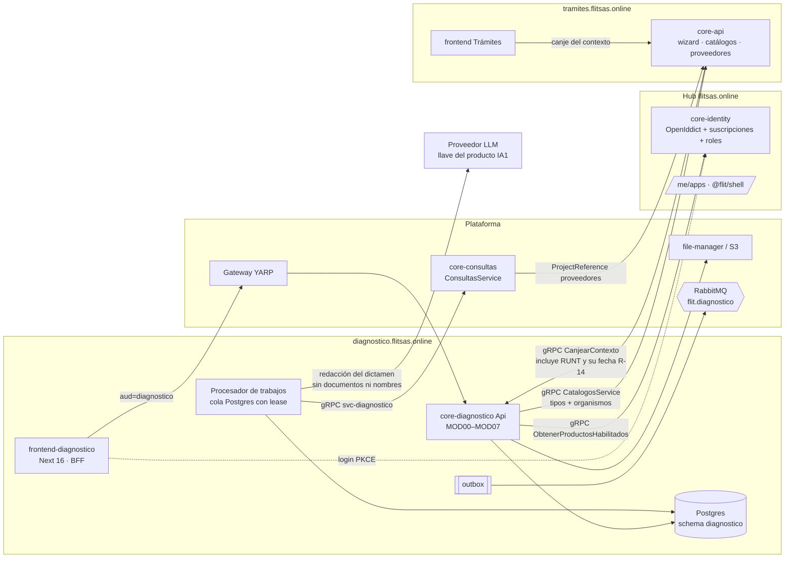
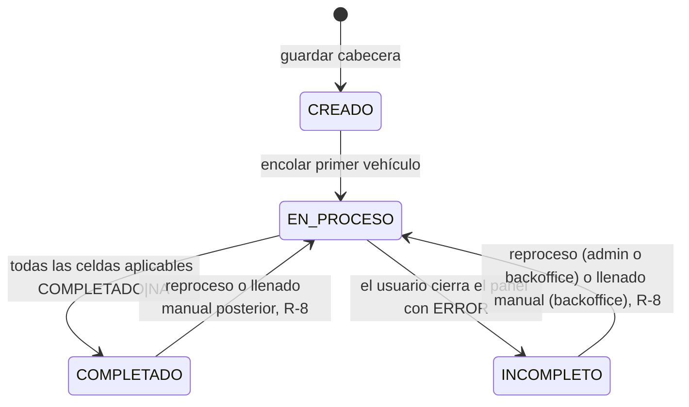
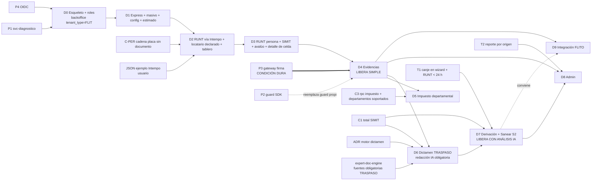

# Plan de implementación v2 — Producto Diagnóstico Vehicular

**Proyecto:** FLIT Suite
**Work items:** proyecto ADO `FLIT - DIAGNOSTICO`
**Fecha:** 2026-10-20 (actualizado el 2026-10-21 con las decisiones R-1..R-24 y con la ronda de descomposición D0–D2)
**Base:** `develop @ 8bcae8f48`
**Reemplaza a:** el plan de entrega de `propuesta_implementacion_diagnostico_vehicular.md` (§10) y la precondición de `epica-habilitacion-suite-y-ajustes.md`. El alcance funcional de esos dos documentos sigue vigente salvo donde este plan lo marca.
**Estado:** propuesta para revisión del Líder Técnico y del PO. Las decisiones de §4 quedan en **Propuesto**.
**Fuentes de hechos:** cuatro barridos de exploración sobre el repo, más lecturas puntuales de los mappers RUNT y del composition root de Comparendos. Lo que no se verificó en código se marca **[supuesto]**.

> Contrastado contra ADO el 2026-10-21 (`docs/diagnosticos/contraste-plan-v2-vs-epicas-ado.md`). Los choques que ese contraste encontró se resolvieron con las decisiones R-1..R-24 del registro. `docs/diagnostico_vehicular_epicas.md` y `plan-suite-flit.md` se citan en la propuesta pero no están en el repo.

---

## Registro de decisiones (2026-10-20)

Se cerraron en la sesión de planeación del 2026-10-20. Las decisiones de negocio las ratifica el PO y las de arquitectura el Líder Técnico. Mientras no lo hagan, quedan **pendientes de ratificar**: el plan avanza con ellas, pero pueden cambiar.

| ID | Decisión | Opción elegida | Consecuencia en el plan | Ratifica |
|---|---|---|---|---|
| D-01 | Quién es el admin del producto | **c — mixto.** Hay tres perfiles. **Usuario:** crea, ve, descarga y deriva. **`admin_diagnostico`** (rol COMPANY): reprocesa celdas en ERROR, edita la configuración y ve todo lo de su empresa. **Backoffice FLIT** (rol interno nuevo `backoffice_diagnostico`): llena datos a mano, hace override, ve la auditoría y la volumetría, entre compañías | §6.2 queda en tres columnas. D0 suma la HU que siembra el rol backoffice. Nadie de la compañía puede fabricar datos | PO, pendiente de ratificar |
| D-02 | Origen del documento del propietario y del locatario | **b — el documento sale de core-consultas**, con la implementación corregida en la segunda tanda. **El RUNT se consulta por placa vía Intempo**, que no exige documento y trae `propietariosActuales[]`. Después se consulta **RUNT persona** (`ConsultarConductor`) del propietario, y del locatario si aplica. Intempo arranca **simulado**, con fixtures construidos a partir del JSON de ejemplo que entregará el usuario, anonimizado antes de versionar (Ley 1581). Si aparece el endpoint del proveedor que devuelve propietario y locatario a partir de la placa, se suma como otro proveedor de la misma cadena | C-PER queda en ≈6 SP. No hay rpc nuevo: la cadena salta los proveedores que exigen documento y se hidrata `propietariosActuales`. El paso 1 del MOD03 es **RUNT por placa (Intempo) o por VIN**. Hay dos celdas nuevas, `RUNT_PROPIETARIO` y `RUNT_LOCATARIO`. SIMIT locatario y RUNT locatario quedan en `NA` mientras ningún proveedor devuelva el locatario. **Modificada el 2026-10-21 por R-3:** el documento del locatario lo declara el cliente; sin él, N/A «sin documento de locatario» | LT (contrato) + PO (locatario en NA), pendiente de ratificar |
| D-03 | Usuario de varias compañías | **a — una sesión es una compañía.** Verificado: el token sale de `user.TenantId` (`OidcPrincipalFactory.cs:94`) y no existe cambio de compañía. Para trabajar en otra compañía, el usuario cierra sesión y vuelve a entrar | Sin selector en el producto. **Mejora en D8:** una empresa padre (`is_group_parent`, `OidcPrincipalFactory.cs:100`) ve los diagnósticos de sus hijas en solo lectura (≈5 SP), con su propio test de fuga | PO, pendiente de ratificar |
| D-04 | Configuración por compañía | **b — dos niveles.** **Contractual** (solo backoffice FLIT, `diagnostico.configuracion.contrato.editar`): `fuentes_habilitadas`, `limite_vehiculos_lote`, `dictamen_llm` y `retencion_dias_max`. **Operativa** (admin de la compañía, `diagnostico.configuracion.editar`): `visibilidad_usuario`, `fuentes_por_defecto` (subconjunto de las habilitadas) y `retencion_dias`, que solo puede bajar hasta el máximo contractual | DDL de `configuracion_empresa`, §6.1, §6.2 y la pantalla 10 con dos pestañas. La HU de configuración entra en D1. **Modificada el 2026-10-21 por R-2, R-11b y R-18** (sin `dictamen_llm` ni retención; suma `estimado_consultas`) | PO, pendiente de ratificar |
| D-16 | Cómo se emite el acceso de backoffice | **a — sin cambios en identidad.** El backoffice son usuarios de la compañía con `tenant_type='FLIT'` (valor permitido por `ck_tenants_tenant_type`: RENTING, CONCESIONARIO, FLIT; `Ddl/109`), con el rol `backoffice_diagnostico` y Diagnóstico encendido para esa compañía. La API exige **el permiso de backoffice y el claim `tenant_type=FLIT`** a la vez. Verificado: el claim se emite (`OidcPrincipalFactory.cs:99`) y viaja en el access token (`:141-143`). Las rutas `/backoffice/*` llevan `?empresa=` explícito y usan `IgnoreQueryFilters()` con auditoría (ADR-0069) | ≈3 SP en D0. CA de seguridad: «un usuario con `backoffice_diagnostico` en una compañía no FLIT recibe 403 en `/backoffice/*`» | LT, pendiente de ratificar |
| D-P | Puerta mínima de plataforma | **b — en paralelo.** P1 y P4 corren con D0. El producto usa un guard propio por petición (`IProductosHabilitados`) hasta que llegue P2. **P3 es condición dura** para exponer en QA y para liberar | §7.1 y §8 | LT, pendiente de ratificar |
| D-08 | *Sanear* | **b — S2.** Salida informativa: deuda desglosada por fuente con monto, más un detalle exportable (≈2 SP en D7). Se conecta cuando exista un módulo de saneamiento | §7.4, D7 y la épica 12679 | PO, pendiente de ratificar |
| D-09 | FLITO | **b — X2, diferido.** FLITO entrará por una API de integración del producto con cliente externo (patrón ADR-0067). Primero se construye el producto; después se definen los contratos | FLITO sale de D1. Se crea la ola **D9 Integración FLITO**, después de D4 como mínimo | PO, pendiente de ratificar |
| D-G / D-06 | Motor de dictamen y alcance inicial | **a + i.** Motor determinista con catálogo versionado, sembrado de `BlockingCriteria`, `ConsultationBlockingPolicy`, `SoatGate` y limitaciones/prenda del RUNT. Un LLM opcional solo redacta los alertamientos, con plantilla de respaldo y llave propia del producto (IA1). Primera entrega: **familia TRASPASO** (traspaso, traspaso unilateral y transferencia de dominio). La prenda entra en la siguiente versión del catálogo. Cancelación de matrícula espera a T3. **Modificada el 2026-10-21 por R-2: pasa a a + b (LLM obligatorio como redactor)** | §4 (g) y D6 | LT (ADR) + PO (alcance), pendiente de ratificar |

**Spike de D-02, verificado en código el 2026-10-20:**
- **Intempo**, consultado solo con placa o VIN, trae en el crudo `propietariosActuales[].noDocumento`, `tipoDocumento` y `nombreCompleto` (`IntempoVehicleResponse.cs:99-100,157-166`). El mapper no los expone.
- ~~**Ningún proveedor trae el locatario.**~~ **Corregido el 2026-10-21 (H-INT):** Intempo sí lo trae (`lessee[]` y `propietariosActuales[].locatarios[]`); el DTO de core-api no lo mapea.
- **Kyverum y Verifik exigen el documento del propietario para consultar por placa.** Ver `KyverumRuntVehicleConsultationProvider.cs:31-35` (`RequiresOwnerDocument`), `VerifikConsultationProvider.cs:48-55` y `consultas.proto:77-78` («Obligatorio para consultar por placa»). Por VIN no lo exigen.
- **`ConsultarMultas`** acepta documento o placa (la placa solo en SIMIT). Responde un `ResultadoConsulta` genérico, sin el total en pesos tipado (`consultas.proto:95-106`). El frente C1 sigue abierto.

**Forma de C-PER (segunda tanda).** Se compararon dos formas:
- (a) La cadena de `ConsultarVehiculo` salta los proveedores con `RequiresOwnerDocument` cuando llega una placa sin documento, de modo que responde Intempo. Además, el mapper de Intempo hidrata `owner_document_type` y `owner_document_number` desde `propietariosActuales`, sin el nombre.
- (b) Un rpc nuevo, `ConsultarPersonasVehiculo`.

**Se elige (a)** porque reutiliza el rpc, la cadena de respaldo y el consumo que ya existen, sin contrato nuevo. El rpc (b) solo se reconsidera si el endpoint nuevo del proveedor no cabe como un proveedor más de la cadena.

### 2026-10-21 — resolución de choques con ADO (R-1..R-24)

Las tomó el usuario una por una, a partir del contraste con las épicas de ADO (`contraste-plan-v2-vs-epicas-ado.md` §6). Igual que las del 10-20, quedan **pendientes de ratificar** por el PO (negocio) y el LT (arquitectura).

| ID | Origen | Decisión | Consecuencia en el plan | Ratifica |
|---|---|---|---|---|
| R-1 | D-01 | **Se mantiene D-01 = c.** El admin de la compañía (`admin_diagnostico`) reprocesa celdas en `ERROR`. Llenar a mano y override: solo backoffice FLIT | El reproceso solo repite la consulta real (nunca escribe datos) y queda en el log con `disparador=REPROCESO` + usuario. §6.1, §6.2, §9.2, §12 (12637, 12638, 12669, 12881 CA 11) | PO, pendiente de ratificar |
| R-2 | D-G | **Nombre comercial «Con Análisis IA» y LLM obligatorio como redactor.** D-G pasa de a + i a **a + b**: veredicto determinista (catálogo versionado) + redacción por LLM siempre | `dictamen_llm` sale del nivel contractual. Queda solo `redaccion_ia_suspendida` como interruptor de emergencia del backoffice, apagado por defecto y no visible al cliente. El costo del LLM entra al precio del plan. Al LLM no van documentos ni nombres. «Con análisis» se renombra «Con Análisis IA». §4 (g), §5, D6, §12 (12637, 12678) | LT (ADR) + PO, pendiente de ratificar |
| R-2b | R-2 | **Si el LLM falla o no responde**, el dictamen sale con el veredicto y la redacción de plantilla, marcado «redacción IA pendiente». Un reintento en segundo plano la completa | Nunca bloquea al cliente. Estado de redacción por dictamen (`PENDIENTE`/`COMPLETADA`) con reintento y backoff en la cola durable. Si ya se generó un PDF con la plantilla, la redacción IA lo invalida y se regenera. §3.4, §5, D6, §9 | LT, pendiente de ratificar |
| R-3 | D-02 / K-15 | **Documento del locatario opcional en la captura**: columna opcional en la plantilla masiva y campo opcional en express | Si viene: `RUNT_LOCATARIO` (`ConsultarConductor`) y `SIMIT_LOCATARIO` (`ConsultarMultas` por documento). Si no: N/A con motivo «sin documento de locatario». Se cifra igual que el del propietario, con `origen=DECLARADO_CLIENTE`. Cuando exista el endpoint placa → locatario, se autollena y el campo queda de respaldo. ≈3 SP en D2. §12 (12641, 12659) | PO, pendiente de ratificar |
| R-4 | K-1 | **Sin alta de compañías en Diagnóstico.** Se crean en el hub y se enciende el producto | Conversión y origen = primer producto encendido de la compañía por `platform.tenant_products.created_at` (DDL 119:69-77). El DDL 121 rellenó filas de compañías existentes: el dato es fiable solo para compañías nuevas. §12 (12881 CA 3 y §2) | PO, pendiente de ratificar |
| R-5 | K-2 | **Sin login propio.** El subdominio redirige al login del hub (OIDC PKCE, `aud=diagnostico`, patrón Comparendos `@flit/auth`) | §12 (12881 CA 4: «sin sesión → login del hub → regresa a Diagnóstico») | PO + LT, pendiente de ratificar |
| R-6 | K-3 | **El backoffice FLIT no crea diagnósticos en la v1.** Siempre los crea un usuario de la compañía que paga | Soporte y demos con una compañía FLIT de pruebas con el producto encendido. §6.2, §12 (12881 §8) | PO, pendiente de ratificar |
| R-7 | K-4 | **Avance por vehículo.** Dictamen, derivación y evidencia parcial apenas las celdas del vehículo están en `COMPLETADO`/`NA` | §3.4, §3.5. §12 (12637: «ningún módulo opera sin que el anterior haya completado» aplica por vehículo, no por lote) | PO, pendiente de ratificar |
| R-8 | K-5 | **Un lote cerrado (`COMPLETADO`/`INCOMPLETO`) vuelve a `EN_PROCESO`** al reprocesar o llenar a mano, y se recalcula al terminar | Cada transición queda en un historial con disparador y usuario. §3.5, §5, §12 (12637) | PO, pendiente de ratificar |
| R-9 | K-6 / ADR f | **El impuesto no se ofrece hasta C3.** Se retira «impuesto manual primero» | Dos niveles: por compañía en `fuentes_habilitadas`; por departamento, core-consultas declara qué departamentos soporta, y un vehículo de un departamento sin soporte queda N/A con motivo «departamento no soportado» (no `ERROR`). El servicio público sigue en N/A. D5 pierde el llenado manual del impuesto. 12659 se cumple tal cual | PO + LT, pendiente de ratificar |
| R-10 | K-7 | ***Sanear* aparece con Bloqueado (Con Análisis IA) o con deuda > 0 (Simple)** | Sigue siendo salida informativa (D-08). §7.4, §12 (12638, 12679) | PO, pendiente de ratificar |
| R-11 | K-8 | **Estimado de consultas por fuente**: válidos × fuentes − N/A previsibles, en número de consultas y sin pesos. Configurable | Campo `estimado_consultas` ∈ {`NO_MOSTRAR`, `ANTES_DE_LANZAR` (resumen previo), `AL_FINALIZAR` (detalle del lote y reporte)}. ≈2–3 SP en D1. §12 (12640, 12641) | PO, pendiente de ratificar |
| R-11b | R-11 | **`estimado_consultas` es nivel operativo** (admin de la compañía, `diagnostico.configuracion.editar`), con `NO_MOSTRAR` por defecto | §5, §6.1 | PO, pendiente de ratificar |
| R-12 | K-9 | **Se acepta la auto-asignación** de `admin_diagnostico` a todo AdminCompany (DDL 126) | El guard de producto la neutraliza si Diagnóstico está apagado. En MOD00 §4 y CA 8, «no se hereda» significa que los roles de Trámites no dan permisos de Diagnóstico; el AdminCompany recibe `admin_diagnostico` por diseño. §6.2, §12 (MOD00) | PO + LT, pendiente de ratificar |
| R-13 | K-10 | **Clic en el semáforo:** todo usuario que puede ver el diagnóstico (según `visibilidad_usuario`) ve el resultado normalizado de esa fuente | Documentos de persona enmascarados, nunca el payload crudo del proveedor. El origen manual no se muestra (R-20). Endpoint de detalle de consulta en D3. §6.1, §12 (12680: «la administración» → «los usuarios con acceso al diagnóstico») | PO, pendiente de ratificar |
| R-20 | tensión R-13 ↔ CA 16 / 12669 | **El cliente no ve el origen manual en ningún lugar** (grilla, detalle de celda ni PDF) | Corrige R-13: el detalle no revela si la celda se llenó a mano. Solo el backoffice FLIT y la auditoría lo ven. Se cumplen el CA 16 y 12669 al pie de la letra | PO, pendiente de ratificar |
| R-21 | A-10 / 12680 80-03 | **`visibilidad_usuario` = `EMPRESA` por defecto**: todo usuario ve todos los diagnósticos de su compañía | El admin de la compañía puede bajarlo a `PROPIOS` en la configuración operativa. Cumple 12680 («todos sus lotes», columna de usuario creador) sin enmendarla. §5 | PO, pendiente de ratificar |
| R-22 | derivada de R-18 | **Tampoco se purgan los tokens de derivación.** Siguen el TTL de 10 min y el uso único; la fila queda para siempre | Sin job de limpieza técnica. La tabla de tokens se vigila con las métricas de tamaño de §10 | LT, pendiente de ratificar |
| R-23 | D-07 | **Los departamentos con impuesto los decide solo core-consultas**: soportado = consulta automatizada activa en la plataforma | `diagnostico.departamentos_impuesto` es caché del rpc de capacidad, sin edición manual. Para apagar un departamento (portal caído) se apaga en core-consultas. Una sola fuente de verdad, reutilizable por Trámites y Comparendos | PO + LT, pendiente de ratificar |
| R-24 | D-15 | **RUNT persona en celda propia**: `RUNT_PROPIETARIO` y `RUNT_LOCATARIO`, en los grupos «Por Propietario» y «Por Locatario» | Cada celda tiene semáforo, reproceso y consumo propios; si falla, no bloquea el vehículo. Coherente con R-3, R-17 y el enum del DDL | LT, pendiente de ratificar |
| R-14 | K-11 | **Trámites reutiliza el RUNT de Diagnóstico si tiene menos de 24 h** (configurable), leyéndolo con el token del handoff. Si es más viejo, consulta normal | ≈5 SP en T1 + cambio en `RunConsultationCommand` de Trámites (otro equipo). Riesgo aceptado: Trámites decide bloqueos sobre un dato de hasta 24 h. §6.3, §6.5, §7.3 | PO + equipo de Trámites, pendiente de ratificar |
| R-15 | K-12 | **Iconos y loader del UI kit de Diseño** (comentario del 2026-10-01 en 12638) entran como insumo de la HU de front en D0, **manteniendo el estándar del proyecto** (SuiteShell, tokens `@flit`, componentes de la suite) | Los choques los decide Diseño. Auditoría con `flit-design-guardian` antes de diseñar pantallas. D0 | PO + Diseño, pendiente de ratificar |
| R-16 | K-13 | **Un trámite por vehículo de diagnóstico** (índice único `tenant_id` + `external_ref`) | Tras derivar → «Ver trámite #N». Si se cancela o hace falta otro tipo, se crea un diagnóstico nuevo. §5, D7, §12 (12679) | PO, pendiente de ratificar |
| R-17 | K-14 / D-18 | **En Con Análisis IA son obligatorias las fuentes que declara la familia** en el catálogo de reglas (casillas marcadas y bloqueadas con tooltip); el resto, a la carta | TRASPASO propuesto: RUNT vehículo, SIMIT vehículo, RUNT propietario y SIMIT propietario. **Se valida con `expert-doc-engine`** contra la Res. 20233040017145 antes de D6. D-18 queda resuelta. §12 (12640) | PO, pendiente de ratificar |
| R-18 | K-16 / X-13 | **No se borra nada.** La retención era alcance nuevo del plan: ninguna épica la menciona | Salen `retencion_dias`, `retencion_dias_max`, `ck_retencion`, la regla de recorte de retención, el job de purga y la columna «Retención» de §9.3. Los documentos de persona siguen cifrados y enmascarados. Nada se agrega a 12680 sobre retención | PO + Legal, pendiente de ratificar |
| R-19 | K-17 / D-05 | **La captura usa el mismo `PLATE_PATTERN` de Trámites** (`frontend/lib/validation/fieldRules.ts:81`: `AAA123`, `ABC12D`, `ABC12`, `[RS]` + 5-6 dígitos, `AA123456`; VIN `^[A-HJ-NPR-Z0-9]{17}$` en `:64`) | El RUNT valida en definitiva. D-05 queda resuelta (unión, opción c). §4 (j), §9.1, §12 (12641) | PO, pendiente de ratificar |

**Efecto sobre el registro del 10-20:**
- **D-G:** modificada por R-2 (a + b) y R-2b.
- **D-02:** el locatario deja de quedar siempre en N/A; entra por captura declarada (R-3).
- **D-04:** el nivel contractual pierde `dictamen_llm` y `retencion_dias_max`, y el operativo pierde `retencion_dias` y suma `estimado_consultas` (R-2, R-11b, R-18).
- **D-05:** resuelta por R-19.
- **D-18:** resuelta por R-17.

### 2026-10-21 — ronda de descomposición D0–D2

Las tomó el usuario el 2026-10-21 para arrancar la ejecución. Las de arquitectura las ratifica el Líder Técnico en el PR de la ronda; las de negocio, el PO.

| ID | Decisión | Consecuencia en el plan | Ratifica |
|---|---|---|---|
| RD-1 | **Alcance de la ronda: D0 + D1 + D2.** Épicas 13714 (MOD00), 12640, 12641, 12659 y 12669; 12881, 12637 y 12638 como paraguas. **Fuera:** F00.3 handoff (D7) y C-PER (cadena Intempo en core-api). D2 corre con **Intempo SIMULADO**: adaptador fake con fixtures anonimizados | §8.2, §8.6. C-PER sigue siendo condición para QA, no para la ronda | PO, pendiente de ratificar |
| RD-2 | **Sprint ADO: «Iteration 1» del proyecto `FLIT - DIAGNOSTICO`.** Asignación: Juan Montoya | §8.6, §12 | PO |
| RD-3 | **Los ADR (a) cola durable con lease, (b) aislamiento por tenant, (c) tiempo real por polling, D-16 backoffice y D-P se implementan en estado Propuesto.** El Líder Técnico los ratifica en el PR | §4 resumen de ADR, §11.2 (D-11 queda solo con la h) | LT, en el PR |
| RD-4 | **Puertos: API 4029/5029/6029 (DEV/QA/PDN), gRPC interno 8087. Servicio `svc-diagnostico`** | §10 deja de marcarlos como propuesta | LT, pendiente de ratificar |
| RD-5 | **Una sola rama `feature/AB-12881-diagnostico-d0-d2` y un solo PR a `develop` para D0–D2.** Excepción explícita a la regla 9 (PR ≤ 800 líneas), aprobada por el usuario | §8.6 | Usuario (excepción aprobada) |
| RD-6 | **UI kit:** el proyecto de Diseño (`D:\Cursor\FLIT\proto`, Vite + antd) es **solo referencia visual**. Se construye con el estándar de la suite (Next 16, Tailwind 4, `tokens.css`, `lucide-react`, SuiteShell, `@flit/ui`). El CSS `.flit-loader` / `.flit-escena-*` (hoy solo en `frontend/app/globals.css:80-135`) **se mueve a `packages/ui/src/styles/`** para que los satélites lo tengan. Ocho decisiones abiertas para Diseño (paleta manual vs `tokens.css`, iconos SVG vs lucide, loader oficial, CTA sólido vs degradado, barra superior vs SuiteShell, etiqueta flecha vs StatusBadge, tonos AA, favicon) se registran en la épica **#12638** y **no bloquean D0–D2** | Concreta R-15. §8.2 (D0), §12 (12638) | PO + Diseño, pendiente de ratificar |
| D-10 | **b con corte a medianoche.** Se reutiliza el resultado de placa + fuente de la **misma compañía** consultado el **mismo día**, sin consumo; la celda muestra la fecha y hora del dato. La vigencia vence a las **00:00 hora Colombia** aunque no hayan pasado 24 h. Lo vencido **no se borra**: queda como log/historial | ≈3 SP en D2. §4 (i), §8.2, §9.2. Cierra D-10 | PO, pendiente de ratificar |
| D-12 | **a — manda core-consultas** (sus timeouts y su SLA; lo que devuelva como error es error). Diagnóstico reintenta **solo errores transitorios**, con backoff, hasta 3 veces. El número es configuración **global de la aplicación** (no por compañía): `Diagnostico:Consultas:MaxReintentos` ∈ [0, 3], **valor por defecto 1**. El error definitivo no se reintenta. Agotados los reintentos → celda `ERROR` reprocesable | §8.2 (D2), §9.2, §10. Cierra D-12 | LT, pendiente de ratificar |
| H-INT | **Hallazgo Intempo: el proveedor SÍ trae el locatario.** Estructura (sin datos): `lessee[]` {`documentNumber`, `documentType`, `lesseeType`, `names`} y `propietariosActuales[]` {`noDocumento`, `tipoDocumento`, `tipoPropiedad` 1\|3, `detallePropiedad` PROPIO\|LEASING, `locatarios[]` {`ndoc`, `tdoc` C\|N, `tipo`, `nombreRazonSocial`}}; `infracciones[]` con `valorInfraccion`/`estado`. El DTO de core-api (`services/core-api/src/Flit.Modules.Consultas/Contracts/IntempoVehicleResponse.cs:99-100`) solo mapea `propietariosActuales` | Se corrige el supuesto «ningún proveedor trae el locatario». Bajo R-3, el locatario se **autollena con `origen=PROVEEDOR`** y el declarado por el cliente queda de respaldo. El riesgo del locatario baja de Alta a **Media**. El mapper de C-PER debe hidratar `locatarios` y `tipoPropiedad`/`detallePropiedad`. Las muestras reales (`docs/diagnosticos/json-intempo.txt`) contienen PII: **no se citan ni se commitean**; los fixtures de D2 se generan anonimizados con variantes inventadas (propietario persona natural, NIT, leasing con locatario C y con locatario N). §3, §4 (e), §7.2, §11.1, §12 | LT (C-PER) + PO (R-3), pendiente de ratificar |

**Efecto sobre registros anteriores:**
- **D-02 y R-3:** el locatario ya no depende solo de la declaración del cliente. Cuando C-PER hidrate `locatarios`, se autollena con `origen=PROVEEDOR`; el declarado queda de respaldo. En la ronda D0–D2 (Intempo simulado) los fixtures ya traen las variantes con locatario.
- **R-15:** concretada por RD-6.
- **D-10 y D-12:** cerradas. Siguen abiertas D-11 (solo ADR h), D-13, D-14, D-17 y C1; ninguna bloquea D0–D2.
- **Pendiente:** validar con `expert-doc-engine` las fuentes obligatorias de TRASPASO (R-17) antes de D6.

---

## 1. Resumen ejecutivo

La propuesta v1 describe bien **qué** hace el producto. El código desmiente varios supuestos sobre **dónde se apoya**:

- La puerta de salida de la plataforma no está cumplida. Las 7 casillas están sin marcar. El gateway acepta tokens sin firma, OIDC viene apagado por defecto y el SDK no trae un guard de suscripción por petición.
- `flit-product` no existe. La plantilla de facto es **Comparendos** (backend `flit-servicio` + frontend clonado).
- El saneamiento y el inventario FLITO no existen en Trámites. FLITO es un sistema externo.
- El contrato de consultas no tiene impuesto departamental, ni SIMIT locatario. Los mappers RUNT normalizados **no devuelven el documento del propietario ni el del locatario**.
- Kyverum y Verifik **exigen** el documento del propietario para consultar el RUNT por placa.
- El wizard solo acepta `seedPlaca` y `seedVin`. No existe ningún handoff firmado.

Este plan cambia seis cosas:

1. **No espera a la puerta completa.** Define una **puerta mínima viable** y la corre en paralelo con el esqueleto del producto. El producto lleva su propio guard de suscripción. P3 (firma en el gateway) es condición dura para QA.
2. **El RUNT por placa sale por Intempo**, que no exige documento y trae los propietarios. Después se consulta RUNT persona del propietario (`ConsultarConductor`) como una celda propia. Intempo arranca simulado, con fixtures anonimizados. **El documento del locatario lo declara el cliente** (opcional en la captura, R-3); sin él, las celdas de locatario quedan N/A con motivo «sin documento de locatario». Intempo también trae el locatario (H-INT, 2026-10-21): cuando C-PER lo hidrate, se autollena con `origen=PROVEEDOR` y el declarado queda de respaldo.
3. **Corrige los defectos de Comparendos.** La cola pasa a ser durable en Postgres, el tenant se aísla con un filtro global y la entrega va en olas cortas.
4. **Libera primero el modo Simple con RUNT, SIMIT y avalúo.** El impuesto (solo cuando exista C3, R-9), el dictamen y la derivación entran en olas posteriores, cada una ligada a su frente externo.
5. **«Con Análisis IA»: veredicto determinista, redacción siempre por IA** (R-2). El catálogo de reglas versionado decide Viable o Bloqueado; el LLM redacta siempre y, si falla, sale la plantilla marcada «redacción IA pendiente» y se completa en segundo plano (R-2b). Al LLM no llegan documentos ni nombres.
6. **Saneamiento y FLITO quedan para después.** *Sanear* es una salida informativa con la deuda desglosada. FLITO entra al final, por una API de integración (ola D9).

No se borra nada: el plan no define retención ni purga (R-18). Los documentos de persona se conservan cifrados y enmascarados.

---

## 2. Contraste propuesta v1 ↔ realidad del código

Estado: **H** hecho, **P** parcial, **A** ausente.

| # | Supuesto de la v1 | Estado | Evidencia | Consecuencia para el plan |
|---|---|---|---|---|
| 1 | El gateway y la API validan la firma y la audiencia del token | P | El SDK valida JWKS y audience. El gateway YARP acepta tokens sin firma y `JwtRequired` siempre vale true (`Flit.Gateway/Program.cs:44-85`) | El frente Plataforma tiene que cerrar el gateway antes de exponer el producto en QA. La API del producto valida por su cuenta con el SDK |
| 2 | Login OIDC en el hub | P | `Suite:Oidc:Enabled=false` por defecto (appsettings, líneas 200-205). OpenIddict 7.7.1 en core-identity. No se leyeron los overrides por ambiente | Hay que verificar el estado por ambiente. Si OIDC está apagado en QA, el producto no tiene cómo entrar |
| 3 | Abrir el producto desde el hub sin otro login | P | Existen `/me/apps`, `@flit/auth` y `@flit/shell`. Comparendos ya lo hace (middleware + login PKCE del hub) | Se copia el patrón de `frontend-comparendos` tal cual |
| 4 | Cambiar de compañía activa en el hub | A | No existe en el hub, en auth ni en identidad | El producto trabaja con un solo tenant por sesión. Un usuario multiempresa cierra sesión y vuelve a entrar. Es una decisión abierta (§11) |
| 5 | Al suspender la suscripción, el efecto se nota en minutos | P | Existe `PUT /admin/tenants/{id}/products`, pero la UI vive en Trámites (`ProductosTab`). `ProductAccessResolver` no tiene caché. No se publica `platform.tenant_product.changed`. `RequireProduct` vive solo en core-api, para trámites, con `Enforce=false` | Hoy el efecto se nota al renovar el token, a los 15 min. Hace falta un guard de suscripción en el SDK (frente Plataforma P2) |
| 6 | El administrador de la compañía asigna roles por producto desde el hub | A en UI, H en datos | `security.roles` tiene `product_code`. `admin_diagnostico` es un rol COMPANY que se asigna solo a todo AdminCompany (`Ddl/126-HU12967-admin-por-producto.sql`). El hub no tiene pantallas de administración | En DEV/QA los roles se asignan por la vía actual: semilla o admin de Trámites **[supuesto]**. La UI del hub no bloquea al producto. El rol backoffice FLIT no existe y se siembra en D0 (D-01) |
| 7 | Producto de prueba levantado con `flit-product` | A | `templates/flit-product` no existe. Solo existe `flit-servicio` (backend). El demo se retiró el 2026-10-02 (DDL 125) | Comparendos hace de plantilla. El frontend se clona, no se genera |
| 8 | Consulta externa con consumo medido | H para comparendos, A para diagnóstico | Consumo por tenant, producto, fuente, proveedor y caché, con rpc `ObtenerConsumo`. No existe `svc-diagnostico` | Crear el cliente `svc-diagnostico` con sus scopes. Es el entregable P1 |
| 9 | RUNT devuelve placa, documento del propietario, locatario, servicio y departamento | **P (verificado)** | Ver §2.1 y el spike del registro de decisiones | Kyverum y Verifik **piden** el documento para consultar por placa. El RUNT por placa sale por Intempo y se hidrata `propietariosActuales` (frente C-PER) |
| 10 | SIMIT por vehículo, propietario y locatario | P | Hay dos contratos: `ConsultarMultas` (normalizado, con cadena de proveedores) y `ConsultarComparendos` (crudo). El concepto de locatario no existe | Decisión (e). El locatario se modela en el producto como otra celda sobre el mismo rpc, con el documento que declara el cliente (R-3) |
| 11 | El avalúo está en la plataforma | H | `ConsultarAvaluos` (Fasecolda, MercadoLibre, BaseGravable) | Se reutiliza. Fuente `AVALUO` |
| 12 | El impuesto departamental está en el contrato de consultas | A | Sin rpc, sin proveedor, sin scraping. Solo existen `AsumeImpuestoVehiculo` y el advisory VB-A-10 | Decisión (f), cerrada por R-9: la fuente no se ofrece hasta C3. Sale del camino crítico del modo Simple |
| 13 | Tabla maestra de secretarías | P | `catalogs.transit_offices` (DepartmentCode, DepartmentName) en core-api. Comparendos ya la replica por gRPC `CatalogosService` (`Modulos.cs:137-151`) | Se reutiliza la réplica de Comparendos para pasar de organismo a departamento |
| 14 | Caché de consultas en la plataforma | A | La caché vive en Trámites (`RunConsultationCommand`, core-api) | Diagnóstico no la hereda. Decisión (i) |
| 15 | Los proveedores viven en el módulo de consultas | P | Físicamente están en `services/core-api/src/Flit.Modules.Consultas`. core-consultas los usa por ProjectReference | Cada cambio de proveedor (impuesto, campos RUNT) toca core-api y redespliega Trámites **[supuesto sobre el ciclo de despliegue]** |
| 16 | Validador de placa y VIN | P | Solo existe en el frontend de Trámites (`frontend/lib/validation/fieldRules.ts:64,81`), con reglas más amplias que la v1. En backend solo `PlateRangeRules.IsValidPlate` (carro). No hay validador de VIN en .NET | Se escribe en el Domain del producto con el mismo `PLATE_PATTERN` y la misma regla de VIN de Trámites (R-19) |
| 17 | Wizard con datos precargados | P | Ruta `/tramites/nuevo/{code}?seedPlaca=&seedVin=`. No precarga propietario ni datos del vehículo | Frente Trámites T1 (canje de contexto) |
| 18 | `origen_diagnostico_id` en el trámite | A, con patrón | `ProcedureInstance.Origin + ExternalRef` (hoy `'ict'`), con índice único parcial `(tenant_id, external_ref)` | Se reutiliza con `Origin='diagnostico'`. No hace falta una columna nueva |
| 19 | Contexto firmado de un solo uso | A | No existe | Decisión (h) y entregable del producto + T1 |
| 20 | Saneamiento en Trámites | A | No existe ningún módulo de saneamiento | *Sanear* pasa a salida informativa (D-08 = S2) |
| 21 | Inventario FLITO con selección múltiple | A | FLITO es externo: consume `/tramites/sync` y webhooks firmados | FLITO entra por API de integración (ADR-0067) en la ola D9 (D-09) |
| 22 | Catálogo de tipos de trámite activos | P | `GET /api/v1/tramites/procedure-types?publicationStatus=published` + `wizardEnabled`. Cancelación de matrícula (OTROS) depende de las fases C–E de `docs/diagnostico-habilitacion-dinamica-tipos-tramite.md` | Con Análisis IA arranca con los tipos de la familia TRASPASO publicados. Los demás entran cuando el wizard los habilite |
| 23 | Base de conocimiento para el dictamen | P | Hay reglas de viabilidad dispersas: `BlockingCriteria` por OT, `OtRuleGateService`, `ProcedureRadicationGate`, `ConsultationBlockingPolicy`, `SoatGate`. No hay motor de dictamen | Decisión (g). Las reglas se reescriben como catálogo versionado del producto, tomando esas como fuente |
| 24 | Canal en tiempo real | A | No hay SignalR, SSE ni WebSocket en ningún producto. Comparendos hace polling | Decisión (c) |
| 25 | Exchange de eventos del producto | A | `deploy/rabbitmq/definitions.json` tiene `flit.plataforma`, `flit.tramites`, `flit.consultas` y `flit.notificaciones` | Hay que crear `flit.diagnostico` (P1) |
| 26 | El token trae `parent_tenant_id` | A | El emisor no lo pone, aunque el contrato §2 lo pide | Diagnóstico no depende de él en esta versión. Se anota para Marca Blanca |
| 27 | LLM disponible para el producto | P | La configuración de IA vive en core-api (`AiCatalog`, ADR-0070 multi-proveedor). Comparendos llama a Anthropic con llave propia (`Modulos.cs:65-76`) | Decisión (g). Ya hay precedente de LLM dentro de un producto |
| 28 | `core-diagnostico` y `frontend-diagnostico` | P | Solo tienen README (HU12987). Producto `diagnostico`, puertos web 4024/5024/6024 y schema `diagnostico` reservados. La fila en `platform.products` existe (DDL 119) y el hub muestra la tarjeta *Próximamente* | El esqueleto parte de algo ya reservado |

### 2.1 Verificación propia: campos RUNT que condicionan MOD03

Lectura de `services/core-api/src/Flit.Modules.Consultas/Contracts/`:

| Dato que la v1 espera del RUNT | Kyverum (`KyverumRuntVehicleResultMapper.cs:234-282`) | Verifik (`VerifikResultMapper.cs:202-209`) | Intempo (`IntempoVehicleResultMapper.cs:187-196`) |
|---|---|---|---|
| Placa y VIN | `plate`, `vin` | Sí | Sí |
| Servicio (particular o público) | `vehicle_service` ← `TipoServicio` | `vehicle_service` | `vehicle_service` |
| Departamento | **No.** Solo `transit_office_name` (organismo, corregido por placa preasignada, HU12648) | Solo `transit_office_name` | Solo `transit_office_name` |
| Tipo de documento del propietario | `owner_document_type` ← `tipoDocPropietario` (línea 242) | No | No |
| **Número de documento del propietario** | **No se mapea** | **No** | **No** |
| **Locatario (tipo y número)** | **No existe** | **No existe** | **No existe** |
| Garantías y prendas (acreedor) | Sí (`RuntGarantiasMobiliarias`, Bug #13203) | Sí | — |

Hay que mirar también cómo se consulta. El spike del 2026-10-20 resolvió la duda: Kyverum y Verifik **exigen** el documento del propietario para consultar por placa (`KyverumRuntVehicleConsultationProvider.cs:31-35`, `VerifikConsultationProvider.cs:48-55`, `consultas.proto:77-78`). Por VIN no lo exigen. Intempo sí devuelve los propietarios en el crudo (`IntempoVehicleResponse.cs:99-100,157-166`).

**Consecuencias:**

- **Servicio:** está disponible. La regla «servicio público → impuesto N/A» se puede implementar desde la primera ola de RUNT. Falta normalizar el texto (`PARTICULAR`, `PÚBLICO`, `OFICIAL`, `DIPLOMÁTICO`) **[supuesto sobre los valores]**.
- **Departamento:** se deriva del organismo contra la réplica de `catalogs.transit_offices`. Hay que emparejar por nombre, lo que es frágil **[supuesto]**. Lo ideal es que el mapper hidrate `transit_office_code` o `department_code`. Se incluye como entregable menor del frente C-PER.
- **Documento del propietario:** sale del mismo RUNT por placa, respondido por Intempo (D-02, forma a de C-PER). Con ese documento se consultan RUNT persona (`ConsultarConductor`) y SIMIT propietario.
- **Locatario:** **Intempo sí lo trae** (H-INT, 2026-10-21): `lessee[]` y `propietariosActuales[].locatarios[]`, con `tipoPropiedad`/`detallePropiedad` (PROPIO o LEASING). El DTO de core-api solo mapea `propietariosActuales` (`IntempoVehicleResponse.cs:99-100`), así que C-PER debe hidratar los locatarios. Bajo R-3, el documento se **autollena con `origen=PROVEEDOR`** y el que **declara el cliente** en la captura (opcional) queda de respaldo, cifrado con `origen=DECLARADO_CLIENTE`. Con documento, `RUNT_LOCATARIO` y `SIMIT_LOCATARIO` se consultan; sin ninguno de los dos, quedan en `NA` con motivo `SIN_DOCUMENTO_LOCATARIO`. El modelo no cambia.
- **Leasing:** en un vehículo con leasing, el propietario suele ser la financiera. Un SIMIT por el NIT de una financiera devuelve cientos de registros: Comparendos superó el límite de 4 MB con Bancolombia (`Modulos.cs:81-85`). En leasing, la celda que importa para el trámite es la del **locatario**, que se consulta con el documento que trae Intempo (cuando C-PER lo hidrate) o con el que declara el cliente. Es un riesgo de negocio (§11).

---

## 3. Arquitectura objetivo

### 3.1 Comparendos como plantilla de facto

| Pieza de Comparendos | En Diagnóstico | Motivo |
|---|---|---|
| 3 proyectos: Api con `Modulos/*` verticales, Domain puro y Grpc.Contracts, más tests. `.slnx` y SDK .NET 10.0.300 | **Se copia** | Es el patrón vigente. No hay capa Application separada |
| Composition root `Modulos.cs` con adaptadores Real, Simulado y NoConectado por configuración | **Se copia** | Es *fail-closed* fuera de DEV. La simulación es explícita |
| `Flit.Platform.Sdk`: `AddFlitPlatformAuthentication`, `AddFlitGrpcServer`, `AddFlitOutbox<DiagnosticoDb>` | **Se copia** | No se reinventa nada |
| Schema propio, con outbox, inbox e historial de migraciones dentro del schema | **Se copia** | Schema `diagnostico` |
| `IProductosHabilitados` por gRPC a identidad, con caché y *fail-closed* | **Se copia y se extiende** | En Comparendos solo cubre jobs. En Diagnóstico se usa también por petición mientras no exista el guard del SDK (P2) |
| `RegistroManifiesto` (PUT del manifest) | **Se copia** | |
| `RequirePermiso(slug)` + `PoliticaUsuario` | **Se copia** | Slugs `diagnostico.<modulo>.<accion>` |
| Fuentes por gRPC a core-consultas, detrás de una interfaz con implementación simulada | **Se copia** | Una interfaz por fuente: `IFuenteRunt` (vehículo), `IFuenteRuntPersona`, `IFuenteSimit`, `IFuenteAvaluo`, `IFuenteImpuesto`. La simulada de RUNT reproduce la forma de Intempo con fixtures anonimizados |
| Réplica de organismos por `CatalogosService` | **Se copia** | Organismo → departamento para la regla del impuesto |
| Alertas de integración + log (HU13462) | **Se copia** | Alimenta el log de intentos |
| Idempotencia por índice único + reintento en 23505 con contexto nuevo | **Se copia** | `(vehiculo_id, fuente)` |
| Excel `TabularWorkbookWriter`, PDF desde HTML, exportación en segundo plano, file-manager | **Se copia** | MOD07 |
| Tests con `Program.Build` real + Postgres efímero + JWKS propio | **Se copia y se corrige** | Los tests de integración se omiten si no hay Postgres. En CI deben fallar, no omitirse |
| Cola `Channel` en memoria (`ColaTrabajos`) | **Se corrige** | Pierde lo encolado al reiniciar y no escala a más de una réplica. Ver decisión (a) |
| Filtro manual de `EmpresaId` en cada consulta | **Se corrige** | Hay riesgo de fuga entre empresas. Ver decisión (b) |
| Polling `setInterval` | **Se conserva en la primera entrega** | Ver decisión (c) |
| gRPC con `MaxReceiveMessageSize` de 64 MB y sin paginación | **Se evita** | El contrato normalizado no tiene ese problema. Para NIT grandes, ver §2.1 |
| Todo el producto en una ola (HU13454-13499 entraron el 10-09) | **Se corrige** | Olas de 1–2 semanas con salida verificable (§8) |
| `frontend-comparendos`: Next 16.3.8, React 19.2.4, `@flit/*`, middleware con guard, BFF `app/api/v1/[...path]`, `ComparendosShell` | **Se clona** | `frontend-diagnostico` con `DiagnosticoShell` |

### 3.2 Layout de carpetas

```text
services/core-diagnostico/
  Flit.Diagnostico.slnx
  Dockerfile
  README.md                         (ya existe, HU12987)
  src/
    Flit.Diagnostico.Api/
      Program.cs
      Modulos/
        Modulos.cs                  composition root (patrón Comparendos)
        Comun/                      Auditoria, RegistroArchivos, UsuarioActual, TenantFilter
        Plataforma/                 ProductosHabilitados, GuardSuscripcion, Autorizacion, RegistroManifiesto
        Configuracion/              MOD00 — config del producto por compañía
        Parametrizacion/            MOD01 — cabecera, alcance, modo
        Captura/                    MOD02 — validador, plantilla, carga masiva, express
        Consultas/                  MOD03 — cola durable, orquestador por vehículo, Fuentes/*, reproceso, manual
        Tablero/                    MOD04 — grilla, estado global, cierre de panel
        Dictamen/                   MOD05 — motor de reglas, redactor LLM obligatorio + reintento, override
        Derivacion/                 MOD06 — contexto de un solo uso, gRPC de canje, seguimiento
        Reportes/                   MOD07 — PDF, Excel, ZIP, volumetría, conversión
        Integracion/                D9 — API para FLITO con cliente externo (diferida, D-09)
        Trabajos/                   cola Postgres con lease, procesador, programador
      Persistence/
        DiagnosticoDb.cs            con HasQueryFilter por tenant
        Migrations/
      Grpc/
        DerivacionGrpcService.cs    canje del contexto (lo llama core-api)
    Flit.Diagnostico.Domain/
      Identificadores/              ValidadorIdentificador (placa carro, moto, remolque, VIN)
      Diagnosticos/                 agregados, estados y transiciones
      Consultas/                    Fuente, EstadoCelda, ReglasAplicabilidad (impuesto N/A por servicio o departamento, locatario sin documento)
      Dictamen/                     Regla, CatalogoReglas, Evaluador, RedaccionPlantilla (respaldo R-2b)
    Flit.Diagnostico.Grpc.Contracts/
  tests/
    Flit.Diagnostico.Domain.Tests/
    Flit.Diagnostico.Api.Tests/     integración con Program.Build + Postgres efímero

frontend-diagnostico/
  package.json                      @flit/auth, @flit/shell, @flit/brand, @flit/ui (workspace:*)
  middleware.ts                     claimsTokenFromCookieHeader(cookie,'diagnostico') → login del hub
  app/
    (app)/layout.tsx                getSession('diagnostico') + DiagnosticoShell
    (app)/page.tsx                  home + express + Descargar Plantilla Base
    (app)/diagnosticos/nuevo/       MOD01
    (app)/diagnosticos/[id]/carga/  MOD02 resumen de validación
    (app)/diagnosticos/[id]/        MOD04 grilla, MOD05 dictamen, MOD06 acciones
    (app)/diagnosticos/             MOD07 listado
    (app)/admin/volumetria/         MOD07 admin
    (app)/configuracion/            MOD00 config de la compañía activa
    auth/*                          createAuthRoutes (fuera del guard)
    api/v1/[...path]/route.ts       BFF createApiProxy (Bearer aud=diagnostico)
  e2e/                              Playwright
```

### 3.3 Componentes



### 3.4 Secuencia por vehículo

```mermaid
sequenceDiagram
  autonumber
  participant U as Usuario (frontend)
  participant A as core-diagnostico API
  participant Q as Cola (tabla trabajos)
  participant W as Procesador
  participant C as core-consultas
  participant M as Motor de dictamen
  participant L as Proveedor LLM
  participant T as Trámites (core-api)

  U->>A: POST /diagnosticos/{id}/vehiculos (lote validado; documento de locatario opcional)
  A->>A: crea vehículos + celdas PENDIENTE según alcance; documento de locatario cifrado (origen DECLARADO_CLIENTE)
  A->>Q: inserta trabajo RUNT por vehículo (misma transacción)
  A-->>U: 202 + estado EN_PROCESO
  loop cada N s (polling, decisión c)
    U->>A: GET /diagnosticos/{id}/grilla?desde=version
  end
  W->>Q: toma la celda RUNT (FOR UPDATE SKIP LOCKED, lease 2 min)
  W->>C: ConsultarVehiculo(placa sin documento | vin) [tenant en metadata]
  Note over C: placa sin documento → la cadena salta Kyverum y Verifik (RequiresOwnerDocument) → Intempo (simulado al inicio)
  alt RUNT falla
    C-->>W: error / semáforo rojo
    W->>A: intento Error; celda RUNT=ERROR; resto=ERROR (bloqueadas por RUNT)
  else RUNT responde
    C-->>W: ResultadoConsulta (proveedor, campos hidratados + owner_document_type/number)
    W->>A: persiste placa, VIN, servicio, organismo→departamento, documento cifrado (sin nombre)
    W->>W: reglas N/A (impuesto: servicio público o departamento no soportado por core-consultas; locatario: sin documento declarado)
    par fuentes del alcance
      W->>C: ConsultarConductor(doc propietario) → RUNT_PROPIETARIO
    and
      W->>C: ConsultarConductor(doc locatario declarado) → RUNT_LOCATARIO
    and
      W->>C: ConsultarMultas(placa) → SIMIT_VEHICULO
    and
      W->>C: ConsultarMultas(doc propietario) → SIMIT_PROPIETARIO
    and
      W->>C: ConsultarMultas(doc locatario declarado) → SIMIT_LOCATARIO
    and
      W->>C: ConsultarAvaluos(placa) → AVALUO
    and
      W->>C: ConsultarImpuestoVehicular(placa, depto) → IMPUESTO (solo con C3 y departamento soportado)
    end
    W->>A: un intento por llamada; celda COMPLETADO/ERROR (idempotente por vehiculo+fuente)
  end
  opt celdas de ESE vehículo en COMPLETADO o NA y modo CON_ANALISIS (R-7)
    W->>M: evaluar(tipo_tramite, consolidado, catálogo de reglas vN)
    M->>M: veredicto determinista + reglas disparadas
    M->>L: redactar(veredicto, reglas, montos, datos del bien) — sin documentos ni nombres
    alt LLM responde
      L-->>M: texto
      M-->>A: dictamen vN (redactado_por=LLM, estado_redaccion=COMPLETADA)
    else LLM falla, no responde o redacción suspendida
      M-->>A: dictamen vN con plantilla (redactado_por=PLANTILLA, estado_redaccion=PENDIENTE)
      Note over W,L: reintento con backoff en la cola durable; al completar, se reemplaza el texto y se invalida el PDF (R-2b)
    end
    A->>A: outbox diagnostico.dictamen.emitido
  end
  U->>A: POST /vehiculos/{vid}/derivaciones (Crear trámite; uno por vehículo, R-16)
  A-->>U: URL tramites.../nuevo/{tipo}?ctx=<token opaco>
  U->>T: abre el wizard con ctx
  T->>A: gRPC CanjearContexto(ctx, tenant)
  A-->>T: payload + RUNT normalizado y su fecha (una sola vez; el segundo canje se rechaza)
  T->>T: RUNT con menos de 24 h → lo reutiliza; si no, consulta normal (R-14)
  T->>T: borrador con Origin='diagnostico', ExternalRef=vehiculo_id
  T-->>A: outbox flit.tramites (trámite creado) o consulta por ExternalRef
```

### 3.5 Estados



Celda: `PENDIENTE → EN_CURSO → COMPLETADO | ERROR | NA`, y `ERROR → PENDIENTE` (reproceso) o `ERROR → COMPLETADO` (manual). `EN_CURSO` es nuevo frente a la v1: hace falta para la cola con lease y para que el idempotente distinga «tomada» de «pendiente».

La v1 no define la vuelta de `INCOMPLETO` o `COMPLETADO` a `EN_PROCESO`. Se agrega por **R-8**: el lote vuelve a `EN_PROCESO` al reprocesar o llenar a mano y se recalcula al terminar. Cada transición del lote queda en `historial_estado_diagnostico` con disparador y usuario (§5).

**El avance es por vehículo (R-7).** Dictamen, derivación y evidencia parcial de un vehículo arrancan apenas sus celdas están en `COMPLETADO` o `NA`, sin esperar al lote.

**Flujo MOD03 final** (segunda tanda, 2026-10-20; ajustado el 2026-10-21):

1. MOD02 normaliza y clasifica el identificador con la regla de Trámites (R-19; normalización alineada por decisión del usuario el 2026-10-21): primero como VIN con `sanitizeVin` (mayúsculas, solo A-H, J-N, P, R-Z y 0-9, corte a 17) y `VIN_PATTERN`; si no casa, como placa con `sanitizePlate` (mayúsculas, solo A-Z y 0-9, corte a 8) y `PLATE_PATTERN`. Así `ABC-123` es la placa `ABC123`. El corte es la máscara de captura de Trámites: en el masivo, `AB1234567` queda como la maquinaria `AB123456` **[riesgo aceptado]**. Casos en `contracts/fixtures/validacion/identificadores-vehiculo.json`. Un valor inválido no se encola. Si el cliente declaró el documento del locatario, se guarda cifrado con `origen=DECLARADO_CLIENTE` (R-3).
2. **Celda RUNT:** `ConsultarVehiculo` por placa sin documento (responde Intempo) o por VIN (cadena normal). Se guardan la placa, el VIN, el servicio, el organismo → departamento y el documento del propietario (cifrado, sin nombre). Si falla, el vehículo queda bloqueado y el resto de celdas pasa a `ERROR`.
3. **Reglas N/A:** el impuesto queda N/A si el servicio es público o si core-consultas no soporta el departamento (`DEPARTAMENTO_NO_SOPORTADO`, R-9). `RUNT_LOCATARIO` y `SIMIT_LOCATARIO` quedan N/A con `SIN_DOCUMENTO_LOCATARIO` si no se declaró el documento.
4. **En paralelo, según el alcance:** `RUNT_PROPIETARIO` y `RUNT_LOCATARIO` (`ConsultarConductor`), `SIMIT_VEHICULO`, `SIMIT_PROPIETARIO`, `SIMIT_LOCATARIO`, `AVALUO` e `IMPUESTO_DEPARTAMENTAL` (solo si la compañía lo tiene habilitado, lo que exige C3). Cada fallo queda en su celda.
5. Con las celdas del vehículo en `COMPLETADO` o `NA` y modo Con Análisis IA → dictamen: veredicto determinista y redacción por LLM, con plantilla de respaldo si el LLM falla (R-2, R-2b).

**¿Dónde va RUNT persona (`ConsultarConductor`)? (D-15, reformulada)**

| | Paso interno de la celda RUNT | **Celda propia `RUNT_PROPIETARIO` / `RUNT_LOCATARIO`** (recomendada) | Insumo de la celda SIMIT propietario |
|---|---|---|---|
| Pros | No cambia el enum | Es otra fuente (RUNT persona), con su propio fallo, reproceso, intento y consumo, igual que SIMIT vehículo, propietario y locatario. Un fallo no bloquea al vehículo. El dictamen puede exigirla por tipo de trámite (por ejemplo, la inscripción en el RUNT para un traspaso **[supuesto de negocio]**). Encaja en los grupos «Por Propietario» y «Por Locatario» de la 12638 | No cambia el enum |
| Contras | Un fallo de persona bloquearía al vehículo entero: bloqueo de más | El enum suma dos fuentes y hay que enmendar la 12659 #1. Suma dos columnas en la grilla y una sección en el PDF | Mezcla dos fuentes en una celda. No se consulta si no se marcó SIMIT propietario. La semántica del fallo es ambigua |

**Recomendación: celda propia.** Con esto, el `paso` dentro del intento deja de ser necesario. Falta que el LT la ratifique (D-15). La obligatoriedad en Con Análisis IA ya está decidida (R-17, resuelve D-18): son obligatorias las fuentes que declara la familia en el catálogo; para TRASPASO se proponen RUNT vehículo, SIMIT vehículo, RUNT propietario y SIMIT propietario, a validar con `expert-doc-engine` antes de D6.

---

## 4. Decisiones de arquitectura

Cada decisión trae 2–3 alternativas y una recomendación. Las marcadas **ADR** se proponen como ADR en estado **Propuesto**. La numeración se asigna al versionar, porque hay números duplicados en el repo (ADR-0070 está tres veces).

### (a) Cola y orquestación durable por vehículo — ADR

| | A1. `Channel` en memoria (como Comparendos) | A2. Tabla Postgres con lease + `FOR UPDATE SKIP LOCKED` | A3. Consumers RabbitMQ + inbox |
|---|---|---|---|
| Pros | Ya está escrito. Cero infraestructura. Latencia mínima | Durable. Funciona con más de una réplica. Se encola en la **misma transacción** que crea las celdas. Sin dependencias nuevas. Reintentos y backoff con columnas. Se observa con SQL | Durable. Escala horizontal. El SDK ya trae inbox. Es el bus de la plataforma |
| Contras | Pierde trabajo al reiniciar. Una sola réplica. Un lote de 200 placas a medias queda colgado | Polling de la tabla, con carga en BD (bajo a esta escala). Hay que escribir la lógica de lease y expiración | Ningún producto consume RabbitMQ hoy (patrón nuevo). Publicar en el bus y en BD a la vez exige outbox. Las colas por vehículo son más difíciles de inspeccionar |
| Esfuerzo | S | M | L |
| Riesgos | Pérdida silenciosa en cada deploy | Un lease mal calculado produce doble llamada, que se mitiga con el índice único `(vehiculo_id, fuente)` | Configurar vhost y permisos, más la curva de aprendizaje |

**Recomendación: A2.** Diagnóstico hace un trabajo por vehículo, con reproceso por celda, y eso cabe en una tabla. Es la única opción durable sin patrón nuevo. A3 queda para cuando haya consumidores externos.

Comparendos debería migrar a lo mismo, como deuda aparte y fuera de este plan.

### (b) Aislamiento por tenant — ADR

| | B1. Filtro manual `Where(EmpresaId)` (como Comparendos) | B2. `HasQueryFilter` global con el tenant de `IPlatformTenantAccessor` | B3. RLS con `FORCE ROW LEVEL SECURITY` y rol de app no dueño |
|---|---|---|---|
| Pros | Simple y explícito | Imposible olvidarlo en una consulta nueva. Saltarlo exige `IgnoreQueryFilters()`, que se puede auditar con grep. Sin infraestructura | Defensa en la base de datos, incluso ante SQL crudo |
| Contras | Un olvido es una fuga. Ya pasó en el repo (ver «RLS decorativo») | No cubre SQL crudo. Los jobs sin usuario necesitan un tenant explícito | Exige un usuario de BD distinto del dueño del schema (hoy la app es dueña) y `SET app.tenant` por conexión. Choca con el pool. Las migraciones se complican |
| Esfuerzo | S | S | L |
| Riesgos | Alto | El admin entre compañías necesita un camino controlado | Rendimiento, y depuración opaca para el equipo |

**Recomendación: B2**, con un test de fuga obligatorio por endpoint de lectura (dos empresas en el mismo Postgres). El backoffice FLIT (`backoffice_diagnostico`, D-01) usa `IgnoreQueryFilters()` solo en los endpoints `/backoffice/*` y `/admin/*`, con auditoría, siguiendo el patrón de ADR-0069 (lectura entre compañías acotada y auditada). B3 queda como endurecimiento de la plataforma, no del producto.

### (c) Tiempo real del dashboard — ADR

| | C1. Polling incremental (`?desde=version`) | C2. SSE a través del BFF Next | C3. SignalR |
|---|---|---|---|
| Pros | Es el patrón de Comparendos. Funciona detrás de gateway y BFF sin cambios. Con `version` por diagnóstico solo viaja lo que cambió | Empuje real. HTTP simple, unidireccional | Bidireccional y con reconexión |
| Contras | Hasta N segundos de latencia. Carga de lecturas | El BFF y el gateway YARP deben soportar streaming sin buffer **[supuesto no verificado]**. Conexiones largas por usuario | Dependencia nueva. Sticky sessions o backplane. Nadie lo usa en el repo |
| Esfuerzo | S | M | L |
| Riesgos | Bajo | Timeouts de proxy en k3s y nginx | Alto en operación |

**Recomendación: C1 desde la ola D2**, con polling cada 3 s mientras haya celdas `PENDIENTE` o `EN_CURSO`, y apagado cuando no las hay. C2 se evalúa en la ola D8 solo si el PO pide menos de 3 s. El CA «sin recargar la página» se cumple con C1, porque solo cambia la celda.

### (d) Dónde vive la orquestación RUNT → fuentes

| | D1. En el producto (procesador de Diagnóstico) | D2. Un rpc compuesto `DiagnosticarVehiculo` en core-consultas |
|---|---|---|
| Pros | Cada celda tiene su estado, su intento y su reproceso, como pide la v1 (principios 2, 4 y 7). El producto decide la aplicabilidad (impuesto, locatario). La plataforma queda genérica | Menos llamadas gRPC. Otros productos podrían reutilizarlo |
| Contras | Más llamadas. El producto conoce el orden de las fuentes | La plataforma aprende reglas de negocio de Diagnóstico. Un fallo parcial obliga a devolver un resultado mixto o a reintentar todo, lo que choca con el principio 4. Es otro despliegue de core-consultas |
| Esfuerzo | M | M en plataforma + S en producto |
| Riesgos | Bajo | Acoplamiento y doble consumo en reintentos |

**Recomendación: D1.** Coincide con la v1 («la plataforma ejecuta, el producto orquesta»). No hace falta ADR: refuerza ADR-0070 (gRPC entre servicios).

### (e) Contrato SIMIT y modelo de SIMIT locatario — ADR

| | E1. `ConsultarMultas` normalizado, con cadena de respaldo | E2. `ConsultarComparendos` crudo (como Comparendos) |
|---|---|---|
| Pros | Devuelve semáforo, chequeos y `proveedor`. La cadena (Kyverum → Verifik) la resuelve la plataforma, como pide la v1 («Diagnóstico no elige proveedor»). El consumo queda medido | Detalle completo por comparendo. Búsqueda por documento o placa |
| Contras | Hay que verificar que acepte búsqueda por documento además de por placa **[supuesto]** y que traiga el total en pesos | El producto elige proveedor y canal, sin respaldo: contradice la v1. Respuestas de hasta 64 MB. Simulado solo en Dev |
| Esfuerzo | S | M |
| Riesgos | Que falte el detalle que necesita el dictamen | Volumen y acoplamiento al proveedor |

**Elegida: E1.** Se decidió en sesión el 2026-10-20 y la ratifica el LT.

Lo verificado: `ConsultarMultas` acepta documento o placa (la placa solo en SIMIT) y responde un `ResultadoConsulta` genérico, sin el total en pesos tipado (`consultas.proto:95-106`). Sacar el monto adeudado sigue abierto como frente **C1**. Lo necesitan el dictamen (D6) y *Sanear* (D7), no el semáforo (D3).

SIMIT locatario **se modela solo en el producto**: es la misma llamada `ConsultarMultas` con el documento del locatario y produce otra celda (`SIMIT_LOCATARIO`). La plataforma no necesita el concepto de locatario.

**Obtener el documento: decidido (D-02), con la implementación corregida en la segunda tanda.**

| | Columna opcional en plantilla y express | rpc nuevo `ConsultarPersonasVehiculo` | **RUNT por placa vía Intempo + hidratar `propietariosActuales`** (elegida para el propietario) |
|---|---|---|---|
| Por qué sí o por qué no | Carga al usuario y es fuente de errores. Para el propietario no se incluye. **Para el locatario se adopta (R-3)** como respaldo: desde H-INT (2026-10-21) Intempo lo devuelve y se autollena con `origen=PROVEEDOR` | Es un contrato nuevo para algo que el rpc actual ya puede devolver. Queda como opción si el endpoint nuevo del proveedor no cabe en la cadena | Intempo no exige documento y trae `propietariosActuales[].noDocumento/tipoDocumento`. Se reutilizan el rpc, la cadena y el consumo |

Hay dos cambios en core-consultas:
1. Cuando llega una placa sin documento, la cadena de `ConsultarVehiculo` salta los proveedores con `RequiresOwnerDocument` (Kyverum y Verifik). Intempo entra en la cadena por defecto.
2. El mapper de Intempo hidrata `owner_document_type` y `owner_document_number`, sin el nombre. **Desde H-INT (2026-10-21)** hidrata además `locatarios[]` (documento y tipo, sin el nombre) y `tipoPropiedad`/`detallePropiedad`.

Esfuerzo: ≈6 SP (frente C-PER). Con el documento, `ConsultarConductor` alimenta `RUNT_PROPIETARIO`. El locatario se autollena desde Intempo con `origen=PROVEEDOR`, y el declarado en la captura (R-3) queda de respaldo: con documento se consultan `RUNT_LOCATARIO` y `SIMIT_LOCATARIO`; sin ninguno quedan en `NA` (`SIN_DOCUMENTO_LOCATARIO`). Mientras C-PER no hidrate los locatarios, el declarado no se puede verificar contra el RUNT del vehículo (§11.1). En la ronda D0–D2, C-PER queda fuera y D2 usa un adaptador Intempo simulado con fixtures anonimizados (RD-1). **[Supuesto]:** `ConsultarConductor` recibe tipo y número de documento. Hay que verificarlo en el proto en D3.

### (f) Impuesto departamental — ADR

| | F1. Scraper por departamento dentro de core-consultas (rpc `ConsultarImpuestoVehicular`) | F2. Servicio de scraping aparte (worker propio) | F3. Manual primero: celda en `ERROR` con llenado manual del admin, y el rpc después |
|---|---|---|---|
| Pros | Una sola puerta. Consumo medido. Se reutiliza `proveedor` | Aísla la fragilidad del scraping y de su navegador headless. Se despliega aparte | Desbloquea la entrega ya. El valor llega con el modelo de celda completo. Da tiempo a elegir los departamentos prioritarios |
| Contras | Un navegador headless (Playwright .NET es dependencia nueva) dentro de core-consultas, que es proceso compartido. Los proveedores viven en core-api (§2 #15) | Otro servicio, otro despliegue y otro contrato. python-ml no sirve hoy | Trabajo manual del backoffice. No escala |
| Esfuerzo | L (por departamento: M) | L | S |
| Riesgos | Términos de uso de cada secretaría, captchas, cambios de HTML | Igual que F1, más la operación | Que se vuelva permanente |

**Decidida: F1, sin F3 (R-9, 2026-10-21; ratifican PO + LT).** Se retira «manual primero»: el impuesto **no se ofrece hasta que exista C3**. Hay dos niveles de control:

- **Por compañía:** `IMPUESTO_DEPARTAMENTAL` solo entra en `fuentes_habilitadas` cuando C3 está en producción.
- **Por departamento:** core-consultas declara qué departamentos soporta. Un vehículo de un departamento sin soporte queda en `NA` con motivo `DEPARTAMENTO_NO_SOPORTADO`, no en `ERROR`. El servicio público sigue en `NA` (`SERVICIO_PUBLICO`).

La ola D5 entrega la celda, las dos reglas de N/A, la réplica de la capacidad por departamento y el adaptador del rpc. **D5 ya no tiene llenado manual del impuesto** y depende de C3. El frente C3 construye el rpc con una interfaz de proveedor, la declaración de departamentos soportados y un primer departamento piloto elegido por el PO. F2 no se adopta (otro servicio, otro despliegue y otro contrato); F3 queda descartada por R-9.

**Antes de escribir un solo scraper**, Seguridad y Legal deben validar los términos de uso.

### (g) Motor de dictamen MOD05 y dónde vive la configuración de IA — ADR (obligatorio, ya exigido por la v1)

**Motor:**

| | G1. Reglas deterministas por tipo de trámite → veredicto. Plantillas de texto para los alertamientos | G2. Como G1, más un LLM que **solo redacta** los alertamientos a partir de los hallazgos | G3. LLM puro, con la base de conocimiento en el prompt |
|---|---|---|---|
| Pros | Auditable, reproducible y probable con tests unitarios. Sin costo por vehículo. El override se explica solo | Mantiene la ventaja de G1 en el veredicto y gana redacción natural. Si el LLM cae, se usa la plantilla | Menos código de reglas. Flexible ante casos raros |
| Contras | Textos más rígidos | Costo y latencia por vehículo. Hay que vigilar que el texto no contradiga el veredicto | No es reproducible. Es difícil de probar. Puede alucinar un bloqueo. El veredicto es legalmente sensible |
| Esfuerzo | M | M + S | M |
| Riesgos | Que el catálogo quede incompleto | Fuga de PII al prompt | Dictámenes inconsistentes (riesgo ya señalado en la v1 §13) |

**Elegida: G2 — G1 + LLM obligatorio como redactor (D-G = a + b, R-2 del 2026-10-21).** Reemplaza la elección del 10-20 (a + i, LLM opcional). La ratifican el LT (ADR) y el PO (alcance y precio). El veredicto es siempre determinista. El LLM **siempre** redacta en el plan «Con Análisis IA», y su costo por dictamen entra al precio del plan. No hay bandera contractual por compañía: solo el interruptor de emergencia del backoffice `redaccion_ia_suspendida` (por defecto `false`, no visible al cliente).

**Respaldo cuando el LLM falla (R-2b).** El dictamen se entrega con el veredicto y la redacción de plantilla, marcado «redacción IA pendiente» (`estado_redaccion=PENDIENTE`). Un reintento con backoff en la cola durable completa la redacción (`COMPLETADA`). Si ya se generó un PDF con la plantilla, la redacción IA cambia la huella, lo invalida y se regenera. El cliente nunca queda bloqueado por el LLM. Con `redaccion_ia_suspendida=true` los dictámenes quedan en `PENDIENTE` y se completan al reactivarla. El LLM no puede cambiar el veredicto: si su texto lo contradice, se descarta y se reintenta.

**Alcance de la primera entrega:** familia TRASPASO (traspaso, traspaso unilateral, transferencia de dominio). La prenda (registro y levantamiento) entra en la versión 2 del catálogo. Cancelación de matrícula espera a T3. El catálogo de reglas es una tabla versionada del producto (`regla_dictamen`: tipo de trámite, código, condición declarativa sobre el consolidado, severidad, plantilla, versión). Se siembra a partir de las reglas existentes en Trámites (`BlockingCriteria`, `ConsultationBlockingPolicy`, `SoatGate`, limitaciones y prenda de los mappers RUNT). El dictamen guarda la versión del catálogo que usó. Cada familia declara en el catálogo sus **fuentes obligatorias** (R-17), que MOD01 marca y bloquea con tooltip. El `expert-doc-engine` no dictamina las reglas de viabilidad (no son reglas del FUR ni del mandato), pero sí valida la lista de fuentes obligatorias de TRASPASO contra la Res. 20233040017145 antes de D6.

**Configuración de IA** (aplica porque G2 es obligatoria):

| | IA1. Llave y opciones propias del producto (como el OCR de Comparendos, `Modulos.cs:65-76`) | IA2. gRPC hacia la IA de core-api (`AiCatalog`, ADR-0070 multi-proveedor) | IA3. Mover la IA a la plataforma |
|---|---|---|---|
| Pros | Ya tiene precedente. Sin acoplamiento a Trámites | Failover por herramienta y configuración del SuperAdmin ya resueltos | Correcto a largo plazo para la suite |
| Contras | Duplica la gestión de llaves | El producto depende de que Trámites esté arriba. Hay que exponer un rpc nuevo | Es otro frente de plataforma |
| Esfuerzo | S | M | L |

**Elegida: IA1**, con la misma clase de opciones que Comparendos (`Diagnostico:Anthropic`). **Minimización de PII:** al LLM solo le llegan el veredicto, las reglas disparadas (código, fuente, severidad), los montos y los datos del bien (placa, clase, marca, línea, modelo, servicio). Nunca documentos ni nombres. IA3 se registra como deuda de la suite. Con el LLM en el camino de todo dictamen, la disponibilidad del proveedor pasa a ser un riesgo (§11.1), mitigado por R-2b.

### (h) Handoff firmado a Trámites — ADR

| | H1. Token opaco de un solo uso, guardado en Diagnóstico y canjeado por gRPC desde core-api | H2. JWT firmado de corta vida con `jti` | H3. Referencia sin token (`?origen=diagnostico&ref=<vehiculo_id>`) y lectura por gRPC con validación de tenant |
|---|---|---|---|
| Pros | Cumple literalmente el CA 10 de MOD00 (segundo canje rechazado). El payload nunca viaja en la URL (PII). Se revoca borrando la fila. Diagnóstico es dueño del dato | Autocontenido, sin llamada de vuelta | Lo más simple. La idempotencia ya existe en `(tenant_id, external_ref)` |
| Contras | Diagnóstico tiene que exponer un rpc (`DerivacionService.CanjearContexto`) y core-api tiene que poder llamarlo (scope nuevo) | El payload viaja en la URL o hay que cifrarlo. Hace falta un almacén de `jti` en Trámites para el uso único. Claves de firma compartidas o emitidas por identidad | No es de un solo uso: cualquiera con el mismo tenant y el id reabre el contexto. No cumple el CA 10 |
| Esfuerzo | M | M | S |
| Riesgos | Bajo | Fuga de PII en logs de URL | Incumple el CA |

**Recomendación: H1 + `Origin='diagnostico'` y `ExternalRef=<vehiculo_id>`.** Así se reutilizan el patrón y el índice único de ICT. El token es aleatorio de 256 bits y se guarda **hasheado**, con TTL de 10 min, ligado a tenant, usuario y tipo de trámite. El canje valida que el tenant del token de Trámites coincida.

La vuelta («Derivado al Trámite #N») tiene dos opciones:

- **H1-a:** Diagnóstico consulta a core-api por `ExternalRef` cuando se pinta la fila.
- **H1-b:** Diagnóstico consume un evento de `flit.tramites`. Sería su primer consumer RabbitMQ.

Se recomienda **H1-a** hasta que exista un consumer en el producto.

Dos decisiones del 2026-10-21 acotan el handoff:
- **Un trámite por vehículo (R-16).** Lo impone el índice único `(tenant_id, external_ref)` de Trámites, y el producto lo refleja con un índice parcial en `derivaciones` (§5). Tras derivar, la fila muestra «Ver trámite #N». Si el trámite se cancela o hace falta otro tipo, se crea un diagnóstico nuevo.
- **Reutilización del RUNT (R-14).** El canje entrega también el RUNT normalizado y la fecha en que se consultó. Si tiene menos de 24 h (configurable en Trámites), el wizard lo reutiliza y no reconsulta; si es más viejo, consulta normal. Exige un cambio en `RunConsultationCommand` de Trámites (frente T1).

### (i) Caché de consultas

| | I1. Sin caché. Solo deduplicación dentro del lote | I2. Caché en el producto, por `(tenant, fuente, identificador)` con TTL | I3. Mover la caché de Trámites a core-consultas |
|---|---|---|---|
| Pros | Datos siempre frescos. Cero código | Ahorra consumo en lotes repetidos | Todos los productos la heredan. `desde_cache` ya se mide en el consumo |
| Contras | Cada vehículo repetido entre lotes vuelve a cobrar | Duplica una lógica que ya existe en Trámites. Hay que decidir qué tan fresco es «fresco» | Refactor en core-api y core-consultas. Riesgo de regresión en Trámites |
| Esfuerzo | S | M | L |

**Recomendación: I1 en el producto** (deduplicación por placa normalizada dentro del lote, CA de la épica 12641 #2). **I3 queda como frente de Consultas**, no bloqueante. Cuánto tiempo puede tener un dato para considerarse vigente es una decisión del **PO** (§11): un diagnóstico para un trámite exige datos del día.

**Decidido (D-10 = b con corte a medianoche, 2026-10-21; ratifica el PO).** Además de I1, se reutiliza el resultado de placa + fuente de la **misma compañía** consultado el **mismo día**, sin consumo; la celda muestra la fecha y hora del dato. La vigencia vence a las **00:00 hora Colombia** aunque no hayan pasado 24 h. Lo vencido no se borra: queda como log/historial. No cruza compañías. ≈3 SP en D2.

### (j) Validador de identificadores (adicional)

| | J1. En el Domain de Diagnóstico | J2. Librería compartida en `Flit.Platform.Sdk` | J3. Validación en core-consultas |
|---|---|---|---|
| Pros | Rápido. Sin coordinar con nadie | Una sola verdad para Trámites y Diagnóstico | Defensa en la puerta |
| Contras | Pueden divergir las reglas con `fieldRules.ts` | El SDK es de infraestructura, no de dominio | Gasta una llamada para rechazar |

**Recomendación: J1**, con tabla de casos compartida (fixtures) contra `fieldRules.ts`. **Formatos decididos (R-19, resuelve D-05 con la opción c):** el mismo `PLATE_PATTERN` de Trámites (`frontend/lib/validation/fieldRules.ts:81`: `AAA123`, `ABC12D`, `ABC12`, `[RS]` + 5-6 dígitos, `AA123456`) y el VIN `^[A-HJ-NPR-Z0-9]{17}$` (`:64`). El RUNT valida en definitiva.

### Resumen de ADR propuestos

| ADR (número al versionar) | Decisión | Estado de la decisión | Antes de la ola |
|---|---|---|---|
| ADR-xxxx Cola durable por vehículo en Postgres | (a) A2 | **Se implementa en Propuesto en D0–D2 (RD-3)**; el LT ratifica en el PR | D2 |
| ADR-xxxx Aislamiento por tenant con filtro global | (b) B2 | **Se implementa en Propuesto en D0–D2 (RD-3)**; el LT ratifica en el PR | D0 |
| ADR-xxxx Tiempo real del tablero por polling incremental | (c) C1 | **Se implementa en Propuesto en D0–D2 (RD-3)**; el LT ratifica en el PR | D2 |
| ADR-xxxx SIMIT normalizado, RUNT por placa vía Intempo y celdas de persona del producto | (e) E1 + cadena «placa sin documento» + `RUNT_PROPIETARIO`/`RUNT_LOCATARIO` | **Decidida en sesión**, pendiente de ratificar por el LT | D2 |
| ADR-xxxx Impuesto departamental solo con rpc y capacidad por departamento | (f) F1, sin F3 | **Decidida (R-9)**, pendiente de ratificar por el LT | D5 |
| ADR-xxxx Motor de dictamen determinista, redacción IA obligatoria con respaldo de plantilla | (g) G1 + G2 obligatoria + R-2b + IA1 | **Decidida (R-2, R-2b)**, pendiente de ratificar por el LT | D6 |
| ADR-xxxx Handoff de un solo uso entre subdominios | (h) H1 | Recomendada, abierta | D7 |

Todos los ADR quedan en estado **Propuesto** hasta que el Líder Técnico los acepte. Lo mismo aplica a D-16 (backoffice) y D-P (puerta mínima), que también se implementan en Propuesto en la ronda D0–D2 (RD-3).

---

## 5. Modelo de datos — schema `diagnostico`

DDL de referencia. Lo materializa el `database-agent` según `.claude/skills/db-schema-validator/checklist-validacion-schema.md`. Convenciones: `snake_case`, uuid v7 como clave primaria **[supuesto: convención del SDK]**, `tenant_id` en cada tabla de negocio, `timestamptz`. Outbox, inbox e historial de migraciones los crea el SDK dentro del schema.

```sql
-- Configuración del producto por compañía (MOD00). Dos niveles (D-04 = b), ajustados por R-2, R-11b y R-18.
CREATE TABLE diagnostico.configuracion_empresa (
  tenant_id             uuid PRIMARY KEY,
  -- Nivel contractual: solo backoffice FLIT (diagnostico.configuracion.contrato.editar + tenant_type=FLIT)
  fuentes_habilitadas   jsonb NOT NULL DEFAULT '["RUNT"]',  -- lo que la compañía contrató; IMPUESTO_DEPARTAMENTAL solo con C3 (R-9)
  limite_vehiculos_lote int   NOT NULL DEFAULT 500 CHECK (limite_vehiculos_lote > 0),
  contrato_actualizado_por uuid NULL,
  contrato_actualizado_en  timestamptz NULL,
  -- Interruptor de emergencia del backoffice (R-2). No es contractual ni se muestra al cliente
  redaccion_ia_suspendida boolean NOT NULL DEFAULT false,
  -- Nivel operativo: admin de la compañía (diagnostico.configuracion.editar)
  visibilidad_usuario   varchar(8) NOT NULL DEFAULT 'EMPRESA'   -- R-21: 12680 «todos sus lotes»
                        CHECK (visibilidad_usuario IN ('PROPIOS','EMPRESA')),  -- D-01
  fuentes_por_defecto   jsonb NOT NULL DEFAULT '["RUNT"]',  -- premarcadas en MOD01
  estimado_consultas    varchar(16) NOT NULL DEFAULT 'NO_MOSTRAR'
                        CHECK (estimado_consultas IN ('NO_MOSTRAR','ANTES_DE_LANZAR','AL_FINALIZAR')),  -- R-11, R-11b
  operativa_actualizada_por uuid NULL,
  operativa_actualizada_en  timestamptz NULL,
  CONSTRAINT ck_por_defecto_subconjunto CHECK (fuentes_habilitadas @> fuentes_por_defecto)
);
-- Regla de aplicación: si el backoffice reduce fuentes_habilitadas, el mismo comando recorta
-- fuentes_por_defecto, para que el CHECK nunca bloquee el cambio contractual.
-- Sin retención ni purga (R-18): no hay retencion_dias, retencion_dias_max ni job de purga.

-- Cabecera (MOD01). Materializada en la HU #13738 (migración D1_CabeceraDiagnostico); los códigos salen de los enums del dominio
CREATE TABLE diagnostico.diagnosticos (
  id                   uuid PRIMARY KEY,                -- uuid v7 de la aplicación
  tenant_id            uuid NOT NULL,
  nombre               varchar(150) NOT NULL,
  modo                 varchar(16) NOT NULL CHECK (modo IN ('SIMPLE','CON_ANALISIS')),
  tipo_tramite_codigo  varchar(64) NULL,               -- código de tramites.procedure_types
  es_express           boolean NOT NULL DEFAULT false,
  alcance              jsonb NOT NULL,                 -- fuentes; RUNT siempre (ck_diagnosticos_alcance_valido)
  configuracion        jsonb NOT NULL,                 -- copia inmutable al guardar (objeto)
  estimado_consultas   jsonb NULL,                     -- estimado por fuente al confirmar (R-11), objeto; lo compara el detalle del lote (#13720)
  estado               varchar(16) NOT NULL CHECK (estado IN ('CREADO','EN_PROCESO','COMPLETADO','INCOMPLETO')),
  version_tablero      bigint NOT NULL DEFAULT 0,       -- sube con cada cambio de celda (polling ?desde=)
  usuario_creador_id   uuid NOT NULL,
  creado_en            timestamptz NOT NULL,            -- instante; el corte del día en hora Colombia (D-10) se calcula al leer
  cerrado_en           timestamptz NULL,
  CONSTRAINT uq_diagnosticos_tenant_id UNIQUE (tenant_id, id),  -- sostiene la FK compuesta del historial
  CONSTRAINT ck_tipo_con_analisis CHECK (modo = 'SIMPLE' OR tipo_tramite_codigo IS NOT NULL),
  CONSTRAINT ck_diagnosticos_alcance_valido CHECK (jsonb_typeof(alcance) = 'array'
    AND alcance <@ '["RUNT","RUNT_PROPIETARIO","RUNT_LOCATARIO","SIMIT_VEHICULO","SIMIT_PROPIETARIO","SIMIT_LOCATARIO","AVALUO","IMPUESTO_DEPARTAMENTAL"]'
    AND alcance @> '["RUNT"]'),
  CONSTRAINT ck_diagnosticos_configuracion_objeto CHECK (jsonb_typeof(configuracion) = 'object'),
  CONSTRAINT ck_diagnosticos_estimado_consultas_objeto CHECK (estimado_consultas IS NULL OR jsonb_typeof(estimado_consultas) = 'object')
);
CREATE INDEX ix_diag_tenant_creado ON diagnostico.diagnosticos (tenant_id, creado_en DESC);
-- modo CON_ANALISIS es el plan comercial «Con Análisis IA» (R-2). Concurrencia optimista con xmin.
-- Modo, tipo de trámite, express, alcance, configuración, creador y creado_en no cambian tras guardar (EF lo rechaza).

-- Historial de estados del lote (R-8). Solo inserción
CREATE TABLE diagnostico.historial_estado_diagnostico (
  id               uuid PRIMARY KEY,
  tenant_id        uuid NOT NULL,
  diagnostico_id   uuid NOT NULL,
  estado_anterior  varchar(16) NULL CHECK (estado_anterior IN ('CREADO','EN_PROCESO','COMPLETADO','INCOMPLETO')),  -- nulo en la creación
  estado_nuevo     varchar(16) NOT NULL CHECK (estado_nuevo IN ('CREADO','EN_PROCESO','COMPLETADO','INCOMPLETO')),
  disparador       varchar(16) NOT NULL CHECK (disparador IN ('AUTO','CIERRE_PANEL','REPROCESO','MANUAL')),
  usuario_id       uuid NULL,                         -- nulo cuando lo dispara el procesador
  en               timestamptz NOT NULL,
  -- FK compuesta: la fila y su lote son de la misma empresa, también por SQL directo (HU #13738)
  CONSTRAINT fk_historial_estado_diagnostico_diagnosticos FOREIGN KEY (tenant_id, diagnostico_id)
    REFERENCES diagnostico.diagnosticos (tenant_id, id) ON DELETE RESTRICT
);
CREATE INDEX ix_historial_diagnostico ON diagnostico.historial_estado_diagnostico (tenant_id, diagnostico_id, en);

-- Vehículo del diagnóstico (MOD02 + datos RUNT). Materializado en la HU #13735 (migración D1_Vehiculos)
CREATE TABLE diagnostico.vehiculos (
  id                     uuid PRIMARY KEY,
  tenant_id              uuid NOT NULL,
  diagnostico_id         uuid NOT NULL,
  identificador_original varchar(32) NOT NULL,
  identificador_norm     varchar(17) NOT NULL          -- sanitizeVin / sanitizePlate de Trámites (ck_vehiculos_identificador_norm: mayúsculas, sin espacios)
                         CHECK (identificador_norm = upper(identificador_norm) AND identificador_norm !~ '\s'),
  tipo_identificador     varchar(16) NOT NULL CHECK (tipo_identificador IN
                         ('PLACA_CARRO','PLACA_MOTO','PLACA_REMOLQUE','PLACA_MAQUINARIA','VIN')),  -- maquinaria: 2 letras + 6 dígitos (R-19)
  placa                  varchar(10) NULL,
  vin                    varchar(17) NULL,
  servicio               varchar(32) NULL,             -- normalizado de vehicle_service
  organismo_nombre       varchar(200) NULL,            -- transit_office_name
  departamento_codigo    varchar(8)  NULL,             -- derivado de la réplica de organismos
  propietario_doc_tipo   varchar(8)  NULL,             -- hidratado del RUNT por placa vía Intempo (D-02)
  propietario_doc_cifrado bytea      NULL,             -- PII, ver §9.3. El nombre no se guarda
  locatario_doc_tipo     varchar(8)  NULL,             -- declarado por el cliente en la captura (R-3)
  locatario_doc_cifrado  bytea       NULL,             -- PII, mismo cifrado que el del propietario
  locatario_doc_origen   varchar(20) NULL CHECK (locatario_doc_origen IN ('DECLARADO_CLIENTE','PROVEEDOR')),
  datos_consolidados     jsonb NOT NULL DEFAULT '{}'   -- sin documentos en claro
                         CHECK (jsonb_typeof(datos_consolidados) = 'object'),
  runt_consultado_en     timestamptz NULL,             -- edad del RUNT para la reutilización en Trámites (R-14)
  estado_consultas       varchar(16) NOT NULL DEFAULT 'PENDIENTE', -- derivado
  orden                  int NOT NULL,
  -- FK compuesta: el vehículo y su lote son de la misma empresa, también por SQL directo (HU #13735, como el historial)
  CONSTRAINT fk_vehiculos_diagnosticos FOREIGN KEY (tenant_id, diagnostico_id)
    REFERENCES diagnostico.diagnosticos (tenant_id, id) ON DELETE RESTRICT,
  CONSTRAINT ck_locatario_origen CHECK ((locatario_doc_cifrado IS NULL) = (locatario_doc_origen IS NULL))
);
-- Deduplicación por lote (12641 #2). Empieza por tenant_id para cubrir la FK compuesta; como el lote fija la empresa,
-- la unicidad es la misma que (diagnostico_id, identificador_norm).
CREATE UNIQUE INDEX ux_vehiculo_por_lote ON diagnostico.vehiculos (tenant_id, diagnostico_id, identificador_norm);
-- Intempo trae el locatario (H-INT): el autollenado guarda origen=PROVEEDOR y el documento declarado por el cliente
-- queda de respaldo con origen=DECLARADO_CLIENTE (R-3). Concurrencia optimista con xmin.

-- Llaves de ASP.NET Data Protection del servicio (HU #13735, patrón HU10233_DataProtectionKeys de core-api): sin ellas,
-- un reinicio dejaría ilegibles los documentos cifrados. Del servicio, sin tenant_id
CREATE TABLE diagnostico.data_protection_keys (
  id            int GENERATED BY DEFAULT AS IDENTITY PRIMARY KEY,
  friendly_name text NULL,
  xml           text NULL
);

-- Celda del semáforo (MOD03/MOD04). También es la unidad de trabajo de la cola (decisión a).
-- Materializada en la HU #13723 (migración D2_MotorConsultas). Clase (a) de ADR-0072: xmin, sin borrado lógico.
-- FK compuestas por empresa y RESTRICT (ADR-0072 (c)); los códigos salen de los enums del dominio (Fuente, EstadoCelda, MotivoNa, OrigenCelda)
CREATE TABLE diagnostico.consultas (
  id                 uuid PRIMARY KEY,
  tenant_id          uuid NOT NULL,
  diagnostico_id     uuid NOT NULL,
  vehiculo_id        uuid NOT NULL,
  fuente             varchar(32) NOT NULL CHECK (fuente IN
                     ('RUNT','RUNT_PROPIETARIO','RUNT_LOCATARIO','SIMIT_VEHICULO','SIMIT_PROPIETARIO','SIMIT_LOCATARIO',
                      'AVALUO','IMPUESTO_DEPARTAMENTAL')),
  estado             varchar(16) NOT NULL CHECK (estado IN ('PENDIENTE','EN_CURSO','COMPLETADO','ERROR','NA')),
  motivo_na          varchar(32) NULL CHECK (motivo_na IN
                     ('SERVICIO_PUBLICO','DEPARTAMENTO_NO_SOPORTADO','SIN_DOCUMENTO_LOCATARIO')),  -- R-9, R-3
  origen             varchar(8) NULL CHECK (origen IN ('API','MANUAL')),
  tipo_error         varchar(32) NULL,                  -- causa del ERROR: código de TipoErrorFuente o BLOQUEADA_POR_RUNT (HU #13730, D2_TipoErrorCelda); ck_consultas_tipo_error: solo con estado ERROR
  payload            jsonb NULL CHECK (payload IS NULL OR jsonb_typeof(payload) = 'object'),  -- normalizado, nunca el crudo (R-13); @pii:medium
  usuario_manual_id  uuid NULL,                         -- nunca en DTO de cliente
  dato_obtenido_en   timestamptz NULL,                  -- fecha y hora del dato que muestra la celda (D-10)
  reutilizada_de_id  uuid NULL,                         -- celda de la misma empresa y del mismo día reutilizada sin consumo (D-10)
  -- cola durable
  disponible_desde   timestamptz NOT NULL DEFAULT now(),
  lease_hasta        timestamptz NULL,
  intentos_auto      int NOT NULL DEFAULT 0 CHECK (intentos_auto >= 0),
  actualizado_en     timestamptz NOT NULL,
  version_tablero    bigint NOT NULL,
  CONSTRAINT uq_consultas_tenant_id UNIQUE (tenant_id, id),  -- sostiene las FK compuestas de intentos y reutilización
  CONSTRAINT fk_consultas_vehiculos FOREIGN KEY (tenant_id, vehiculo_id)
    REFERENCES diagnostico.vehiculos (tenant_id, id) ON DELETE RESTRICT,
  CONSTRAINT fk_consultas_diagnosticos FOREIGN KEY (tenant_id, diagnostico_id)
    REFERENCES diagnostico.diagnosticos (tenant_id, id) ON DELETE RESTRICT,
  CONSTRAINT fk_consultas_consultas_reutilizada_de FOREIGN KEY (tenant_id, reutilizada_de_id)
    REFERENCES diagnostico.consultas (tenant_id, id) ON DELETE RESTRICT,  -- solo se reutiliza un dato de la misma empresa
  CONSTRAINT ck_motivo_na CHECK ((estado = 'NA') = (motivo_na IS NOT NULL))
);
-- Idempotencia (12659 #5): una celda por vehículo y fuente. Empieza por tenant_id para cubrir la FK al vehículo; como el
-- vehículo fija la empresa, la unicidad es la misma que (vehiculo_id, fuente).
CREATE UNIQUE INDEX ux_consulta_vehiculo_fuente ON diagnostico.consultas (tenant_id, vehiculo_id, fuente);
CREATE INDEX ix_cola ON diagnostico.consultas (disponible_desde)
  WHERE estado IN ('PENDIENTE','EN_CURSO');           -- cola de todas las empresas; toma con FOR UPDATE SKIP LOCKED
CREATE INDEX ix_consultas_tablero ON diagnostico.consultas (tenant_id, diagnostico_id, version_tablero);  -- cubre la FK al lote
CREATE INDEX ix_consultas_reutilizada_de ON diagnostico.consultas (tenant_id, reutilizada_de_id);
CREATE INDEX ix_consultas_reutilizacion ON diagnostico.consultas (tenant_id, fuente, dato_obtenido_en)
  WHERE estado = 'COMPLETADO';                         -- reutilización del mismo día (D-10)
-- Del vehículo, en la misma migración: uq_vehiculos_tenant_id UNIQUE (tenant_id, id) e ix_vehiculos_tenant_placa (tenant_id, placa) (D-10)

-- Intento (auditoría, solo inserción). Clase (b) de ADR-0072: FK compuestas y RESTRICT a la celda, al vehículo y al lote
CREATE TABLE diagnostico.intentos_consulta (
  id                       uuid PRIMARY KEY,
  tenant_id                uuid NOT NULL,
  diagnostico_id           uuid NOT NULL,
  vehiculo_id              uuid NOT NULL,
  consulta_id              uuid NOT NULL,
  fuente                   varchar(32) NOT NULL,      -- CHECK con el enum Fuente
  servicio                 varchar(16) NULL CHECK (servicio IN
                           ('VERIFIK','KYVERUM','INTEMPO','SMARTCLOUD','FASECOLDA','MERCADOLIBRE','BASEGRAVABLE','SCRAPING','FLITFINES','OTRO')),
  disparador               varchar(16) NOT NULL CHECK (disparador IN ('AUTO','REPROCESO','MANUAL')),
  inicio                   timestamptz NOT NULL,
  fin                      timestamptz NOT NULL,
  estado                   varchar(8) NOT NULL CHECK (estado IN ('SUCCESS','ERROR')),  -- en mayúsculas como el resto del schema (HU #13723)
  tipo_error               varchar(32) NULL,          -- TipoErrorFuente (patrón Comparendos)
  mensaje_error            text NULL,
  transaccion_proveedor_id varchar(128) NULL,
  desde_cache              boolean NOT NULL DEFAULT false,
  usuario_id               uuid NULL,
  CONSTRAINT fk_intentos_consulta_consultas FOREIGN KEY (tenant_id, consulta_id)
    REFERENCES diagnostico.consultas (tenant_id, id) ON DELETE RESTRICT,
  CONSTRAINT fk_intentos_consulta_vehiculos FOREIGN KEY (tenant_id, vehiculo_id)
    REFERENCES diagnostico.vehiculos (tenant_id, id) ON DELETE RESTRICT,
  CONSTRAINT fk_intentos_consulta_diagnosticos FOREIGN KEY (tenant_id, diagnostico_id)
    REFERENCES diagnostico.diagnosticos (tenant_id, id) ON DELETE RESTRICT
);
CREATE INDEX ix_intentos_consulta_celda ON diagnostico.intentos_consulta (tenant_id, consulta_id, inicio);
CREATE INDEX ix_intentos_consulta_vehiculo ON diagnostico.intentos_consulta (tenant_id, vehiculo_id);
CREATE INDEX ix_intentos_consulta_diagnostico ON diagnostico.intentos_consulta (tenant_id, diagnostico_id);
CREATE INDEX ix_intentos_metricas ON diagnostico.intentos_consulta (tenant_id, fuente, servicio, inicio);

-- Catálogo de reglas del dictamen (decisión g)
CREATE TABLE diagnostico.reglas_dictamen (
  id                  uuid PRIMARY KEY,
  catalogo_version    int NOT NULL,
  tipo_tramite_codigo varchar(64) NOT NULL,
  codigo              varchar(64) NOT NULL,
  condicion           jsonb NOT NULL,                 -- declarativa sobre datos_consolidados
  efecto              varchar(16) NOT NULL CHECK (efecto IN ('BLOQUEA','ADVIERTE')),
  plantilla_texto     text NOT NULL,
  vigente             boolean NOT NULL,
  CONSTRAINT ux_regla UNIQUE (catalogo_version, tipo_tramite_codigo, codigo)
);   -- catálogo global de FLIT, sin tenant_id [supuesto: no hay reglas por empresa]

-- Dictamen (MOD05)
CREATE TABLE diagnostico.dictamenes (
  id                   uuid PRIMARY KEY,
  tenant_id            uuid NOT NULL,
  vehiculo_id          uuid NOT NULL,                  -- FK compuesta (tenant_id, vehiculo_id) a vehiculos (tenant_id, id), RESTRICT (ADR-0072 (c))
  version              int NOT NULL,
  vigente              boolean NOT NULL,
  veredicto            varchar(16) NOT NULL CHECK (veredicto IN ('VIABLE','BLOQUEADO')),
  alertamientos        jsonb NOT NULL,                -- [{codigo, texto, efecto, fuente}]
  catalogo_version     int NOT NULL,
  redactado_por        varchar(16) NOT NULL CHECK (redactado_por IN ('PLANTILLA','LLM')),
  estado_redaccion     varchar(16) NOT NULL CHECK (estado_redaccion IN ('PENDIENTE','COMPLETADA')),  -- R-2b
  redaccion_intentos   int NOT NULL DEFAULT 0,
  redaccion_disponible_desde timestamptz NULL,        -- backoff del reintento en la cola durable
  redaccion_lease_hasta      timestamptz NULL,
  analisis_override    boolean NOT NULL DEFAULT false,
  usuario_override_id  uuid NULL,
  override_en          timestamptz NULL,
  creado_en            timestamptz NOT NULL,
  CONSTRAINT ux_dictamen_version UNIQUE (vehiculo_id, version),
  CONSTRAINT ck_redaccion CHECK ((estado_redaccion = 'COMPLETADA') = (redactado_por = 'LLM'))
);
CREATE UNIQUE INDEX ux_dictamen_vigente ON diagnostico.dictamenes (vehiculo_id) WHERE vigente;
CREATE INDEX ix_redaccion_pendiente ON diagnostico.dictamenes (redaccion_disponible_desde)
  WHERE estado_redaccion = 'PENDIENTE' AND vigente;   -- toma con FOR UPDATE SKIP LOCKED, como la cola de celdas

-- Derivación (MOD06, decisión h)
CREATE TABLE diagnostico.derivaciones (
  id                  uuid PRIMARY KEY,
  tenant_id           uuid NOT NULL,
  vehiculo_id         uuid NOT NULL,                 -- FK compuesta (tenant_id, vehiculo_id) a vehiculos (tenant_id, id), RESTRICT (ADR-0072 (c))
  destino             varchar(16) NOT NULL CHECK (destino IN ('WIZARD','SANEAMIENTO')),
  tipo_tramite_codigo varchar(64) NOT NULL,
  token_hash          bytea NOT NULL UNIQUE,         -- SHA-256 del token opaco
  usuario_id          uuid NOT NULL,
  expira_en           timestamptz NOT NULL,
  canjeado_en         timestamptz NULL,              -- uso único
  tramite_ref         varchar(64) NULL,              -- número del trámite, lo trae H1-a
  creado_en           timestamptz NOT NULL
);
CREATE INDEX ix_derivacion_vehiculo ON diagnostico.derivaciones (vehiculo_id);
CREATE UNIQUE INDEX ux_derivacion_canjeada ON diagnostico.derivaciones (vehiculo_id)
  WHERE destino = 'WIZARD' AND canjeado_en IS NOT NULL;   -- un trámite por vehículo (R-16)

-- Evidencias (MOD07)
CREATE TABLE diagnostico.evidencias (
  id              uuid PRIMARY KEY,
  tenant_id       uuid NOT NULL,
  diagnostico_id  uuid NOT NULL,
  vehiculo_id     uuid NULL,                         -- nulo para Excel o ZIP del lote
  tipo            varchar(8) NOT NULL CHECK (tipo IN ('PDF','XLSX','ZIP')),
  huella          char(64) NOT NULL,                 -- hash de las entradas (incluye el texto del dictamen): si no cambia, no se regenera
  archivo_ref     varchar(256) NOT NULL,             -- file-manager
  vigente         boolean NOT NULL,
  creado_en       timestamptz NOT NULL
);
CREATE UNIQUE INDEX ux_evidencia_vigente ON diagnostico.evidencias (diagnostico_id, vehiculo_id, tipo) WHERE vigente;

-- Réplica de organismos con bandera de impuesto (patrón Comparendos, HU13459). Materializadas en la HU #13723
-- (D2_MotorConsultas): catálogos globales sin tenant_id (excepción por tabla de ADR-0072); ix_organismos_nombre_norm (nombre_norm)
CREATE TABLE diagnostico.organismos (
  codigo               varchar(16) PRIMARY KEY,
  nombre               varchar(200) NOT NULL,
  nombre_norm          varchar(200) NOT NULL,
  departamento_codigo  varchar(8) NOT NULL,
  departamento_nombre  varchar(100) NOT NULL
);
CREATE TABLE diagnostico.departamentos_impuesto (
  departamento_codigo  varchar(8) PRIMARY KEY,
  soportado            boolean NOT NULL,             -- caché del rpc de capacidad de core-consultas (R-9, R-23); sin edición manual
  actualizado_en       timestamptz NOT NULL
);
```

**Decisiones del 2026-10-20 reflejadas:** la configuración tiene dos niveles con CHECK de subconjunto (D-04). El enum de fuentes suma `RUNT_PROPIETARIO` y `RUNT_LOCATARIO` (§3.5, D-15), así que cada intento corresponde a una sola llamada y no hace falta `paso`. El documento del propietario sale del RUNT por placa vía Intempo.

**Decisiones del 2026-10-21 reflejadas:**
- **R-2:** sale `dictamen_llm` del nivel contractual. Queda `redaccion_ia_suspendida`, solo backoffice.
- **R-2b:** el dictamen lleva `estado_redaccion` y las columnas de reintento.
- **R-3:** el documento del locatario declarado se cifra y lleva `locatario_doc_origen`.
- **R-8:** el historial de estados del lote se guarda en `historial_estado_diagnostico`.
- **R-9 y R-3:** `motivo_na` queda cerrado a tres valores, con CHECK de coherencia contra `estado`.
- **R-11:** `estimado_consultas` es nivel operativo.
- **R-14:** `runt_consultado_en` permite que Trámites decida si reutiliza el RUNT.
- **R-16:** índice parcial de un trámite por vehículo.
- **R-18:** sin columnas ni CHECK de retención.
- **R-1:** el reproceso ya queda en `intentos_consulta` con `disparador=REPROCESO` y `usuario_id`.

**Correcciones de la épica que ya incorpora:** la fuente es `AVALUO`, no `FASECOLDA` (12659 #1). El intento lleva `servicio` (12659 #2). La idempotencia es `(vehiculo_id, fuente)` (12659 #5). El manual audita sin `transaccion_proveedor_id` (12659 #6). La deduplicación es por lote (12641 #2). La evidencia se invalida con la huella (12680 #3).

**Fuera del modelo:** no hay copia de compañías ni de usuarios. Los nombres se resuelven en el momento por gRPC con identidad (`IUsuariosEmpresa`, `IEmpresasPlataforma`, patrón Comparendos).

---

## 6. Contratos

### 6.1 REST del producto — `/api/v1/diagnostico/*`

| MOD | Método y ruta | Permiso | Notas |
|---|---|---|---|
| 00 | `GET /sesion` | `PoliticaUsuario` | Compañía, rol, permisos y capacidades (patrón Comparendos) |
| 00 | `GET /configuracion` | `diagnostico.configuracion.ver` | Devuelve los dos niveles; el contractual en solo lectura. Nunca devuelve `redaccion_ia_suspendida` |
| 00 | `PUT /configuracion` | `diagnostico.configuracion.editar` | Solo el nivel operativo de la compañía activa (`visibilidad_usuario`, `fuentes_por_defecto` ⊆ habilitadas, `estimado_consultas` ∈ {`NO_MOSTRAR`, `ANTES_DE_LANZAR`, `AL_FINALIZAR`}). Devuelve 403 si llegan campos contractuales o `redaccion_ia_suspendida`, y 422 si se viola un límite o un valor. Rechaza usuarios, roles y suscripción (CA MOD00 6) |
| 00 | `GET/PUT /backoffice/empresas/{empresa}/configuracion/contrato` | `diagnostico.configuracion.contrato.editar` + `tenant_type=FLIT` | Nivel contractual (`fuentes_habilitadas`, `limite_vehiculos_lote`) y el interruptor de emergencia `redaccion_ia_suspendida` (R-2), que no es contractual. Con auditoría. Recorta `fuentes_por_defecto` si hace falta. Devuelve 422 si se habilita `IMPUESTO_DEPARTAMENTAL` sin C3 (R-9) |
| 01 | `POST /diagnosticos` | `diagnostico.diagnosticos.crear` | Devuelve 422 si `alcance` no trae RUNT, si es Con Análisis IA sin tipo o si faltan las fuentes obligatorias de la familia (R-17). El backoffice no crea diagnósticos (R-6) |
| 01 | `PUT /diagnosticos/{id}` | `diagnostico.diagnosticos.crear` | Edita nombre, modo, tipo y alcance de la cabecera solo en `CREADO`; fuera de `CREADO`, 409 `DIAGNOSTICO_NO_EDITABLE` sin cambios. Mismas reglas que la creación, validadas contra la copia inmutable de configuración de la cabecera (no contra la de hoy); la copia, el creador y la fecha de creación no cambian. 422 con `{code, error, campo}`; 404 si no existe o es de otra compañía (HU #13750) |
| 01 | `GET /tipos-tramite` | `diagnostico.diagnosticos.crear` | Proxy del catálogo publicado con `wizardEnabled`. Por tipo incluye las fuentes obligatorias que declara su familia en el catálogo (R-17) |
| 02 | `GET /plantilla` | `diagnostico.diagnosticos.crear` | `.xlsx` con `Identificador_Vehiculo` y las columnas opcionales `Tipo_Documento_Locatario` y `Documento_Locatario` (R-3). El documento del propietario sale del RUNT por placa vía Intempo (D-02) |
| 02 | `POST /diagnosticos/{id}/carga` | `diagnostico.diagnosticos.crear` | Archivo → resumen de validación. No consulta fuentes. Con `estimado_consultas=ANTES_DE_LANZAR`, el resumen trae el estimado por fuente (válidos × fuentes − N/A previsibles, en número de consultas) |
| 02 | `POST /diagnosticos/{id}/carga/validar-filas` | `diagnostico.diagnosticos.crear` | Revalida al vuelo las filas corregidas |
| 02 | `POST /diagnosticos/{id}/vehiculos` | `diagnostico.diagnosticos.crear` | Encola solo los válidos → 202 |
| 02 | `POST /express` | `diagnostico.diagnosticos.crear` | Crea la cabecera con nombre autogenerado + 1 vehículo (documento de locatario opcional) + encola → 201 con `id` |
| 04 | `GET /diagnosticos/{id}/grilla?desde={version}` | `diagnostico.diagnosticos.ver` | Solo devuelve las celdas cambiadas. El DTO de cliente omite `origen` y `usuario_manual_id`. Con `estimado_consultas=AL_FINALIZAR`, el detalle del lote trae el estimado frente a lo consumido |
| 04 | `GET /diagnosticos/{id}/vehiculos/{vid}/consultas/{fuente}` | `diagnostico.diagnosticos.ver` (con `visibilidad_usuario`) | **Detalle de la celda (R-13).** Resultado normalizado de esa fuente, con los documentos de persona enmascarados. Nunca el payload crudo del proveedor. No revela si la celda se llenó a mano (R-20). D3 |
| 04 | `POST /diagnosticos/{id}/cerrar-panel` | `diagnostico.diagnosticos.ver` | Pasa a `INCOMPLETO` si hay `ERROR`. Escribe el historial con `disparador=CIERRE_PANEL` |
| 03 | `POST /consultas/{cid}/reprocesar` | `diagnostico.consultas.reprocesar` | Admin de la compañía o backoffice. Solo si la celda está en `ERROR`. Repite la consulta real y nunca escribe datos. El intento queda con `disparador=REPROCESO` y el usuario (R-1). Si el lote estaba cerrado, vuelve a `EN_PROCESO` (R-8). Devuelve 403 al usuario (12669 #1) |
| 03 | `PUT /consultas/{cid}/manual` | `diagnostico.consultas.llenar` | Solo backoffice FLIT. El schema del cuerpo depende de la fuente. No aplica a `IMPUESTO_DEPARTAMENTAL` (R-9). Si el lote estaba cerrado, vuelve a `EN_PROCESO` (R-8) |
| 03 | `GET /consultas/{cid}/intentos` | `diagnostico.auditoria.ver` | Solo backoffice FLIT |
| 05 | `GET /vehiculos/{vid}/dictamen` | `diagnostico.diagnosticos.ver` | Sin campos de override para el cliente. Incluye `estado_redaccion`; en `PENDIENTE` la UI muestra «redacción IA pendiente» (R-2b) |
| 05 | `PUT /vehiculos/{vid}/dictamen` | `diagnostico.dictamen.override` | Exige `confirmado=true` |
| 06 | `POST /vehiculos/{vid}/derivaciones` | `diagnostico.derivacion.crear` | `{destino, tipo_tramite_codigo}` → `{url, expira_en}`. Devuelve 409 si el vehículo ya originó un trámite (R-16) |
| 07 | `GET /diagnosticos` | `diagnostico.diagnosticos.ver` | Filtros. Siempre la compañía del token (12680 #4). Al usuario le devuelve los suyos o los de su empresa, según `visibilidad_usuario`. Al admin de la compañía, todos los de la empresa |
| 07 | `GET /backoffice/diagnosticos?empresa=` | `diagnostico.backoffice.ver` | Entre compañías, con auditoría (ADR-0069) |
| 07 | `POST /diagnosticos/{id}/evidencias` | `diagnostico.reportes.descargar` | `{tipo, vehiculo_id?}` → 202 y luego `GET /evidencias/{eid}` |
| 07 | `GET /admin/volumetria` | `diagnostico.volumetria.ver` | Entre compañías, auditado (ADR-0069) |
| 07 | `GET /admin/conversion` | `diagnostico.volumetria.ver` | Trámites con `Origin='diagnostico'` (12680 #1). El origen de la compañía es su primer producto encendido por `platform.tenant_products.created_at` (R-4), fiable solo para compañías creadas después del DDL 121 |

Se publica en `contracts/openapi/diagnostico.v1.yaml` (archivo nuevo, patrón `platform.v1.yaml`). No se toca `core-api.v1.yaml` salvo por el frente T1.

### 6.2 Permisos y roles

Se aplica D-01 = c (mixto), decidido en sesión el 2026-10-20 y pendiente de ratificar por el PO.

| Slug | Usuario del producto | Admin de la compañía (`admin_diagnostico`) | Backoffice FLIT (`backoffice_diagnostico`) |
|---|---|---|---|
| `diagnostico.diagnosticos.crear` | Sí | Sí | **No (R-6).** Soporte y demos usan una compañía FLIT de pruebas con el producto encendido |
| `diagnostico.diagnosticos.ver` (incluye el detalle de celda, R-13) | Los suyos, o los de la empresa si `visibilidad_usuario=EMPRESA` | Todos los de su empresa | — (usa `backoffice.ver`) |
| `diagnostico.backoffice.ver` | No | No | Sí, entre compañías con `?empresa=` explícito, con auditoría. Exige además `tenant_type=FLIT` |
| `diagnostico.reportes.descargar` | Sí | Sí | Sí |
| `diagnostico.derivacion.crear` | Sí | Sí | No |
| `diagnostico.configuracion.ver` | Sí | Sí | Sí (lectura) |
| `diagnostico.configuracion.editar` (nivel operativo) | No | Sí | No |
| `diagnostico.configuracion.contrato.editar` (nivel contractual) | No | No | Sí, con `tenant_type=FLIT` |
| `diagnostico.consultas.reprocesar` | No | Sí, solo celdas en `ERROR`. Repite la consulta real y consume contra su empresa | Sí |
| `diagnostico.consultas.llenar` | No | **No** | Sí |
| `diagnostico.dictamen.override` | No | **No** | Sí |
| `diagnostico.auditoria.ver` (origen manual, override, intentos) | No | No | Sí |
| `diagnostico.volumetria.ver` | No | No | Sí |

- **`admin_diagnostico`** está verificado como rol COMPANY que se asigna solo a todo AdminCompany (`Ddl/126-HU12967-admin-por-producto.sql`). **R-12 acepta esa auto-asignación:** el guard de producto la neutraliza si Diagnóstico está apagado, y «no se hereda» (MOD00 §4, CA 8) significa que los roles de Trámites no dan permisos de Diagnóstico. Ese rol solo puede repetir consultas reales, nunca escribir datos (R-1), así que el cliente no fabrica su propio diagnóstico.
- **`backoffice_diagnostico`** es un rol interno nuevo, a sembrar como HU de D0. **D-16 = a (decidido):** lo tienen usuarios de la compañía con `tenant_type='FLIT'` (`ck_tenants_tenant_type`, `Ddl/109`) y Diagnóstico encendido. La `PoliticaBackoffice` exige **el permiso y el claim `tenant_type=FLIT`** a la vez: si una empresa cliente se asigna el rol, recibe 403. El claim está verificado en el access token (`OidcPrincipalFactory.cs:99,141-143`). No hay cambios en identidad.
- **Usuario del producto:** falta sembrar el rol y los slugs.
- **Defensa en dos lados:** la grilla del usuario y la del admin de la compañía no muestran el origen manual, y la API tampoco lo entrega en esos DTO. El detalle de la celda (R-13) tampoco lo entrega (R-20): el origen manual solo lo ven el backoffice FLIT y la auditoría.

### 6.3 gRPC

| Proto | Cambio | Frente |
|---|---|---|
| `contracts/proto/flit/consultas/v1/consultas.proto` | **Nuevo** `ConsultarImpuestoVehicular(placa, departamento_codigo)` → `ResultadoConsulta` con `monto_total`, `vigencias[]` y `proveedor` | C3 |
| `consultas.proto` | **Nuevo** rpc de capacidad que lista los departamentos con impuesto soportado (R-9). El producto lo replica en `departamentos_impuesto` | C3 |
| `consultas.proto` / core-consultas | **Sin rpc nuevo.** `ConsultarVehiculo` con placa sin documento salta los proveedores con `RequiresOwnerDocument` y responde Intempo. Intempo entra en la cadena por defecto. El mapper de Intempo hidrata `owner_document_type` y `owner_document_number` desde `propietariosActuales`, sin el nombre. `ConsultarPersonasVehiculo` queda como opción solo si el endpoint nuevo del proveedor no cabe en la cadena | **C-PER** |
| `consultas.proto` | `ConsultarConductor` (ya existe) con el documento del propietario → `RUNT_PROPIETARIO`, y con el del locatario declarado → `RUNT_LOCATARIO` (R-3). **[Supuesto: recibe tipo y número]**; se verifica en D3 | — |
| `consultas.proto` / mappers | Hidratar `transit_office_code` en `ConsultarVehiculo` para pasar de organismo a departamento sin emparejar por nombre. Si los campos hidratados son clave-valor, el proto no cambia **[supuesto]** | C-PER (menor) |
| `consultas.proto` | `ConsultarMultas` ya acepta documento o placa (verificado, líneas 95-106). Falta el **total adeudado tipado** (o un campo hidratado `total_amount`) | **C1, abierto** |
| `contracts/proto/flit/diagnostico/v1/derivacion.proto` | **Nuevo** `DerivacionService.CanjearContexto(token) → ContextoDerivacion` (placa, VIN, tipo, datos del vehículo, propietario, diagnostico_id, vehiculo_id, **RUNT normalizado y `runt_consultado_en`** para la reutilización en Trámites, R-14). Scope `platform.diagnostico.derivacion` | Producto + T1 |
| `contracts/proto/flit/tramites/v1` | **Nuevo o extendido** `ObtenerPorReferenciaExterna(origen, external_ref)` → número y estado del trámite (H1-a) | T1 |

### 6.4 Eventos — exchange `flit.diagnostico` (outbox)

Entre MOD01 y MOD07 **no hay bus**. Es un solo proceso y la cola es la tabla, así que los «eventos» de la v1 §7 pasan a ser transiciones de estado dentro de la misma transacción. Solo se publica lo que le sirve a otros:

| Evento | Cuándo | Consumidor |
|---|---|---|
| `diagnostico.vehiculo.diagnosticado` | El vehículo cierra sus celdas | Facturación **[supuesto: consumidor futuro]** |
| `diagnostico.dictamen.emitido` | Dictamen nuevo o recálculo | Analítica |
| `diagnostico.diagnostico.cerrado` | `COMPLETADO` o `INCOMPLETO` | Facturación y analítica |

Se documentan en `contracts/asyncapi/diagnostico-events.v1.yaml`. No llevan PII: solo IDs, tenant, modo, tipo y conteos.

### 6.5 Contrato de handoff con Trámites

| Campo | Fuente | Obligatorio |
|---|---|---|
| `tipo_tramite_codigo` | Cabecera o modal (Simple) | Sí |
| `placa`, `vin` | Vehículo | Uno de los dos |
| `vehiculo.*` (marca, línea, modelo, clase, servicio) | `datos_consolidados` | No |
| `propietario.documento_tipo`, `.documento_numero` | Vehículo, descifrado al canjear | Según el wizard (T1) |
| `origen` = `diagnostico`, `external_ref` = `vehiculo_id`, `diagnostico_id` | Producto | Sí |
| `transit_office_id` | De organismo a OT, si existe | No |
| `runt.*` (resultado normalizado) y `runt_consultado_en` | Celda RUNT y `vehiculos.runt_consultado_en` | Sí (R-14) |

El contrato de campos lo cierra el equipo de Trámites (v1 §11). Esta tabla es la propuesta inicial. **Con `ctx`, el wizard no reconsulta el RUNT si el dato tiene menos de 24 h** (configurable en Trámites); si es más viejo, consulta normal (R-14).

---

## 7. Frentes de trabajo fuera del producto

### 7.1 Plataforma — puerta mínima viable para Diagnóstico

| # | Entregable | Dueño sugerido | Bloquea | Criterio |
|---|---|---|---|---|
| P1 | Cliente `svc-diagnostico` (scopes `platform.manifest`, `platform.consultas`, `platform.identidad.read`, `platform.tramites.catalogos`; opcional `notificaciones.send`). Exchange `flit.diagnostico` + usuario RabbitMQ en `deploy/rabbitmq/definitions.json`. Usuario de BD dueño del schema | infra-agent + identidad | D0 (sin él, el producto no arranca fuera de DEV) | `ObtenerConsumo` muestra una consulta con producto `diagnostico` |
| P2 | Guard de suscripción por petición en `Flit.Platform.Sdk` (`RequireProductoActivo`), con caché de 60 s y *fail-closed*. Publicar `platform.tenant_product.changed` e invalidar la caché | backend plataforma | Salida a cliente (CA MOD00 1 y 5). **No bloquea D0–D3 en DEV** | Suspender el producto → 403 en menos de 2 min sin volver a entrar |
| P3 | Gateway YARP valida firma y audiencia | backend plataforma + security | **Condición dura (D-P):** sin P3 no se expone en QA ni se libera | Un token sin firma recibe 401 en el gateway |
| P4 | OIDC encendido y verificado en DEV y QA | infra | D0 en DEV compartido | Login PKCE desde el subdominio |
| P5 | `Suite:Hosts:ComingSoon` sin `diagnostico` cuando se libere | infra | Liberación | La tarjeta del hub abre el producto |
| P6 | Cambio de compañía activa en el hub | identidad + hub | **No bloquea** (D-03) | — |
| P7 | Pantallas de administración del hub (suscripción y roles) | hub | **No bloquea**: interino con `ProductosTab` de Trámites | — |
| P8 | Plantilla `flit-product` (frontend) | plataforma | **No bloquea**: se clona Comparendos. Conviene extraerla después de Diagnóstico, con dos productos como referencia | — |

**Decidido (D-P = b, 2026-10-20; ratifica el LT).** P1 y P4 corren junto con D0. **Mientras P2 no exista**, el producto aplica su propio guard por petición usando `IProductosHabilitados` (ya existe en Comparendos, con caché). Cuando P2 llegue, se cambia por el del SDK. Así el CA 5 de MOD00 se cumple sin esperar a la plataforma.

### 7.2 Consultas

| # | Entregable | Dueño | Bloquea | Nota |
|---|---|---|---|---|
| C-PER | **RUNT por placa sin documento vía Intempo** (reemplaza a C2). Regla de cadena: con placa sin documento se saltan los proveedores con `RequiresOwnerDocument` e Intempo entra en la cadena por defecto. El mapper de Intempo hidrata `propietariosActuales[].noDocumento/tipoDocumento` (`IntempoVehicleResponse.cs:99-100,157-166`), sin el nombre, y **además `locatarios[]` y `tipoPropiedad`/`detallePropiedad`** (H-INT, 2026-10-21). Fixtures de mapper anonimizados, con variantes inventadas (las muestras reales tienen PII y no se commitean). Incluye `transit_office_code` | backend consultas | **D2 en QA**. En DEV, D2 corre con Intempo simulado. **Fuera de la ronda D0–D2 (RD-1)** | ≈6 SP (cadena 2 + mapper y fixtures 2 + `transit_office_code` 2) **[estimación previa a H-INT; la hidratación de locatarios puede sumar]**. Toca `Flit.Modules.Consultas` en core-api. El documento del locatario se autollena (`origen=PROVEEDOR`) y el declarado por el cliente queda de respaldo (R-3). Si aparece otro endpoint del proveedor placa → propietario + locatario, se suma como proveedor (≈3 SP) |
| C1 | **Abierto.** Total adeudado de SIMIT tipado (o hidratado) en `ConsultarMultas`. La búsqueda por documento ya está verificada | backend consultas | D6 (reglas por monto) y D7 (*Sanear* con monto) | ≈2–3 SP. D3 no lo necesita: el semáforo basta |
| C3 | rpc `ConsultarImpuestoVehicular` + interfaz de proveedor + **declaración de los departamentos soportados** (R-9) + departamento piloto. **Sin llenado manual del impuesto** | backend consultas | **D5** (sin C3 la fuente no se ofrece) | La declaración por departamento alimenta el N/A `DEPARTAMENTO_NO_SOPORTADO` del producto |
| C4 | Caché en core-consultas (mover desde `RunConsultationCommand`) | backend consultas | No | Decisión (i) I3 |
| C5 | Validador de VIN en .NET compartido | — | No | J1 lo deja en el producto |
| C6 | Migrar físicamente los proveedores de core-api a core-consultas | plataforma | No | Fuera de este plan. Se menciona porque C-PER y C3 tocan core-api |

### 7.3 Trámites

| # | Entregable | Dueño | Bloquea |
|---|---|---|---|
| T1 | El wizard acepta `?ctx=`, canjea por gRPC con Diagnóstico, precarga y crea el borrador con `Origin='diagnostico'` y `ExternalRef`. rpc `ObtenerPorReferenciaExterna`. **Reutilización del RUNT (R-14):** con `ctx`, si el RUNT del canje tiene menos de 24 h (configurable), `RunConsultationCommand` lo usa y no reconsulta; si es más viejo, consulta normal | backend + frontend Trámites | D7 |
| T2 | Reporte por origen (conteo de trámites con `Origin='diagnostico'`) por empresa y tipo | backend Trámites | D8 (conversión) |
| T3 | Tipos OTROS en el wizard (cancelación de matrícula): fases C–E de `docs/diagnostico-habilitacion-dinamica-tipos-tramite.md` | Trámites | Solo el tipo CANCELACION en Con Análisis IA |

Con R-14, Trámites decide bloqueos sobre un dato del RUNT de hasta 24 h. Es un riesgo aceptado (§11.1).

### 7.4 Saneamiento (no existe)

| Opción | Pros | Contras | Esfuerzo |
|---|---|---|---|
| S1. Construirlo como módulo de Trámites | Cumple MOD06 completo | Es otro producto en sí mismo y no tiene especificación | L+ (fuera de este plan) |
| S2. Diferir *Sanear*. Con Bloqueado se muestran la deuda por fuente y el detalle exportable | Entrega valor ya. No promete un destino inexistente | MOD06 queda parcial | S |
| S3. *Sanear* abre un enlace externo de pago (SIMIT o secretaría) | Accionable | Enlaces frágiles, por departamento | S–M |

**Decidido: S2 (D-08, 2026-10-20; ratifica el PO).** Con veredicto Bloqueado (Con Análisis IA) o con deuda mayor que cero (Simple), según R-10, *Sanear* abre un panel con la deuda desglosada por fuente (SIMIT vehículo, SIMIT propietario, SIMIT locatario si se declaró e impuesto si se consultó), cada una con su monto y su detalle, más una exportación (PDF o Excel del panel). Cuesta ≈2 SP en D7 y depende de C1 para el monto de SIMIT. El modelo `derivaciones.destino='SANEAMIENTO'` queda listo para conectarse cuando exista el módulo.

### 7.5 FLITO (externo)

| Opción | Pros | Contras |
|---|---|---|
| X1. Diferir. La ingesta es solo express y masiva | Cero dependencia externa | Se pierde una vía de la épica 12641 |
| X2. FLITO llama una API de integración del producto (`POST /integracion/diagnosticos`) con cliente externo según ADR-0067, y la respuesta abre el diagnóstico | Respeta que FLITO es externo. El patrón ya existe | Hay que coordinar con el equipo de FLITO, y el usuario de FLITO tiene que tener sesión en la suite |
| X3. Exportar las placas desde FLITO a `.xlsx` y usar la carga masiva | Cero código | Experiencia pobre |

**Decidido: X2, diferido (D-09, 2026-10-20; ratifica el PO).** Primero se construye el producto y después se definen los contratos y las APIs de integración. FLITO sale de D1. Mientras tanto, X3 sirve como guía de uso.

La ola **D9 Integración FLITO** va después de D4 como mínimo, y conviene que vaya después de D7. Incluye:
- Contrato OpenAPI de integración y cliente externo según ADR-0067.
- `POST /integracion/diagnosticos` con lista de placas, que devuelve un enlace al diagnóstico.
- Aviso de resultado a FLITO por webhook firmado vía outbox, con el patrón de ADR-0071.
- Pruebas de contrato con el equipo de FLITO.

---

## 8. Plan de entrega por olas cortas

Recalculado el 2026-10-20 con las decisiones de la sesión y otra vez el 2026-10-21 con R-1..R-19. Cada ola dura 1–2 semanas, termina en PR de menos de 800 líneas por HU y tiene un criterio de salida verificable. Los SP son tentativos (Fibonacci), por HU.

### 8.1 Frentes externos (en paralelo)

| Frente | HUs tentativas (SP) | Total | Lo necesita |
|---|---|---|---|
| **P** Puerta mínima | P1 cliente + exchange + BD (3) · P4 OIDC DEV/QA (3) · P3 gateway (5) · P2 guard SDK + evento (8) | 11–19 | P1 y P4 → D0. **P3 → exponer en QA y liberar (condición dura).** P2 → reemplaza el guard propio, no bloquea |
| **C-PER** RUNT por placa vía Intempo | Cadena «placa sin documento» (2) · Hidratar `propietariosActuales` + fixtures anonimizados (2) · `transit_office_code` (2) · Endpoint nuevo del proveedor cuando exista (3) | 6 (+3) | D2 en QA |
| **C1** Total SIMIT (abierto) | Total tipado o hidratado en `ConsultarMultas` (2–3) | 2–3 | D6 y D7 |
| **C3** Impuesto | rpc + interfaz de proveedor (8) · declaración de departamentos soportados (2) · departamento piloto (5 por departamento) | 15+ | **D5** (sin C3 la fuente no se ofrece, R-9) |
| **T1** Canje en el wizard | `?ctx=` + canje gRPC + precarga + `Origin` (5) · `ObtenerPorReferenciaExterna` (3) · **Reutilización del RUNT < 24 h en `RunConsultationCommand`** (5, R-14) | 13 | D7 |
| **T2** Reporte por origen | Conteo por empresa y tipo (3) | 3 | D8 (conversión) |

### 8.2 Olas del producto

| Ola | Entregable demostrable | HUs tentativas (SP) | Total | Depende de | Criterio de salida |
|---|---|---|---|---|---|
| **D0** Esqueleto | `core-diagnostico` (flit-servicio) + `frontend-diagnostico` clonado. Sesión (una sesión = una compañía, D-03), manifiesto, guard propio de suscripción, `HasQueryFilter`, compose, CD y roles | Backend esqueleto + SDK + manifiesto (5) · Filtro de tenant + test de fuga (3) · Front clonado + guard + shell, con iconos y loader del UI kit de Diseño como insumo y auditoría `flit-design-guardian` (5, R-15). El proyecto de Diseño es solo referencia visual; se construye con el estándar de la suite y el CSS `.flit-loader`/`.flit-escena-*` pasa a `packages/ui/src/styles/` (RD-6) · Compose, cd.yml y servicios-plataforma (3) · Rol usuario + slugs (2) · **Rol `backoffice_diagnostico` + `PoliticaBackoffice` (permiso + `tenant_type=FLIT`) + `?empresa=` auditado** (3) | 21 | P1, P4 (en DEV puede ir con simulación) | Con suscripción activa entra desde el hub. Suspendida, devuelve 403. Sin sesión, va al hub. El test de fuga pasa. **Un usuario con `backoffice_diagnostico` en una compañía no FLIT recibe 403 en `/backoffice/*`** |
| **D1** Parametrización, captura y configuración | MOD01 + MOD02 **solo express y masivo** (FLITO pasa a D9). Validador J1 con el `PLATE_PATTERN` de Trámites (R-19). **Configuración en dos niveles** (D-04): MOD01 solo ofrece las fuentes habilitadas y premarca las de por defecto. **Estimado de consultas por fuente** según `estimado_consultas` (R-11). Sin consultas | Validador + fixtures compartidos con `fieldRules.ts` (3) · MOD01 API + UI (5) · Plantilla + parser + resumen (5) · Corrección en sitio + revalidación (3) · Express (3) · **Configuración contractual + operativa: API + pantalla 10 con pestañas Contrato y Operación** (5) · **Estimado de consultas: cálculo + resumen previo + detalle del lote** (2–3) | 26–27 | D0 | CA globales 6, 7, 18 y 19. El admin de la compañía recibe 403 si edita un campo contractual. `fuentes_por_defecto` fuera de las habilitadas devuelve 422. Con `NO_MOSTRAR` no aparece el estimado; con `ANTES_DE_LANZAR` aparece en el resumen. Un lote de 500 filas valida en menos de 5 s **[supuesto de meta]** |
| **D2** Motor RUNT + tablero | Cola durable (ADR a). **Celda RUNT por placa sin documento vía Intempo** (o por VIN), con el documento del propietario hidratado y cifrado. **Documento del locatario declarado** (R-3). Intentos, servicio y departamento. Grilla con polling | Cola con lease + procesador (5) · RUNT por placa sin documento o por VIN + documento cifrado (3) · **Fuente Intempo simulada con fixtures anonimizados** (2) · Organismo→departamento + N/A por servicio (3) · Intentos + alertas de integración (3) · Grilla + estado global + cerrar panel + historial de estados (5) · **Locatario declarado: columna opcional en la plantilla, campo en express, cifrado con `origen=DECLARADO_CLIENTE` y N/A `SIN_DOCUMENTO_LOCATARIO`** (3) · **Reutilización del mismo día por compañía, placa y fuente, con corte a las 00:00 hora Colombia (D-10)** (3). Reintentos solo de errores transitorios con backoff según `Diagnostico:Consultas:MaxReintentos` (D-12), dentro de la HU de intentos | 27 | D1, ADR a/c/e, **JSON de ejemplo de Intempo (usuario)**. **C-PER y P1 para QA** (DEV con simulación; en la ronda D0–D2, Intempo simulado, RD-1) | CA 8. Matar el pod a mitad de un lote no pierde vehículos. Dos réplicas no duplican consumo. Los fixtures versionados no contienen PII real (revisión del security-agent) y cubren propietario persona natural, NIT y leasing con locatario C y con locatario N (H-INT). Sin documento de locatario, sus celdas quedan N/A y no consumen. Un dato de la misma compañía consultado hoy se reutiliza sin consumo y muestra su fecha y hora; tras las 00:00 se consulta de nuevo (D-10). Un error definitivo no se reintenta; agotados los reintentos, la celda queda en `ERROR` reprocesable (D-12) |
| **D3** RUNT persona, SIMIT y avalúo + reproceso y manual | `RUNT_PROPIETARIO` y `RUNT_LOCATARIO` (`ConsultarConductor`), SIMIT vehículo, propietario y locatario (con los documentos de D2), avalúo en paralelo. Reproceso (admin de la compañía y backoffice) con `disparador=REPROCESO` (R-1). Llenado manual (solo backoffice). Vuelta del lote a `EN_PROCESO` (R-8). **Detalle de celda enmascarado** (R-13) | RUNT persona, propietario y locatario (3) · SIMIT vehículo (3) · SIMIT persona, propietario y locatario (3) · Avalúo (3) · Reproceso + vuelta a `EN_PROCESO` (3) · Llenado manual por fuente (5) · **Detalle de celda con documentos enmascarados** (2) | 22 | D2 | CA 9 y 12. Un fallo de RUNT persona no bloquea al vehículo. Por API: el usuario recibe 403 al reprocesar, y el admin de la compañía recibe 403 al llenar o hacer override. El detalle de celda nunca devuelve el payload crudo ni un documento completo |
| **D4** Evidencias — **libera modo Simple** | PDF por vehículo, Excel del lote, ZIP, evidencia parcial por vehículo (R-7), invalidación por huella. Listado según `visibilidad_usuario` | PDF (5) · Excel dinámico (3) · ZIP + segundo plano (3) · Listado + filtros (3) | 14 | D3. Para liberar: **P3** (dura), P2 o el guard propio, P5 | CA 16. **El cliente usa el modo Simple**: RUNT, RUNT y SIMIT de propietario y de locatario declarado, SIMIT vehículo, avalúo |
| **D5** Impuesto departamental | Celda de impuesto **solo con C3** (R-9). N/A por servicio público y por departamento no soportado. Réplica de la capacidad por departamento. **Sin llenado manual del impuesto** | Reglas de N/A + réplica de departamentos soportados (3) · Adaptador del rpc de impuesto (3) | 6 | D4 y **C3** | CA 10 y 11. Un vehículo de un departamento sin soporte queda N/A con motivo, no en `ERROR`. El backoffice no puede habilitar la fuente sin C3 |
| **D6** Dictamen | ADR g. Catálogo v1 de la **familia TRASPASO** (traspaso, traspaso unilateral, transferencia de dominio), con sus **fuentes obligatorias** (R-17). Motor determinista, recálculo, override (backoffice). **LLM redactor obligatorio** (IA1, R-2) con **plantilla de respaldo y reintento** (R-2b) | Catálogo versionado + siembra TRASPASO (5) · Evaluador + tests por regla (5) · Disparo + recálculo (3) · Override + UI de alertamientos (5) · Redactor LLM obligatorio con minimización de PII (5) · Respaldo de plantilla + `estado_redaccion` + reintento con backoff + regeneración del PDF (3) · Fuentes obligatorias por familia en MOD01, marcadas y bloqueadas con tooltip (2) | 28 | D4, ADR g, **C1** (reglas por monto), validación de `expert-doc-engine` de las fuentes obligatorias de TRASPASO | CA 13 y 14. El mismo consolidado produce el mismo veredicto con cualquier texto. Con el LLM caído, el dictamen sale con plantilla marcada «redacción IA pendiente» y se completa al volver; el PDF previo se invalida |
| **D7** Derivación — **libera Con Análisis IA** | Handoff H1, *Crear trámite* por vehículo (uno por vehículo, R-16), **Sanear informativo (S2)** con Bloqueado o deuda > 0 (R-10), etiqueta de trazabilidad | Token + rpc de canje, con RUNT y su fecha (5) · UI de acciones + modal Simple (3) · Seguimiento H1-a + «Ver trámite #N» (2) · *Sanear*: deuda por fuente + exportación (2) | 12 | D6, **T1**, C1 | CA 15 y CA 10 de MOD00. El segundo canje se rechaza. Un segundo *Crear trámite* del mismo vehículo devuelve 409. *Sanear* muestra el monto y la fuente juntos (12679 #4) |
| **D8** Admin y mejoras | Volumetría por modalidad y fallos por proveedor (backoffice), conversión, **empresa padre ve los diagnósticos de sus hijas en solo lectura** (`is_group_parent`, D-03), SSE opcional | Volumetría (5) · Conversión (3) · Vista padre → hijas, solo lectura, con test de fuga propio (5) · SSE (5, opcional) | 13–18 | D4 (volumetría). D7 + T2 (conversión). D0 (vista padre) | CA 17 y 20. Una hija no ve a su padre ni a sus hermanas. El padre no reprocesa ni deriva por sus hijas |
| **D9** Integración FLITO | API de integración con cliente externo (ADR-0067). FLITO envía placas y recibe el enlace y el aviso de resultado | Contrato OpenAPI + cliente externo (3) · `POST /integracion/diagnosticos` (5) · Aviso por webhook firmado vía outbox (ADR-0071) (5) · Pruebas de contrato con FLITO (2) | 15 | D4 como mínimo (conviene después de D7), y el contrato acordado con el equipo de FLITO | FLITO crea un diagnóstico de N placas sin intervención y recibe el aviso al cerrar |

**Total del producto:** ≈ 184–190 SP (antes 164–177; 181–187 antes de D-10). Fuera del producto: ≈ 11–19 de plataforma, ≈ 8–9 de Consultas (C-PER 6 + C1) más C3 (15+, ahora condición de D5) y 16 de Trámites (T1 13 + T2 3) **[estimación]**.

**Variación frente al 2026-10-20:**

| Ola | Antes | Ahora | Por qué |
|---|---|---|---|
| D1 | 24 | 26–27 | +2–3 estimado de consultas (R-11) |
| D2 | 21 | 27 | +3 locatario declarado (R-3), +3 reutilización del mismo día (D-10) |
| D3 | 20 | 22 | +2 detalle de celda enmascarado (R-13). Las celdas de locatario reutilizan los adaptadores de persona sin SP extra |
| D5 | 6–9 | 6 | −2 llenado manual del impuesto (R-9), −1 locatario por bandera (lo absorbe D2) |
| D6 | 18–23 | 28 | El redactor LLM deja de ser opcional (5 fijos), +3 respaldo y reintento (R-2b), +2 fuentes obligatorias por familia (R-17) |
| T1 (externo) | 8 | 13 | +5 reutilización del RUNT (R-14) |
| C3 (externo) | 13+ | 15+ | +2 declaración de departamentos soportados (R-9) |

La retención y la purga (R-18) no tenían HU propia: viajaban dentro de la HU de configuración de D1, que se mantiene en 5 SP. Su retiro no resta SP explícitos.

### 8.3 Grafo de dependencias



### 8.4 Caminos críticos

- **Al modo Simple:** P1 + P4 → D0 → D1 → D2 (con el JSON de Intempo y, en QA, **C-PER**) → D3 → D4. Son ≈ **110–111 SP de producto** (21 + 26–27 + 27 + 22 + 14; antes ≈ 100), más C-PER (6) como dependencia externa. Para liberar, **P3** es condición dura. El JSON de ejemplo de Intempo (usuario) desbloquea D2 en DEV. C-PER lo desbloquea en QA.
- **A Con Análisis IA:** D4 → D6 → D7, ≈ **40 SP** sobre D4 (28 + 12; antes 30–35), con **C1** (antes de D6), la validación de `expert-doc-engine` de las fuentes obligatorias (antes de D6) y **T1** (antes de D7, ahora 13 SP con R-14) como dependencias externas. El riesgo está en T1 (equipo de Trámites), en la siembra del catálogo TRASPASO con el PO y en la disponibilidad del proveedor LLM, mitigada por R-2b.
- **Impuesto:** D5 ya no corre sin C3. No está en ninguno de los dos caminos críticos.

### 8.5 Qué corre en paralelo

- P2 y P3 corren con D0–D3.
- C-PER corre con D0–D1 y debe estar en QA al cerrar D2. El usuario entrega el JSON de Intempo antes de empezar D2.
- C1 corre con D3–D5.
- C3 corre con D3–D4 y debe estar listo antes de D5.
- T1 corre con D5–D6, incluida la reutilización del RUNT en `RunConsultationCommand`.
- El ADR g, la siembra del catálogo y la validación de las fuentes obligatorias con `expert-doc-engine` corren con D4–D5.
- D5 y D6 pueden ir en paralelo si hay dos personas.
- D8 y D9 son independientes entre sí.

### 8.6 Ronda de ejecución D0–D2 (decidida el 2026-10-21)

- **Alcance (RD-1):** D0 + D1 + D2, ≈ 74–75 SP de producto (21 + 26–27 + 27). Épicas 13714 (MOD00), 12640, 12641, 12659 y 12669; 12881, 12637 y 12638 como paraguas. Quedan fuera F00.3 handoff (D7) y C-PER; D2 corre con Intempo simulado.
- **Sprint y responsable (RD-2):** «Iteration 1» del proyecto `FLIT - DIAGNOSTICO`, asignado a Juan Montoya.
- **Rama y PR (RD-5):** una sola rama `feature/AB-12881-diagnostico-d0-d2` y un solo PR a `develop`. Excepción explícita a la regla 9 (≤ 800 líneas), aprobada por el usuario. Se mantiene «una migración por ola» (§10).
- **ADR (RD-3):** a, b, c, D-16 y D-P se implementan en Propuesto; el LT los ratifica en el PR.
- **No bloquean la ronda:** D-11 (ADR h), D-13, D-14, D-17, C1 y las ocho decisiones de Diseño de la épica 12638 (RD-6).

---

## 9. Estrategia de pruebas y calidad

### 9.1 Niveles

| Nivel | Qué cubre | Herramienta |
|---|---|---|
| Dominio unitario | Validador de identificadores (tabla de fixtures compartida con `fieldRules.ts`: los mismos casos válidos e inválidos de `PLATE_PATTERN` y del VIN, R-19), transiciones de estado, reglas de aplicabilidad (N/A), evaluador de dictamen (un test por regla y tipo), cálculo del estimado de consultas | xunit + FluentAssertions |
| Integración API | Endpoints con `Program.Build` real + Postgres efímero + JWKS propio (patrón Comparendos). Test de fuga entre tenants en cada lectura. 403 del rol cliente en reproceso, manual y override. Cola: lease, expiración, `SKIP LOCKED` con dos procesadores | Mvc.Testing. **No hay Testcontainers**: Postgres de CI. Hay que configurar el job para que falle, no omita, cuando falta Postgres |
| Contrato gRPC | Fuentes simuladas que respetan `ResultadoConsulta`, y casos de error por `TipoErrorFuente`. Canje de derivación (uso único, tenant cruzado rechazado) | Tests contra los stubs generados del proto |
| E2E | Flujo del hub al producto: express → grilla verde → PDF. Masivo con errores corregidos en sitio. Rol cliente sin botones | Playwright en `frontend-diagnostico/e2e` |
| Front unitario | Grilla incremental, guard y nav por permiso | vitest |

**Fuentes simuladas.** Patrón Comparendos: `FuenteSimulada` por configuración (`Diagnostico:Simulacion:Habilitada`) y `NoConectada` en QA y PDN. La simulación es determinista por placa: el último dígito define el escenario (verde, error, servicio público, departamento no soportado). La ausencia de documento de locatario se prueba sin la columna opcional. El redactor LLM tiene su propio simulado con escenarios de éxito, falla y tiempo agotado. Así QA reproduce cada CA sin proveedores reales.

### 9.2 CA globales de la v1 → ola y nivel

| CA | Ola | Nivel |
|---|---|---|
| 1, 2 Suscripción y entrada por el hub | D0 (guard propio), D4 (P2) | Integración + E2E |
| 3, 4 Solo configuración del producto; no crea compañías | D0 | Integración |
| 5 Consulta por la plataforma con servicio y consumo | D2 | Contrato + integración |
| 6 Con Análisis IA sin tipo, o sin RUNT | D1 | Integración |
| 7 Inválido no consulta | D1 | Unitario + integración |
| 8 RUNT falla → nada más | D2 | Integración |
| 9 Error no repite lo verde | D3 | Integración |
| 10, 11 Impuesto N/A y departamento no soportado | D5 | Unitario + integración |
| 12 El cliente no reprocesa, llena ni cambia el dictamen | D3, D6 | Integración (API) + E2E (UI) |
| 13, 14 Dictamen solo en verde y recálculo | D6 | Unitario + integración |
| 15 Trámite con origen y número visible | D7 | E2E entre productos |
| 16 El PDF no revela el origen manual | D4 | Integración (contenido del PDF) |
| 17, 20 Volumetría y conversión | D8 | Integración |
| 18, 19 Corrección en sitio y express | D1 | E2E |
| MOD00 10 Canje único | D7 | Contrato |
| Backoffice en compañía no FLIT → 403 en `/backoffice/*` (D-16) | D0 | Integración |
| Admin de la compañía no edita lo contractual (D-04) | D1 | Integración |
| Padre ve hijas en solo lectura, sin fuga lateral (D-03) | D8 | Integración |
| Reproceso del admin de la compañía: solo celdas en `ERROR`, repite la consulta real, deja intento con `disparador=REPROCESO` y usuario, y nunca escribe datos (R-1) | D3 | Integración |
| Lote `COMPLETADO` o `INCOMPLETO` vuelve a `EN_PROCESO` al reprocesar o llenar a mano, se recalcula al terminar y cada transición queda en el historial con disparador y usuario (R-8) | D3 | Integración |
| Detalle de celda: quien ve el diagnóstico ve el resultado normalizado, con documentos enmascarados, sin payload crudo y sin revelar el origen manual (R-20); un usuario sin visibilidad sobre ese diagnóstico recibe 403 o 404 (R-13) | D3 | Integración + E2E |
| Locatario declarado: con documento se consultan `RUNT_LOCATARIO` y `SIMIT_LOCATARIO` y el documento queda cifrado con `origen=DECLARADO_CLIENTE`; sin documento, N/A `SIN_DOCUMENTO_LOCATARIO` sin consumo (R-3) | D2, D3 | Integración |
| Reutilización del mismo día: misma compañía + placa + fuente consultada hoy → sin consumo y con fecha y hora del dato; otra compañía o después de las 00:00 hora Colombia → consulta nueva; lo vencido sigue en el historial (D-10) | D2 | Unitario (corte de medianoche) + integración |
| Reintentos: solo errores transitorios, con backoff, hasta `Diagnostico:Consultas:MaxReintentos` (∈ [0, 3], por defecto 1); un error definitivo no se reintenta; agotados → `ERROR` reprocesable (D-12) | D2 | Integración |
| Formatos de placa y VIN: la tabla de fixtures es la misma que la de `fieldRules.ts` y ambos validadores dan el mismo resultado en cada caso (R-19) | D1 | Unitario (.NET y vitest) |
| `estimado_consultas`: `NO_MOSTRAR` por defecto; `ANTES_DE_LANZAR` en el resumen; `AL_FINALIZAR` en el detalle del lote y el reporte (R-11) | D1 | Integración |
| Impuesto: departamento no soportado → N/A con motivo, no `ERROR`; el backoffice no habilita la fuente sin C3 (R-9) | D5 | Unitario + integración |
| Con Análisis IA exige las fuentes obligatorias de la familia: casillas bloqueadas en MOD01 y 422 por API si faltan (R-17) | D6 | Integración + E2E |
| LLM caído o sin respuesta: el dictamen sale con plantilla y `estado_redaccion=PENDIENTE`, el reintento lo completa y el PDF previo se invalida y se regenera; el veredicto no cambia (R-2b) | D6 | Integración |
| Al LLM no llegan documentos ni nombres: se inspecciona el prompt armado en un test (R-2) | D6 | Unitario |
| Un vehículo origina un solo trámite: el segundo *Crear trámite* devuelve 409 y la fila muestra «Ver trámite #N» (R-16) | D7 | Integración + E2E |
| Con `ctx` y RUNT de menos de 24 h, el wizard no reconsulta; con RUNT más viejo, consulta (R-14) | T1 | Integración entre productos |
| El backoffice no crea diagnósticos (R-6) | D1 | Integración |

### 9.3 Seguridad y Ley 1581

**No se borra nada (R-18).** El plan no define retención ni purga. Los documentos de persona se conservan **cifrados y enmascarados** de forma indefinida; el riesgo frente a la Ley 1581 lo valora Legal (§11.1).

| Dato | Clasificación | Se guarda | Protección | ¿Va al LLM? |
|---|---|---|---|---|
| Placa, VIN, datos técnicos | Dato del bien, no personal **[supuesto jurídico a validar]** | Sí | Filtro de tenant | Sí (datos del bien) |
| Documento del propietario | **PII** | Sí | Cifrado a nivel de aplicación (ASP.NET DataProtection con llave del producto **[supuesto: disponible en el SDK]**). Nunca en logs, eventos ni DTO de listado. Enmascarado en el detalle de celda (R-13) | **No** |
| Documento del locatario declarado | **PII** aportada por el cliente | Sí, con `origen=DECLARADO_CLIENTE` (R-3) | Igual que el del propietario | **No** |
| Nombre del propietario | PII | **No se hidrata**: el mapper de Intempo no expone `nombreCompleto`. Los fixtures llevan nombres y documentos ficticios | — | No |
| Detalle SIMIT | Puede traer datos del infractor | Solo número, valor, estado y organismo (los mappers ya descartan al infractor, `FlitFinesResultMapper.cs:67`) | Igual | Solo los montos |
| Payload crudo del proveedor | Puede tener PII | **No se pide** (`incluir_cruda=false`). El detalle de celda muestra solo el resultado normalizado | — | No |
| Veredicto y reglas disparadas | No personal | Sí | Filtro de tenant | Sí |
| Token de derivación | Secreto | Hash SHA-256 | TTL de 10 min, uso único | — |

**Minimización hacia el LLM (R-2).** El prompt solo lleva el veredicto, las reglas disparadas, los montos y los datos del bien. Se arma desde un DTO propio que no tiene campos de persona, para que agregar un documento exija cambiar el tipo y no pase inadvertido.

El security-agent revisa D0 (filtro de tenant, guard), D2 (locatario declarado), D3 (manual, detalle de celda), D6 (override, prompt del LLM) y D7 (handoff, RUNT en el canje) antes de cada merge.

---

## 10. Operación

| Tema | Plan |
|---|---|
| Compose | Perfil `diagnostico` en `docker-compose.prod.yml` (patrón Comparendos): API, web, usuario de BD dueño del schema, usuario RabbitMQ y secret `svc-diagnostico`. Guía: `docs/suite/servicio-nuevo.md` §6 |
| Puertos | Web: 4024/5024/6024 (reservados, HU12987). **Decidido (RD-4, 2026-10-21):** API 4029/5029/6029 (DEV/QA/PDN) y gRPC interno 8087, con el cliente `svc-diagnostico`. Registrar en `docs/despliegue-y-puertos.md` §2.d |
| Reintentos | `Diagnostico:Consultas:MaxReintentos` ∈ [0, 3], por defecto 1. Configuración **global de la aplicación**, no por compañía. Solo errores transitorios, con backoff; los timeouts y el SLA son los de core-consultas (D-12) |
| CD | Jobs `build-core-diagnostico` y `build-frontend-diagnostico` → ghcr en `.github/workflows/cd.yml`. Agregar a `servicios-plataforma.yml` (build + tests) |
| k3s DEV | Manifiestos en el repo GitOps externo (patrón HU13454, `docs/suite/despliegue-dev-k3s-comparendos.md`) |
| Local | Comparendos no está en `docker-compose.yml` local. Para Diagnóstico se propone agregarlo con simulación, para que el E2E corra local |
| Migraciones | `Servicio:MigrateOnStartup` como Comparendos. **Una migración por ola**, no una consolidada al final |
| Observabilidad | Tabla `intentos_consulta` como log de negocio. Alertas de integración (HU13462) cuando la tasa de error por fuente y servicio supere un umbral en 15 min. Métricas: latencia por fuente, celdas en `EN_CURSO` con lease vencido, edad de la cola. `/health` y `/health/ready` |
| Costos | Un vehículo consume hasta 8 consultas (con locatario declarado e impuesto habilitado); un lote de 200 llega a 1.600. El **estimado de consultas por fuente** se muestra según `estimado_consultas` (R-11): no se muestra, va en el resumen antes de lanzar o va en el detalle del lote y el reporte. En Con Análisis IA cada dictamen suma una llamada al LLM, más los reintentos de redacción; ese costo entra al precio del plan (R-2). `ObtenerConsumo` de la plataforma es la fuente de facturación; la volumetría del producto agrupa por modalidad (Simple y Con Análisis IA) |
| Datos | **Sin retención ni purga** (R-18). No hay job de limpieza. El crecimiento de `intentos_consulta`, `historial_estado_diagnostico` y la tabla de tokens de derivación (R-22) se vigila con métricas de tamaño |
| LLM | Interruptor de emergencia `redaccion_ia_suspendida` por compañía, operado por el backoffice. Métrica de dictámenes con `estado_redaccion=PENDIENTE` y su edad; alerta si superan un umbral |
| Límites | `limite_vehiculos_lote` por compañía. Concurrencia del procesador por tenant (p. ej. 5 vehículos en vuelo) para no saturar al proveedor ni a una empresa |

---

## 11. Riesgos y decisiones abiertas

### 11.1 Riesgos

| Riesgo | Prob. | Efecto | Mitigación |
|---|---|---|---|
| El RUNT por placa sin documento depende de un solo proveedor (Intempo) hasta que exista el endpoint nuevo. Kyverum y Verifik no consultan por placa sin él | **Alta (verificado)** | Si Intempo cae, ningún vehículo por placa pasa de la celda RUNT | Cadena configurable. Alerta de integración en la celda RUNT por proveedor. Los VIN siguen por la cadena normal. Respaldo posible, no incluido: el usuario aporta el documento |
| Los fixtures de Intempo nacen de un JSON real | Media | Fuga de PII al repo (Ley 1581) | Las muestras reales (`docs/diagnosticos/json-intempo.txt`) **no se commitean ni se citan**. Los fixtures de D2 se generan anonimizados, con variantes inventadas (H-INT). Revisión del security-agent en el PR de D2 |
| El locatario depende de que C-PER hidrate lo que Intempo ya trae (corregido por H-INT el 2026-10-21; antes «ningún proveedor devuelve el locatario», Alta) | **Media** | Hasta que C-PER hidrate `locatarios`, SIMIT locatario (lo que importa para el trámite en leasing y renting) depende de que el cliente declare el documento | Autollenado con `origen=PROVEEDOR` cuando C-PER hidrate `locatarios`; el documento declarado en la captura queda de respaldo (R-3). Sin ninguno, N/A con motivo visible en la UI y el PDF |
| El documento del locatario declarado no es verificable | Media | Un documento equivocado produce un SIMIT y un RUNT de otra persona, y un dictamen sobre datos ajenos | Se marca `origen=DECLARADO_CLIENTE` y se muestra así en el detalle y el PDF. La responsabilidad del dato es del cliente. Se verifica contra el locatario de Intempo cuando C-PER lo hidrate |
| `ConsultarMultas` no trae el total tipado (C1) | Media | Sin monto no hay reglas por monto ni *Sanear* con monto | C1 antes de D6 |
| La puerta de plataforma se retrasa (P2, P3) | Alta | No se libera al cliente | Guard propio en el producto. Desarrollo en DEV con simulación. Liberar solo con P3 |
| Scraping de impuesto: términos de uso y fragilidad | Alta | La fuente de impuesto no se ofrece (R-9) | Legal antes de F1. Mientras tanto la fuente no está en `fuentes_habilitadas` |
| El proveedor LLM queda en el camino crítico de todo dictamen (R-2) | Media | Dictámenes sin redacción IA; costo variable por dictamen | R-2b: veredicto y plantilla nunca esperan al LLM; reintento en segundo plano; interruptor `redaccion_ia_suspendida`; alerta por dictámenes pendientes |
| Trámites decide bloqueos sobre un RUNT de hasta 24 h (R-14) | Media | Un cambio en el RUNT del mismo día (prenda, limitación) no se ve en el wizard | Riesgo aceptado. Umbral configurable en Trámites; con un dato más viejo se consulta normal |
| Conservación indefinida de documentos cifrados (R-18) | Media | Posible incumplimiento del principio de finalidad y temporalidad de la Ley 1581 | Cifrado y enmascarado. **Lo valora Legal** antes de liberar; si exige un plazo, entra como decisión nueva |
| SIMIT por NIT de una financiera (leasing): respuestas enormes | Media | Timeouts y consumo | Contrato normalizado (E1). Priorizar el locatario en leasing |
| Fuga entre empresas | Media (ya pasó en el repo) | Incidente de Ley 1581 | B2 + test de fuga obligatorio |
| Reglas del dictamen incompletas | Media | Dictámenes discutibles | G1 auditable, catálogo versionado, override con auditoría, Con Análisis IA por familia de trámite, fuentes obligatorias validadas con `expert-doc-engine` |
| Trámites no prioriza T1 | Media | Con Análisis IA sin derivación | Liberar Con Análisis IA con dictamen y sin derivación, o con `seedPlaca/seedVin` como degradado (sin uso único: el PO lo acepta o no) |
| Proveedores en core-api: cada cambio de mapper redespliega Trámites | Media | Ventanas de despliegue cruzadas | Agrupar C-PER, C1 y C3 en un solo despliegue |
| La conversión por origen solo es fiable para compañías nuevas (R-4) | Alta (el DDL 121 rellenó filas de compañías existentes, R-4) | Las compañías existentes aparecen con un origen falso | Reportar la conversión solo para compañías creadas después del DDL 121, o marcar las anteriores como origen desconocido |
| Repetir la ola única de Comparendos | Media | Fixes durante semanas | Olas D0–D8 con criterio de salida y una migración por ola |
| Dos réplicas del procesador con Channel | — (eliminado por A2) | — | — |

### 11.2 Decisiones

**Decididas en la sesión del 2026-10-20** (pendientes de ratificar, ver el registro al inicio):

| # | Tema | Elegida | Ratifica | Afecta a |
|---|---|---|---|---|
| D-01 | Quién es el admin del producto | **c — mixto**: usuario / `admin_diagnostico` (reprocesa, configura, ve la empresa) / `backoffice_diagnostico` (manual, override, auditoría, volumetría, entre compañías) | PO | D0, §6.2 |
| D-02 | Documento del propietario y del locatario | **b — RUNT por placa vía Intempo** (cadena «placa sin documento» + hidratar `propietariosActuales`). Después, RUNT persona (`ConsultarConductor`). Intempo arranca simulado con fixtures anonimizados. **Locatario: documento declarado por el cliente (R-3)** | LT + PO | C-PER, D2, D3 |
| D-03 | Usuario de varias compañías | **a — una sesión es una compañía.** Mejora en D8: el padre ve a sus hijas en solo lectura | PO | D0, D8 |
| D-04 | Configuración por compañía | **b — dos niveles**: contractual (backoffice) y operativa (admin de la compañía), con `fuentes_por_defecto` ⊆ habilitadas. Sin retención (R-18); el operativo suma `estimado_consultas` (R-11b) | PO | D1, §5, §6 |
| D-16 | Acceso de backoffice | **a** — `tenant_type=FLIT` + rol `backoffice_diagnostico`, verificados juntos en la API. Sin cambios en identidad | LT | D0 |
| D-P | Puerta mínima | **b — en paralelo**. Guard propio hasta P2. **P3 condición dura** | LT | D0, D4 |
| D-06 / D-G | Motor de dictamen y alcance | **a + b** (modificada por R-2; el 10-20 era a + i) — determinista + LLM **obligatorio** que redacta (IA1), con plantilla de respaldo y reintento (R-2b). Familia TRASPASO; prenda en la v2 del catálogo; cancelación espera a T3 | LT (ADR) + PO (alcance, reglas y precio) | D6 |
| D-08 | *Sanear* | **S2** — deuda por fuente con monto + exportación. Aparece con Bloqueado o con deuda > 0 en Simple (R-10) | PO | D7 |
| D-09 | FLITO | **X2 diferido** — API de integración (ADR-0067) en la ola D9, después del producto | PO | D1 (sale), D9 |

**Decididas en la sesión del 2026-10-21:** R-1..R-24 (ver el registro al inicio). Resuelven **D-05** (por R-19), **D-18** (por R-17), **D-07** (por R-23) y **D-15** (por R-24), y cierran las ADR **f** (por R-9) y **g** (por R-2).

**Decididas en la ronda de descomposición D0–D2 del 2026-10-21** (ver el registro al inicio): RD-1..RD-6, **D-10** (b con corte a medianoche: reutilización del mismo día por compañía, placa y fuente; vence a las 00:00 hora Colombia; lo vencido queda en el historial) y **D-12** (a: mandan los timeouts y el SLA de core-consultas; reintento solo de transitorios con backoff, `Diagnostico:Consultas:MaxReintentos` global ∈ [0, 3], por defecto 1). Los ADR a, b y c, D-16 y D-P se implementan en Propuesto y los ratifica el LT en el PR (RD-3). El hallazgo H-INT corrige el supuesto de que ningún proveedor trae el locatario.

**Origen manual (R-20):** el cliente no lo ve en ningún lugar (grilla, detalle de celda ni PDF), como piden el CA 16 y 12669. Solo lo ven el backoffice FLIT y la auditoría.

**Siguen abiertas** (ninguna bloquea D0–D2):

| # | Tema | Opciones | Recomendación | Decide | Antes de |
|---|---|---|---|---|---|
| D-11 | ADR h (handoff). La f queda cerrada por R-9 y la g por R-2; a, b y c se implementan en Propuesto en D0–D2 (RD-3) | §4 | La recomendación de §4 (h) | **LT** | D7 |
| D-13 | Ubicación de PDF y ZIP | file-manager (patrón) / S3 directo | file-manager | **LT** | D4 |
| D-14 | Liberar Con Análisis IA sin derivación si T1 se demora | Sí / No | Sí, con *Crear trámite* oculto | **PO** | D6 |
| C1 | Total adeudado de SIMIT en `ConsultarMultas` | Campo tipado / campo hidratado `total_amount` / sumar en el producto desde el detalle | Campo hidratado (sin cambiar el proto) **[supuesto]** | **LT** + frente Consultas | D6 |
| D-17 | Contrato de integración con FLITO | Se define al llegar a D9 | — | **PO** + equipo FLITO | D9 |

**Pendiente:** validar con `expert-doc-engine` las fuentes obligatorias de TRASPASO (R-17) antes de D6.

---

## 12. Impacto en ADO (propuesta, no ejecutar)

> Contrastado con el texto vigente de las épicas el 2026-10-21 (`contraste-plan-v2-vs-epicas-ado.md`; el texto para pegar está en su §7). Las épicas viven en el proyecto `FLIT - DIAGNOSTICO`. Se registra con `/decompose-feature` o `/register-work`, con el sprint siguiente al activo, el tag DOR y AssignedTo humano. Las decisiones del 2026-10-20 y R-1..R-24 deben estar ratificadas por el PO y el LT antes de editar las épicas. **Ronda D0–D2 (RD-2):** sprint «Iteration 1» del proyecto `FLIT - DIAGNOSTICO`, asignación Juan Montoya.

| Épica | Acción | Detalle |
|---|---|---|
| **12881** (paraguas, Active) | **Reemplazar la descripción** (texto en el §7.1 del contraste) y enlazar como paraguas (`Related` con las demás) | Su texto es la propuesta del 2026-09-23 y es la que más contradice. **CA 3 y §2:** sin alta de compañías; se crean en el hub y se enciende el producto; el origen para conversión es el primer producto encendido por `platform.tenant_products.created_at` (R-4). **CA 4:** «sin sesión → login del hub → regresa a Diagnóstico» (R-5). **CA 11:** el admin de la compañía reprocesa celdas en error; llenar y override solo backoffice (R-1). **§8, matriz de roles:** el backoffice no crea diagnósticos (R-6). Renombrar «Con análisis» → «Con Análisis IA» |
| **MOD00 (nueva)** | Crear con **alcance recortado** | Quitar como precondición la «puerta completa» y poner la puerta mínima (D-P), con P3 como condición dura. Tiene tres Features. **F00.1 Esqueleto del producto** (D0): sesión de una compañía (D-03), HU para sembrar **`backoffice_diagnostico`** con `PoliticaBackoffice` (permiso + `tenant_type=FLIT`, D-16) y el rol de usuario con sus slugs; insumo del UI kit de Diseño (R-15). **F00.2 Acceso, suscripción y configuración** (guard propio y configuración en dos niveles, D-04, en D1). **F00.3 Handoff entre subdominios** (D7). Los 11 CA se mantienen. **§4 y CA 8:** «no se hereda» significa que los roles de Trámites no dan permisos de Diagnóstico; el AdminCompany recibe `admin_diagnostico` por diseño (R-12). Se agregan tres CA: «el admin de la compañía no puede llenar datos, hacer override ni editar la configuración contractual», «un usuario con `backoffice_diagnostico` en una compañía no FLIT recibe 403 en `/backoffice/*`» y «`fuentes_por_defecto` siempre es un subconjunto de las habilitadas». Los CA 1, 2 y 5 se verifican con P2 y P3 |
| **Plataforma (nueva o dentro del Frente A de la Suite)** | Crear Feature «Puerta mínima para Diagnóstico» | HUs P1–P5. P6–P8 como backlog sin compromiso. Revisar si encaja bajo el Frente A (A-01 #12894) |
| **Consultas (nueva Feature)** | Crear | **C-PER** RUNT por placa sin documento vía Intempo: cadena (2), hidratar `propietariosActuales` **con `locatarios[]` y `tipoPropiedad`/`detallePropiedad` (H-INT)** + fixtures anonimizados (2), `transit_office_code` (2). Fuera de la ronda D0–D2 (RD-1). El proveedor del endpoint nuevo se suma cuando exista (3). **C1** total SIMIT (2–3, abierto). **C3** rpc de impuesto + declaración de departamentos soportados (R-9) + piloto, sin llenado manual. C4 como backlog |
| **Trámites (nueva Feature)** | Crear | T1 (canje en el wizard + `ObtenerPorReferenciaExterna` + **reutilización del RUNT de menos de 24 h en `RunConsultationCommand`**, R-14), T2 (reporte por origen). T3 queda enlazada a la épica de tipos dinámicos existente |
| **Integración FLITO (nueva Feature o épica, diferida)** | Crear sin sprint | Ola D9: contrato OpenAPI + cliente externo (ADR-0067), endpoint de creación por lista de placas, aviso por webhook firmado (ADR-0071), pruebas de contrato. Se refina con el equipo de FLITO después de D4/D7 |
| 12637 | **Ajuste** (no «sin cambios»; el texto está en el §7.3 del contraste) | Producto de la Suite con subdominio propio. Tres perfiles: el admin de la compañía reprocesa celdas en error; llenar y override, solo backoffice (R-1). «Con Análisis IA»: «un agente de IA evalúa» → «la IA redacta y explica el dictamen; el veredicto sale del motor de reglas versionado» (R-2). Locatario por documento declarado (R-3). «Ningún módulo opera sin que el anterior haya completado» aplica **por vehículo**, no por lote (R-7). Estados: un lote cerrado vuelve a En Proceso al reprocesar o llenar a mano (R-8) |
| 12638 | +1 CA (épica de ajustes), **y** ajuste | La pantalla 10 de configuración tiene dos pestañas: Contrato (solo backoffice) y Operación (admin de la compañía, con `estimado_consultas`). Tres perfiles de vista: Reprocesar para el admin de la compañía (R-1). **El botón Crear Trámite aparece por fila en cuanto ese vehículo cierra sus consultas** (09-28 #1, que el plan atribuía por error a 12679). *Sanear* informativo (S2) con Bloqueado o con deuda > 0 en Simple (R-10). Selección de empresa del backoffice. Celda N/A con su motivo (servicio público, departamento no soportado, sin documento de locatario). Los grupos Por Propietario y Por Locatario suman RUNT persona. Iconos y loader del UI kit (comentario del 2026-10-01) dentro del estándar de la suite (R-15); el proyecto de Diseño es solo referencia visual (RD-6). **Registrar las ocho decisiones abiertas para Diseño** (paleta manual vs `tokens.css`, iconos SVG vs lucide, loader oficial, CTA sólido vs degradado, barra superior vs SuiteShell, etiqueta flecha vs StatusBadge, tonos AA, favicon), que no bloquean D0–D2. Etiqueta «redacción IA pendiente» (R-2b) |
| 12640 | +2 CA, **y** +3 | MOD01 solo ofrece las fuentes contratadas y premarca `fuentes_por_defecto` (D-04). **En Con Análisis IA son obligatorias las fuentes que declara la familia**, marcadas y bloqueadas con tooltip; el resto a la carta (R-17). Estimado de consultas por fuente según `estimado_consultas` (R-11). Renombrar a «Con Análisis IA» |
| 12641 | +3 CA, **y** ajuste | **FLITO sale del alcance** y pasa a la Feature de integración (D-09). Las vías de ingreso son express y masivo. **Formatos:** el mismo `PLATE_PATTERN` de Trámites (`AAA123`, `ABC12D`, `ABC12`, `[RS]` + 5-6 dígitos, `AA123456`) y VIN de 17 caracteres; hoy la épica solo dice ABC123, ABC12D y R12345 (R-19). **Documento del locatario opcional** como columna de la plantilla y campo del express (R-3). Estimado de consultas en el resumen cuando `estimado_consultas=ANTES_DE_LANZAR` (R-11) |
| 12659 | +6 CA, **y** +3, **y** enmienda del enum | **Enum:** el criterio 1 corrige otra vez el enum de fuentes, que suma `RUNT_PROPIETARIO` y `RUNT_LOCATARIO` (RUNT persona). **CA 7:** «el trabajo encolado sobrevive a un reinicio y a dos réplicas sin doble consumo» (ADR a). **CA 8:** «celda `EN_CURSO` con lease que expira y se retoma». **CA 9:** «el RUNT por placa se consulta sin documento (responde Intempo); el documento del propietario sale de esa respuesta y alimenta RUNT persona y SIMIT propietario. Un fallo de RUNT persona no bloquea al vehículo». **Locatario:** se autollena desde Intempo con `origen=PROVEEDOR` cuando C-PER lo hidrate, y el declarado queda de respaldo (H-INT); con documento se consultan RUNT y SIMIT locatario; sin él, N/A «sin documento de locatario» (R-3). **Vigencia:** se reutiliza el dato de la misma compañía, placa y fuente consultado el mismo día, con corte a las 00:00 hora Colombia (D-10). **Reintentos:** solo transitorios, con backoff, según `Diagnostico:Consultas:MaxReintentos` global (D-12). **Impuesto:** el criterio vigente se cumple tal cual: la fuente no se ofrece hasta que exista la consulta automatizada, y un departamento sin soporte queda N/A con motivo (R-9). Reproceso con `disparador=REPROCESO` y usuario (R-1) |
| 12669 | +2 CA, **y** ajuste | «Tiempo real» se cumple con polling incremental (ADR c). Agregar «test de fuga entre empresas». Reprocesar lo hace el admin de la compañía o el backoffice; llenar, solo el backoffice (R-1). El estado global del lote vuelve a En Proceso tras reproceso o llenado y queda en el historial (R-8) |
| 12678 | **Ajuste** | «Un agente de IA evalúa» → «la IA redacta y explica el dictamen; el veredicto sale del motor de reglas versionado» (R-2). El LLM es **obligatorio** como redactor; si falla, sale la plantilla marcada «redacción IA pendiente» y se completa en segundo plano (R-2b). Al LLM no van documentos ni nombres. **Alcance: familia TRASPASO** (traspaso, traspaso unilateral, transferencia de dominio), con sus fuentes obligatorias (R-17). La prenda va en la siguiente iteración del catálogo. Cancelación espera a T3. El override es solo del backoffice |
| 12679 | +5 CA, **y** ajuste | ***Sanear* pasa a salida informativa (S2)** con Bloqueado o con deuda > 0 en Simple (R-10): deuda por fuente con monto + exportación, hasta que exista saneamiento. El handoff usa `Origin/ExternalRef`. **Un trámite por vehículo**; tras derivar, «Ver trámite #N» (R-16). **El wizard reutiliza el RUNT del diagnóstico si tiene menos de 24 h** (R-14). El texto ya dice «un vehículo»: el ajuste «Crear Trámite por vehículo» del 09-28 va en 12638, no aquí |
| 12680 | +4 CA, **y** +1 | La conversión depende de T2 y del origen por `tenant_products.created_at` (R-4). La volumetría es del backoffice y agrupa por Simple y «Con Análisis IA». **Clic en el semáforo:** «la administración» → «los usuarios con acceso al diagnóstico» ven el resultado normalizado, con documentos enmascarados (R-13). Vista de la empresa padre sobre sus hijas en solo lectura (D8). **No se agrega nada sobre retención** (R-18) |

**Orden sugerido de registro:**
0. Ratificación de las decisiones del 10-20 y de R-1..R-24. Después, reemplazar la descripción de 12881, que es la que más contradice.
1. MOD00 y la Feature de plataforma, porque desbloquean D0.
2. La Feature de Consultas con **C-PER**, porque está en el camino crítico de D2. Además, el usuario debe entregar el JSON de ejemplo de Intempo.
3. Las Features por ola, cada una una ola antes de ejecutarla y no todas al inicio. Esa es la lección de Comparendos.
4. La Feature de integración FLITO queda registrada sin sprint.

---

*Plan derivado del contraste entre la propuesta v1, la épica de habilitación y el estado del código en `develop @ 8bcae8f48`. Las decisiones de §4 quedan en Propuesto hasta validación del Líder Técnico.*
