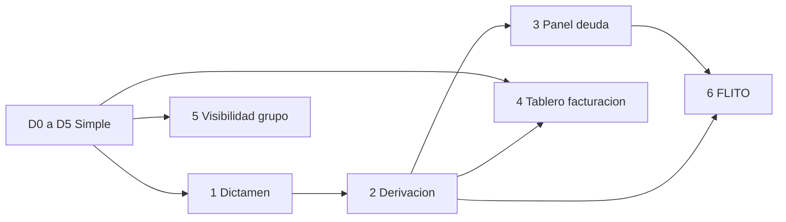

# Pendientes de Diagnóstico — del dictamen a FLITO

Documento de trabajo del 2026-11-03. Describe lo que falta entre el cierre de las olas D0–D5 y la integración con FLITO. No activa Historias de Usuario, no cambia Azure DevOps y no publica contratos: solo fija qué ya existe, qué se construye, en qué archivos enganchar y qué dependencia externa bloquea el arranque.

Fuentes de contratos ya decididos: [plan-implementacion-diagnostico-vehicular-v2.md](plan-implementacion-diagnostico-vehicular-v2.md) (§5 DDL, §6.1 REST, §6.3 gRPC, §7.3–7.5, §8.2). Estado de olas: [estado-implementacion-diagnostico-2026-10-23.md](estado-implementacion-diagnostico-2026-10-23.md). D0–D5 están en código. D6–D9 no tienen módulo, tabla ni ruta.

| Punto | Ola | Épica ADO | Puede arrancar |
|---|---|---|---|
| 1. Dictamen | D6 | #12678, estado New | Después del dictamen de fuentes (R-17), del catálogo con el PO y de la llave LLM |
| 2. Derivación a trámite | D7 | #12679, estado New | Después del punto 1 y del ADR h; el canje completo espera T1 |
| 3. Panel de deuda para sanear | D7 | #12679 | El botón en Con Análisis IA espera el punto 1; el total SIMIT espera C1 |
| 4. Tablero de facturación | D8 (volumetría) | #12680 ya cubre reportes de D4; el tablero no tiene épica propia | La volumetría por compañía y los fallos por proveedor, en paralelo al dictamen |
| 5. Visibilidad de grupo | D8 | Sin épica | En paralelo al dictamen; no depende de los puntos 1–3 |
| 6. Integración FLITO | D9 | Sin épica | Después de que el lote cierre (D4 ya lo hace); conviene después de 1 y 2, y exige el contrato D-17 |

---

## 1. Dictamen

**Objetivo.** Cuando un vehículo de un lote «Con Análisis IA» termina sus celdas, emitir un veredicto determinista de la familia TRASPASO (`VIABLE` o `BLOQUEADO`), con alertamientos redactados por LLM y plantilla de respaldo si el modelo no responde. El cliente ve el veredicto; el override queda en el backoffice.

**Qué hay en código.**

- La cabecera ya guarda `modo` (`SIMPLE` o `CON_ANALISIS`) y `tipo_tramite_codigo`. El validador exige las fuentes obligatorias de la familia: `services/core-diagnostico/src/Flit.Diagnostico.Domain/Diagnosticos/ValidadorCabecera.cs`.
- La UI de parametrización ya consume `fuentesObligatorias` del tipo elegido: `frontend-diagnostico/components/parametrizacion/useParametrizacion.ts`.
- El catálogo gRPC devuelve esa lista vacía a propósito. En `services/core-diagnostico/src/Flit.Diagnostico.Api/Modulos/Catalogos/CatalogoTiposTramiteGrpc.cs` cada tipo se construye con `FuentesObligatorias` en `[]` (R-17 deja el catálogo de reglas para D6). El dominio lo documenta en `TipoTramite.cs`.
- El permiso `diagnostico.dictamen.override` está en el manifiesto (`PermisosTests`) y la sesión expone la capacidad `corregirDictamen` (`frontend-diagnostico/lib/sesion.ts`). No hay endpoint que lo use.
- El interruptor `redaccion_ia_suspendida` vive en `diagnostico.configuracion_empresa` y se edita solo en el contrato del backoffice. `GET /configuracion` no lo devuelve al cliente y `PUT /configuracion` responde 403 si llega en el cuerpo. Nadie lo lee al redactar, porque no hay redactor.
- El disparador natural es `AvanceVehiculo.Terminado` (`services/core-diagnostico/src/Flit.Diagnostico.Domain/Diagnosticos/AvanceVehiculo.cs`): el vehículo está terminado cuando tiene celdas y todas están en `COMPLETADO` o `NA`. El payload normalizado de cada celda ya está en `diagnostico.consultas.payload`.
- El reproceso (`POST /consultas/{cid}/reprocesar`, `EndpointsReproceso.cs`) repite la consulta de una celda en `ERROR` y no recalcula dictamen, porque la tabla no existe.

**Qué se construye.**

- Tablas del plan §5, todavía sin migración: `diagnostico.reglas_dictamen` (catálogo global, sin `tenant_id`) y `diagnostico.dictamenes` (veredicto `VIABLE`/`BLOQUEADO`, `alertamientos`, `catalogo_version`, `redactado_por` `PLANTILLA`/`LLM`, `estado_redaccion` `PENDIENTE`/`COMPLETADA`, columnas de reintento y override).
- Evaluador determinista de la familia TRASPASO (traspaso, traspaso unilateral, transferencia de dominio). El mismo consolidado produce el mismo veredicto con cualquier texto. La prenda queda para la versión 2 del catálogo; la cancelación de matrícula espera T3.
- Siembra de fuentes obligatorias de TRASPASO. Propuesta del plan, sujeta al dictamen normativo: RUNT vehículo, SIMIT vehículo, RUNT propietario, SIMIT propietario. A partir de ahí `CatalogoTiposTramiteGrpc` deja de devolver `[]` y MOD01 marca y bloquea esas fuentes con tooltip.
- Redactor LLM (opción IA1, opciones `Diagnostico:Anthropic`, mismo patrón que el OCR de Comparendos). Al modelo solo llegan veredicto, reglas disparadas, montos y datos del bien (placa, clase, marca, línea, modelo, servicio). Nunca documentos ni nombres. Si el texto contradice el veredicto, se descarta y se reintenta.
- Respaldo R-2b: con el LLM caído o con `redaccion_ia_suspendida=true`, el dictamen sale con plantilla y `estado_redaccion=PENDIENTE`. Una cola durable completa la redacción. Si ya había PDF, el cambio de texto invalida la huella y regenera el archivo (enganche en `services/core-diagnostico/src/Flit.Diagnostico.Api/Modulos/Reportes/` y en `diagnostico.evidencias`).
- Hook al pasar el vehículo a terminado y recálculo cuando un reproceso exitoso cambia el consolidado. Hoy el reproceso no tiene ese gancho.
- Panel de veredicto y alertas en el tablero. El DTO de cliente omite `analisis_override`, `usuario_override_id` y `override_en`.

**Contratos a publicar.**

- `GET /api/v1/diagnostico/vehiculos/{vid}/dictamen` con `diagnostico.diagnosticos.ver`. Incluye `estado_redaccion`; en `PENDIENTE` la UI dice «redacción IA pendiente». Sin campos de override.
- `PUT /api/v1/diagnostico/vehiculos/{vid}/dictamen` con `diagnostico.dictamen.override` y cuerpo que exija `confirmado=true`. Solo backoffice FLIT.
- Evento `diagnostico.dictamen.emitido` en `contracts/asyncapi/diagnostico-events.v1.yaml`. Hoy ese archivo solo publica `diagnostico.lote.terminado`. Sin PII: ids, tenant, modo, tipo, veredicto y versión de catálogo.
- ADR de la decisión (g): motor determinista, redacción IA obligatoria con plantilla de respaldo, proveedor propio del producto. Sigue sin versionar; el plan lo deja en Propuesto hasta que el Líder Técnico lo acepte.
- OpenAPI en `contracts/openapi/diagnostico.v1.yaml`. Hoy no hay ruta de dictamen.

**Dependencias externas.**

- Dictamen de `expert-doc-engine` sobre la lista de fuentes obligatorias de TRASPASO frente a la Resolución 20233040017145 (R-17). El motor de viabilidad no es una regla del FUR; la lista de fuentes sí se contrasta con la norma. Bloquea la siembra.
- Catálogo de reglas con el PO (códigos, condición sobre el consolidado, efecto `BLOQUEA`/`ADVIERTE`, plantilla). Bloquea el evaluador.
- Proveedor LLM y llave, decisión del Líder Técnico (IA1). Sin llave se puede dejar el camino de plantilla, pero el criterio de salida de D6 incluye el redactor.
- Frente C1: total adeudado de SIMIT en pesos tipados dentro de `ConsultarMultas` (o un campo hidratado `total_amount`). Hoy `ResultadoSimit` guarda semáforo, cantidad y comparendos con `valor` en texto (`services/core-diagnostico/src/Flit.Diagnostico.Api/Modulos/Consultas/Fuentes/ResultadoSimit.cs`). El detalle corta la lista a 100 comparendos (`DetalleCelda.TopeComparendos`) y el Excel del lote suma esos textos y marca «al menos» si hubo truncamiento (`ExcelLote.cs`). Las reglas por monto no tienen un campo fiable. C1 bloquea esas reglas; el resto del evaluador puede diseñarse en paralelo, pero D6 no cierra sin ellas.

**Criterio de salida.** El mismo consolidado produce el mismo veredicto con cualquier redacción. Con el LLM caído, el dictamen sale con plantilla marcada «redacción IA pendiente» y se completa al volver; el PDF previo se invalida y se regenera. Un override sin `confirmado=true` no se guarda. El cliente no recibe campos de override.

**Qué no entra.** Prenda y cancelación de matrícula. LLM que decida el veredicto. Bandera contractual de IA por compañía (solo existe el interruptor de emergencia). Reglas por empresa. Activación de la épica #12678: sigue en New.

---

## 2. Derivación a trámite

**Objetivo.** Desde un vehículo terminado, emitir un enlace de un solo uso al wizard de Trámites, con el tipo de trámite, los datos del vehículo, el propietario descifrado solo al canjear y el RUNT normalizado con su fecha. Tras el canje, la fila muestra «Ver trámite #N» y un segundo intento responde 409.

**Qué hay en código.**

- Permiso `diagnostico.derivacion.crear` y capacidad `derivar` en la sesión. El rol de backoffice no lleva ese permiso (`PermisosTests`: el manifiesto del backoffice no contiene `diagnostico.derivacion.crear`).
- `TRAMITES_URL` (`frontend-diagnostico/lib/config.server.ts`) alimenta el shell para cuenta y ayuda. No abre un wizard con contexto.
- `ListarTiposTramite` ya alimenta el combobox de parametrización (`CatalogoTiposTramiteGrpc`). Sirve para el modal de tipo cuando el lote es Simple.
- La reutilización de RUNT que ya existe es la del mismo día calendario de Colombia, entre lotes de Diagnóstico (D-10, corte a las 00:00). No es la caché de 24 horas del handoff (R-14), que decide Trámites al canjear.
- `FilaVehiculoDto` (`services/core-diagnostico/src/Flit.Diagnostico.Api/Modulos/Tablero/GrillaDto.cs`) trae identificador, `terminado`, celdas y documentos enmascarados. No trae trámite ni derivación.
- `vehiculos.runt_consultado_en` ya está en el modelo y es el dato que el canje debe entregar.

**Qué se construye.**

- Tabla `diagnostico.derivaciones`: token guardado como SHA-256 (`token_hash`), TTL, `canjeado_en`, `tramite_ref`, `destino` `WIZARD` o `SANEAMIENTO`, e índice único parcial de un wizard canjeado por vehículo (R-16).
- `POST /api/v1/diagnostico/vehiculos/{vid}/derivaciones` con cuerpo `{destino, tipo_tramite_codigo}` y respuesta `{url, expira_en}`. 409 si ese vehículo ya originó un trámite. En esta entrega solo se canjea `destino=WIZARD`. El token es aleatorio de 256 bits, no viaja el payload en la URL, y caduca a los 10 minutos. Queda ligado a tenant, usuario y tipo.
- Proto nuevo `contracts/proto/flit/diagnostico/v1/derivacion.proto`: `DerivacionService.CanjearContexto(token)` devuelve placa o VIN, datos del vehículo, propietario descifrado en el canje, RUNT normalizado, `runt_consultado_en`, `diagnostico_id` y `vehiculo_id`. Scope `platform.diagnostico.derivacion`. El segundo canje se rechaza.
- Seguimiento H1-a: al pintar la fila, Diagnóstico pregunta a Trámites por referencia externa y guarda `tramite_ref`. Extender `FilaVehiculoDto` con esa trazabilidad (número de trámite cuando ya hubo canje).
- UI en la grilla del tablero: botón «Crear trámite» por fila, solo con capacidad `derivar` y vehículo terminado. Si el lote es Simple, un modal elige el tipo (el catálogo ya está). Después del canje, la etiqueta «Ver trámite #N» reemplaza al botón.
- ADR de la decisión (h), handoff de un solo uso. Sigue abierto (D-11); el plan recomienda H1 y no H2 ni H3.

**Contratos a publicar.**

- REST de alta de derivación en `contracts/openapi/diagnostico.v1.yaml`.
- `derivacion.proto` y, del lado de Trámites, `ObtenerPorReferenciaExterna(origen, external_ref)` en `contracts/proto/flit/tramites/v1`.
- Campos del canje, tabla del plan §6.5: `tipo_tramite_codigo`, placa o VIN, datos del bien, documento del propietario descifrado al canjear, `origen=diagnostico`, `external_ref=vehiculo_id`, RUNT normalizado y `runt_consultado_en`.

**Dependencias externas.**

- Frente T1, otro equipo y otro servicio (`services/core-api`, wizard de `frontend/`): aceptar `?ctx=`, canjear por gRPC, precargar, crear el borrador con `Origin=diagnostico` y `ExternalRef=vehiculo_id`, exponer `ObtenerPorReferenciaExterna`, y no reconsultar RUNT en `RunConsultationCommand` si el dato del canje tiene menos de 24 horas (configurable en Trámites). Sin T1 el botón puede emitir el token; el wizard no lo consume.
- ADR h aceptado por el Líder Técnico antes de codificar el rpc. Hoy la decisión está recomendada, no versionada.
- Decisión D-14 del PO: si T1 se demora, ¿se libera el dictamen con «Crear trámite» oculto? El plan la deja abierta, con propuesta «sí, ocultando el botón». No se resuelve en este documento.

**Criterio de salida.** El segundo canje del mismo token se rechaza. Un segundo «Crear trámite» del mismo vehículo responde 409. Tras el canje, la fila muestra «Ver trámite #N». El backoffice no puede derivar.

**Qué no entra.** Canje de `destino=SANEAMIENTO` (queda la fila reservada; lo usa el punto 3 solo como modelo). Consumer RabbitMQ de `flit.tramites` (H1-b): hasta entonces el número se consulta al pintar (H1-a). Reconsultas de RUNT dentro de Diagnóstico con ventana de 24 horas: esa ventana es de Trámites. Un segundo trámite del mismo vehículo: si el trámite se cancela o hace falta otro tipo, se crea un diagnóstico nuevo.

---

## 3. Panel de deuda para sanear

**Objetivo.** Mostrar, sin crear un proceso de saneamiento, la deuda desglosada por fuente de un vehículo terminado, con monto y detalle, y dejarla exportar. En Con Análisis IA el botón aparece solo con veredicto `BLOQUEADO`. En Simple, cuando la deuda es mayor que cero (R-10, D-08 = S2).

**Qué hay en código.**

- Celdas `SIMIT_VEHICULO`, `SIMIT_PROPIETARIO`, `SIMIT_LOCATARIO` e `IMPUESTO_DEPARTAMENTAL` con payload en `diagnostico.consultas`.
- El impuesto ya trae monto tipado: `ResultadoImpuesto` (`services/core-diagnostico/src/Flit.Diagnostico.Api/Modulos/Consultas/Fuentes/ResultadoImpuesto.cs`) expone `monto_total` en pesos enteros y `vigencias`.
- SIMIT trae semáforo, cantidad y comparendos con `valor` en texto (`ResultadoSimit`). No hay monto total de producto. `ExcelLote` suma los comparendos listados y escribe «al menos» si el proveedor truncó (tope de la HU #13798, detalle recortado a 100).
- El detalle de celda (`GET /diagnosticos/{id}/vehiculos/{vid}/consultas/{fuente}`) y el PDF muestran la fuente suelta, no un panel agregado.
- No hay coincidencias de «Sanear» en el código de producto (servicio ni frontend de Diagnóstico).

**Qué se construye.**

- Regla de aparición R-10, en el tablero: Con Análisis IA solo con dictamen vigente `BLOQUEADO`; Simple cuando la suma de deuda de las fuentes aplicables es mayor que cero.
- Lectura que arme las cuatro fuentes del vehículo. Se omite el locatario si no fue declarado y el impuesto si la celda está en `NA`, mostrando el motivo (`SERVICIO_PUBLICO`, `DEPARTAMENTO_NO_SOPORTADO` o el que corresponda).
- UI: botón «Sanear», panel con monto y detalle por fuente, y exportación PDF o Excel de ese panel. No se reutiliza el Excel del lote tal cual (`ExcelLote` es el reporte del lote, con estimado y «al menos»).
- La fila `derivaciones.destino='SANEAMIENTO'` se crea en el DDL del punto 2 y queda reservada. Esta entrega no la inserta ni la canjea.

**Contratos a publicar.**

- Endpoint de lectura del panel (agregado por vehículo) en `diagnostico.v1.yaml`, con el mismo permiso de ver diagnósticos. El plan v2 no le dio ruta propia: al implementarlo hay que nombrarla en el OpenAPI y no colarla en el detalle de una sola celda.
- Esquema de la exportación del panel, distinto del Excel de lote y del PDF de evidencia.

**Dependencias externas.**

- El botón en modo Con Análisis IA espera el dictamen del punto 1. Sin veredicto no se sabe si está `BLOQUEADO`.
- El monto de SIMIT espera C1. Sin C1 el panel puede listar comparendos y el texto `valor`, y debe decir que no hay total de producto. No se presenta la suma del Excel como si fuera el saldo oficial.
- El impuesto real sigue bloqueado por C3 y por la bandera de la fuente (D5). El panel usa la celda que ya exista: si está en `NA`, muestra el motivo y no un monto inventado.

**Criterio de salida.** En Simple, con deuda mayor que cero, «Sanear» muestra cada fuente aplicable con su monto y su detalle, y la exportación corresponde a ese panel. En Con Análisis IA el botón no aparece con veredicto `VIABLE`. No se crea un trámite ni una derivación de saneamiento.

**Qué no entra.** Módulo de saneamiento (S1) ni enlace externo de pago (S3). Canje de `destino=SANEAMIENTO`. Llenado manual del impuesto. Prometer un saldo SIMIT cerrado mientras C1 no exista.

---

## 4. Tablero de facturación del backoffice

**Objetivo.** Dar al backoffice FLIT una vista de consumo entre compañías: cuántos diagnósticos y vehículos corrió cada una, en qué modalidad y tipo de trámite, y cuántos fallos y reprocesos hubo por proveedor. La tasa de conversión (trámites nacidos de un diagnóstico) entra cuando existan la derivación y el reporte de Trámites. Esta vista no liquida facturas ni guarda una tabla de precios.

**Qué hay en código.**

- Permiso `diagnostico.volumetria.ver` y capacidad `verVolumetria` en la sesión. No hay pantalla que los use. El dock (`frontend-diagnostico/components/DiagnosticoShell.tsx`) solo ofrece Configuración y, con capacidad de backoffice, la entrada Backoffice hacia `/backoffice/diagnosticos`.
- `GET /api/v1/diagnostico/backoffice/resumen?empresa=` (`contracts/openapi/diagnostico.v1.yaml`) cuenta diagnósticos y vehículos de una compañía. Es la ruta mínima de D0, auditada en `diagnostico.lecturas_backoffice`. No es el tablero.
- Insumos ya persistidos: `diagnostico.diagnosticos` (modo, tipo, estado, fechas), `diagnostico.vehiculos`, `diagnostico.intentos_consulta` (`servicio`, `estado`, `tipo_error`, `disparador`, `desde_cache`). El índice `ix_intentos_metricas` ya cubre tenant, fuente, servicio e inicio.
- El estimado frente a lo consumido ya vive en la grilla de un lote (`EstimadoVsConsumidoDto`, solo con `estimado_consultas=AL_FINALIZAR` y lote cerrado). No compara compañías.
- La facturación oficial del plan apunta a `ObtenerConsumo` de plataforma (producto `diagnostico`), no a una tabla local de precios. Este tablero agrega lo que el producto ya registró.

**Qué se construye.**

- `GET /api/v1/diagnostico/admin/volumetria` con `diagnostico.volumetria.ver`, lectura auditada al estilo del backoffice (ADR-0069 / ADR-0073): conteos por compañía, modalidad Simple frente a Con Análisis IA, tipo de trámite, fallos y reprocesos por proveedor (`disparador=REPROCESO`, `estado=ERROR`, `servicio`).
- `GET /api/v1/diagnostico/admin/conversion`: trámites con origen diagnóstico. Depende de que el punto 2 escriba `tramite_ref` y de que Trámites exponga el conteo por origen (T2). El plan también recuerda que el primer producto de la compañía, leído de `platform.tenant_products.created_at` (R-4), solo es fiable para compañías creadas después del DDL 121; el tablero no reinterpreta ese dato.
- Ruta de UI condicionada a `verVolumetria`, dentro del backoffice, con filtros de compañía y fechas. El cliente de una compañía no la ve.

**Contratos a publicar.**

- Las dos rutas `/admin/*` en `contracts/openapi/diagnostico.v1.yaml`. Hoy ese archivo no tiene prefijo `/admin/`.
- Dejar explícito en la descripción OpenAPI que el recurso agrega consumo, fallos y conversión, y que no emite factura.

**Dependencias externas.**

- La volumetría por compañía y los fallos por proveedor no tienen dependencia externa nueva: salen de D0–D5. Pueden empezar en paralelo al dictamen.
- La conversión espera el punto 2 (`tramite_ref`) y el frente T2 (reporte de trámites con `Origin=diagnostico`, por empresa y tipo, en core-api). Sin T2 la pantalla muestra volumetría y deja la conversión vacía o ausente, sin inventar la tasa.
- `ObtenerConsumo` de plataforma sigue siendo la fuente de la facturación oficial. Este tablero no la reemplaza. Si plataforma no atribuye el producto `diagnostico`, el hueco es de P1, no de esta pantalla.

**Criterio de salida.** Un usuario con `diagnostico.volumetria.ver` y `tenant_type=FLIT` filtra por compañía y fechas y ve modalidad, tipo, fallos y reprocesos por proveedor. Un admin de compañía cliente recibe 403. La pantalla no muestra precios ni documentos.

**Qué no entra.** Liquidación, precios, impuestos de factura y exportación contable. SSE del plan D8 (mejora opcional del tablero operativo, no de este tablero). Conversión antes de T2. Activar una épica nueva: D8 no tiene épica; #12680 sigue siendo la de reportes ya entregados en D4 (PDF, Excel, ZIP y listado).

---

## 5. Visibilidad de grupo

**Objetivo.** La compañía cabeza de red, con el claim `is_group_parent`, lee en solo lectura los diagnósticos de sus hijas: listado, detalle, grilla y descargas. La hija no ve al padre ni a las hermanas. El padre no reprocesa, no llena, no hace override ni deriva en nombre de una hija. La sesión sigue siendo una sola compañía (D-03).

**Qué hay en código.**

- Aislamiento por `tenant_id` del token: `services/core-diagnostico/src/Flit.Diagnostico.Api/Modulos/Comun/TenantFilter.cs`. Sin empresa no se ve ni se escribe nada. El SuperAdmin no se salta el filtro. La lectura entre compañías solo existe en `/backoffice/*` con `IgnoreQueryFilters()` y auditoría.
- Dentro de la compañía, `AccesoLote` (`services/core-diagnostico/src/Flit.Diagnostico.Api/Modulos/Tablero/AccesoLote.cs`) aplica `visibilidad_usuario` `EMPRESA` o `PROPIOS`. El admin de la compañía (quien tiene `diagnostico.configuracion.editar`) ve todos los lotes de esa empresa. Otra compañía responde 404, igual que un lote inexistente.
- Identidad ya emite `is_group_parent` (`OidcPrincipalFactory` en core-api; el access token lo incluye). Trámites ya recorre padre e hijas. Diagnóstico no lee ese claim: no hay rama que resuelva hijas.
- El backoffice con `?empresa=` es soporte FLIT sobre cualquier compañía, no la vista del cliente cabeza de red. No se reutiliza esa política para el padre.

**Qué se construye.**

- Resolución de las hijas del tenant del token contra identidad, en el momento de la lectura. No se copia el árbol de compañías dentro de Diagnóstico.
- Listado, detalle, grilla y descargas de esas hijas, en solo lectura, para quien trae `is_group_parent` y la hija es suya. Cada respuesta rotula la compañía; el listado no mezcla lotes sin decir de quién son (selector o agrupación).
- Test de fuga propio: una hija no lee al padre ni a una hermana; un padre no lee una compañía que no es hija; el padre recibe 403 al reprocesar, llenar, hacer override o derivar sobre un lote de la hija.
- La sesión de producto sigue siendo la compañía del token. La vista de hijas es una lectura adicional, no un cambio de compañía activa.

**Contratos a publicar.**

- Extensión de `GET /diagnosticos` (y de las lecturas de detalle, grilla y evidencias que el padre necesite) en `diagnostico.v1.yaml`, con el alcance «hijas en solo lectura» descrito en la operación. No hace falta un permiso nuevo si se apoya en `diagnostico.diagnosticos.ver` más el claim; si el diseño separa el permiso, se siembra en el manifiesto y se documenta aquí antes de codificar.
- Ningún campo nuevo de identidad: el claim ya existe. El rpc o la consulta de hijas es el que identidad ya ofrece a Trámites; Diagnóstico lo consume, no lo redefine.

**Dependencias externas.**

- Identidad debe seguir emitiendo `is_group_parent` y poder listar las hijas del tenant. Eso ya existe para Trámites. No bloquea el diseño.
- No depende de los puntos 1, 2 ni 3. Puede empezar en paralelo al dictamen, sobre D0–D5.
- No cambia D-03: no hay selector de compañía activa en el producto. P6 (cambio de compañía en el hub) sigue sin bloquear.

**Criterio de salida.** Una hija no ve a su padre ni a sus hermanas. El padre ve los lotes de sus hijas, rotulados, y puede descargar evidencias, y no puede reprocesar, llenar, corregir el dictamen ni derivar por ellas. El test de fuga del tenant actual sigue en verde y se suma el de grupo.

**Qué no entra.** Escritura en la hija. Copiar `identity.tenants` al schema `diagnostico`. Tratar al padre como backoffice FLIT. SSE. Mezclar esta vista con `GET /backoffice/diagnosticos?empresa=`.

---

## 6. Integración FLITO

**Objetivo.** Que FLITO cree un diagnóstico con una lista de placas y reciba un enlace, y que al cerrarse el lote reciba un aviso firmado. Mientras el contrato no exista, la vía operativa sigue siendo la carga `.xlsx`.

**Qué hay en código.**

- En Trámites (core-api), no en Diagnóstico: clientes externos según [ADR-0067](../../services/core-api/docs/adr/ADR-0067-clientes-de-integracion-externos.md), feed `GET /api/v1/external/tramites/sync`, webhooks según [ADR-0071](../../services/core-api/docs/adr/ADR-0071-avisos-de-sincronizacion-a-flito.md) y la tabla `integrations.flito_sync_signals`. Eso sincroniza trámites. No crea diagnósticos.
- En core-diagnostico hay outbox del SDK y el exchange `flit.diagnostico`. El único evento publicado es `diagnostico.lote.terminado` (`contracts/asyncapi/diagnostico-events.v1.yaml`), sin consumidor.
- No hay carpeta `Integracion/` en el servicio ni rutas `/integracion/*` en `contracts/openapi/diagnostico.v1.yaml`.

**Qué se construye.**

- Contrato D-17 con el equipo FLITO, antes de codificar: quién es el cliente de máquina, qué scopes lleva, si el alta del cliente vive en core-api (patrón ADR-0067, misma puerta que Trámites) o en core-diagnostico, y si el aviso al cerrar lleva solo el cierre del lote o también el veredicto y la derivación.
- `POST /api/v1/diagnostico/integracion/diagnosticos` con la lista de placas. Crea el lote (reutiliza la ingesta ya existente de D1, sin pasar por la pantalla) y responde el enlace al diagnóstico. El usuario de FLITO necesita sesión de suite, como fijó la opción X2.
- Webhook firmado al cerrar, por la outbox de Diagnóstico hacia notificaciones, siguiendo el patrón de ADR-0071. No se reutiliza `integrations.flito_sync_signals`: esa tabla es de trámites.
- Pruebas de contrato con el equipo FLITO.

**Contratos a publicar.**

- OpenAPI de integración en `diagnostico.v1.yaml` (o un archivo de integración aparte, si D-17 lo separa del API de usuario).
- Evento de aviso a FLITO en `diagnostico-events.v1.yaml`, distinto de `diagnostico.lote.terminado` si el consumidor y el sobre no son los mismos. Sin PII.
- Alta del cliente de máquina y scopes, en el lugar que D-17 elija. No se copia el feed `/external/tramites/sync`.

**Dependencias externas.**

- Contrato D-17 firmado por el PO y el equipo FLITO. Sin él no se codifica la ruta: el plan dejó X2 diferido a propósito (D-09).
- Decisión de dónde vive el alta del cliente (core-api o core-diagnostico). Bloquea el manifiesto de scopes, no la forma del `POST`.
- D4 ya cierra el lote y publica `diagnostico.lote.terminado`, así que el aviso de cierre no espera dictamen. Conviene construir el webhook después de los puntos 1 y 2 para que D-17 pueda incluir veredicto y `tramite_ref` si el equipo FLITO los pide. Si el contrato dice que el aviso es solo el cierre, D9 puede salir con D4 y ampliarse después.

**Criterio de salida.** FLITO crea un diagnóstico de N placas sin usar la pantalla de carga y recibe el aviso firmado cuando el lote pasa a `COMPLETADO` o `INCOMPLETO`. Un reintento del mismo cierre no duplica el lote ni el aviso. La carga `.xlsx` sigue funcionando.

**Qué no entra.** Crear el diagnóstico desde `flito_sync_signals`. Hacer que FLITO consulte RUNT por su cuenta. Sustituir el wizard de Trámites. Activar una épica: D9 no tiene Feature ni épica asignada.

---

## Orden de implementación

1. **Dictamen (D6, épica #12678).** Primero el dictamen de fuentes (R-17), el catálogo con el PO y el ADR (g). C1 puede avanzar en paralelo desde ya; sin el total tipado no se cierran las reglas por monto. La llave LLM la define el Líder Técnico antes del redactor.
2. **Derivación (D7, épica #12679),** cuando el dictamen ya dispara al cerrar el vehículo. El ADR (h) va antes del rpc. El botón puede emitir token sin T1; el flujo completo espera a que Trámites canjee `?ctx=`. D-14 dice si el dictamen se libera mientras tanto.
3. **Panel de deuda,** en la misma ola D7, detrás del veredicto. El desglose de impuesto y el listado de comparendos no esperan C1; el total SIMIT sí.
4. **Tablero de facturación, parte de volumetría,** en paralelo a 1–3. Solo lee D0–D5. La conversión se engancha cuando existan `tramite_ref` y T2.
5. **Visibilidad de grupo,** en paralelo a 1–3. Solo lee identidad y las tablas actuales. Su test de fuga es propio.
6. **FLITO,** cuando D-17 diga el contenido del aviso. El cierre del lote ya existe. Si el aviso debe llevar veredicto o número de trámite, espera 1 y 2.

Lo que puede ir en paralelo al dictamen, sin esperarlo: la volumetría y los fallos por proveedor del punto 4, y todo el punto 5. La conversión del punto 4 no. El punto 3 no, en modo Con Análisis IA. El punto 6 no conviene adelantarlo hasta cerrar D-17.

### Gates humanos

Este documento no los cruza.

- Las épicas #12678 (dictamen) y #12679 (derivación) siguen en New. Pasarlas de estado, sembrar Features e Historias y activar una HU piden confirmación humana. Aquí no se activa ninguna HU.
- D8 (tablero de facturación y visibilidad de grupo) no tiene épica. #12680 es la épica de reportes ya usada por D4; no se reabre ni se cierra desde este archivo.
- D9 (FLITO) no tiene épica ni Feature. D-17 la define el PO con el equipo FLITO.
- Los ADR (g) y (h) quedan en Propuesto hasta que el Líder Técnico los acepte. Este archivo no los versiona.
- D-14 (liberar el dictamen sin derivación) sigue abierta para el PO.
- C1, T1 y T2 son trabajo de otros equipos. No se implementan en este repositorio de producto como parte de estos pendientes.
