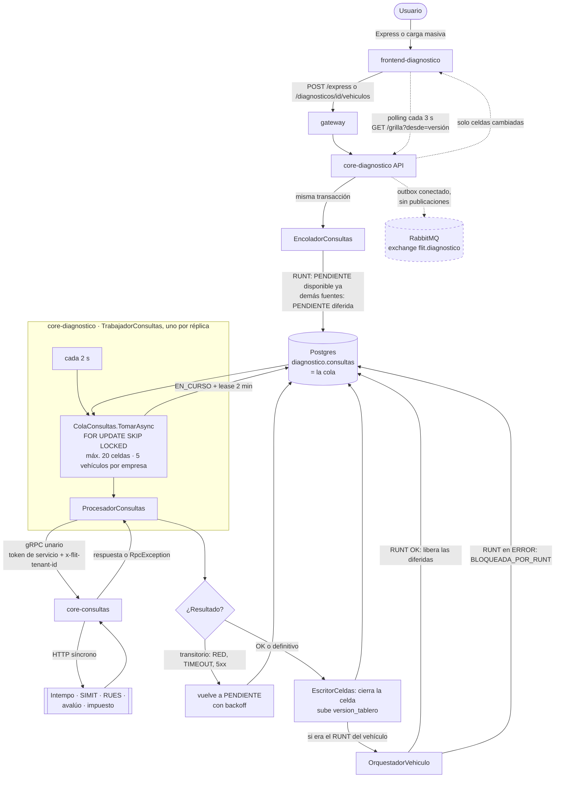
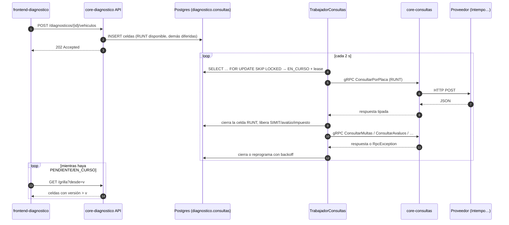

# Diagnóstico Vehicular — revisión de la validación manual en local (2026-10-26)

> Revisión de código sobre la rama `feature/AB-12881-diagnostico-d0-d2` (último commit `cecab44cc`). Responde los tres
> hallazgos de la validación manual. Las anclas `archivo:línea` derivan rápido: reverificarlas antes de citarlas.

## Resumen

| # | Hallazgo | Estado | Causa | Qué hace falta |
|---|----------|--------|-------|----------------|
| 1 | No se ve la carga masiva ni la plantilla | **Implementada, sin entrada en el menú.** La plantilla existe pero **no trae instrucciones** | Ninguna pantalla de producción enlaza a `/diagnosticos/nuevo`, que es por donde se llega a la carga | Defecto de la HU #13754: botón «Nuevo diagnóstico (lote)». Ajuste nuevo: hoja de instrucciones en la plantilla |
| 2 | Solo se ve el RUNT; no aparecen SIMIT, impuesto, avalúo ni el semáforo | **Es configuración local.** Las fuentes están implementadas. El semáforo **por celda** existe; el **semáforo global** (dictamen) **no existe**: es la ola D6 | Sin simulación encendida y sin dirección de core-consultas, todas las fuentes salvo el RUNT quedan «no conectadas» y el backend no las ofrece | Encender el modo simulado en local (§2.3) y habilitar las fuentes en el contrato de la compañía |
| 3 | ¿Las consultas van por RabbitMQ o directo a core-consultas? | **Ninguna pasa por RabbitMQ.** La cola es una tabla de Postgres; un trabajador interno llama a core-consultas por **gRPC directo**, una llamada por celda | Decisión de arquitectura del plan v2 (ADR «cola durable en Postgres con SKIP LOCKED», HU #13727) | Nada. RabbitMQ está conectado al servicio, pero ninguna consulta pasa por él (§3.3) |

---

## 1. Carga masiva y plantilla

### 1.1 Lo que existe

| Pieza | Dónde | Detalle |
|-------|-------|---------|
| Descargar la plantilla | `GET /api/v1/diagnostico/plantilla`. `Modulos/Carga/CargaEndpoints.cs:23-35` | Genera un `.xlsx` en memoria con `PlantillaCarga.Generar()` |
| Analizar el archivo | `POST /diagnosticos/{id}/carga` (multipart, campo `archivo`) | `.xlsx` o `.csv` (`.xls` se rechaza con `FORMATO_XLS_NO_ADMITIDO`), máximo 5 MB (`Diagnostico:Carga:TamanoMaximoBytes`). Solo con el diagnóstico en `CREADO` (si no, 409). Analiza sin guardar |
| Confirmar los vehículos | `POST /diagnosticos/{id}/vehiculos` → 202. `Modulos/Vehiculos/VehiculosEndpoints.cs:31` | Valida `limite_vehiculos_lote` del contrato de la compañía («divida el lote o retire vehículos»), guarda y **encola las consultas** |
| Pantalla de carga | `frontend-diagnostico/app/(app)/diagnosticos/[id]/carga/page.tsx` → `components/carga/CargaMasiva.tsx` | El botón «Descargar plantilla» está en `components/carga/SubidaArchivo.tsx:70` |
| Permiso | `diagnostico.diagnosticos.crear` (`Plataforma/Permisos.cs:10`, capacidad `crearDiagnosticos`) | El mismo permiso para la plantilla, la carga y la pantalla. Ninguna bandera ni configuración operativa la oculta |

D1 está marcada como terminada (HUs #13749 backend y #13754 frontend).

### 1.2 Por qué no se ve

A la pantalla de carga se llega por tres caminos, y los tres dependen de que el diagnóstico ya exista:

- desde `/diagnosticos/nuevo`, después de crear la cabecera (`app/(app)/diagnosticos/nuevo/page.tsx:78`);
- desde el tablero de un lote (`components/tablero/TableroLote.tsx:128`);
- desde una fila del listado en estado `CREADO` (`lib/diagnosticos/listado.ts:171`).

**Ningún archivo de producción enlaza a `/diagnosticos/nuevo`:** solo lo hacen los tests. El menú del shell
(`components/DiagnosticoShell.tsx:35-56`) solo tiene Configuración y Backoffice, y el inicio (`app/(app)/page.tsx:34-40`)
solo muestra Express y el listado. Sin escribir la URL a mano no hay forma de empezar un lote.

**Para probarlo hoy:** con un usuario que tenga `diagnostico.diagnosticos.crear`, abrir `/diagnosticos/nuevo`, crear
la cabecera, pulsar «Cargar vehículos» y descargar la plantilla desde esa pantalla.

### 1.3 La plantilla no trae instrucciones

`Modulos/Carga/PlantillaCarga.cs:21-25` y `:47-70` generan **una sola hoja**, «Vehiculos», con tres encabezados en formato
texto y la fila 1 congelada:

| Identificador_Vehiculo | Tipo_Documento_Locatario | Documento_Locatario |
|---|---|---|

No hay hoja ni filas de instrucciones. Para agregarlas sin romper el lector (que espera los encabezados en la fila 1 de
la primera hoja, `VehiculosEndpoints.cs:43` / `LectorXlsx.cs`), lo seguro es una **segunda hoja «Instrucciones»** con:
qué va en cada columna, formato de la placa y del VIN, cuándo diligenciar el locatario, tipos de documento admitidos,
límite de vehículos del contrato, tamaño máximo y formatos aceptados.

### 1.4 Propuesta

| Cambio | Clasificación | Responsable |
|--------|---------------|-------------|
| Botón o ítem de menú «Nuevo diagnóstico (lote)» hacia `/diagnosticos/nuevo`, visible con `crearDiagnosticos` | **Caso B**: defecto de lo entregado en D1 (#13754) | `frontend-agent` vía `/fix-bug` |
| Hoja «Instrucciones» en la plantilla | **Caso C**: cambia lo que descarga el usuario; el texto lo aprueba el PO | `backend-agent`; una HU nueva o ampliar #13749 |

---

## 2. SIMIT, impuesto, avalúo y semáforo

### 2.1 Por qué en local solo sale el RUNT

El backend decide qué fuentes ofrecer (`fuentes_disponibles`) **sin mirar la compañía**. La configuración de la compañía
solo recorta esa lista después. `Modulos/Consultas/FuentesDisponibles.cs:27-29`:

```
disponible = tiene adaptador
           ∧ el adaptador no es el «no conectado»
           ∧ la bandera de la fuente lo permite
           ∧ (fuente ≠ impuesto ∨ hay ≥ 1 departamento soportado en la réplica)
```

El modo de los adaptadores se elige **al arrancar**, para todas las fuentes de core-consultas a la vez
(`Modulos/Consultas/Fuentes/SeleccionAdaptadores.cs:80-106`):

| `Diagnostico:Simulacion:Habilitada` | `Diagnostico:Consultas:Address` | Modo |
|---|---|---|
| `true` (solo con `Diagnostico:Ambiente` = `LOCAL` o `DEV`) | cualquiera (la simulación manda) | **Simulado** |
| `false` | con valor | **Real** |
| `false` | vacía | **No conectado** |

`appsettings.json` trae `Simulacion:Habilitada=false` (línea 13) y `Consultas:Address=""` (línea 51), y no existe un
`appsettings.Development.json` local, solo el `.example`. Resultado: **modo no conectado**. RUNT persona, SIMIT
(vehículo, propietario y locatario), avalúo e impuesto quedan fuera de `fuentes_disponibles`. El RUNT del vehículo se
sigue ofreciendo porque `EsNoConectada` nunca es verdadero para él (`SeleccionAdaptadores.cs:124`).

Todas las fuentes tienen variante real, simulada y no conectada en `Modulos/Consultas/Fuentes/`: `FuenteSimit*`,
`FuenteAvaluo*`, `FuenteImpuesto*`, `FuenteRuntPersona*`, `FuenteRues*` y `FuenteRuntIntempo*`.

> **No usar el modo real en local** mientras core-consultas no tenga `INTEMPO_API_BASE_URL`. El RUNT termina en ERROR
> `NO_CONECTADO` y, como las demás celdas esperan al RUNT, quedan en «Espera al RUNT del vehículo»
> (`pruebas-validacion-diagnostico-local.md:86-89`).

### 2.2 El impuesto

Además de la bandera `Diagnostico:Fuentes:ImpuestoDisponible=true` (por defecto `false`, `DisponibilidadFuentes.cs:14-17`),
el impuesto exige que la réplica `diagnostico.departamentos_impuesto` tenga al menos un departamento soportado
(`Catalogos/EstadoCapacidadImpuesto.cs:26`). **En modo simulado eso se cumple solo:** `CapacidadImpuestoSimulada` entrega
05 (Antioquia) y 25 (Cundinamarca), y el trabajador de sincronización los copia a la réplica en su primera vuelta
(`Catalogos/CapacidadImpuestoPlataforma.cs:48-53`). En modo real depende del proveedor de la ola C3, que aún no existe
(core-consultas responde `UNIMPLEMENTED`).

### 2.3 Configuración mínima en local para ver todas las fuentes

En `services/core-diagnostico/src/Flit.Diagnostico.Api/appsettings.Development.json` (o como variables `Diagnostico__…`):

```jsonc
"Diagnostico": {
  "Ambiente": "LOCAL",
  "Simulacion": { "Habilitada": true },
  "Fuentes": { "ImpuestoDisponible": true },
  "Identidad": { "SimularSuscripcionActiva": true },   // solo en local: la empresa queda suscrita al producto
  "Tramites": { "Address": "http://127.0.0.1:8082" }
  // "Consultas:Address" NO se define: la simulación manda sobre ella
}
```

Y en la aplicación, como administrador:

1. **Contrato** (backoffice FLIT): incluir SIMIT, avalúo e impuesto en `fuentes_habilitadas` de la compañía.
2. **Operación** (admin de la compañía): marcarlas en `fuentes_por_defecto` si se quieren preseleccionadas al crear el
   diagnóstico.

El front filtra con `fuentes_disponibles` en las pantallas de contrato, operación y parametrización
(`lib/configuracion.ts:41`, `components/configuracion/PestanaContrato.tsx:262`, `PestanaOperacion.tsx:41`,
`components/parametrizacion/useParametrizacion.ts:54-55`).

> El `appsettings.Development.json.example` actual **no trae** `Ambiente`, `Simulacion`, `Fuentes:ImpuestoDisponible` ni
> `Identidad:SimularSuscripcionActiva`. Conviene agregarlos (Caso A, sin cambio funcional).

### 2.4 Semáforo y estado de cada consulta

| Qué | Estado | Dónde |
|-----|--------|-------|
| **Semáforo por celda** (vehículo × fuente) | ✅ Existe | Ruta `/diagnosticos/[id]`: `TableroLote` → `GrillaSemaforos` → `CeldaSemaforo`, con `DetalleCelda` para el detalle (`components/tablero/TableroLote.tsx:160`, `CeldaSemaforo.tsx:17-23`) |
| Estados de la celda | ✅ | `PENDIENTE`, `EN_CURSO`, `COMPLETADO`, `ERROR`, `NA`. `NO_CONECTADO`, `RED`, `TIMEOUT`, `AUTENTICACION` y `BLOQUEADA_POR_RUNT` son **tipos de error dentro de `ERROR`**. Una celda que espera o quedó bloqueada por el RUNT muestra «Espera al RUNT del vehículo» (`CeldaSemaforo.tsx:56-62`) |
| **Semáforo global / dictamen** (¿se puede hacer el traspaso?) | ❌ **No existe** | Es la **ola D6**: dictamen TRASPASO con catálogo de reglas, motor determinista y redacción opcional por LLM (épica #12678, en New, sin descomponer). Hoy solo existe el permiso `diagnostico.dictamen.override` (`Plataforma/Permisos.cs:20`) |

Con el modo simulado del §2.3, el tablero muestra una columna por fuente elegida y cada celda se colorea al terminar.

---

## 3. ¿RabbitMQ o directo a core-consultas?

### 3.1 Respuesta

**Directo, por gRPC, con una cola propia en Postgres.** Ninguna consulta pasa por RabbitMQ.

1. Al confirmar el lote o crear un Express, `EncoladorConsultas` (`Modulos/Consultas/EncoladorConsultas.cs`) inserta,
   **dentro de la misma transacción**, una celda `PENDIENTE` por vehículo y fuente en `diagnostico.consultas`. Esa tabla
   **es la cola**. La celda RUNT queda disponible de inmediato y las demás nacen **diferidas** (`disponible_desde =
   9999-12-31`) hasta que el RUNT del vehículo termine.
2. `TrabajadorConsultas` (BackgroundService, uno por réplica; `Diagnostico:Procesador:Habilitado=true` por defecto)
   reclama hasta 20 celdas cada 2 s con `SELECT … FOR UPDATE SKIP LOCKED`, respetando un límite de 5 vehículos en
   vuelo por empresa, y las pasa a `EN_CURSO` con un *lease* de 2 min (`Modulos/Trabajos/ColaConsultas.cs:46-71`).
3. `ProcesadorConsultas` llama a la fuente. En modo real es un **gRPC unario a core-consultas** con token de servicio
   (scope `platform.consultas`) y `x-flit-tenant-id` (`Fuentes/ClienteConsultas.cs:100-138`):

   | Fuente | rpc |
   |--------|-----|
   | RUNT vehículo | `RuntIntempoService.ConsultarPorPlaca` / `ConsultarPorVin` (`FuenteRuntReal.cs:38-39`) |
   | RUNT persona (propietario, locatario) | `ConsultasService.ConsultarConductor` (`FuenteRuntPersonaReal.cs:29`) |
   | SIMIT (vehículo, propietario, locatario) | `ConsultasService.ConsultarMultas` (`FuenteSimitReal.cs:25`) |
   | RUES | `ConsultasService.ConsultarRues` (`FuenteRuesReal.cs:18`) |
   | Avalúo | `ConsultasService.ConsultarAvaluos` (`FuenteAvaluoReal.cs:28`) |
   | Impuesto | `ConsultasService.ConsultarImpuestoVehicular` (`FuenteImpuestoReal.cs:41`) |

4. core-consultas llama al proveedor (Intempo, SIMIT, etc.) por **HTTP síncrono** dentro del mismo handler gRPC
   (`core-consultas/.../RuntIntempo/ProveedorRuntIntempo.cs:88`).
5. La respuesta o la `RpcException` se traduce a un tipo de error (`TraductorErroresConsultas`):
   `Unavailable` → RED y `DeadlineExceeded` → TIMEOUT, ambos transitorios; `FailedPrecondition` y `Unimplemented` →
   NO_CONECTADO; `Unauthenticated` y `PermissionDenied` → AUTENTICACION; el resto → ESTADO_NO_OK.
6. `PoliticaReintentos` decide: si el error es **transitorio**, la celda vuelve a `PENDIENTE` con *backoff*. Si es
   **definitivo** o la consulta salió **OK**, `EscritorCeldas` la cierra y sube `version_tablero`
   (`ProcesadorConsultas.cs:92-110`).
7. Cuando se cierra el RUNT de un vehículo, `OrquestadorVehiculo` **libera** sus celdas diferidas. Si el RUNT quedó en
   ERROR, las marca `ERROR / BLOQUEADA_POR_RUNT`.
8. Si una réplica muere, sus celdas `EN_CURSO` las retoma otra cuando vence el *lease*.
9. El front hace **polling incremental** cada 3 s a `GET /diagnosticos/{id}/grilla?desde=<versión>` mientras quede alguna
   celda `PENDIENTE` o `EN_CURSO` (`frontend-diagnostico/lib/tablero/api.ts:77-79`, `useGrillaIncremental`).

### 3.2 Diagrama de flujo





### 3.3 ¿Y RabbitMQ?

El servicio **sí** tiene RabbitMQ conectado: `Platform:Messaging:ConnectionString` sale de `RABBITMQ_URL_DIAGNOSTICO`
(`ServicioSettings.cs:21`), registra el outbox de la plataforma (`AddFlitOutbox<DiagnosticoDb>`, `Program.cs:81`) y la
base trae las tablas outbox e inbox del SDK (`Persistence/DiagnosticoDb.cs:53`). Pero **ningún módulo publica ni consume
mensajes**: buscando `Outbox`, `Publish`, `Consumer` y `Enqueue` en `Modulos/` no aparece ningún resultado. Es
infraestructura lista para eventos futuros (por ejemplo «diagnóstico terminado» hacia otros productos o FLITO). No hace
falta para las consultas, y que RabbitMQ esté caído no detiene un diagnóstico.

Por qué no se usó RabbitMQ para las consultas (plan v2, ADR «a», HU #13727):

- la cola vive en la **misma transacción** que crea los vehículos, así que no hay celdas huérfanas ni mensajes sin fila;
- el **límite por empresa** y el **orden RUNT → demás** se resuelven con SQL sobre la misma tabla;
- el **reintento con backoff** y la **recuperación por lease** no necesitan colas de reintento ni *dead-letter*;
- el **tablero** lee el estado de la misma tabla.

La misma técnica se usa para generar los ZIP de evidencias (`Modulos/Trabajos/ColaEvidencias.cs`).

---

## 4. Siguientes pasos propuestos

| # | Acción | Tipo | Gate |
|---|--------|------|------|
| 1 | Completar `appsettings.Development.json.example` con las claves del §2.3 | Caso A | ninguno |
| 2 | Botón «Nuevo diagnóstico (lote)» en el inicio o en el menú | Caso B (`/fix-bug`, `frontend-agent`) | registro del Bug antes del merge |
| 3 | Hoja «Instrucciones» en la plantilla, con el texto aprobado por el PO | Caso C (HU nueva o ampliar #13749) | activar la HU |
| 4 | Semáforo global (dictamen TRASPASO) | Ola D6 (épica #12678): descomponer | DoR y activación |
