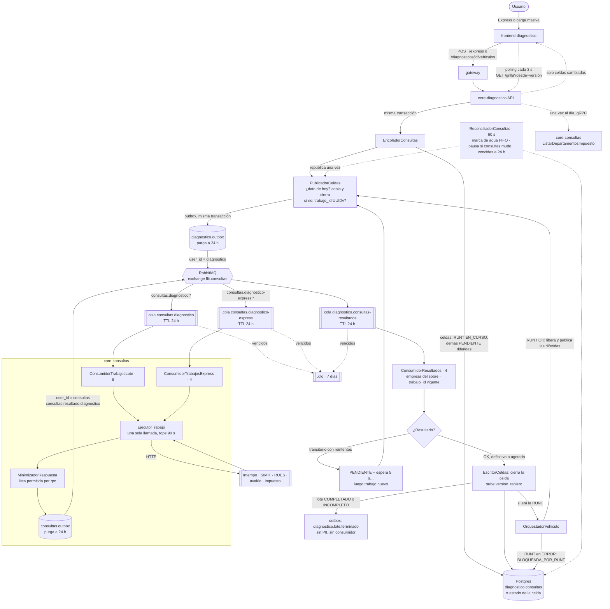
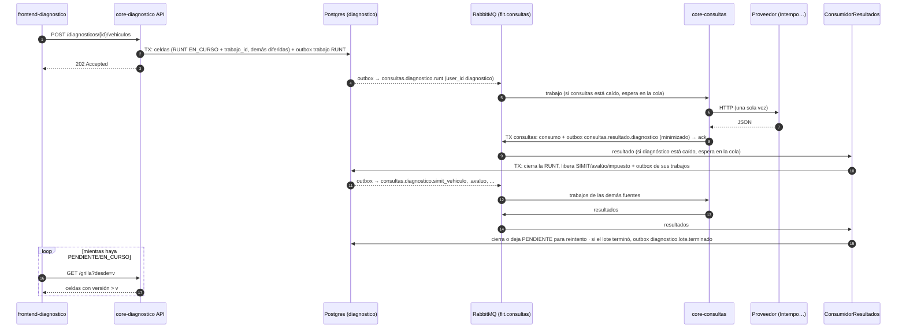

# Diagnóstico Vehicular — revisión de la validación manual en local (2026-10-26)

> Revisión de código sobre la rama `feature/AB-12881-diagnostico-d0-d2` (último commit `cecab44cc`). Responde los tres
> hallazgos de la validación manual. Las anclas `archivo:línea` derivan rápido: reverificarlas antes de citarlas.
> **§3 y la fila 3 del resumen se reescribieron sobre `63e0fe89c`** (consultas por RabbitMQ, ADR-0075). §1, §2 y §4
> siguen con el estado de `cecab44cc`.

## Resumen

| # | Hallazgo | Estado | Causa | Qué hace falta |
|---|----------|--------|-------|----------------|
| 1 | No se ve la carga masiva ni la plantilla | **Implementada, sin entrada en el menú.** La plantilla existe pero **no trae instrucciones** | Ninguna pantalla de producción enlaza a `/diagnosticos/nuevo`, que es por donde se llega a la carga | Defecto de la HU #13754: botón «Nuevo diagnóstico (lote)». Ajuste nuevo: hoja de instrucciones en la plantilla |
| 2 | Solo se ve el RUNT; no aparecen SIMIT, impuesto, avalúo ni el semáforo | **Es configuración local.** Las fuentes están implementadas. El semáforo **por celda** existe; el **semáforo global** (dictamen) **no existe**: es la ola D6 | Sin simulación encendida y sin dirección de core-consultas, todas las fuentes salvo el RUNT quedan «no conectadas» y el backend no las ofrece | Encender el modo simulado en local (§2.3) y habilitar las fuentes en el contrato de la compañía |
| 3 | ¿Las consultas van por RabbitMQ o directo a core-consultas? | **Actualizado el 2026-10-26 (`63e0fe89c`): todas van por RabbitMQ.** Diagnóstico publica un trabajo por celda en `flit.consultas`, core-consultas lo consume y publica el resultado, y diagnóstico cierra la celda. Diagnóstico ya no llama por gRPC a las fuentes; solo a `ListarDepartamentosImpuesto` | La cola en Postgres del plan v2 la reemplazó ADR-0075 (Propuesto): con core-consultas caído las celdas pasaban a ERROR, y el acta con el LT exige que los trabajos esperen en la cola | Levantar RabbitMQ y core-consultas, y preparar el broker (§3.3). Pendiente de PR y de la revisión del LT |

---

## 1. Carga masiva y plantilla

### 1.1 Lo que existe

| Pieza | Dónde | Detalle |
|-------|-------|---------|
| Descargar la plantilla | `GET /api/v1/diagnostico/plantilla`. `Modulos/Carga/CargaEndpoints.cs:23-35` | Genera un `.xlsx` en memoria con `PlantillaCarga.Generar()` |
| Analizar el archivo | `POST /diagnosticos/{id}/carga` (multipart, campo `archivo`) | `.xlsx` o `.csv` (`.xls` se rechaza con `FORMATO_XLS_NO_ADMITIDO`), máximo 5 MB (`Diagnostico:Carga:TamanoMaximoBytes`). Solo con el diagnóstico en `CREADO` (si no, 409). Analiza sin guardar |
| Confirmar los vehículos | `POST /diagnosticos/{id}/vehiculos` → 202. `Modulos/Vehiculos/VehiculosEndpoints.cs:31` | Valida `limite_vehiculos_lote` del contrato de la compañía («divida el lote o retire vehículos»), guarda y **encola las consultas** |
| Pantalla de carga | `frontend-diagnostico/app/(app)/diagnosticos/[id]/carga/page.tsx` → `components/carga/CargaMasiva.tsx` | El botón «Descargar plantilla» está en `components/carga/SubidaArchivo.tsx:70` |
| Permiso | `diagnostico.diagnosticos.crear` (`Plataforma/Permisos.cs:10`, capacidad `crearDiagnosticos`) | El mismo permiso para la plantilla, la carga y la pantalla. Ninguna bandera ni configuración operativa la oculta |

D1 está marcada como terminada (HUs #13749 backend y #13754 frontend).

### 1.2 Por qué no se ve

A la pantalla de carga se llega por tres caminos, y los tres dependen de que el diagnóstico ya exista:

- desde `/diagnosticos/nuevo`, después de crear la cabecera (`app/(app)/diagnosticos/nuevo/page.tsx:78`);
- desde el tablero de un lote (`components/tablero/TableroLote.tsx:128`);
- desde una fila del listado en estado `CREADO` (`lib/diagnosticos/listado.ts:171`).

**Ningún archivo de producción enlaza a `/diagnosticos/nuevo`:** solo lo hacen los tests. El menú del shell
(`components/DiagnosticoShell.tsx:35-56`) solo tiene Configuración y Backoffice, y el inicio (`app/(app)/page.tsx:34-40`)
solo muestra Express y el listado. Sin escribir la URL a mano no hay forma de empezar un lote.

**Para probarlo hoy:** con un usuario que tenga `diagnostico.diagnosticos.crear`, abrir `/diagnosticos/nuevo`, crear
la cabecera, pulsar «Cargar vehículos» y descargar la plantilla desde esa pantalla.

### 1.3 La plantilla no trae instrucciones

`Modulos/Carga/PlantillaCarga.cs:21-25` y `:47-70` generan **una sola hoja**, «Vehiculos», con tres encabezados en formato
texto y la fila 1 congelada:

| Identificador_Vehiculo | Tipo_Documento_Locatario | Documento_Locatario |
|---|---|---|

No hay hoja ni filas de instrucciones. Para agregarlas sin romper el lector (que espera los encabezados en la fila 1 de
la primera hoja, `VehiculosEndpoints.cs:43` / `LectorXlsx.cs`), lo seguro es una **segunda hoja «Instrucciones»** con:
qué va en cada columna, formato de la placa y del VIN, cuándo diligenciar el locatario, tipos de documento admitidos,
límite de vehículos del contrato, tamaño máximo y formatos aceptados.

### 1.4 Propuesta

| Cambio | Clasificación | Responsable |
|--------|---------------|-------------|
| Botón o ítem de menú «Nuevo diagnóstico (lote)» hacia `/diagnosticos/nuevo`, visible con `crearDiagnosticos` | **Caso B**: defecto de lo entregado en D1 (#13754) | `frontend-agent` vía `/fix-bug` |
| Hoja «Instrucciones» en la plantilla | **Caso C**: cambia lo que descarga el usuario; el texto lo aprueba el PO | `backend-agent`; una HU nueva o ampliar #13749 |

---

## 2. SIMIT, impuesto, avalúo y semáforo

### 2.1 Por qué en local solo sale el RUNT

El backend decide qué fuentes ofrecer (`fuentes_disponibles`) **sin mirar la compañía**. La configuración de la compañía
solo recorta esa lista después. `Modulos/Consultas/FuentesDisponibles.cs:27-29`:

```
disponible = tiene adaptador
           ∧ el adaptador no es el «no conectado»
           ∧ la bandera de la fuente lo permite
           ∧ (fuente ≠ impuesto ∨ hay ≥ 1 departamento soportado en la réplica)
```

El modo de los adaptadores se elige **al arrancar**, para todas las fuentes de core-consultas a la vez
(`Modulos/Consultas/Fuentes/SeleccionAdaptadores.cs:80-106`):

| `Diagnostico:Simulacion:Habilitada` | `Diagnostico:Consultas:Address` | Modo |
|---|---|---|
| `true` (solo con `Diagnostico:Ambiente` = `LOCAL` o `DEV`) | cualquiera (la simulación manda) | **Simulado** |
| `false` | con valor | **Real** |
| `false` | vacía | **No conectado** |

`appsettings.json` trae `Simulacion:Habilitada=false` (línea 13) y `Consultas:Address=""` (línea 51), y no existe un
`appsettings.Development.json` local, solo el `.example`. Resultado: **modo no conectado**. RUNT persona, SIMIT
(vehículo, propietario y locatario), avalúo e impuesto quedan fuera de `fuentes_disponibles`. El RUNT del vehículo se
sigue ofreciendo porque `EsNoConectada` nunca es verdadero para él (`SeleccionAdaptadores.cs:124`).

Todas las fuentes tienen variante real, simulada y no conectada en `Modulos/Consultas/Fuentes/`: `FuenteSimit*`,
`FuenteAvaluo*`, `FuenteImpuesto*`, `FuenteRuntPersona*`, `FuenteRues*` y `FuenteRuntIntempo*`.

> **No usar el modo real en local** mientras core-consultas no tenga `INTEMPO_API_BASE_URL`. El RUNT termina en ERROR
> `NO_CONECTADO` y, como las demás celdas esperan al RUNT, quedan en «Espera al RUNT del vehículo»
> (`pruebas-validacion-diagnostico-local.md:86-89`).

### 2.2 El impuesto

Además de la bandera `Diagnostico:Fuentes:ImpuestoDisponible=true` (por defecto `false`, `DisponibilidadFuentes.cs:14-17`),
el impuesto exige que la réplica `diagnostico.departamentos_impuesto` tenga al menos un departamento soportado
(`Catalogos/EstadoCapacidadImpuesto.cs:26`). **En modo simulado eso se cumple solo:** `CapacidadImpuestoSimulada` entrega
05 (Antioquia) y 25 (Cundinamarca), y el trabajador de sincronización los copia a la réplica en su primera vuelta
(`Catalogos/CapacidadImpuestoPlataforma.cs:48-53`). En modo real depende del proveedor de la ola C3, que aún no existe
(core-consultas responde `UNIMPLEMENTED`).

### 2.3 Configuración mínima en local para ver todas las fuentes

En `services/core-diagnostico/src/Flit.Diagnostico.Api/appsettings.Development.json` (o como variables `Diagnostico__…`):

```jsonc
"Diagnostico": {
  "Ambiente": "LOCAL",
  "Simulacion": { "Habilitada": true },
  "Fuentes": { "ImpuestoDisponible": true },
  "Identidad": { "SimularSuscripcionActiva": true },   // solo en local: la empresa queda suscrita al producto
  "Tramites": { "Address": "http://127.0.0.1:8082" }
  // "Consultas:Address" NO se define: la simulación manda sobre ella
}
```

Y en la aplicación, como administrador:

1. **Contrato** (backoffice FLIT): incluir SIMIT, avalúo e impuesto en `fuentes_habilitadas` de la compañía.
2. **Operación** (admin de la compañía): marcarlas en `fuentes_por_defecto` si se quieren preseleccionadas al crear el
   diagnóstico.

El front filtra con `fuentes_disponibles` en las pantallas de contrato, operación y parametrización
(`lib/configuracion.ts:41`, `components/configuracion/PestanaContrato.tsx:262`, `PestanaOperacion.tsx:41`,
`components/parametrizacion/useParametrizacion.ts:54-55`).

> El `appsettings.Development.json.example` actual **no trae** `Ambiente`, `Simulacion`, `Fuentes:ImpuestoDisponible` ni
> `Identidad:SimularSuscripcionActiva`. Conviene agregarlos (Caso A, sin cambio funcional).

### 2.4 Semáforo y estado de cada consulta

| Qué | Estado | Dónde |
|-----|--------|-------|
| **Semáforo por celda** (vehículo × fuente) | ✅ Existe | Ruta `/diagnosticos/[id]`: `TableroLote` → `GrillaSemaforos` → `CeldaSemaforo`, con `DetalleCelda` para el detalle (`components/tablero/TableroLote.tsx:160`, `CeldaSemaforo.tsx:17-23`) |
| Estados de la celda | ✅ | `PENDIENTE`, `EN_CURSO`, `COMPLETADO`, `ERROR`, `NA`. `NO_CONECTADO`, `RED`, `TIMEOUT`, `AUTENTICACION` y `BLOQUEADA_POR_RUNT` son **tipos de error dentro de `ERROR`**. Una celda que espera o quedó bloqueada por el RUNT muestra «Espera al RUNT del vehículo» (`CeldaSemaforo.tsx:56-62`) |
| **Semáforo global / dictamen** (¿se puede hacer el traspaso?) | ❌ **No existe** | Es la **ola D6**: dictamen TRASPASO con catálogo de reglas, motor determinista y redacción opcional por LLM (épica #12678, en New, sin descomponer). Hoy solo existe el permiso `diagnostico.dictamen.override` (`Plataforma/Permisos.cs:20`) |

Con el modo simulado del §2.3, el tablero muestra una columna por fuente elegida y cada celda se colorea al terminar.

---

## 3. ¿RabbitMQ o directo a core-consultas?

> **Reescrita el 2026-10-26 sobre `63e0fe89c`.** La versión anterior de esta sección describía la cola en Postgres y el
> polling de `TrabajadorConsultas` (decisión (a) A2 del plan v2). Esa decisión la reemplazó
> [ADR-0075](../decisions/ADR-0075-diagnostico-consultas-por-rabbitmq.md) (Propuesto) y el trabajador ya no existe.
> Diseño completo: `docs/diagnosticos/diseno-consultas-por-rabbitmq.md`.

### 3.1 Respuesta

**Todas las consultas de fuentes van por RabbitMQ.** core-diagnostico publica un trabajo por celda (o por persona) en
`flit.consultas`; core-consultas lo consume, llama al proveedor **una sola vez** y publica el resultado en su propio
exchange; core-diagnostico consume el resultado y cierra la celda. `diagnostico.consultas` sigue siendo el **estado** de
cada celda (lo que lee el tablero), pero ya no es una cola: nadie la recorre con `FOR UPDATE SKIP LOCKED`.

**Diagnóstico ya no llama por gRPC a ninguna fuente.** El único rpc que le queda hacia core-consultas es
`ListarDepartamentosImpuesto`, el catálogo diario de departamentos con impuesto, global y síncrono
(`Modulos/Catalogos/CapacidadImpuestoPlataforma.cs:31`, por `ClienteConsultas.LlamarGlobalAsync`).

1. **Encolado.** Al confirmar el lote o crear un Express, `EncoladorConsultas` inserta en la misma transacción una celda
   por vehículo y fuente. La RUNT de cada vehículo se publica de inmediato con `PublicadorCeldas.PublicarAsync`
   (`EncoladorConsultas.cs:91`); las demás nacen **diferidas** hasta que termine la RUNT. Publicar es:
   - si la compañía ya tiene hoy el dato de esa placa y fuente, copiarlo y cerrar la celda sin mensaje;
   - si no, `trabajo_id` nuevo (UUIDv7), la celda pasa a **EN_CURSO** y la outbox recibe un trabajo
     `consultas.diagnostico.<fuente>` (o `consultas.diagnostico-express.<fuente>` si el lote es Express) con el
     `*Request` proto en proto-JSON, en claro y con lo mínimo: placa o VIN, y tipo y número de documento cuando la
     fuente lo exige (`PublicadorCeldas.cs:102-121`). En las celdas de persona sale un trabajo por persona, con el mismo
     `trabajo_id`. Una persona sin documento consultable no publica: queda en ERROR `ESTADO_NO_OK`.
2. **Envío.** El publicador de la outbox de diagnóstico lo manda a `flit.consultas` con `user_id = diagnostico`, que el
   broker valida. Las colas están declaradas por adelantado en `deploy/rabbitmq/definitions.json`: si core-consultas
   está caído, el trabajo **espera** en la cola (hasta 24 h; después pasa a la `.dlq`).
3. **Ejecución en core-consultas.** `ConsumidorTrabajosLote` (cola `consultas.diagnostico`, 8 a la vez) y
   `ConsumidorTrabajosExpress` (cola `consultas.diagnostico-express`, 4 a la vez) solo aceptan trabajos del productor
   `diagnostico`. `EjecutorTrabajo` llama a los mismos métodos que atienden el gRPC en línea, con el llamador
   `svc-diagnostico` y la empresa del sobre, así que la medición de consumo, el proveedor por empresa y la caché no
   cambian:

   | Fuente | rpc que atiende el trabajo |
   |--------|-----|
   | RUNT vehículo | `RuntIntempoService/ConsultarPorPlaca` o `ConsultarPorVin` |
   | RUNT persona (propietario, locatario) | `ConsultasService/ConsultarConductor` |
   | SIMIT (vehículo, propietario, locatario) | `ConsultasService/ConsultarMultas` |
   | RUES | `ConsultasService/ConsultarRues` |
   | Avalúo | `ConsultasService/ConsultarAvaluos` |
   | Impuesto | `ConsultasService/ConsultarImpuestoVehicular` |

   Consulta **una sola vez**, con un tope de 90 s. El proveedor (Intempo, SIMIT, etc.) se sigue llamando por HTTP desde
   core-consultas.
4. **Resultado.** `PublicadorResultado` deja en la outbox de core-consultas el evento `consultas.resultado.diagnostico`:
   `OK` con el `*Response` proyectado a la lista de campos que diagnóstico lee (`MinimizadorRespuesta`; sin nombres,
   direcciones ni contacto), o `ERROR` con el código gRPC (`PublicadorResultado.cs:27-29`). Si core-diagnostico está
   caído, el resultado **espera** en `diagnostico.consultas-resultados`.
5. **Cierre en diagnóstico.** `ConsumidorResultados` (cola `diagnostico.consultas-resultados`, 4 a la vez, solo del
   productor `consultas`) fija la empresa del sobre, descarta el resultado si su `trabajo_id` ya no es el vigente y lo
   traduce con `TraductorErroresConsultas`: `Unavailable` → RED y `DeadlineExceeded` → TIMEOUT, ambos transitorios;
   `FailedPrecondition` y `Unimplemented` → NO_CONECTADO; `Unauthenticated` y `PermissionDenied` → AUTENTICACION; el
   resto → ESTADO_NO_OK.
6. **Reintentos.** Los decide diagnóstico con `PoliticaReintentos` (`Diagnostico:Consultas:MaxReintentos`, 1 por
   defecto). Un transitorio con reintentos disponibles deja la celda en **PENDIENTE** con su `trabajo_id`, el resultado
   espera en la cola de reintentos y, al vencer la espera, se publica un trabajo nuevo. Efectivo: 5 s (y 15 y 35 s si
   se configuran 2 o 3 reintentos). Si es **definitivo**, se agotaron los reintentos o la consulta salió **OK**,
   `EscritorCeldas` cierra la celda y sube `version_tablero`.
7. **Orden RUNT → demás.** Cuando cierra la RUNT de un vehículo, `OrquestadorVehiculo` **libera** sus celdas diferidas y
   las **publica** en la misma transacción, ya con los datos de la RUNT (modelo, cilindraje, departamento). Si la RUNT
   quedó en ERROR, las marca `ERROR / BLOQUEADA_POR_RUNT` y no publica nada.
8. **Fin del lote.** Si con esa celda el lote queda COMPLETADO o INCOMPLETO (también al cerrar el panel o por llenado
   manual), sale el evento `diagnostico.lote.terminado` (totales, sin datos personales) en la misma transacción. Por
   ahora no tiene consumidor.
9. **Red de seguridad.** `ReconciliadorConsultas` corre cada 60 s. Una celda con trabajo y sin resultado tras 30 min solo
   se toca si su cola ya devolvió trabajos publicados más de 15 min después que el suyo; entonces la republica una vez
   y, a la siguiente, la cierra en ERROR reprocesable. No hace nada si core-consultas no devolvió ningún resultado en
   10 min (está caído y los trabajos esperan). Pasadas 24 h + 30 min desde la publicación, el trabajo ya venció en el
   broker y la celda se cierra en ERROR reprocesable.
10. El front hace **polling incremental** cada 3 s a `GET /diagnosticos/{id}/grilla?desde=<versión>` mientras quede
    alguna celda `PENDIENTE` o `EN_CURSO` (`frontend-diagnostico/lib/tablero/api.ts:77-79`, `useGrillaIncremental`).
    Sin cambios.

### 3.2 Diagrama de flujo





### 3.3 Qué hace falta para verlo funcionar

- **RabbitMQ y core-consultas arriba.** Sin core-consultas no se cierra ninguna celda: quedan EN_CURSO esperando (en
  local, hasta que se levante; el reconciliador no las toca mientras consultas no devuelva resultados).
- **Usuario `diagnostico` con destino `consultas`** en el broker (`deploy/rabbitmq/usuario-de-servicio.sh diagnostico
  <clave> consultas`) y `RABBITMQ_URL_DIAGNOSTICO` definida; si no, la outbox de diagnóstico no puede publicar.
- **Colas declaradas** con `definitions.json` antes de publicar (`import_definitions`); sin cola, el broker descarta el
  mensaje.
- **Simulación en local o DEV:** ahora vive en core-consultas (`Consultas:Simulacion:Habilitada=true` con
  `Consultas:Ambiente` = `LOCAL` o `DEV`; en otro ambiente no arranca). Las claves `Diagnostico:Simulacion:*` y
  `Diagnostico:Procesador:*` ya no existen.
- **Por qué cambió** (frente al plan v2): con la cola en Postgres, si core-consultas estaba caído las celdas pasaban a
  ERROR a los ~35 s. El acta con el LT exige que los trabajos esperen en la cola (§3.2, §3.4) y que las integraciones
  vivan en Consultas (§3.5). El costo aceptado es que placa, VIN y documentos viajan en claro por el broker y la outbox,
  con retención acotada (riesgo U1 registrado en ADR-0075).
- La cola del ZIP de evidencias (`Modulos/Trabajos/ColaEvidencias.cs`) **no cambió**: sigue en Postgres.

---

## 4. Siguientes pasos propuestos

| # | Acción | Tipo | Gate |
|---|--------|------|------|
| 1 | Completar `appsettings.Development.json.example` con las claves del §2.3 | Caso A | ninguno |
| 2 | Botón «Nuevo diagnóstico (lote)» en el inicio o en el menú | Caso B (`/fix-bug`, `frontend-agent`) | registro del Bug antes del merge |
| 3 | Hoja «Instrucciones» en la plantilla, con el texto aprobado por el PO | Caso C (HU nueva o ampliar #13749) | activar la HU |
| 4 | Semáforo global (dictamen TRASPASO) | Ola D6 (épica #12678): descomponer | DoR y activación |
