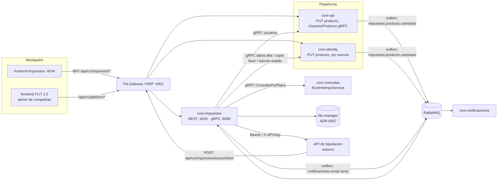
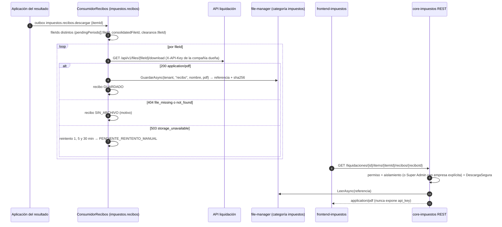

# Producto Impuestos — plan de implementación técnica

> Generado: 2026-11-24 · Estado: **Propuesto** (diseño de arquitectura, Fase 2). Nada publicado en ADO ni GitHub.
> Base de código: `develop@6bc0a9163`.
> Decisión de integración: [ADR-0093](../decisions/ADR-0093-impuestos-integracion-directa-api-liquidacion.md) (Propuesto). Excepción a `ADR-0065-consultas-externas-capacidad-de-plataforma.md`.
> Insumos vinculantes: `.claude/state/producto-impuestos/decisiones-usuario.md` (B1–B3, D-*, DA-1..DA-10; si dos chocan, manda la última), `06-reconciliacion-v2.md` (Feature v2 con 10 sub-features y unos 211 SP), `03-contrato-api.md` y la guía `docs/integraciones/guia-integracion-clientes.md` (en el plan se cita como `[API §n]`).
> Molde: `services/core-diagnostico` y `frontend-diagnostico`. De ellos se **copia la forma**, no el código: no hay `ProjectReference` ni `import` hacia esos proyectos ni hacia `core-consultas/Impuesto` (EP-CF1). El servicio nace de `dotnet new flit-servicio` (`docs/suite/servicio-nuevo.md`).

---

## 0. Resumen ejecutivo

- **Servicio nuevo `core-impuestos`** (esquema `impuestos`). Integra directo el API de liquidación con tres credenciales: el `INTEGRATION_TOKEN`, que es del ambiente, y la `api_key` y el `webhook_secret`, que son de cada compañía. Guarda esas credenciales cifradas con un Data Protection propio (DA-2=b) y recibe el webhook por su propia ruta en el gateway.
- **Frontend nuevo `frontend-impuestos`**, con `@flit/auth`, `@flit/shell` y `@flit/ui`. Tiene dashboard, impuestos (grid y detalle del lote o de la placa), carga masiva, reportes, usuarios, configuración y, para el Super Admin, el backoffice con selector de compañía y la carga de credenciales.
- **Plataforma**:
  - La activación y la desactivación dejan un **trabajo** `impuestos.producto.cambiado` en la outbox, dentro de la misma transacción y en los dos hosts que exponen el PUT (core-api y core-identity).
  - Tres rpc nuevos en core-identity: datos del alta; lectura de la llave de Diagnóstico para copiarla, que responde aunque Diagnóstico esté apagado (DA-3 residual); y reporte del estado de aprovisionamiento al admin de compañías.
  - DDL 205: producto, rol `admin_impuestos` y tabla del estado de aprovisionamiento.
- **Stub local** del API en `scripts/dev/stub-impuestos/` (Python, solo stdlib, patrón del stub Kyverum 8899) en el puerto **8898**. Implementa el contrato `[API §3–§9]`, los webhooks firmados y el vector de prueba.
- **Puertos** (validados libres en `docker-compose.prod.yml` y `docs/despliegue-y-puertos.md`): API 4033/5033/6033, sin publicar; FE 4034/5034/6034; gRPC 8089. Las variables usan el prefijo `IMPUESTOS_SVC_*`, que no colisiona con `IMPUESTO_*` porque el carácter siguiente es `S`, no `_`.
- **Entrega** (DA-10): una rama `feature/AB-<id>-producto-impuestos` creada desde `develop` actualizado y un PR. Son **22 módulos** en 6 oleadas internas sobre las ranuras be1, be2, fe1 y fe2. Cada módulo corre su lista cerrada de pruebas al cerrar y la regresión completa va al final.

---

## 1. Decisiones de diseño (alternativas por punto abierto)

Cada punto que el panel dejó a arquitectura se resuelve con 2–3 alternativas. La decisión transversal, «integración directa frente a ADR-0065», está en ADR-0093.

### 1.1 Cómo se entera core-impuestos de la activación (D-ACT, A-H09)

Hechos verificados:
- `SetTenantProductEnabledHandler` (`services/core-api/src/Flit.Modules.Platform/Application/TenantProducts/SetTenantProductEnabledHandler.cs`) lo usan **dos hosts**: core-api (`Flit.Api/Program.cs:194`, `MapIdentityEndpoints` en `:319`) y core-identity (`Flit.Identity.Api/Program.cs:103,143`).
- Los dos tienen outbox sobre el mismo `DbContext` que `IIdentityDb`: core-api tiene `FlitDbContext`, con productor `tramites` (`Flit.Infrastructure/Messaging/TramitesBus.cs:94`) y `IIdentityDb = FlitDbContext` (`InfrastructureExtensions.cs:84`); core-identity tiene `IdentityDbContext`, con productor `plataforma`.
- `IPlatformOutbox.Enqueue` exige que el tipo empiece por el productor (`PlatformOutbox.cs:31-33`). Por eso el canal `platform.tenant_product.changed` de `contracts/asyncapi/plataforma-events.v1.yaml` **no se puede emitir** tal como está declarado.
- Con `FLIT_IDENTITY_CLUSTER_ENABLED=false`, que es el valor por defecto, el gateway manda `/api/v1/platform/**` a core-api.

| | E1 · Evento `plataforma.tenant_product.changed` solo desde core-identity | **E2 · Trabajo dirigido `impuestos.producto.cambiado` (EnqueueJob)** | E3 · Sondeo de `ListarEmpresasConProducto` |
|---|---|---|---|
| Pros | Evento genérico que sirve a todos los productos; el canal ya está en AsyncAPI | Funciona igual en los dos hosts (`EnqueueJob` admite cualquier productor distinto de `impuestos`); es atómico con el `SaveChanges` del repositorio; reutiliza `CorreoPorBusEmailSender` como precedente | No toca la plataforma |
| Contras | En core-api el productor es `tramites`: o el PUT falla en ese host o hay que encender el clúster de identidad en todos los ambientes; hay que renombrar el canal | La plataforma conoce la lista de productos con aprovisionamiento; dos usuarios del broker (`tramites`, `plataforma`) necesitan permiso de escritura en `flit.impuestos` | No es outbox (viola D-ACT); retraso igual al intervalo; no ve la suspensión al instante |
| Esfuerzo | M | S | S |
| Riesgos | Un PUT atendido por core-api no emite el evento y la compañía queda sin aprovisionar | Que se olvide el permiso del broker en un ambiente (se mitiga con un *health check* que falla si no puede publicar) | Carrera entre activar y desactivar |

**Decisión: E2.**
- Puerto nuevo `ITenantProductChangeJobs` en `Flit.Modules.Platform.Application`, con la implementación en `Flit.Identity.Infrastructure` sobre `IPlatformOutbox`.
- `ITenantProductRepository.SetAsync` recibe un `Action<TenantProductChange>? antesDeGuardar`. El aviso se encola solo si hubo cambio y viaja en el mismo `SaveChanges`.
- La lista de productos con aprovisionamiento es `ProductosConAprovisionamiento = { impuestos }`, una constante de plataforma.
- El canal `platform.tenant_product.changed` queda como deuda declarada (§12, R-10), fuera de alcance.

### 1.2 Estado de aprovisionamiento visible en el admin de compañías (F1b-CF1, A-H11)

El admin de compañías vive en **`frontend/`** (`frontend/components/admin/companies/tabs/ProductosTab.tsx`, que llama a `frontend/lib/api/platform.ts`), **no en `frontend-hub`** como decía el encargo. Su token es de plataforma o trámites, no `aud=impuestos`.

| | **R1 · rpc push a un *read-model* de plataforma** | R2 · El admin llama a core-impuestos por REST | R3 · Evento `impuestos.aprovisionamiento.cambiado` consumido por core-identity |
|---|---|---|---|
| Pros | El admin solo habla con la plataforma; se extiende el `GET …/products` existente; Reintentar se encola por outbox | Sin réplica de estado | Desacoplado |
| Contras | Copia del estado (consistencia eventual, unos segundos) | El token del admin no tiene `aud=impuestos`; habría que abrir CORS y una audiencia nueva | core-identity no tiene precedente de consumidor de negocio; el esfuerzo es mayor |
| Esfuerzo | S–M | M | M–L |
| Riesgos | Que el estado se vea viejo: lo mitigan la versión monotónica y el reportador con reintento | Escalada de privilegios entre audiencias | Bandeja nueva en identity |

**Decisión: R1.**
- rpc `AprovisionamientoProductoService.ReportarEstadoAprovisionamiento`: core-impuestos escribe en `platform.tenant_product_provisioning` (DDL 205). Solo acepta una versión mayor que la guardada.
- Reintentar: `POST /api/v1/platform/admin/tenants/{id}/products/impuestos/aprovisionamiento/reintentar` encola el trabajo `impuestos.aprovisionamiento.reintentar`.

### 1.3 Vista previa del alta en el diálogo de activación (F1b-CF2, D-TAXID, D-EMAIL, DA-8)

| | **P1 · Regla y datos en la plataforma (handler compartido por el rpc y el REST)** | P2 · Regla duplicada en TypeScript y C# con vector común | P3 · core-impuestos expone la vista previa |
|---|---|---|---|
| Pros | Una sola fuente de la normalización del NIT, que es dato de la compañía; la ven el diálogo y el rpc | Sin endpoint nuevo | La regla vive junto al consumidor |
| Contras | La plataforma aprende una regla de «NIT base sin DV» | Dos implementaciones que pueden divergir | Mismo problema de audiencia que R2 |
| Esfuerzo | S | S | M |

**Decisión: P1.**
- `NitEmpresa.NormalizarBase(...)` en `Flit.Modules.Platform.Domain` y handler `ObtenerDatosAltaProveedorHandler`.
- El handler se expone como `GET …/products/impuestos/alta-previa` (diálogo) y como rpc `EmpresasService.ObtenerDatosAltaProveedor` (core-impuestos).
- La precondición «sin AdminCompany activo ⇒ no se activa» se valida en `SetTenantProductEnabledHandler` con `IPrecondicionActivacion` y el código nuevo `ProvisioningPrerequisiteMissing` (409).

Regla de normalización (D-TAXID). Los casos van al test de vector `NitEmpresaTests`:
1. Se quitan puntos y espacios y se pasa a mayúsculas.
2. Con guion: la base es lo que va antes, y debe tener de 3 a 20 dígitos. Si tras el guion no hay exactamente un dígito, el NIT es ambiguo.
3. Sin guion: de 3 a 9 dígitos, la base es el valor tal cual. Con 10 dígitos o más, o con letras, es ambiguo.
4. Vacío: estado `AUSENTE`. Base igual a la de un ancestro: estado `IGUAL_A_CABEZA` (DA-8).
5. `AMBIGUO`, `AUSENTE` e `IGUAL_A_CABEZA` ⇒ estado «Requiere revisión del NIT».

`legal_name` = `identity.tenants.legal_name` (DDL 01, `varchar(255)`). Si pasa de 200, el estado es `ERROR` con motivo `RAZON_SOCIAL_LARGA` (el API admite de 1 a 200) (S14 verificado).

### 1.4 Ritmo del masivo (DA-5, A-H05)

| | **C1 · Crédito por compañía + cola propia (patrón `DespachadorCredito` de la derivación de Diagnóstico)** | C2 · Trabajador único que sondea la tabla | C3 · Un POST por placa dentro de la petición de carga |
|---|---|---|---|
| Pros | Concurrencia exacta por compañía (2) y global (6); reintentos con backoff; sobrevive a reinicios | Sin broker | Simple |
| Contras | Una cola más | Bloqueos de filas y sondeo continuo | Timeout HTTP; sin límite de ritmo |
| Esfuerzo | M | M | S |

**Decisión: C1.**
- Evento `impuestos.liquidacion.solicitada` (solo ids) por la outbox a la cola propia `impuestos.liquidaciones`.
- `DespachadorCredito` libera el siguiente ítem al encolar y al cerrar cada uno.
- Freno global: `TasaPorSegundo` y pausa tras N transitorios seguidos.
- `rate_limited` y caída transitoria del RUNT: reenvío automático como consulta nueva con backoff de 30 s, 2 min y 10 min, máximo 3 intentos. Después, `ERROR` reintentable (DA-5).

### 1.5 Correlación del webhook y del «Incierto» (DA-4, A-H08)

- **Token opaco por ítem**: 32 bytes aleatorios en base64url (43 caracteres). En la base solo se guarda `SHA-256(token)` en `liquidacion_items.token_hash` (único).
- `callbackUrl = {Impuestos:Avisos:UrlBase}/{token}`, por ejemplo `https://dev.flitsas.online/api/v1/impuestos/avisos/<token>`, con un máximo de 2048 caracteres.
- Respuestas del receptor:

| Caso | Respuesta | Por qué |
|---|---|---|
| Token desconocido | `410 Gone` | Corta los ~21 h de reintentos del API; con 256 bits no hay enumeración posible |
| Token conocido, firma o timestamp inválidos | `401` | `[API §6]` |
| Válido | `200` siempre, también si es duplicado, si la compañía está suspendida (S6) o si el ítem está cerrado (DA-6b, resultado tardío) | `[API §6]`, S6, DA-6b |
| Cuerpo > 256 KB | `413` | — |
| Más de 60 peticiones por minuto por IP | `429` | Límite de `LimitesSolicitudes` |

- Después de verificar la firma, si `consulta.id` del cuerpo no coincide con `consulta_api_id` del ítem, se responde `200` y se descarta con alerta `aviso_consulta_distinta`. Cuando el ítem está en `INCIERTO`, la coincidencia se adopta (§3.2).
- «Incierto» con secreto: se esperan 30 min (`Impuestos:Conciliacion:EsperaIncierto`). Luego se recorre `GET /api/v1/consultas?limit=50&cursor=` dentro de la ventana `enviado_en ± 15 min`, hasta 10 páginas, buscando el token en `callback_url`. Si aparece, se adopta; si no, el estado pasa a `INCIERTO_REQUIERE_DECISION`. Sin secreto el paso a ese estado es directo. **Nunca** se empareja por placa y hora.

### 1.6 Recibos PDF (DA-9c)

- Se guardan en el file-manager corporativo, categoría `impuestos` (`ADR-0057-almacenamiento-de-archivos-por-ambiente-y-contabo.md`, el único Aceptado). La forma se copia de `core-diagnostico/.../Infraestructura/Archivos/AlmacenArchivos.cs`; las pruebas usan `GuardarEnBase`.
- Se descargan del API al aplicar un resultado `succeeded` o `partial`: un archivo por `fileId` distinto (el mismo `fileId` puede repetirse en varias vigencias, `[API §8]`).
- `404 file_missing` o `not_found` ⇒ `SIN_ARCHIVO` con el motivo. `503` ⇒ hasta 3 reintentos (1, 5 y 30 min) y después `PENDIENTE_REINTENTO_MANUAL`.

### 1.7 PII (DA-7=b, Ley 1581)

- **Se persisten**, cifrados con el Data Protection del servicio: el tipo y el número de documento del propietario, su nombre y el cuerpo completo del resultado (`resultado_cifrado`, porque `validations[].sent` y `portal` pueden traer datos del propietario).
- **No se persisten** la dirección, el correo ni los teléfonos. Solo existen en memoria mientras se arma el payload.
- Los montos, estados, departamentos y vigencias se guardan aparte, en columnas sin PII, para el dashboard y los reportes.
- Se muestran **sin enmascarar** en el grid, el detalle, los reportes y los exportes (decisión del usuario DA-7=b; queda en ADR-0093 para el gate de security-agent). La dirección nunca se exporta.
- **Logs**: sin PII, sin placa, sin payload y sin secretos. `RedaccionCabeceras` redacta `X-API-Key`, `Authorization` y `X-Flit-Signature` (EP-CF3a).
- **Retención**: la misma política de Diagnóstico, que hoy es **no borrar** (R-18 en `docs/diagnosticos/plan-implementacion-diagnostico-vehicular-v2.md:73`). Hay dos purgas técnicas: la outbox publicada a las 24 h (`Platform:Messaging:RetencionPublicados`) e `impuestos.avisos_recibidos` a los 30 días.

---

## 2. Arquitectura



### 2.1 Secuencia — activación y aprovisionamiento con outbox

```mermaid
sequenceDiagram
  autonumber
  actor SA as Super Admin
  participant FEA as frontend (admin compañías)
  participant P as core-api o core-identity (PUT)
  participant DB as Base plataforma (tenant_products + outbox)
  participant MQ as RabbitMQ flit.impuestos
  participant IMP as core-impuestos
  participant ID as core-identity (gRPC)
  participant API as API liquidación

  SA->>FEA: Abre «Activar Impuestos»
  FEA->>P: GET …/products/impuestos/alta-previa
  P-->>FEA: legalName, taxIdBase, estadoNit, contactEmail, bloqueo
  Note over FEA: Muestra tax_id y correo; si bloqueo=SIN_ADMIN no deja confirmar
  SA->>FEA: Confirmar
  FEA->>P: PUT …/products/impuestos {enabled:true}
  P->>P: Precondición AdminCompany activo (409 si falta)
  P->>DB: UPDATE tenant_products + INSERT outbox (impuestos.producto.cambiado) — mismo SaveChanges
  P-->>FEA: 200
  DB-->>MQ: OutboxPublisherService publica
  MQ->>IMP: ConsumidorCambioProducto (bandeja: dedupe por eventId)
  IMP->>IMP: aprovisionamiento ← PENDIENTE (versión+1) y reporte pendiente
  alt Ya hay credencial impuestos en core-impuestos
    IMP->>API: GET /api/v1/fuentes (X-API-Key)
    API-->>IMP: 200 → LISTO / LISTO_SIN_WEBHOOK · 401 → REQUIERE_CREDENCIALES
  else Sin credencial propia
    IMP->>ID: ObtenerCredencialImpuestoParaCopia (svc-impuestos, auditado, ignora apagado)
    alt Diagnóstico tiene llave
      ID-->>IMP: api_key
      IMP->>API: GET /api/v1/fuentes
      API-->>IMP: 200 → guarda copia cifrada, origen=COPIA_DIAGNOSTICO → LISTO_SIN_WEBHOOK
    else Sin llave de Diagnóstico
      IMP->>ID: ObtenerDatosAltaProveedor
      ID-->>IMP: legal_name, tax_id_base, estado_nit, contact_email
      alt estado_nit ≠ VALIDO
        IMP->>IMP: REQUIERE_REVISION_NIT
      else
        IMP->>IMP: registra intento de alta (antes del POST)
        IMP->>API: POST /api/v1/integracion/empresas (Bearer INTEGRATION_TOKEN)
        alt 201
          API-->>IMP: company.id, api_key, webhook_secret (una vez)
          IMP->>IMP: MISMA transacción: credenciales cifradas + LISTO (firma_confirmada=false) + historial
        else 409 tax_id_taken
          IMP->>IMP: REQUIERE_CREDENCIALES (sin reintento)
        else 400 o 415
          IMP->>IMP: ERROR (DATOS)
        else 401 o 404
          IMP->>IMP: ERROR (AMBIENTE) + alerta operativa
        else DNS, conexión rechazada o TLS handshake (no salió)
          IMP->>IMP: PENDIENTE + reintento con backoff (1, 5, 15, 60 min)
        else timeout, 5xx o corte tras enviar
          IMP->>IMP: INCIERTO (sin reintento automático)
        end
      end
    end
  end
  IMP->>ID: ReportarEstadoAprovisionamiento(estado, motivo, acción, versión)
  ID->>ID: UPSERT platform.tenant_product_provisioning si versión > guardada
  SA->>FEA: Ve el estado; «Reintentar» (ERROR o INCIERTO)
  FEA->>P: POST …/aprovisionamiento/reintentar → outbox impuestos.aprovisionamiento.reintentar
```

Desactivar (`enabled:false`) produce el mismo trabajo con `enabled=false`. El aprovisionamiento pasa a `SUSPENDIDO` y guarda el estado previo. No se toca la empresa en el API (D-DESACT). Reactivar vuelve al estado previo si era `LISTO*`. Si no lo era, se reevalúa el flujo completo.

### 2.2 Secuencia — liquidación por placa (RUNT → payload → API → webhook o respaldo GET)

```mermaid
sequenceDiagram
  autonumber
  actor U as Gestor / Admin Impuestos
  participant FE as frontend-impuestos (BFF)
  participant IMP as core-impuestos REST
  participant W as ConsumidorLiquidacion (cola impuestos.liquidaciones)
  participant CC as core-consultas (RuntIntempoService)
  participant API as API liquidación
  participant R as ReceptorAvisos (AllowAnonymous)
  participant K as TrabajadorConciliacion

  U->>FE: placa
  FE->>IMP: POST /api/v1/impuestos/liquidaciones/individual {placa}
  IMP->>IMP: Guard: producto activo, aprovisionamiento LISTO o LISTO_SIN_WEBHOOK, permiso crear
  IMP->>IMP: Liquidación INDIVIDUAL + ítem PENDIENTE + copia de config + outbox impuestos.liquidacion.solicitada
  IMP-->>FE: 201 {id, items[0]}
  W->>W: DespachadorCredito (≤2 en vuelo por compañía, ≤6 global)
  W->>CC: ConsultarPorPlaca(placa) [svc-impuestos, x-flit-tenant-id]
  CC-->>W: VehiculoIntempo (propietario, documento, organismo, modelo, dirección, contacto)
  W->>W: Homologa organismo → secretaryDepartmentCode + secretaryCity (impuestos.organismos)
  alt Falta un dato o no hay homologación
    W->>W: DATOS_INCOMPLETOS (campo_faltante)
  else Departamento fuera de la config contractual
    W->>W: DEPARTAMENTO_NO_HABILITADO
  else
    W->>W: ConstructorSolicitud según params_schema de /fuentes (25 exige OwnerEmail + celular o teléfono del RUNT; sin contacto de respaldo, DA-9a)
    W->>W: ENVIANDO + token nuevo (hash) — commit ANTES del POST
    W->>API: POST /api/v1/consultas (X-API-Key) [callbackUrl solo si hay webhook_secret y sin modo respaldo]
    alt 202
      API-->>W: {id, queued}
      W->>W: ENVIADO (consulta_api_id, proximo_poll_en según modo)
    else 400, 409 o 422
      W->>W: ERROR (código del API, clase)
    else 401
      W->>W: ERROR + aprovisionamiento REQUIERE_CREDENCIALES + alerta (F1a-CF12)
    else no salió
      W->>W: reintento con backoff (no cuenta como intento enviado)
    else timeout o 5xx tras enviar
      W->>W: INCIERTO (sin reenvío)
    end
  end
  API->>R: POST /api/v1/impuestos/avisos/{token} (X-Flit-*)
  R->>R: hash(token) → ítem → secreto de la compañía → HMAC v1 en tiempo constante, ±300 s
  R->>R: dedupe X-Flit-Delivery · consulta.id == ítem · attempt ≥ máximo
  R-->>API: 200 (menos de 10 s; aplica en segundo plano)
  R->>R: Aplica resultado: EXITOSO o ERROR; vigencias; contadores; firma_confirmada=true; outbox impuestos.recibos.descargar
  K->>API: GET /api/v1/consultas/{id} (ítems ENVIADO con proximo_poll_en vencido)
  API-->>K: misma forma + webhook{status}
  K->>K: Aplica el resultado si es final; si no, reprograma
```

Calendario de conciliación (S12; ajustado a DA-6=c, **sin vencimiento**):

| Modo | Calendario |
|---|---|
| Con webhook | Primer GET a los 2 min; luego cada 5 min hasta 24 h; después cada 6 h, indefinidamente, mientras el ítem no tenga estado final ni el lote se cierre |
| Sin webhook (`LISTO_SIN_WEBHOOK` o modo respaldo por firma) | Cada 10 s durante 10 min; luego el calendario anterior |

Todos los valores se pueden cambiar en `Impuestos:Conciliacion:*`.

### 2.3 Secuencia — masivo con concurrencia

```mermaid
sequenceDiagram
  autonumber
  actor U as Gestor / Admin
  participant FE as frontend-impuestos
  participant IMP as core-impuestos
  participant D as DespachadorCredito
  participant W as ConsumidorLiquidacion
  participant L as CierreLote
  participant N as core-notificaciones

  U->>FE: archivo .xlsx o .csv (columna «placa»)
  FE->>IMP: POST /liquidaciones/masiva/analizar (multipart, ≤5 MB)
  IMP-->>FE: {validas, duplicadas, invalidas[fila,motivo], tope, superaTope}
  alt superaTope
    FE-->>U: Rechazo con el tope vigente (antes de crear el lote)
  else
    U->>FE: Confirmar
    FE->>IMP: POST /liquidaciones/masiva (mismo archivo; el servidor revalida)
    IMP->>IMP: Lote MASIVA CREADO + N ítems PENDIENTE (placas únicas, S4) + copia de config
    IMP->>D: encola hasta 2 ítems → impuestos.liquidacion.solicitada
    IMP-->>FE: 201 lote EN_PROCESO
    loop por ítem
      W->>W: mismo flujo de §2.2
      W->>D: al quedar en estado final o ENVIADO, libera el crédito → siguiente ítem
    end
    L->>L: tras cada cambio de ítem: ¿todos en estado final o INCIERTO_REQUIERE_DECISION?
    alt sí
      L->>IMP: COMPLETADO o COMPLETADO_CON_NOVEDADES, terminado_en
      L->>N: outbox notificaciones.email.send (un correo por destinatario configurado)
      L->>IMP: notificación en pantalla (bandeja)
    end
    opt Admin o Super Admin cierra a mano (DA-6b)
      U->>IMP: POST /liquidaciones/{id}/cerrar
      IMP->>IMP: pendientes → SIN_RESULTADO_LOTE_CERRADO; lote CERRADO_MANUALMENTE (usuario, fecha); correo + aviso
    end
  end
```

El crédito se libera cuando el ítem llega a **ENVIADO**, no a su resultado. La espera del webhook no ocupa capacidad. Si el API responde `rate_limited` en un resultado `failed` (vía webhook o GET), el ítem vuelve a `REINTENTO_PROGRAMADO` y reocupa el crédito, hasta 3 veces (DA-5).

### 2.4 Secuencia — descarga y almacenamiento de PDFs



Con la compañía suspendida, los recibos guardados se siguen sirviendo al Super Admin, porque las credenciales y los archivos son locales (F1b-CF6, DA-3).

---

## 3. Máquinas de estado

Viven en `Flit.Impuestos.Domain` como tablas de transición puras con pruebas (M05). Las API solo aplican transiciones permitidas; cualquier otra lanza `TransicionInvalida`.

### 3.1 Aprovisionamiento (por compañía)

| Estado | Liquida | Acción del Super Admin | Dónde se ve |
|---|---|---|---|
| `PENDIENTE` | No | — (en curso o reintento automático programado) | Admin de compañías y backoffice Impuestos |
| `LISTO` | Sí, con `callbackUrl`. Marca `firma_confirmada=false` («firma sin confirmar») hasta el primer webhook válido | — | Ídem |
| `LISTO_SIN_WEBHOOK` | Sí, sin `callbackUrl` (polling) | Cargar secreto | Ídem |
| `ERROR` (`DATOS` o `AMBIENTE`) | No | Reintentar | Ídem |
| `INCIERTO` | No | Reintentar (puede terminar en 409 y luego en `REQUIERE_CREDENCIALES`) | Ídem |
| `REQUIERE_CREDENCIALES` | No | Cargar credenciales (api_key + webhook_secret), tras rotar en la consola del API | Ídem |
| `REQUIERE_REVISION_NIT` | No | Corregir el NIT en el admin de compañías + Reintentar | Ídem |
| `SUSPENDIDO` | No crea nuevas; termina lo que está en curso | Reactivar desde el admin | Ídem |

Marca ortogonal: `modo_respaldo_firma`. Se enciende tras 5 firmas inválidas seguidas de tokens conocidos en una hora y deja de enviar `callbackUrl`. La apaga el primer webhook válido o una carga de secreto nueva (F2b-CF3).

| Desde | Evento | Hacia |
|---|---|---|
| (sin fila) / `SUSPENDIDO` sin estado listo previo | `producto.cambiado(enabled)` | `PENDIENTE` → evaluación |
| `PENDIENTE` | Credencial propia válida (`GET /fuentes` 200) | `LISTO` si hay secreto; si no, `LISTO_SIN_WEBHOOK` |
| `PENDIENTE` | Copia de la llave de Diagnóstico válida | `LISTO_SIN_WEBHOOK` |
| `PENDIENTE` | Credencial propia o copiada → 401 | `REQUIERE_CREDENCIALES` |
| `PENDIENTE` | `estado_nit` ≠ `VALIDO` | `REQUIERE_REVISION_NIT` |
| `PENDIENTE` | Alta 201 | `LISTO` (firma sin confirmar) |
| `PENDIENTE` | Alta 409 | `REQUIERE_CREDENCIALES` |
| `PENDIENTE` | Alta 400, 415 o razón social > 200 | `ERROR(DATOS)` |
| `PENDIENTE` | Alta 401 o 404 | `ERROR(AMBIENTE)` + alerta |
| `PENDIENTE` | No salió (DNS, ECONNREFUSED, TLS) | `PENDIENTE` (reintento N+1, máximo 5; luego `ERROR(AMBIENTE)`) |
| `PENDIENTE` | Timeout, 5xx o corte tras enviar | `INCIERTO` |
| `ERROR` / `INCIERTO` / `REQUIERE_REVISION_NIT` | Reintentar (trabajo) | `PENDIENTE` |
| `REQUIERE_CREDENCIALES` / `LISTO_SIN_WEBHOOK` | Carga manual válida | `LISTO` (o `LISTO_SIN_WEBHOOK` si no se cargó secreto) |
| `LISTO` / `LISTO_SIN_WEBHOOK` | 401 en cualquier llamada con api_key | `REQUIERE_CREDENCIALES` + alerta |
| `LISTO` | Primer webhook válido | `LISTO` (`firma_confirmada=true`) |
| cualquiera ≠ `SUSPENDIDO` | `producto.cambiado(disabled)` | `SUSPENDIDO` (guarda `estado_previo`) |
| `SUSPENDIDO` | `producto.cambiado(enabled)` con `estado_previo` ∈ {`LISTO`, `LISTO_SIN_WEBHOOK`} | `estado_previo`, sin alta (D-DESACT) |

Cada transición escribe una fila en `impuestos.historial_aprovisionamiento` y sube `version`. El `ReportadorEstado` reporta a la plataforma.

### 3.2 Ítem de liquidación

| Estado | ¿Es final? | Cuenta en el dashboard como |
|---|---|---|
| `PENDIENTE` | No | Pendiente |
| `CONSULTANDO_RUNT` | No | Pendiente |
| `REINTENTO_PROGRAMADO` | No | Pendiente |
| `ENVIANDO` | No | Pendiente |
| `ENVIADO` | No | «Pendiente de webhook» o «pendiente por consulta» según el modo (F4a-CF2) |
| `INCIERTO` | No | Incierto |
| `INCIERTO_REQUIERE_DECISION` | **Sí para el cierre del lote** (DA-6b) | Incierto |
| `DATOS_INCOMPLETOS` | Sí | Datos incompletos |
| `DEPARTAMENTO_NO_HABILITADO` | Sí | Departamento no habilitado |
| `EXITOSO` (`con_deuda` / `paz_y_salvo`; marca `parcial` si `partial`) | Sí | Exitosa |
| `ERROR` (clase `CORREGIR_DATOS` / `DEPENDE` / `REINTENTABLE`) | Sí | Error |
| `SIN_RESULTADO_LOTE_CERRADO` | Sí; acepta un resultado tardío | Sin resultado |

| Desde | Evento | Hacia |
|---|---|---|
| `PENDIENTE` | Crédito asignado | `CONSULTANDO_RUNT` |
| `CONSULTANDO_RUNT` | RUNT ok + payload completo + departamento habilitado | `ENVIANDO` |
| `CONSULTANDO_RUNT` | Falta un dato o no hay homologación | `DATOS_INCOMPLETOS` (`campo_faltante`) |
| `CONSULTANDO_RUNT` | Departamento fuera del contrato | `DEPARTAMENTO_NO_HABILITADO` |
| `CONSULTANDO_RUNT` | RUNT transitorio (intentos < 3) | `REINTENTO_PROGRAMADO` |
| `CONSULTANDO_RUNT` | RUNT transitorio (intentos = 3) o placa no encontrada | `ERROR` (`RUNT_*`) |
| `REINTENTO_PROGRAMADO` | Vence `proximo_intento_en` | `PENDIENTE` (re-encola con crédito) |
| `ENVIANDO` | 202 | `ENVIADO` |
| `ENVIANDO` | 400, 409 o 422 | `ERROR` (código del API) |
| `ENVIANDO` | 401 | `ERROR` + aprovisionamiento `REQUIERE_CREDENCIALES` |
| `ENVIANDO` | No salió | `ENVIANDO` (reintento local, mismo token) |
| `ENVIANDO` | Timeout o 5xx tras enviar | `INCIERTO` |
| `ENVIADO` | Webhook o GET final `succeeded` / `partial` | `EXITOSO` |
| `ENVIADO` | Final `failed` con `rate_limited` (intentos < 3) | `REINTENTO_PROGRAMADO` (consulta nueva, token nuevo) |
| `ENVIADO` | Final `failed` con otro código | `ERROR` (clase según `[API §9]`) |
| `INCIERTO` | Webhook válido con su token | Igual que `ENVIADO` + resultado (adopta `consulta.id`) |
| `INCIERTO` | Plazo vencido y token hallado en el listado | `ENVIADO` (adopta el id) |
| `INCIERTO` | Plazo vencido y token no hallado, o sin secreto | `INCIERTO_REQUIERE_DECISION` |
| `INCIERTO_REQUIERE_DECISION` | Relanzar (con aviso de posible duplicado) | Se queda igual; crea una liquidación individual nueva (`relanzado_desde`, `posible_duplicado=true`) |
| `ERROR` (`REINTENTABLE`) | Relanzar | Ídem |
| no final | Cierre manual del lote | `SIN_RESULTADO_LOTE_CERRADO` |
| `SIN_RESULTADO_LOTE_CERRADO` | Resultado tardío (webhook o GET) | `EXITOSO` o `ERROR` (`resultado_tardio=true`; el lote no se reabre) |

Un aviso con `attempt` menor que `attempt_api_max` se registra y no se aplica.

### 3.3 Lote (cabecera `liquidaciones`; la individual es un lote de un ítem)

| Desde | Evento | Hacia |
|---|---|---|
| — | Crear (individual o masiva) | `CREADO` |
| `CREADO` | Primer ítem despachado | `EN_PROCESO` |
| `EN_PROCESO` | Todos los ítems en estado final (incluido `INCIERTO_REQUIERE_DECISION`) y todos `EXITOSO` | `COMPLETADO` |
| `EN_PROCESO` | Ídem, con al menos un ítem no `EXITOSO` | `COMPLETADO_CON_NOVEDADES` |
| `CREADO` / `EN_PROCESO` | Cierre manual (Admin o Super Admin) | `CERRADO_MANUALMENTE` (`cerrado_por`, `cerrado_en`) |
| `COMPLETADO*` / `CERRADO_MANUALMENTE` | Resultado tardío | Mismo estado; se recalculan los contadores |

El correo y el aviso en pantalla salen una sola vez, al entrar en un estado terminal (`aviso_enviado_en`).

**Supuesto de arquitectura S-A (lo confirma el PO):** la liquidación individual se modela como un lote `INDIVIDUAL` de un ítem. Así el grid lista los dos tipos con su columna (F3-CF6) y el cierre manual de DA-6b vale también para una individual que se quedó pendiente.

---

## 4. Modelo de datos

### 4.1 Esquema `impuestos` (core-impuestos)

El usuario es `flit_impuestos` (`deploy/postgres/servicio-con-esquema-propio.sql`). Las migraciones EF corren al arrancar. **El modelo completo va en la migración inicial `R0_Modelo` (M05)**, para que los carriles paralelos no choquen con migraciones. Toda entidad con `tenant_id` implementa `IEntidadDeEmpresa` y entra en el filtro global (forma de `ADR-0072-diagnostico-aislamiento-por-tenant.md`). Lo que sigue es DDL de referencia; lo materializa el `database-agent` según `.claude/skills/db-schema-validator/checklist-validacion-schema.md`.

```sql
-- La plantilla trae outbox, inbox y data_protection_keys.
CREATE TABLE impuestos.aprovisionamientos (
  tenant_id uuid PRIMARY KEY,
  estado varchar(32) NOT NULL CHECK (estado IN ('PENDIENTE','LISTO','LISTO_SIN_WEBHOOK','ERROR','INCIERTO',
         'REQUIERE_CREDENCIALES','REQUIERE_REVISION_NIT','SUSPENDIDO')),
  error_tipo varchar(16) NULL CHECK (error_tipo IN ('DATOS','AMBIENTE')),
  motivo_codigo varchar(64) NULL, motivo_detalle varchar(500) NULL,       -- sin secretos ni PII
  estado_previo varchar(32) NULL,
  firma_confirmada boolean NOT NULL DEFAULT false,
  modo_respaldo_firma boolean NOT NULL DEFAULT false,
  firmas_invalidas_consecutivas int NOT NULL DEFAULT 0,
  intentos_automaticos int NOT NULL DEFAULT 0, proximo_intento_en timestamptz NULL,
  ultimo_cambio_plataforma_id uuid NULL,                                   -- eventId del trabajo
  version bigint NOT NULL DEFAULT 1, reportado_version bigint NOT NULL DEFAULT 0,
  creado_en timestamptz NOT NULL DEFAULT now(), actualizado_en timestamptz NOT NULL DEFAULT now());

CREATE TABLE impuestos.credenciales_empresa (
  tenant_id uuid PRIMARY KEY REFERENCES impuestos.aprovisionamientos(tenant_id),
  api_key_cifrada bytea NOT NULL,                     -- Data Protection, purpose impuestos.credenciales.v1.{tenant}.api_key
  api_key_prefijo varchar(12) NULL,                   -- para soporte; no es secreto
  webhook_secret_cifrado bytea NULL,                  -- purpose ….webhook_secret
  empresa_api_id varchar(64) NULL,                    -- company.id; opcional (copia o carga manual, T-H14)
  origen varchar(24) NOT NULL CHECK (origen IN ('ALTA','COPIA_DIAGNOSTICO','CARGA_MANUAL')),
  version bigint NOT NULL DEFAULT 1, actualizado_en timestamptz NOT NULL, actualizado_por uuid NULL);
COMMENT ON COLUMN impuestos.credenciales_empresa.api_key_cifrada IS '@secret';

CREATE TABLE impuestos.historial_aprovisionamiento (
  id uuid PRIMARY KEY, tenant_id uuid NOT NULL, desde varchar(32) NULL, hacia varchar(32) NOT NULL,
  motivo_codigo varchar(64) NULL, actor_id uuid NULL, actor_tipo varchar(16) NOT NULL, en timestamptz NOT NULL);

CREATE TABLE impuestos.configuracion_empresa (
  tenant_id uuid PRIMARY KEY,
  max_registros_lote_contractual int NOT NULL DEFAULT 500 CHECK (max_registros_lote_contractual BETWEEN 1 AND 5000),
  departamentos_habilitados varchar(2)[] NULL,        -- NULL = todos los activos de /fuentes
  max_registros_lote_operativo int NULL,              -- ≤ contractual (validado en la aplicación)
  correos_aviso varchar(254)[] NOT NULL DEFAULT '{}', -- @pii:low (correos de la compañía)
  version bigint NOT NULL DEFAULT 1, actualizado_en timestamptz NOT NULL, actualizado_por uuid NULL);

CREATE TABLE impuestos.liquidaciones (
  id uuid PRIMARY KEY, tenant_id uuid NOT NULL,
  tipo varchar(12) NOT NULL CHECK (tipo IN ('INDIVIDUAL','MASIVA')),
  estado varchar(28) NOT NULL CHECK (estado IN ('CREADO','EN_PROCESO','COMPLETADO','COMPLETADO_CON_NOVEDADES','CERRADO_MANUALMENTE')),
  nombre_archivo varchar(200) NULL, total_items int NOT NULL,
  c_exitosas int NOT NULL DEFAULT 0, c_con_deuda int NOT NULL DEFAULT 0, c_paz_y_salvo int NOT NULL DEFAULT 0,
  c_error int NOT NULL DEFAULT 0, c_datos_incompletos int NOT NULL DEFAULT 0, c_dpto_no_habilitado int NOT NULL DEFAULT 0,
  c_incierto int NOT NULL DEFAULT 0, c_sin_resultado int NOT NULL DEFAULT 0, c_pendientes int NOT NULL,
  config_copia jsonb NOT NULL,                        -- {maxRegistros, departamentosHabilitados, concurrencia} (F3-CF3)
  creada_por uuid NOT NULL, creada_en timestamptz NOT NULL, terminada_en timestamptz NULL,
  cerrada_por uuid NULL, cerrada_en timestamptz NULL, aviso_enviado_en timestamptz NULL,
  xmin_version xid);                                  -- concurrencia optimista (xmin)
CREATE INDEX ix_liq_tenant_creada ON impuestos.liquidaciones (tenant_id, creada_en DESC);

CREATE TABLE impuestos.liquidacion_items (
  id uuid PRIMARY KEY, liquidacion_id uuid NOT NULL REFERENCES impuestos.liquidaciones(id), tenant_id uuid NOT NULL,
  fila int NULL, placa varchar(10) NOT NULL,          -- normalizada S16
  estado varchar(32) NOT NULL, error_codigo varchar(48) NULL, error_clase varchar(16) NULL,
  error_mensaje varchar(500) NULL, campo_faltante varchar(64) NULL,
  departamento_codigo varchar(2) NULL, departamento_nombre varchar(80) NULL, secretaria_ciudad varchar(80) NULL,
  documento_tipo varchar(3) NULL,
  documento_numero_cifrado bytea NULL, propietario_nombre_cifrado bytea NULL,     -- @pii:high, DA-7
  consulta_api_id varchar(64) NULL, token_hash bytea NULL UNIQUE, con_callback boolean NOT NULL DEFAULT false,
  intentos_runt int NOT NULL DEFAULT 0, intentos_reenvio int NOT NULL DEFAULT 0, proximo_intento_en timestamptz NULL,
  enviado_en timestamptz NULL, proximo_poll_en timestamptz NULL, attempt_api_max int NOT NULL DEFAULT 0,
  consulta_status varchar(12) NULL, resultado_status varchar(12) NULL, parcial boolean NOT NULL DEFAULT false,
  total_a_pagar numeric(18,2) NULL,                   -- NULL ≠ 0 (F2-CF14)
  resultado_cifrado bytea NULL,                        -- cuerpo §6 completo (validations puede traer PII)
  warnings text[] NOT NULL DEFAULT '{}', resultado_tardio boolean NOT NULL DEFAULT false,
  relanzado_desde uuid NULL REFERENCES impuestos.liquidacion_items(id), posible_duplicado boolean NOT NULL DEFAULT false,
  actualizado_en timestamptz NOT NULL, xmin_version xid);
CREATE INDEX ix_items_liq ON impuestos.liquidacion_items (liquidacion_id, estado);
CREATE INDEX ix_items_poll ON impuestos.liquidacion_items (proximo_poll_en) WHERE estado IN ('ENVIADO','INCIERTO');
CREATE INDEX ix_items_tenant_placa ON impuestos.liquidacion_items (tenant_id, placa);

CREATE TABLE impuestos.liquidacion_periodos (
  id uuid PRIMARY KEY, item_id uuid NOT NULL REFERENCES impuestos.liquidacion_items(id), tenant_id uuid NOT NULL,
  periodo varchar(9) NOT NULL, avaluo numeric(18,2) NULL, impuesto numeric(18,2) NULL, sancion numeric(18,2) NULL,
  intereses numeric(18,2) NULL, descuentos numeric(18,2) NULL, pagos_previos numeric(18,2) NULL,
  total_a_pagar numeric(18,2) NULL, otros_cargos jsonb NOT NULL DEFAULT '[]', vencimiento date NULL,
  referencia_pago varchar(80) NULL, file_id_api varchar(64) NULL, no_liquidable boolean NOT NULL DEFAULT false);

CREATE TABLE impuestos.recibos (
  id uuid PRIMARY KEY, item_id uuid NOT NULL REFERENCES impuestos.liquidacion_items(id), tenant_id uuid NOT NULL,
  file_id_api varchar(64) NOT NULL, tipo varchar(12) NOT NULL CHECK (tipo IN ('VIGENCIA','CONSOLIDADO','PAZ_Y_SALVO')),
  periodos varchar(9)[] NOT NULL DEFAULT '{}',
  estado varchar(28) NOT NULL CHECK (estado IN ('PENDIENTE','GUARDADO','SIN_ARCHIVO','PENDIENTE_REINTENTO_MANUAL')),
  referencia_almacen varchar(200) NULL, sha256 char(64) NULL, tamano bigint NULL, intentos int NOT NULL DEFAULT 0,
  motivo varchar(64) NULL, UNIQUE (item_id, file_id_api));

CREATE TABLE impuestos.avisos_recibidos (               -- dedupe X-Flit-Delivery; purga a los 30 días
  delivery_id varchar(80) PRIMARY KEY, item_id uuid NULL, tenant_id uuid NULL, consulta_id varchar(64) NULL,
  attempt int NULL, recibido_en timestamptz NOT NULL, resultado varchar(24) NOT NULL);   -- sin cuerpo (PII)

CREATE TABLE impuestos.organismos (                     -- réplica diaria de CatalogosService.ListarOrganismosTransito
  codigo varchar(16) PRIMARY KEY, nombre varchar(200) NOT NULL, nombre_normalizado varchar(200) NOT NULL,
  departamento_codigo varchar(2) NULL, departamento varchar(80) NULL, municipio varchar(80) NULL,
  sincronizado_en timestamptz NOT NULL);
CREATE INDEX ix_org_nombre ON impuestos.organismos (nombre_normalizado);

CREATE TABLE impuestos.fuentes_api (                     -- caché de GET /fuentes (global, refresco cada 6 h)
  departamento_codigo varchar(2) PRIMARY KEY, nombre varchar(80) NOT NULL, activa boolean NOT NULL,
  params_schema jsonb NOT NULL, sincronizado_en timestamptz NOT NULL);

CREATE TABLE impuestos.notificaciones (                  -- aviso en pantalla «lote terminado» (DA-6b)
  id uuid PRIMARY KEY, tenant_id uuid NOT NULL, liquidacion_id uuid NOT NULL, tipo varchar(32) NOT NULL,
  creada_en timestamptz NOT NULL, leida_por uuid[] NOT NULL DEFAULT '{}');

CREATE TABLE impuestos.auditoria_lectura_backoffice (    -- Super Admin entre compañías (forma ADR-0073)
  id uuid PRIMARY KEY, actor_id uuid NOT NULL, tenant_id uuid NOT NULL, recurso varchar(64) NOT NULL, en timestamptz NOT NULL);
```

### 4.2 Cifrado (Data Protection propio)

- Forma de `core-diagnostico/.../Plataforma/ProteccionDocumentos.cs`: anillo en `impuestos.data_protection_keys`, protegido con un **certificado propio** (`.pfx` fuera de la base y del repo) y `SetApplicationName("flit-core-impuestos")`. Es fail-closed: sin certificado, el servicio no arranca.
- Credenciales: `IProtector.CreateProtector("impuestos.credenciales.v1", tenantId, codigo)`, un *purpose* por compañía y por código (DA-2=b).
- PII y resultado: *purpose* `impuestos.pii.v1` y `impuestos.resultado.v1`.
- Variables: `Impuestos__DataProtection__CertificadoRuta` y `__CertificadoClave`, que salen de `IMPUESTOS_SVC_DP_CERTIFICADO_RUTA` y `IMPUESTOS_SVC_DP_CERTIFICADO_CLAVE`.
- `INTEGRATION_TOKEN`: es secreto de ambiente (`Impuestos__Api__IntegrationToken` ← `IMPUESTOS_SVC_INTEGRATION_TOKEN`) y no se guarda en la base.

### 4.3 Plataforma — DDL 205 + migración core-api

Archivo `services/core-api/src/Flit.Infrastructure/Persistence/Sql/Ddl/205-impuestos-producto-y-aprovisionamiento.sql` y migración `20261125000000_ImpuestosProductoYAprovisionamiento.cs`. El último DDL es 204, con dos archivos; al rebasar hay que verificar que 205 sigue libre.

1. `INSERT INTO platform.products ('impuestos','Impuestos','receipt','active',60) ON CONFLICT DO NOTHING`.
2. Rol de sistema `admin_impuestos` (COMPANY, `product_code='impuestos'`), con el mismo molde que el DDL 126 §1, y siembra a los AdminCompany activos (DDL 126 §2).
3. **Ascenso de Gestor a Admin** (F5b-CF2, A-H16): `uq_ura_active_user_tenant_product` (DDL 120:161) permite un solo rol activo por usuario, compañía y producto. Por eso el DDL cierra el `gestor_impuestos` activo de quien también es AdminCompany y le asigna `admin_impuestos`. En `security.trg_ura_mirror_product_admins` se agrega una rama **solo para `impuestos`** que hace lo mismo al asignar AdminCompany. Los demás productos no cambian (gate LT G-3).
4. `CREATE TABLE platform.tenant_product_provisioning (tenant_id uuid, product_code varchar(32) REFERENCES platform.products(code), estado varchar(32) NOT NULL, motivo_codigo varchar(64) NULL, mensaje varchar(300) NULL, accion varchar(32) NULL, firma_confirmada boolean NULL, version bigint NOT NULL, actualizado_en timestamptz NOT NULL, PRIMARY KEY (tenant_id, product_code))`, con su trigger de auditoría según el patrón del DDL 119.
5. Sin cambio en el CHECK del DDL 204 (DA-2=b).

El rol `gestor_impuestos` y los permisos de los dos roles los crea el **manifiesto** (`PUT /platform/products/impuestos/manifest`). El DDL solo siembra `admin_impuestos`, igual que con Diagnóstico.

---

## 5. Contratos

### 5.1 REST del producto — `contracts/openapi/impuestos.v1.yaml` (base `/api/v1/impuestos`)

Todas las rutas de negocio pasan por `GuardSuscripcion` (producto activo para la compañía; fail-closed) y por un permiso. Super Admin: `?empresa=<tenantId>` en las rutas que lo admiten (`EmpresaExplicita` + `IgnoreQueryFilters` solo en `Modulos/Backoffice` + auditoría). Las listas paginadas responden `{ "items": [...], "total", "page", "pageSize" }`.

| Método y ruta | Permiso | Cuerpo / query | Respuesta | Errores |
|---|---|---|---|---|
| GET `/sesion` | autenticado | — | `{usuario, empresa{id,nombre}, roles, permisos, esSuperAdmin, aprovisionamiento{estado, firmaConfirmada}}` | 401, 403 |
| GET `/dashboard` | `impuestos.dashboard.ver` | `desde, hasta` (30 días por defecto), `empresa?` (SA) | contadores, resultados, deuda, `montoTotal`, `liquidacionesSinMonto`, `parcial`, serie por día, por departamento, últimos 5 lotes, `ranking[]` (solo SA) | 400 rango |
| GET `/liquidaciones` | `impuestos.liquidaciones.ver` | `tipo, estado, desde, hasta, placa, page, empresa?` | `{items:[{id, tipo, estado, totalItems, contadores, creadaEn, creadaPor{id,nombre}, empresa{id,nombre}}]}` | — |
| POST `/liquidaciones/individual` | `impuestos.liquidaciones.crear` | `{placa}` | **201** liquidación completa con `items[0]` | 409 `APROVISIONAMIENTO_NO_LISTO` / `PRODUCTO_SUSPENDIDO`; 422 `PLACA_INVALIDA` |
| GET `/liquidaciones/plantilla` | `…crear` | — | `.xlsx` | — |
| POST `/liquidaciones/masiva/analizar` | `…crear` | multipart `archivo` (.xlsx o .csv, ≤ 5 MB) | `{validas, duplicadas, invalidas:[{fila, valor, motivo}], tope, superaTope}` | 413, 415, 422 `COLUMNA_PLACA_AUSENTE` |
| POST `/liquidaciones/masiva` | `…crear` | multipart `archivo` (el servidor revalida) | **201** liquidación (sin items; se paginan aparte) | 409 como la individual; 422 `LIMITE_SUPERADO {tope}` |
| GET `/liquidaciones/{id}` | `…ver` | `empresa?` | liquidación completa (cabecera + contadores + `configCopia`) | 404 |
| GET `/liquidaciones/{id}/items` | `…ver` | `estado, placa, page` | `{items:[{id, placa, estado, errorCodigo, errorClase, campoFaltante, departamento{codigo,nombre}, propietario{nombre, documentoTipo, documentoNumero}, totalAPagar, resultadoStatus, parcial, posibleDuplicado}]}` | 404 |
| GET `/liquidaciones/{id}/items/{itemId}` | `…ver` | — | ítem + `resultado` (§6 completo, `null` ≠ 0) + `periodos[]` + `recibos[{id, tipo, periodos, estado, motivo}]` + `liquidacionId` | 404 |
| POST `/liquidaciones/{id}/cerrar` | `impuestos.liquidaciones.cerrar` | `{motivo?}` | 200 liquidación completa | 409 `YA_TERMINADA` |
| POST `/liquidaciones/{id}/items/{itemId}/relanzar` | `…crear` | `{confirmarPosibleDuplicado: true}` | **201** liquidación individual nueva | 409 `NO_RELANZABLE`, 422 sin confirmación |
| GET `/liquidaciones/{id}/items/{itemId}/recibos/{reciboId}` | `impuestos.recibos.descargar` | — | `application/pdf` | 404, 409 `RECIBO_NO_DISPONIBLE` |
| GET `/reportes/{tipo}` (`detalle`, `lotes`, `deuda`, `errores`) | `impuestos.reportes.ver` | `desde, hasta, tipo, estado, departamento, usuario, placa, page, empresa?` | `{items:[…], total}` | 400 |
| GET `/reportes/{tipo}/excel` · `/pdf` | `impuestos.reportes.exportar` | mismos filtros | archivo | 422 `TOPE_EXPORTACION {tope: 5000 \| 1000}` (no trunca en silencio) |
| GET `/configuracion` | `impuestos.configuracion.ver` | `empresa?` | `{contractual{maxRegistrosLote, departamentosHabilitados}, operativa{maxRegistrosLote, correosAviso}, departamentosDisponibles[]}` | — |
| PUT `/configuracion` | `impuestos.configuracion.editar` | `{maxRegistrosLote, correosAviso[]}` | 200 configuración completa | 422 `TOPE_SUPERA_CONTRACTUAL {tope}` |
| GET `/fuentes` | `impuestos.configuracion.ver` | — | `{items:[{codigo, nombre, activa}]}` | 409 sin aprovisionamiento listo |
| GET/POST/PUT `/usuarios…` | `impuestos.usuarios.gestionar` | forma de Diagnóstico (`/usuarios`, `/usuarios/{id}/rol`, `/suspender`, `/reactivar`) | `{items:[{id, nombre, email, rol, estado}]}` / 201 usuario / 204 | 409, 422 |
| GET `/notificaciones` · POST `/notificaciones/{id}/leida` | autenticado | — | `{items:[{id, tipo, liquidacionId, creadaEn, leida}]}` / 204 | — |
| GET `/backoffice/empresas` | `impuestos.backoffice.ver` (SA) | `q, page` | `{items:[{id, nombre, nit, aprovisionamiento{estado, motivo, accion, firmaConfirmada}, suspendida}]}`; incluye suspendidas (F4-CF10) | — |
| GET `/backoffice/empresas/{tenantId}/aprovisionamiento` | SA | — | estado + historial | 404 |
| PUT `/backoffice/empresas/{tenantId}/credenciales` | `impuestos.credenciales.cargar` (SA) | `{apiKey, webhookSecret?}` | **204** (nunca devuelve valores) | 422 `CREDENCIAL_INVALIDA` (validada con `/fuentes`), 409 estado no admite carga |
| GET `/backoffice/empresas/{tenantId}/credenciales` | SA | — | `{tieneApiKey, tieneWebhookSecret, origen, apiKeyPrefijo, actualizadoEn}` (EP-CF3c) | — |
| POST `/backoffice/empresas/{tenantId}/aprovisionamiento/reintentar` | SA | — | 202 | 409 estado no reintentable |
| PUT `/backoffice/empresas/{tenantId}/configuracion-contractual` | `impuestos.configuracion.contrato.editar` (SA) | `{maxRegistrosLote, departamentosHabilitados[] \| null}` | 200 configuración completa | 422 departamento ∉ `/fuentes` |
| POST `/avisos/{token}` | **anónimo** (firma) | cuerpo crudo del API | 200 / 401 / 410 / 413 / 429 | — |

Campos que necesita el front para enlazar y nombrar: en todas las vistas de ítem van `liquidacionId`, `empresa{id,nombre}`, `placa` y `creadaPor{id,nombre}`. En la individual, `items[0].id` permite navegar directo al detalle de la placa.

### 5.2 Permisos y manifiesto (`Plataforma/Permisos.cs` de core-impuestos)

| Módulo (`security.modules`) | Permiso | `gestor_impuestos` | `admin_impuestos` | Solo SA |
|---|---|---|---|---|
| `impuestos_liquidaciones` | `impuestos.dashboard.ver`, `impuestos.liquidaciones.ver`, `impuestos.liquidaciones.crear`, `impuestos.recibos.descargar` | Sí | Sí | |
| | `impuestos.liquidaciones.cerrar` | — | Sí | |
| `impuestos_reportes` | `impuestos.reportes.ver`, `impuestos.reportes.exportar` | Sí | Sí | |
| `impuestos_usuarios` | `impuestos.usuarios.gestionar` | — | Sí | |
| `impuestos_configuracion` | `impuestos.configuracion.ver`, `impuestos.configuracion.editar` | — | Sí | |
| | `impuestos.configuracion.contrato.editar` | — | — | Sí |
| `impuestos_backoffice` | `impuestos.backoffice.ver`, `impuestos.credenciales.cargar` | — | — | Sí |

El Super Admin no recibe un rol de producto (F5b-CF1). Pasa `PoliticaBackoffice`, con la forma de `core-diagnostico/.../Plataforma/PoliticaBackoffice.cs`. Los permisos de solo SA exigen además `tenant_type=FLIT` si alguien arma un rol a mano.

### 5.3 gRPC

**`contracts/proto/flit/impuestos/v1/impuestos.proto`** (paquete `flit.impuestos.v1`; el CI exige un contrato por servicio):

```proto
service ImpuestosService {
  // Resumen para el hub (forma de diagnostico.v1.ObtenerResumenEmpresa). Token de servicio, x-flit-tenant-id.
  rpc ObtenerResumenEmpresa(ObtenerResumenEmpresaRequest) returns (ObtenerResumenEmpresaResponse);
}
```

**Nuevos en `contracts/proto/flit/identidad/v1/`** (los atiende core-identity; los clientes son de servicio con `aud=plataforma`):

```proto
// identidad.proto · EmpresasService
// Solo svc-impuestos, scope platform.identidad.empresas.alta. Datos para el alta del proveedor (ADR-0093).
rpc ObtenerDatosAltaProveedor(ObtenerDatosAltaProveedorRequest) returns (ObtenerDatosAltaProveedorResponse);
message ObtenerDatosAltaProveedorResponse {
  string legal_name = 1; string tax_id_base = 2; EstadoNit estado_nit = 3;
  string contact_email = 4;   // AdminCompany activo más antiguo; vacío ⇒ SIN_ADMIN
  bool empresa_activa = 5;
}
enum EstadoNit { ESTADO_NIT_UNSPECIFIED = 0; ESTADO_NIT_VALIDO = 1; ESTADO_NIT_AMBIGUO = 2;
                 ESTADO_NIT_AUSENTE = 3; ESTADO_NIT_IGUAL_A_CABEZA = 4; }

// credenciales_producto.proto · CredencialesProductoService
// Solo svc-impuestos, scope platform.identidad.credenciales.impuesto.copia. Devuelve diagnostico/impuesto_api_key AUNQUE
// Diagnóstico esté apagado (DA-3 residual). Solo se llama al aprovisionar. Auditado en admin.tenant_config_audit_logs.
rpc ObtenerCredencialImpuestoParaCopia(ObtenerCredencialImpuestoParaCopiaRequest) returns (ObtenerCredencialImpuestoParaCopiaResponse);
message ObtenerCredencialImpuestoParaCopiaResponse { bool existe = 1; string api_key = 2; int64 version = 3; }

// aprovisionamiento_producto.proto (nuevo) · AprovisionamientoProductoService
// Solo svc-impuestos, scope platform.aprovisionamiento.reportar. El producto sale del token. Idempotente por versión.
rpc ReportarEstadoAprovisionamiento(ReportarEstadoAprovisionamientoRequest) returns (ReportarEstadoAprovisionamientoResponse);
message ReportarEstadoAprovisionamientoRequest {
  string estado = 1; string motivo_codigo = 2; string mensaje = 3; string accion = 4;
  bool firma_confirmada = 5; int64 version = 6; }
message ReportarEstadoAprovisionamientoResponse { bool aplicado = 1; int64 version_guardada = 2; }
```

**Consumidos sin cambios:**
- `flit.consultas.v1.RuntIntempoService.ConsultarPorPlaca` (scope `platform.consultas`; mide el consumo por producto según el token).
- `flit.tramites.v1.CatalogosService.ListarOrganismosTransito` (scope `platform.tramites.catalogos`).
- `flit.platform.v1.UsuariosProductoService`: hay que generalizar `DiagnosticoUsuariosServicioAuthorization` (core-api) a un mapa cliente → producto `{svc-diagnostico→diagnostico, svc-impuestos→impuestos}` y agregar el scope `platform.usuarios.impuestos`.
- `flit.identidad.v1.IdentidadService.ObtenerProductosHabilitados` (guard).

**Cliente `svc-impuestos`** (`Suite:Oidc:ServiceClients` de core-api): `platform.manifest`, `platform.identidad.read`, `platform.identidad.empresas`, `platform.identidad.empresas.alta`, `platform.identidad.credenciales.impuesto.copia`, `platform.aprovisionamiento.reportar`, `platform.consultas`, `platform.tramites.catalogos`, `platform.usuarios.impuestos`, `platform.usuarios.impuestos.conteos`. Los scopes nuevos van a `OidcDefaults.ServiceScopeAudiences` y al contrato de plataforma §3.

### 5.4 REST de plataforma (aditivo) — `contracts/openapi/platform.v1.yaml`

| Método y ruta | Permiso | Respuesta |
|---|---|---|
| GET `/api/v1/platform/admin/tenants/{id}/products` (existente) | SuperAdmin | Cada producto suma `provisioning: {status, reason, message, action, signatureConfirmed, updatedAt} \| null` |
| GET `/api/v1/platform/admin/tenants/{id}/products/{code}/alta-previa` | SuperAdmin | `{legalName, taxIdBase, nitStatus, contactEmail, blocking: null \| "SIN_ADMIN"}`; 404 si `code` no tiene aprovisionamiento |
| POST `/api/v1/platform/admin/tenants/{id}/products/{code}/aprovisionamiento/reintentar` | SuperAdmin | 202; 404 si `code` no tiene aprovisionamiento; 409 si el producto está apagado |
| PUT `/api/v1/platform/admin/tenants/{id}/products/{code}` (existente) | SuperAdmin | Nuevo **409** `PROVISIONING_PREREQUISITE_MISSING` («La compañía no tiene un Administrador de Compañía activo») |

Los cuatro endpoints viven en `Flit.Identity.Web/Endpoints/Platform/PlatformEndpoints.cs`, que mapean los dos hosts.

### 5.5 Mensajería — `contracts/asyncapi/impuestos-events.v1.yaml` (exchange `flit.impuestos`)

| Tipo | Productor | Datos | Consumidor (cola) |
|---|---|---|---|
| `impuestos.producto.cambiado` (trabajo) | core-api (`tramites`) y core-identity (`plataforma`) | `{tenantId, productCode, enabled, changedAt}` (sin PII, A-H10) | core-impuestos `impuestos.plataforma` |
| `impuestos.aprovisionamiento.reintentar` (trabajo) | core-api y core-identity | `{tenantId, solicitadoPor}` | ídem |
| `impuestos.liquidacion.solicitada` (evento) | core-impuestos | `{liquidacionId, itemId}` | core-impuestos `impuestos.liquidaciones` |
| `impuestos.recibos.descargar` (evento) | core-impuestos | `{itemId}` | core-impuestos `impuestos.recibos` |
| `notificaciones.email.send` (trabajo, existente) | core-impuestos | correo ya armado «Lote terminado» (sin PII del propietario) | core-notificaciones |

Permisos del broker (`deploy/rabbitmq/usuario-de-servicio.sh`; gate LT): el usuario `impuestos` (propio) escribe en `flit.impuestos` y `flit.notificaciones`; `tramites` y `plataforma` escriben también en `flit.impuestos`.

### 5.6 Cliente del API de liquidación (core-impuestos `Modulos/ApiLiquidacion`)

| Operación | Autenticación | Uso |
|---|---|---|
| `POST /api/v1/integracion/empresas` | `Authorization: Bearer {INTEGRATION_TOKEN}` | Alta (cuerpo exacto `{legal_name, tax_id, contact_email}`) |
| `GET /api/v1/fuentes` | `X-API-Key` | Validar credencial y catálogo de departamentos |
| `POST /api/v1/consultas` | `X-API-Key` | Liquidar (solo los campos de `detail` del contrato; nunca `processStep`, `lastTaxHandler` ni `credentials`) |
| `GET /api/v1/consultas/{id}`, `GET /api/v1/consultas?…` | `X-API-Key` | Respaldo y correlación del «Incierto» |
| `GET /api/v1/files/{id}/download` | `X-API-Key` | Recibos |

`ClasificadorEnvio` traduce las excepciones de `HttpClient` a `NoSalio` (`SocketException` `ConnectionRefused` o `HostNotFound`, `AuthenticationException` en el *handshake*), `Incierto` (`TaskCanceledException` por timeout, `HttpIOException` tras escribir, 5xx) o `Respuesta(status, error.code)`. Timeout: `IMPUESTOS_SVC_HTTP_TIMEOUT_SECONDS` (30 s). Sin Polly ni dependencias nuevas.

### 5.7 Deltas 1.1.0 de `impuestos.v1.yaml` (2026-11-25)

Salieron al implementar M06, M08, M16, M17 y M18. Todos son aditivos, salvo el código de `?empresa`, que se unifica. Cada módulo cumple su delta en su código y en sus pruebas.

| # | Delta | Implementa |
|---|---|---|
| 1 | `guardarConfiguracionContractual`: 409 `APROVISIONAMIENTO_NO_LISTO` (no se puede validar contra `/fuentes`) | M08-fix |
| 2 | `?empresa` (solo SA) en POST individual, `masiva/analizar`, `masiva`, `relanzar` y GET `plantilla` | M09 |
| 3 | `?empresa` en `PUT /configuracion` (obligatoria para el SA) | M08-fix |
| 4 | `ResumenLiquidacion.itemId` y `estadoItem` (solo INDIVIDUAL) | M09 |
| 5 | `Liquidacion.motivoCierre` (más la descripción de `cerradaPor`/`cerradaEn`); `Item.secretaria{nombre, ciudad}` y `Item.relanzadoDesdeItemId` (`relanzadoDesde` se conserva con el mismo valor) | M10/M12 |
| 6 | `UsuarioImpuestos.protegido` (AdminCompany, D-ROL-ADMIN); filtros `rol` y `estado` en `GET /usuarios` (enum `EstadoUsuarioImpuestos`); `EmpresaBackoffice.usuarios` (conteo) | M13 |
| 7 | `empresa{id, nombre, nit}` (`EmpresaIdentificada`) en `AprovisionamientoDetalle` y en `PaginaUsuarios` del SA | M13 |
| 8 | `?empresa` de quien no es SA: un solo código, **403 `EMPRESA_SOLO_SUPER_ADMIN`**. `EMPRESA_REQUERIDA` es 400 (valor no uuid, repetido o ausente donde el SA opera sobre una sola compañía; respuesta `Empresa400`). `EMPRESA_NO_PERMITIDA` queda retirado (literal conservado para clientes viejos) | M08-fix |
| — | Literales: `CREDENCIAL_INVALIDA`, `EMPRESA_REQUERIDA` y `EMPRESA_SOLO_SUPER_ADMIN` tienen texto en `x-flit-literales.errores`; el `error` que emite el backend debe ser ese literal | M06-fix |
| 9 | Exportes `/reportes/{tipo}/excel` y `/pdf` declaran los mismos filtros que el GET (parámetros `Reporte*` compartidos) | M14 |
| 10 | `Dashboard.serie[].individuales/masivas`; `Dashboard.porDepartamento[].monto` (nullable) | M14 |
| 11 | `empresa{id, nombre}` en las cuatro filas de reporte cuando el SA está en la vista global | M14 |
| 12 | `GET /catalogos/reportes` (`impuestos.reportes.ver`): `{departamentos[], usuarios[{id, nombre}]}` para los filtros | M14 |
| 13 | `Dashboard.montoTotal` nullable (null = «Sin dato», nunca 0) | M14 |
| 14 | `GET` y `PUT /configuracion`: 404 `EMPRESA_NO_ENCONTRADA` cuando el Super Admin elige con `?empresa` una compañía inexistente o sin Impuestos; no se audita ni se siembra la fila | M08-fix |

Para el delta 12 se eligió una ruta propia entre tres opciones. Las otras dos eran abrir `/fuentes` a `reportes.ver` o añadir `/usuarios?soloNombres` con `reportes.ver`. Ambas ampliaban permisos de rutas que exponen más datos: correos, estados y la regla 409 del aprovisionamiento. Con la ruta propia, el Gestor solo ve id y nombre, y una compañía suspendida o en error sigue filtrando sus reportes.

---

## 6. Frontend

### 6.1 `frontend-impuestos` (nuevo, `@flit/frontend-impuestos`, puerto 4034)

Copia la forma de `frontend-diagnostico`: Next.js 16 App Router, `@flit/auth` (OIDC `aud=impuestos`, `app/auth/[...ruta]/route.ts`), BFF `app/api/v1/[...path]/route.ts` hacia `CORE_API_ORIGIN` (gateway), `middleware.ts`, `@flit/shell`, `@flit/ui` y `@flit/brand`. No importa nada de `frontend-diagnostico` (test de arquitectura FE).

| Ruta | Pantalla | Permiso |
|---|---|---|
| `/` | Dashboard (rango 30 días por defecto; ranking y selector solo SA) | `impuestos.dashboard.ver` |
| `/liquidaciones` | Grid mixto (individual y masiva, con columna Tipo), filtros, botones «Liquidar placa» y «Carga masiva» | `…liquidaciones.ver` |
| `/liquidaciones/nueva` | Liquidación por placa (solo la placa) | `…crear` |
| `/liquidaciones/masiva` | Carga masiva: plantilla, análisis, confirmación y tope | `…crear` |
| `/liquidaciones/[id]` | Detalle del lote: avance, contadores, grid de ítems, «Cerrar lote» (Admin o SA) | `…ver` |
| `/liquidaciones/[id]/items/[itemId]` | Detalle de la placa: propietario, departamento, vigencias (null = «sin dato»), totales, `warnings`, `validations`, `file_errors`, error clasificado, recibos, «Relanzar» con aviso de duplicado | `…ver` |
| `/reportes` | 4 reportes, filtros y exportación Excel o PDF con topes | `impuestos.reportes.ver` |
| `/usuarios` | Lista, invitar, cambiar rol, suspender y reactivar | `impuestos.usuarios.gestionar` |
| `/configuracion` | Pestaña Operativa (Admin) y pestaña Contractual (SA) | `impuestos.configuracion.ver` |
| `/backoffice/empresas` | SA: compañías con su estado de aprovisionamiento | `impuestos.backoffice.ver` |
| `/backoffice/empresas/[tenantId]` | SA: historial, Reintentar, **carga manual de credenciales** (campos tipo contraseña que nunca se vuelven a mostrar; solo «configurada el …») | `impuestos.credenciales.cargar` |
| `/403`, `not-found` | — | — |

- Selector de compañía (SA) en la barra del shell: guarda `empresa` en la URL y lo propagan los *fetchers*.
- Banners de estado: «Firma sin confirmar», «Modo sin webhook», «Producto suspendido: solo lectura».
- Aviso «lote terminado» en pantalla: la campana lee `/notificaciones` y se refresca al cambiar de ruta, sin sondeo agresivo.

### 6.2 Cambios en otros frontends

- **`frontend/` (admin de compañías)**:
  - `ProductosTab.tsx` abre `DialogoActivacionImpuestos.tsx` al encender `impuestos`. El diálogo llama a `alta-previa`, muestra el tax_id y el correo que se enviarán y bloquea si `SIN_ADMIN`.
  - Nuevo `EstadoAprovisionamiento.tsx`: chip con texto e icono (nunca solo color), motivo legible y acción (Reintentar, o enlace al backoffice de Impuestos para cargar credenciales o secreto, o «Corregir NIT» que abre la pestaña de datos de la compañía).
  - `frontend/lib/api/platform.ts`: tipos `provisioning`, `getAltaPrevia` y `retryProvisioning`.
- **`frontend-hub`**: `lib/products.ts` (ficha `impuestos`, `status: "soon"` hasta la liberación).
- **`packages/shell`**: `src/apps.ts` (tagline e icono `receipt`).

---

## 7. Stub local del API (`scripts/dev/stub-impuestos/`)

Python, solo stdlib (`ThreadingHTTPServer`), en `127.0.0.1:8898`. Lee el cuerpo con `Content-Length` **o** `Transfer-Encoding: chunked` (trampa documentada del stub Kyverum). Tiene un panel HTML de escenarios en `/__panel` y control por cabecera `X-Stub-Escenario` o por placa mágica.

| Escenario | Comportamiento |
|---|---|
| `alta-ok` / `alta-409` / `alta-400` / `alta-401` / `alta-404` / `alta-timeout-post-envio` | `POST /integracion/empresas`; el 201 devuelve `api_key` de 43 caracteres y `webhook_secret` `whsec_…` |
| `fuentes` | Departamentos 05, 76, 68, 81, 41, 18, 44, 17, 63, 13, 08 y 25 con `params_schema` según `[API §4]`; 41 inactivo para probar `source_inactive` |
| `consulta-ok-deuda` / `-paz-y-salvo` / `-partial` / `-failed-<codigo>` / `-rate-limited` / `-timeout-post-envio` / `-422-<codigo>` / `-401` | `POST /consultas` 202; luego un webhook firmado a `callbackUrl` a los N s |
| `webhook-desordenado` | Envía `attempt=2` antes que `attempt=1` |
| `webhook-firma-invalida` | Firma con un secreto equivocado |
| `webhook-reintentos` | Reintenta con **timestamp y firma nuevos** y el mismo `delivery_id` (S15, `[API §6]`) |
| `sin-callback` | Sin `callbackUrl` no hay aviso; el GET responde `running` K veces y luego el resultado |
| `422-webhook-not-configured` | Si la empresa no tiene secreto y llega `callbackUrl` |
| `files-ok` / `file-missing` / `storage-unavailable` | `GET /files/{id}/download` |
| `listado` | `GET /consultas?cursor=` con `callback_url` (supuesto P11) |

- Acepta `callbackUrl` **http** solo porque es el stub. El producto exige https fuera de `localhost` (`Impuestos:Avisos:PermitirHttpLocal` existe solo en `appsettings.Development.json.example`, apagada por defecto) (T-H29).
- Vector de prueba integrado en `test_stub.py`: secreto `whsec_prueba`, ts `1700000000`, cuerpo `{"a":1}` ⇒ `v1=0ca0bb9c916989fb6c1d1eb729a180da30cb078b7cbe551c8f8da0ec452ac9db`.

---

## 8. Infraestructura

| Elemento | Valor propuesto | Archivo |
|---|---|---|
| core-impuestos REST | `CORE_IMPUESTOS_PORT` 4033 / 5033 / 6033 (interno, sin publicar) | `docker-compose.prod.yml`, `docs/despliegue-y-puertos.md` §2 |
| core-impuestos gRPC | `CORE_IMPUESTOS_GRPC_PORT` 8089 (h2c, sin publicar) | ídem, §2.d |
| frontend-impuestos | `IMPUESTOS_PORT` 4034 / 5034 / 6034 | ídem |
| Perfil compose | `impuestos` | `docker-compose.prod.yml` |
| Gateway | Ruta `impuestos-route` `/api/v1/impuestos/{**catch-all}` → `core-impuestos-cluster` (sin política del gateway: el token lo valida el servicio y `/avisos/*` es anónimo con firma). **No choca** con `/api/v1/webhooks/**` | `services/core-api/src/Flit.Gateway/appsettings.json`, compose del gateway |
| Host del webhook | `IMPUESTOS_SVC_AVISOS_URL_BASE` = `https://<host público>/api/v1/impuestos/avisos` (DEV en la oleada; QA y PDN con `/deploy-env`) | `.env.prod.example`, flit-gitops |
| nginx de borde | Server `impuestos.<ambiente>.flitsas.online` → `IMPUESTOS_PORT`; el host público del webhook reenvía `/api/` al gateway sin redirecciones | `deploy/edge/nginx/flit-suite-hosts.conf.example` |
| OIDC | `ProductCodes.Impuestos`: `OidcClientSync` registra el cliente `impuestos` con `redirect_uri` `https://impuestos.<amb>/auth/callback` | `ProductCodes.cs`; en `Suite:Hosts:ComingSoon` se suma `impuestos` (core-api `appsettings.json:236`) |
| CD | Jobs `build-core-impuestos` y `build-frontend-impuestos` (copiados de los de Diagnóstico), `deploy-to-vps` (`needs`, tags, `SERVICES` y `case`) | `.github/workflows/cd.yml` |
| CI | Automático (`servicios-plataforma.yml` descubre `ServicioSettings.cs`) | — |
| DEV k3s | `services/flit2-dev/` con configmaps y sealed-secrets para core-impuestos y frontend-impuestos (repo **externo** flit-gitops) | handoff |

Variables nuevas (`.env.prod.example`; ninguna empieza por `IMPUESTO_`):

```
CORE_IMPUESTOS_PORT=4033  CORE_IMPUESTOS_GRPC_PORT=8089  IMPUESTOS_PORT=4034  CORE_IMPUESTOS_TAG=  FRONTEND_IMPUESTOS_TAG=
CONNECTION_STRING_IMPUESTOS=          SVC_IMPUESTOS_CLIENT_SECRET=          RABBITMQ_URL_IMPUESTOS=
IMPUESTOS_SVC_API_BASE_URL=           IMPUESTOS_SVC_INTEGRATION_TOKEN=      IMPUESTOS_SVC_HTTP_TIMEOUT_SECONDS=30
IMPUESTOS_SVC_AVISOS_URL_BASE=        IMPUESTOS_SVC_DP_CERTIFICADO_RUTA=    IMPUESTOS_SVC_DP_CERTIFICADO_CLAVE=
IMPUESTOS_SVC_CONCURRENCIA_EMPRESA=2  IMPUESTOS_SVC_CONCURRENCIA_GLOBAL=6   IMPUESTOS_SVC_ARCHIVOS_URL=
CORE_IMPUESTOS_MEM_LIMIT=0  CORE_IMPUESTOS_CPUS=0
```

En local, `scripts/dev/levantar-diagnostico-local.sh` suma `core-impuestos` (bin en `E:/flit/bin/core-impuestos`) y el stub 8898, y `frontend-impuestos` con `pnpm --filter @flit/frontend-impuestos dev`. Además, `pnpm-workspace.yaml` incluye `frontend-impuestos`.

---

## 9. Módulos de implementación, archivos y pruebas

Convenciones:
- **IMP** = `services/core-impuestos/`.
- **API** = `IMP/src/Flit.Impuestos.Api/`, **DOM** = `IMP/src/Flit.Impuestos.Domain/`, **T** = `IMP/tests/Flit.Impuestos.Tests/`.
- **FEI** = `frontend-impuestos/`.
- **CA** = `services/core-api/`, **CID** = `services/core-identity/`.

Las pruebas .NET corren con `scripts/dev/t.sh dotnet <csproj> --filter "FullyQualifiedName~<Clase>"` (la primera vez con `--build`), y las de Vitest con `scripts/dev/t.sh vitest <archivos>`. La base de pruebas es la 5433 (`ConnectionStrings__Core`), según `.claude/rules/pruebas-locales.md`. Ningún agente amplía la lista cerrada.

### M00 · Stub del API — carril **fe2** · depende de: —
- Crear: `scripts/dev/stub-impuestos/stub_impuestos.py`, `scripts/dev/stub-impuestos/escenarios.py`, `scripts/dev/stub-impuestos/test_stub.py`, `scripts/dev/stub-impuestos/README.md`.
- Pruebas: `python -I -m unittest discover -s scripts/dev/stub-impuestos -p test_stub.py` (vector de firma, chunked, 201/409, reintento con timestamp nuevo, attempt desordenado, `file_missing`).
- **No se versiona:** `scripts/dev/` está en `.gitignore` (herramientas locales, igual que el stub de Kyverum en 8899). El stub vive en la copia local del repo; arranque: `python -I scripts/dev/stub-impuestos/stub_impuestos.py` (puerto 8898, panel `/__panel`).

### M01 · Contratos — carril **be2** · depende de: —
- Crear: `contracts/proto/flit/impuestos/v1/impuestos.proto`, `contracts/proto/flit/identidad/v1/aprovisionamiento_producto.proto`, `contracts/asyncapi/impuestos-events.v1.yaml`, `contracts/openapi/impuestos.v1.yaml`.
- Modificar: `contracts/proto/flit/identidad/v1/identidad.proto` (rpc `ObtenerDatosAltaProveedor` + `EstadoNit`), `contracts/proto/flit/identidad/v1/credenciales_producto.proto` (rpc `ObtenerCredencialImpuestoParaCopia`), `contracts/proto/README.md` (fila «Código C#»), `contracts/openapi/platform.v1.yaml` (§5.4), `contracts/asyncapi/validate.cjs` (si enumera archivos).
- Pruebas: `cd contracts/proto && npx -y @bufbuild/buf@1.73.0 lint`; `node contracts/asyncapi/validate.cjs`.

### M02 · Plataforma: catálogo, DDL 205, OIDC y scopes — carril **be2** · depende de: M01
- Crear: `CA/src/Flit.Infrastructure/Persistence/Sql/Ddl/205-impuestos-producto-y-aprovisionamiento.sql`, `CA/src/Flit.Infrastructure/Migrations/20261125000000_ImpuestosProductoYAprovisionamiento.cs` (+ `.Designer.cs`), `CA/src/Flit.Infrastructure/Persistence/Entities/Platform/TenantProductProvisioningEntity.cs`, `CA/src/Flit.Identity.Infrastructure/Persistence/Configurations/Platform/TenantProductProvisioningConfiguration.cs`.
- Modificar: `CA/src/Flit.Modules.Security.Application/Products/ProductCodes.cs` (+`Impuestos`), `CA/src/Flit.Infrastructure/Migrations/FlitDbContextModelSnapshot.cs`, `CA/src/Flit.Platform.Sdk/Identity/OidcDefaults.cs` (scopes nuevos), `CA/src/Flit.Api/appsettings.json` (`svc-impuestos`, `ComingSoon`), `CA/src/Flit.Identity.Infrastructure/Persistence/IdentityDbContext.cs` y `CA/src/Flit.Infrastructure/Persistence/FlitDbContext.cs` (DbSet de la tabla).
- Pruebas: `Flit.Modules.Security.Application.Tests` → `ProductCodesTests`; `Flit.Integration.Tests` → `PlatformProductsTests`; `Flit.Identity.Tests` → `ServiceTokenAudienceTests`, `OidcClientSyncConcurrenciaTests`; **nuevo** `Flit.Integration.Tests/Platform/Ddl205ImpuestosTests.cs` (producto, rol, siembra y ascenso Gestor→Admin solo en impuestos).

### M03 · Plataforma: trabajo por outbox, precondición, reintentar y vista previa — carril **be2** · depende de: M02
- Crear: `CA/src/Flit.Modules.Platform/Application/TenantProducts/ITenantProductChangeJobs.cs`, `…/ProductosConAprovisionamiento.cs`, `…/IPrecondicionActivacion.cs`, `…/RetryProvisioningHandler.cs`, `CA/src/Flit.Modules.Platform/Domain/Companies/NitEmpresa.cs`, `CA/src/Flit.Modules.Platform/Application/Companies/ObtenerDatosAltaProveedorHandler.cs`, `CA/src/Flit.Identity.Infrastructure/Platform/TenantProductChangeJobsOutbox.cs`, `CA/src/Flit.Identity.Infrastructure/Platform/PrecondicionAdminCompanyActivo.cs`, `CA/src/Flit.Identity.Infrastructure/Platform/DatosAltaProveedorStore.cs`.
- Modificar: `CA/src/Flit.Modules.Platform/Application/TenantProducts/SetTenantProductEnabledHandler.cs`, `…/TenantProductException.cs` (`ProvisioningPrerequisiteMissing`), `CA/src/Flit.Modules.Platform/Domain/TenantProducts/ITenantProductRepository.cs` (`antesDeGuardar`), `CA/src/Flit.Identity.Infrastructure/Persistence/Repositories/Platform/TenantProductRepository.cs`, `CA/src/Flit.Modules.Platform/PlatformModuleExtensions.cs`, `CID/src/Flit.Identity.Web/Endpoints/Platform/PlatformEndpoints.cs` (alta-previa, reintentar, 409 nuevo).
- Pruebas: `Flit.Modules.Platform.Tests` → `SetTenantProductEnabledHandlerTests`; **nuevas** `NitEmpresaTests` (vector D-TAXID y DA-8), `RetryProvisioningHandlerTests`, `ObtenerDatosAltaProveedorHandlerTests`; `Flit.Integration.Tests` → `PlatformProductsTests` + **nueva** `TenantProductChangeOutboxTests` (atomicidad en los dos hosts: sin cambio no hay trabajo, rollback quita el trabajo); `Flit.Admin.Tests` → `AdminPortalCajaTests` (usa el handler).

### M04 · Plataforma: rpc de identidad y usuarios por producto — carril **be2** · depende de: M03
- Crear: `CID/src/Flit.Identity.Api/Grpc/AprovisionamientoProductoGrpcService.cs`, `CA/src/Flit.Modules.Platform/Application/TenantProducts/ReportProvisioningStatusHandler.cs`, `CA/src/Flit.Modules.Platform/Application/TenantProducts/GetTenantProductCredentialForCopyHandler.cs`, `CA/src/Flit.Api/Authorization/UsuariosProductoServicioAuthorization.cs` (generaliza la de Diagnóstico).
- Modificar: `CID/src/Flit.Identity.Api/Grpc/CredencialesProductoGrpcService.cs` (rpc nuevo; `svc-impuestos` solo en ese rpc), `CID/src/Flit.Identity.Api/Grpc/EmpresasGrpcService.cs` (`ObtenerDatosAltaProveedor`), `CID/src/Flit.Identity.Api/Grpc/IdentidadGrpcHosting.cs`, `CA/src/Flit.Modules.Platform/Application/TenantProducts/ListTenantProductsHandler.cs` (+`provisioning`), `CA/src/Flit.Api/Authorization/DiagnosticoUsuariosServicioAuthorization.cs` (delegado), `CA/src/Flit.Api/Grpc/UsuariosProductoGrpcService.cs`, `CA/src/Flit.Api/Authorization/ApiSecurityExtensions.cs`, `CA/src/Flit.Api/Usuarios/UsuariosProductoExtensions.cs`.
- Pruebas: `Flit.Identity.Tests` → `CredencialesProductoGrpcTests`, `IdentidadGrpcTests`, **nueva** `AprovisionamientoProductoGrpcTests` (versión monotónica, solo `svc-impuestos`); `Flit.Modules.Platform.Tests` → `ListTenantProductsHandlerTests`, **nuevas** `ReportProvisioningStatusHandlerTests`, `GetTenantProductCredentialForCopyHandlerTests` (devuelve la llave con Diagnóstico apagado y audita); `Flit.Admin.Tests` → `UsuariosProductoGrpcServiceTests`.

### M05 · core-impuestos: esqueleto, modelo completo y dominio — carril **be1** · depende de: M01
- Generar con `dotnet new flit-servicio -n Impuestos -o core-impuestos`: `IMP/Directory.Build.props`, `Directory.Packages.props`, `Dockerfile`, `Flit.Impuestos.slnx`, `global.json`, `README.md`, `API/Flit.Impuestos.Api.csproj`, `API/Program.cs`, `API/ServicioSettings.cs`, `API/appsettings.json`, `API/appsettings.Development.json.example`, `IMP/src/Flit.Impuestos.Grpc.Contracts/Flit.Impuestos.Grpc.Contracts.csproj`, `T/Flit.Impuestos.Tests.csproj`, `T/ServicioHostTests.cs`.
- Crear dominio: `DOM/Flit.Impuestos.Domain.csproj`, `DOM/Aprovisionamiento/EstadoAprovisionamiento.cs`, `DOM/Aprovisionamiento/TransicionesAprovisionamiento.cs`, `DOM/Liquidaciones/EstadoItem.cs`, `DOM/Liquidaciones/TransicionesItem.cs`, `DOM/Liquidaciones/EstadoLote.cs`, `DOM/Liquidaciones/CierreLote.cs`, `DOM/Liquidaciones/Placa.cs` (S16), `DOM/Liquidaciones/ClaseError.cs` (`[API §9]`).
- Crear persistencia: `API/Persistence/ImpuestosDb.cs`, `API/Persistence/Configuraciones/*.cs` (una por tabla de §4.1: 13 archivos), `API/Persistence/Migrations/<ts>_R0_Modelo.cs` (+ Designer y Snapshot).
- Crear plataforma: `API/Plataforma/{Autorizacion.cs, GuardSuscripcion.cs, Permisos.cs, RegistroManifiesto.cs, PoliticaBackoffice.cs, ProteccionDatos.cs, ProductosHabilitados.cs, Errores.cs, LimitesSolicitudes.cs, CuerpoAcotado.cs, SinCache.cs, RedaccionCabeceras.cs, MetricasImpuestos.cs}`, `API/Modulos/Comun/{TenantFilter.cs, IEntidadDeEmpresa.cs, EmpresaExplicita.cs, AuditoriaLecturaBackoffice.cs, RangoDias.cs}`, `API/Modulos/Sesion/SesionEndpoints.cs`, `API/Grpc/ImpuestosGrpcService.cs`.
- Pruebas (nuevas): `T/ServicioHostTests`, `T/Dominio/TransicionesAprovisionamientoTests`, `T/Dominio/TransicionesItemTests`, `T/Dominio/CierreLoteTests`, `T/Dominio/PlacaTests`, `T/Dominio/ClaseErrorTests`, `T/Aislamiento/EntidadesConTenantTests`, `T/Aislamiento/IgnoreQueryFiltersSoloEnBackofficeTests`, `T/Plataforma/PermisosTests`, `T/Plataforma/RegistroManifiestoTests`, `T/Plataforma/GuardSuscripcionTests`, `T/Seguridad/RedaccionCabecerasTests` (EP-CF3a), `T/Seguridad/CertificadoDePrueba.cs`, `T/Arquitectura/IndependenciaTests` (EP-CF1: sin referencias a `core-diagnostico`, `core-consultas/Impuesto`, `Flit.Diagnostico.*`), `T/Api/SesionTests`, `T/Api/ApiDePrueba.cs` (fixture).

### M06 · Credenciales y cliente del API — carril **be1** · depende de: M05, M00
- Crear: `API/Modulos/Credenciales/{AlmacenCredenciales.cs, CredencialesEmpresa.cs, CredencialesBackofficeEndpoints.cs}`, `API/Modulos/ApiLiquidacion/{ClienteApiLiquidacion.cs, OpcionesApiLiquidacion.cs, ClasificadorEnvio.cs, ResultadoEnvio.cs, ContratoApiDtos.cs, ErroresApi.cs}`.
- Pruebas (nuevas): `T/Credenciales/AlmacenCredencialesTests` (cifrado por compañía; descifrar con otro *purpose* falla), `T/Credenciales/CargaManualCredencialesTests` (204, nunca devuelve valores, valida con `/fuentes`), `T/Seguridad/SinSecretosEnRespuestasTests` (EP-CF3b y EP-CF3c), `T/ApiLiquidacion/ClasificadorEnvioTests`, `T/ApiLiquidacion/ClienteApiLiquidacionTests` (cabeceras y cuerpo exacto del alta contra un `HttpMessageHandler` de prueba).

### M07 · Aprovisionamiento — carril **be1** · depende de: M06, M04 (proto), M03 (trabajo)
- Crear: `API/Modulos/Aprovisionamiento/{ConsumidorCambioProducto.cs, ConsumidorReintentoAprovisionamiento.cs, Aprovisionador.cs, EvaluadorCredencialesExistentes.cs, AltaEmpresaApi.cs, ClienteIdentidadAlta.cs, ReportadorEstado.cs, TrabajadorReintentoAlta.cs, AprovisionamientoBackofficeEndpoints.cs}`.
- Modificar: `API/Program.cs` (consumidores, `svc-impuestos`), `API/ServicioSettings.cs` (`IMPUESTOS_SVC_INTEGRATION_TOKEN`, `IMPUESTOS_SVC_API_BASE_URL`, certificado).
- Pruebas (nuevas): `T/Aprovisionamiento/AprovisionadorTests` (orden D-CRED-DIAG, cada respuesta del alta según D-ALTA-REINTENTOS, 409, NIT, copia sin alta), `T/Aprovisionamiento/ConsumidorCambioProductoTests` (dedupe por bandeja: dos entregas, un alta), `T/Aprovisionamiento/SuspensionYReactivacionTests` (D-DESACT), `T/Aprovisionamiento/ReportadorEstadoTests`, `T/Aprovisionamiento/AltaPersisteCredencialesAtomicoTests` (201 → credencial y estado en la misma transacción).

### M08 · Configuración y catálogos — carril **be2** · depende de: M05, M06
- Crear: `API/Modulos/Configuracion/{ConfiguracionEndpoints.cs, ServicioConfiguracion.cs, ConfiguracionDtos.cs, CopiaConfiguracion.cs, ConfiguracionContractualBackofficeEndpoints.cs}`, `API/Modulos/Catalogos/{SincronizacionOrganismos.cs, TrabajadorSincronizacionOrganismos.cs, CatalogoOrganismosGrpc.cs, HomologacionSecretaria.cs, SincronizacionFuentes.cs, FuentesEndpoints.cs}`, `API/Persistence/Siembra/ConfiguracionPorDefecto.cs` (F5a-CF4).
- Pruebas (nuevas): `T/Configuracion/ConfiguracionTests` (operativo ≤ contractual con 422 y tope; contractual solo SA; departamentos ⊆ `/fuentes`), `T/Configuracion/CopiaConfiguracionTests`, `T/Catalogos/HomologacionSecretariaTests` (organismo → DANE + ciudad; ambiguo o ausente ⇒ null), `T/Catalogos/SincronizacionFuentesTests`.

### M09 · Liquidación: solicitud — carril **be1** · depende de: M07, M08
- Crear: `API/Modulos/Liquidaciones/{LiquidacionesEndpoints.cs, CrearLiquidacionIndividual.cs, LiquidacionesDtos.cs, ConsultaLiquidaciones.cs}`, `API/Modulos/Ejecucion/{DespachadorCredito.cs, ConsumidorLiquidacion.cs, FrenoGlobal.cs, ClienteRunt.cs, ConstructorSolicitud.cs, ValidadorParamsSchema.cs, GeneradorTokenAviso.cs, ReconciliadorEjecucion.cs, OpcionesEjecucion.cs}`.
- Pruebas (nuevas): `T/Ejecucion/ConstructorSolicitudTests` (por departamento según `params_schema`; 25 sin contacto ⇒ `DATOS_INCOMPLETOS`; NIT sin DV; sin campos prohibidos; `callbackUrl` solo con secreto y sin modo respaldo), `T/Ejecucion/ConsumidorLiquidacionTests` (registro antes del POST; timeout ⇒ `INCIERTO`; no salió ⇒ reintento; 401 ⇒ `REQUIERE_CREDENCIALES`; `rate_limited` ⇒ hasta 3), `T/Ejecucion/DespachadorCreditoTests` (2 por compañía, 6 global), `T/Ejecucion/GeneradorTokenAvisoTests`, `T/Api/LiquidacionIndividualEndpointsTests` (guard de aprovisionamiento y suspensión), `T/Aislamiento/FugaEntreEmpresasTests`.

### M10 · Resultado: webhook, conciliación e «Incierto» — carril **be2** · depende de: M09 (estados en M05)
- Crear: `API/Modulos/Avisos/{AvisosEndpoints.cs, VerificadorFirma.cs, ProcesadorAviso.cs, ColaAvisos.cs}`, `API/Modulos/Resultados/{AplicadorResultado.cs, LectorResultado.cs, ContadoresLote.cs}`, `API/Modulos/Conciliacion/{TrabajadorConciliacion.cs, CalendarioConciliacion.cs, CorrelacionIncierto.cs, OpcionesConciliacion.cs}`, `API/Modulos/Liquidaciones/RelanzarItem.cs`.
- Pruebas (nuevas): `T/Avisos/VerificadorFirmaTests` (**vector `[API §6]`**, tiempo constante, ±300 s), `T/Avisos/AvisosEndpointsTests` (410 token desconocido, 401, 200 duplicado, 200 suspendida, 413, `consulta.id` distinta, menos de 10 s), `T/Avisos/ModoRespaldoFirmaTests` (5 inválidas ⇒ respaldo; una válida ⇒ sale), `T/Resultados/AplicadorResultadoTests` (null ≠ 0, mayor `attempt`, `warnings` y `validations`, clase de error, resultado tardío sin reabrir el lote), `T/Conciliacion/CalendarioConciliacionTests`, `T/Conciliacion/CorrelacionInciertoTests` (solo por token; sin secreto ⇒ requiere decisión), `T/Api/RelanzarItemTests`.

### M11 · Recibos PDF — carril **be2** · depende de: M10
- Crear: `API/Infraestructura/Archivos/AlmacenArchivos.cs` (forma de Diagnóstico, categoría `impuestos`), `API/Modulos/Recibos/{ConsumidorRecibos.cs, DescargaRecibos.cs, RecibosEndpoints.cs}`, `API/Plataforma/DescargaSegura.cs`.
- Pruebas (nuevas): `T/Recibos/DescargaRecibosTests` (`fileId` repetido = un archivo; `file_missing` ⇒ `SIN_ARCHIVO`; `503` ⇒ reintentos y luego manual), `T/Recibos/RecibosEndpointsTests` (aislamiento; SA con empresa explícita; nunca `X-API-Key` hacia afuera).

### M12 · Masivo, cierre y aviso — carril **be1** · depende de: M09, M10
- Crear: `API/Modulos/Carga/{AnalizadorCarga.cs, PlantillaCarga.cs, CargaEndpoints.cs}`, `API/Modulos/Liquidaciones/{CrearLiquidacionMasiva.cs, CerrarLiquidacion.cs, EvaluadorTerminacion.cs}`, `API/Modulos/Avisos/AvisoLoteTerminado.cs` (correo por `notificaciones.email.send`), `API/Modulos/Notificaciones/{NotificacionesEndpoints.cs}`, `API/Infraestructura/Excel/LectorXlsx.cs` (sin dependencia nueva: misma librería que Diagnóstico en `Directory.Packages.props`).
- Pruebas (nuevas): `T/Carga/AnalizadorCargaTests` (CSV y XLSX, columna «placa», S16, duplicadas S4, tope ⇒ rechazo previo), `T/Liquidaciones/LiquidacionMasivaTests` (copia de config en la cabecera, F3-CF3), `T/Liquidaciones/EvaluadorTerminacionTests` (Completado vs con novedades; `INCIERTO_REQUIERE_DECISION` cuenta como terminal), `T/Liquidaciones/CerrarLiquidacionTests` (solo Admin o SA; pendientes ⇒ `SIN_RESULTADO_LOTE_CERRADO`), `T/Avisos/AvisoLoteTerminadoTests` (un solo envío; sin PII del propietario).

### M13 · Usuarios, backoffice y suspensión — carril **be2** · depende de: M05, M04
- Crear: `API/Modulos/Usuarios/{UsuariosEndpoints.cs, UsuariosDtos.cs, TraduccionErroresUsuarios.cs}`, `API/Plataforma/UsuariosPlataforma.cs`, `API/Modulos/Backoffice/{EmpresasBackofficeEndpoints.cs, AmbitoDeLaEmpresa.cs, LecturaEntreEmpresas.cs}`.
- Pruebas (nuevas): `T/Usuarios/UsuariosEndpointsTests` (Admin gestiona solo su compañía; Gestor 403; SA en cualquier compañía con el producto), `T/Plataforma/PoliticaBackofficeTests`, `T/Plataforma/SuperAdminLecturaAuditadaTests`, `T/Plataforma/SuspensionConservaDatosTests` (F1b-CF5/CF6/CF8, F4-CF10), `T/Plataforma/RolesDeOtroProductoTests`.

### M14 · Dashboard y reportes (BE) — carril **be1** · depende de: M12
- Crear: `API/Modulos/Estadisticas/{EstadisticasEndpoints.cs, CalculadoraEstadisticas.cs, EstadisticasDto.cs, FiltroEstadisticas.cs}`, `API/Modulos/Reportes/{ReportesEndpoints.cs, CatalogoReportes.cs, ConsultaReportes.cs, ExcelReporte.cs, PdfReporte.cs, TopesExportacion.cs, RegistroAccesosReporte.cs}`.
- Pruebas (nuevas): `T/Estadisticas/CalculadoraEstadisticasTests` (monto excluye null, `liquidacionesSinMonto`, `parcial`, contadores propios F4a-CF4, «pendiente de webhook» frente a «por consulta»), `T/Estadisticas/EstadisticasSuperAdminTests` (ranking y selector solo SA), `T/Reportes/ReportesTests` (4 tipos y filtros), `T/Reportes/TopesExportacionTests` (5000/1000 ⇒ 422, sin truncar), `T/Reportes/ColumnasPropietarioTests` (DA-7: sin enmascarar, sin dirección), `T/Aislamiento/AislamientoReportesTests`.

### M15 · frontend-impuestos: esqueleto — carril **fe1** · depende de: M01 (openapi)
- Crear: `FEI/{package.json, next.config.ts, tsconfig.json, eslint.config.mjs, postcss.config.mjs, vitest.config.ts, vitest.setup.ts, vitest-jest-dom.d.ts, middleware.ts, Dockerfile, README.md, AGENTS.md}`, `FEI/app/{layout.tsx, globals.css, icon.svg, not-found.tsx}`, `FEI/app/403/page.tsx`, `FEI/app/healthz/route.ts`, `FEI/app/auth/[...ruta]/route.ts`, `FEI/app/api/v1/[...path]/route.ts`, `FEI/app/(app)/layout.tsx`, `FEI/lib/{api.ts, auth.server.ts, config.server.ts, errores.ts, rotulos.ts, sesion.ts, empresaSeleccionada.ts}`, `FEI/components/{ImpuestosShell.tsx, SelectorEmpresa.tsx, BannerEstadoProducto.tsx, CampanaAvisos.tsx}`, `FEI/__tests__/{server-only.ts, sesion-de-prueba.ts}`.
- Modificar: `pnpm-workspace.yaml`.
- Pruebas (nuevas): `FEI/__tests__/middleware.test.ts`, `FEI/__tests__/bff-proxy.test.ts`, `FEI/__tests__/ImpuestosShell.test.tsx` (módulos por rol, F6-CF3), `FEI/__tests__/SelectorEmpresa.test.tsx`, `FEI/__tests__/independencia.test.ts` (EP-CF1: ningún import de `frontend-diagnostico`).

### M16 · FE liquidaciones — carril **fe1** · depende de: M15 (contrato M01)
- Crear: `FEI/app/(app)/liquidaciones/{page.tsx, nueva/page.tsx, masiva/page.tsx, [id]/page.tsx, [id]/items/[itemId]/page.tsx}`, `FEI/lib/liquidaciones/{api.ts, tipos.ts, formato.ts, estados.ts}`, `FEI/components/liquidaciones/{GridLiquidaciones.tsx, FormularioPlaca.tsx, CargaMasiva.tsx, ResumenAnalisis.tsx, DetalleLote.tsx, GridItems.tsx, DetalleItem.tsx, TablaVigencias.tsx, ListaRecibos.tsx, DialogoCerrarLote.tsx, DialogoRelanzar.tsx, ChipEstado.tsx}`.
- Pruebas (nuevas): `FEI/lib/liquidaciones/__tests__/formato.test.ts` (null ⇒ «sin dato», nunca 0), `FEI/components/liquidaciones/__tests__/{GridLiquidaciones.test.tsx, CargaMasiva.test.tsx, DetalleItem.test.tsx, DialogoCerrarLote.test.tsx, DialogoRelanzar.test.tsx}`.

### M17 · FE dashboard y reportes — carril **fe2** · depende de: M15
- Crear: `FEI/app/(app)/page.tsx`, `FEI/app/(app)/reportes/page.tsx`, `FEI/lib/estadisticas/{api.ts, tipos.ts, periodo.ts}`, `FEI/lib/reportes/{api.ts, catalogo.ts, useDescarga.ts}`, `FEI/components/estadisticas/{Dashboard.tsx, Contadores.tsx, GraficaPorDia.tsx, DistribucionDepartamento.tsx, UltimosLotes.tsx, RankingEmpresas.tsx, MontoTotal.tsx}`, `FEI/components/reportes/{Reportes.tsx, FiltrosReporte.tsx, TablaReporte.tsx}`.
- Pruebas (nuevas): `FEI/components/estadisticas/__tests__/{Dashboard.test.tsx, MontoTotal.test.tsx}` (marca «parcial»), `FEI/components/reportes/__tests__/Reportes.test.tsx` (tope ⇒ mensaje), `FEI/lib/estadisticas/__tests__/periodo.test.ts`.

### M18 · FE usuarios, configuración y backoffice — carril **fe2** · depende de: M15
- Crear: `FEI/app/(app)/{usuarios/page.tsx, configuracion/page.tsx, backoffice/empresas/page.tsx, backoffice/empresas/[tenantId]/page.tsx}`, `FEI/lib/{usuarios/api.ts, configuracion/api.ts, backoffice/api.ts}`, `FEI/components/usuarios/{Usuarios.tsx, DialogoInvitar.tsx}`, `FEI/components/configuracion/{Configuracion.tsx, PestanaOperativa.tsx, PestanaContractual.tsx}`, `FEI/components/backoffice/{EmpresasAprovisionamiento.tsx, DetalleAprovisionamiento.tsx, FormularioCredenciales.tsx}`.
- Pruebas (nuevas): `FEI/components/configuracion/__tests__/Configuracion.test.tsx` (tope contractual), `FEI/components/backoffice/__tests__/FormularioCredenciales.test.tsx` (nunca muestra valores; limpia al guardar), `FEI/components/usuarios/__tests__/Usuarios.test.tsx`.

### M19 · FE admin de compañías, hub y shell — carril **fe1** · depende de: M01 (platform.v1)
- Crear: `frontend/components/admin/companies/tabs/DialogoActivacionImpuestos.tsx`, `frontend/components/admin/companies/tabs/EstadoAprovisionamiento.tsx`.
- Modificar: `frontend/components/admin/companies/tabs/ProductosTab.tsx`, `frontend/lib/api/platform.ts`, `frontend-hub/lib/products.ts`, `packages/shell/src/apps.ts`.
- Pruebas: `frontend/components/admin/companies/__tests__/ProductosTab.test.tsx` + **nuevas** `DialogoActivacionImpuestos.test.tsx` (muestra tax_id y correo; `SIN_ADMIN` bloquea), `EstadoAprovisionamiento.test.tsx` (8 estados con texto y acción); `frontend-hub/lib/__tests__/products.test.ts`; `packages/shell/src/__tests__/SuiteShell.test.tsx`.

### M20 · Infraestructura, despliegue y documentación — carril **be1** (sin compilar) · depende de: M05, M15
- Modificar: `docker-compose.prod.yml` (bloques `core-impuestos` y `frontend-impuestos`, gateway `core-impuestos-cluster`), `services/core-api/src/Flit.Gateway/appsettings.json` (`impuestos-route` + clúster), `.github/workflows/cd.yml`, `.env.prod.example`, `deploy/edge/nginx/flit-suite-hosts.conf.example`, `docs/despliegue-y-puertos.md`, `scripts/dev/levantar-diagnostico-local.sh` (core-impuestos + stub 8898 + FE 4034), `docs/suite/contrato-plataforma-v1.md` (§3 scopes nuevos).
- Crear: `docs/suite/handoff-vps-impuestos.md`, `docs/suite/despliegue-develop-impuestos.md`, `docs/impuestos/guia-entorno-local.md`, `scripts/dev/nuevo-certificado-impuestos.ps1`.
- Pruebas: `docker compose -f docker-compose.prod.yml config -q` con un `.env` de ejemplo; `Flit.Gateway.Tests` → la clase de rutas, si existe (lo verifica el orquestador antes de ponerla en la lista); `python -I scripts/dev/variables-entorno.py` (si valida el `.env`).

### M21 · E2E y regresión final — carril **fe1** (E2E) + **fe2** (regresión FE) · depende de: todos
- Crear: `FEI/e2e/{playwright.config.ts, aprovisionamiento.spec.ts, liquidacion-individual.spec.ts, liquidacion-masiva.spec.ts, recibos.spec.ts, permisos-por-rol.spec.ts}` (contra la suite local + stub 8898).
- Regresión completa al final, **en serie** (BE y FE no a la vez, `.claude/rules/pruebas-locales.md` §4): `Flit.Impuestos.Tests` completo, `Flit.Modules.Platform.Tests`, `Flit.Identity.Tests`, `Flit.Admin.Tests`, `Flit.Integration.Tests`, `frontend-impuestos` completo, `frontend` completo. Se avisa del tiempo antes (memoria «regresión local: tiempo y CI») y se ofrece delegar al CI.

**Conteo aproximado:** 22 módulos; unos **265 archivos** (≈ 205 nuevos y ≈ 60 modificados; el desglose por módulo está arriba). El tamaño del PR supera con creces las 800 líneas: es la excepción explícita del usuario a la regla 9 (DA-10).

---

## 10. Orden de ejecución (una rama, carriles en oleadas internas)

Rama `feature/AB-<id-HU-backend>-producto-impuestos`, creada desde `develop` actualizado. Las ranuras se preparan con `scripts/dev/carril.sh preparar <ranura> carril/impuestos-<ranura> <HEAD de la rama>`. Cada carril se integra en la rama de la ola al cerrar su módulo (el módulo cierra con su lista de pruebas en verde) y libera la ranura. Máximo 2 carriles .NET y 2 FE.

| Oleada | be1 | be2 | fe1 | fe2 | Hito |
|---|---|---|---|---|---|
| 1 | M05 | M01 → M02 | M15 | M00 | Servicio vacío compila; contratos; stub |
| 2 | M06 → M07 | M03 → M04 | M19 | M18 (contra el contrato) | Aprovisionamiento extremo a extremo con el stub |
| 3 | M09 | M08 | M16 (grid, individual, detalle) | M17 | — |
| 4 | M12 | M10 → M11 | M16 (masiva, cierre, relanzar) | M18 (backoffice y credenciales) | **Hito MVP**: individual en local con webhook y polling |
| 5 | M14 | M13 | — | — | BE completo |
| 6 | M20 | — | M21 (E2E) | M21 (regresión FE) | Regresión BE en serie al final |

Nota: M08 entra en la oleada 3 en be2 y M09 (be1) lo espera. Si M08 se atrasa, M09 arranca con `ConfiguracionPorDefecto` (que es de M08) en un *stub* local del carril y se reintegra; el orquestador decide. Para no repetir el retrabajo de la ola del redactor IA, los literales de error y de UI van cerrados en `impuestos.v1.yaml` (M01) antes de los carriles FE.

---

## 11. Gates del Líder Técnico (día 0)

| # | Gate | Qué necesita | Bloquea |
|---|---|---|---|
| G-1 | **ADR-0093** ratificado (Propuesto → decisión del LT) | Lectura del ADR; excepción a ADR-0065 §6–7 | M06, M07, M10 (diseño de la integración directa) |
| G-2 | Esquema `impuestos` + usuario `flit_impuestos` en DEV (QA y PDN al promover) | `servicio-con-esquema-propio.sql` + `verificar-aislamiento.sql` | Despliegue DEV (M20); en local se usa la 5433 |
| G-3 | DDL 205: rama del trigger del DDL 126 solo para `impuestos` (ascenso Gestor→Admin) | Revisión del SQL | M02 |
| G-4 | Puertos 4033/5033/6033, 4034/5034/6034 y 8089 | Confirmar y registrar en `despliegue-y-puertos.md` | M20 |
| G-5 | Cliente OIDC `impuestos` + `svc-impuestos` con sus scopes; scopes nuevos en el contrato de plataforma §3 | Secretos `SVC_IMPUESTOS_CLIENT_SECRET` por ambiente | M02, M20 |
| G-6 | **Host público https del webhook en DEV** (certificado válido, sin redirecciones, `/api/` → gateway) + `IMPUESTOS_SVC_AVISOS_URL_BASE` | Ingress k3s y nginx | Aceptación F6-CF4 en DEV |
| G-7 | flit-gitops (externo): `services/flit2-dev/` con configmaps y sealed-secrets de core-impuestos y frontend-impuestos (`replicas: 0` antes del CD) | Repo externo | Despliegue DEV |
| G-8 | Broker: usuario `impuestos`; permiso de escritura de `tramites` y `plataforma` en `flit.impuestos`; `impuestos` en `flit.notificaciones` | `deploy/rabbitmq/usuario-de-servicio.sh` | M03 en DEV |
| G-9 | Secretos del API por ambiente: `IMPUESTOS_SVC_API_BASE_URL` e `IMPUESTOS_SVC_INTEGRATION_TOKEN` (los emite FLIT API) + integración habilitada en el ambiente (si no, el alta da 404) | Canal seguro | Prueba real en DEV |
| G-10 | Certificado Data Protection propio (`.pfx`) por ambiente, con respaldo | Secreto montado | Arranque en DEV |
| G-11 | Categoría `impuestos` del file-manager (ADR-0057) | Configuración del file-manager | M11 en DEV |
| G-12 | Aval de **security-agent** sobre DA-7=b (PII sin enmascarar), sobre la lectura de la llave de Diagnóstico con el producto apagado (DA-3 residual) y sobre el canal h2c en claro (mismo riesgo aceptado del `credenciales_producto.proto`) | Revisión | Merge |

Fuera del LT, para el PO o negocio: costo Intempo por placa (DA-5) y `04-api.md` (P11: campos del listado y rotación separada de api_key y webhook_secret).

---

## 12. Riesgos

| # | Riesgo | Impacto | Mitigación |
|---|---|---|---|
| R-1 | El API no idempotente + timeout tras el alta ⇒ 409 sin credenciales | Compañía en `REQUIERE_CREDENCIALES` y rotación manual en la consola del API | Ningún reintento automático tras envío; transacción mínima entre el 201 y el commit; carga manual protegida |
| R-2 | Empresa compartida con Diagnóstico (mismo `tax_id`): rotar en la consola para recuperar el secreto puede invalidar la llave de Diagnóstico | Diagnóstico C3 deja de liquidar | Antes de pedir una rotación, confirmar en `04-api.md` que api_key y webhook_secret rotan por separado; aviso en el formulario de carga |
| R-3 | El listado `GET /consultas` no trae `callback_url` | Todo «Incierto» termina en «requiere decisión» y en relanzamientos manuales | El stub lo simula como supuesto; si no lo trae, el comportamiento sigue siendo seguro (nunca empareja a ciegas) |
| R-4 | DEV sin host público https a tiempo (G-6) | Sin webhook en DEV, solo polling | Con el modo sin webhook el producto sigue funcionando; la aceptación del webhook se mueve a cuando G-6 esté listo |
| R-5 | PR de ~265 archivos en una rama (excepción a la regla 9) | Revisión humana lenta; conflictos con develop | Módulos integrados por carril con pruebas al cerrar; rebase diario; el PR lleva un índice por módulo con trazabilidad |
| R-6 | Concurrencia RUNT y costo Intempo en lotes grandes | Costo y `rate_limited` en cadena | Crédito 2 por compañía y 6 global, freno global, tope contractual por lote; validar el costo con negocio |
| R-7 | PII sin enmascarar (DA-7=b) y sin purga (R-18) | Hallazgo de Ley 1581 en security | Cifrado en reposo, sin dirección ni contacto persistidos, logs sin PII, auditoría de lecturas del SA; decisión registrada en ADR-0093 (G-12) |
| R-8 | Rama del trigger del DDL 126 solo para impuestos | Divergencia con el resto de productos | Acotada por `product_code` y con prueba propia (`Ddl205ImpuestosTests`) |
| R-9 | Ruta `/api/v1/platform/**` servida por core-api o core-identity según la bandera | Comportamiento distinto entre hosts | E2 encola en los dos; `TenantProductChangeOutboxTests` cubre los dos hosts |
| R-10 | Canal `platform.tenant_product.changed` de AsyncAPI no emitible (productor `plataforma`) | Deuda de contrato | Se registra para el LT; no entra en el alcance |
| R-11 | `ListTenantProductsHandler`, `credenciales_producto.proto` y `platform.v1.yaml` citan un ADR-0092 que no existe | Trazabilidad rota | Este plan usa ADR-0093; deuda aparte para el LT (A-H25) |
| R-12 | Departamento derivado del organismo por nombre (réplica de organismos) | `DATOS_INCOMPLETOS` falsos | Normalización igual a la observada en Diagnóstico (sin reutilizar código); el motivo nombra el campo |

---

## 13. Trazabilidad: criterio → módulo → prueba

| Criterio (06-reconciliacion-v2) | Módulo | Prueba |
|---|---|---|
| EP-CF1 independencia | M05, M15 | `IndependenciaTests`, `independencia.test.ts` |
| EP-CF2 credenciales propias; Diagnóstico intacto | M04, M07 | `GetTenantProductCredentialForCopyHandlerTests`, `AprovisionadorTests` |
| EP-CF3 (a)(b)(c) secretos | M05, M06 | `RedaccionCabecerasTests`, `SinSecretosEnRespuestasTests` |
| F6-CF1 login y pantalla principal | M15, M21 | `middleware.test.ts`, `permisos-por-rol.spec.ts` |
| F6-CF2 bloqueo (sin rol, sin producto, suspendida) | M05, M13 | `GuardSuscripcionTests`, `SuspensionConservaDatosTests` |
| F6-CF3 módulos por rol | M15 | `ImpuestosShell.test.tsx` |
| F6-CF4 webhook https en DEV | M20 | Verificación manual en DEV (G-6) + `AvisosEndpointsTests` |
| F6-CF5 prefijo `IMPUESTOS_SVC_*` | M20 | `ServicioHostTests` (nombres de variables) |
| F6-CF6 Próximamente | M02, M19 | `products.test.ts`, `PlatformProductsTests` |
| F6-CF7 stub | M00 | `test_stub.py` |
| F1a-CF1 catálogo | M02 | `ProductCodesTests`, `Ddl205ImpuestosTests` |
| F1a-CF2 outbox en los dos hosts | M03 | `TenantProductChangeOutboxTests`, `SetTenantProductEnabledHandlerTests` |
| F1a-CF3 dedupe | M07 | `ConsumidorCambioProductoTests` |
| F1a-CF4 cuerpo exacto del alta; sin admin ⇒ bloqueo | M03, M06 | `ObtenerDatosAltaProveedorHandlerTests`, `ClienteApiLiquidacionTests`, `SetTenantProductEnabledHandlerTests` |
| F1a-CF5 persistencia atómica (DA-2=b) | M07 | `AltaPersisteCredencialesAtomicoTests` |
| F1a-CF6 carga manual solo en `REQUIERE_CREDENCIALES` o para el secreto | M06 | `CargaManualCredencialesTests` |
| F1a-CF7 orden D-CRED-DIAG | M07 | `AprovisionadorTests` |
| F1a-CF8 reintentos D-ALTA-REINTENTOS | M06, M07 | `ClasificadorEnvioTests`, `AprovisionadorTests` |
| F1a-CF9 409 | M07 | `AprovisionadorTests` |
| F1a-CF10 estados y acciones | M05, M19 | `TransicionesAprovisionamientoTests`, `EstadoAprovisionamiento.test.tsx` |
| F1a-CF11 firma sin confirmar | M10 | `AplicadorResultadoTests` |
| F1a-CF12 401 posterior | M09 | `ConsumidorLiquidacionTests` |
| F1b-CF1 estado en el admin | M04, M19 | `ReportProvisioningStatusHandlerTests`, `ListTenantProductsHandlerTests`, `EstadoAprovisionamiento.test.tsx` |
| F1b-CF2 tax_id en el diálogo; NIT ambiguo | M03, M19 | `NitEmpresaTests`, `DialogoActivacionImpuestos.test.tsx` |
| F1b-CF3 formulario protegido | M06, M18 | `CargaManualCredencialesTests`, `FormularioCredenciales.test.tsx` |
| F1b-CF4 sin `LISTO` no se liquida | M09 | `LiquidacionIndividualEndpointsTests` |
| F1b-CF5/CF6/CF8 suspensión | M07, M13 | `SuspensionYReactivacionTests`, `SuspensionConservaDatosTests` |
| F1b-CF7 reactivar sin alta | M07 | `SuspensionYReactivacionTests` |
| F5a-CF1/CF2 contractual y operativa | M08, M18 | `ConfiguracionTests`, `Configuracion.test.tsx` |
| F5a-CF3 contacto dpto 25 (DA-9a=d: sin respaldo) | M09 | `ConstructorSolicitudTests` |
| F5a-CF4 valores por defecto | M08 | `ConfiguracionTests` |
| F2a-CF1 solo placa | M09, M16 | `LiquidacionIndividualEndpointsTests`, `GridLiquidaciones.test.tsx` |
| F2a-CF2 RUNT por `svc-impuestos` | M09 | `ConsumidorLiquidacionTests` |
| F2a-CF3 homologación | M08 | `HomologacionSecretariaTests` |
| F2a-CF4 datos incompletos, payload, `params_schema` | M09 | `ConstructorSolicitudTests` |
| F2a-CF5 departamento no habilitado | M09 | `ConstructorSolicitudTests` |
| F2a-CF7 registro previo e «Incierto» | M09, M10 | `ConsumidorLiquidacionTests`, `CorrelacionInciertoTests` |
| F2a-CF8 `callbackUrl` condicionada | M09 | `ConstructorSolicitudTests` |
| F2a-CF9/CF10 grid y aislamiento | M09, M16 | `FugaEntreEmpresasTests`, `GridLiquidaciones.test.tsx` |
| F2b-CF1 token → firma → `consulta.id` | M10 | `AvisosEndpointsTests`, `VerificadorFirmaTests` |
| F2b-CF2 menos de 10 s, dedupe, attempt, vector | M10 | `AvisosEndpointsTests`, `VerificadorFirmaTests`, `AplicadorResultadoTests` |
| F2b-CF3 firmas inválidas ⇒ respaldo | M10 | `ModoRespaldoFirmaTests` |
| F2b-CF4/CF5 conciliación (sin vencimiento, DA-6=c) | M10 | `CalendarioConciliacionTests` |
| F2b-CF6 resultado y PII (DA-7) | M10, M14 | `AplicadorResultadoTests`, `ColumnasPropietarioTests` |
| F2b-CF7 null ≠ 0, `warnings`, clasificación, PDF por proxy | M10, M11, M16 | `AplicadorResultadoTests`, `RecibosEndpointsTests`, `formato.test.ts`, `DetalleItem.test.tsx` |
| F3-CF1 CSV/XLSX + S16 | M12 | `AnalizadorCargaTests` |
| F3-CF2 tope antes de crear | M12, M16 | `AnalizadorCargaTests`, `CargaMasiva.test.tsx` |
| F3-CF3 copia de config | M12 | `LiquidacionMasivaTests` |
| F3-CF4 reglas de F2 por ítem | M09, M12 | `ConsumidorLiquidacionTests` |
| F3-CF5/CF6 avance y grid mixto | M12, M16 | `EvaluadorTerminacionTests`, `GridLiquidaciones.test.tsx` |
| F3-CF7 aviso de lote terminado (correo + pantalla) | M12 | `AvisoLoteTerminadoTests` |
| F3-CF8 lote en curso al suspender | M13 | `SuspensionConservaDatosTests` |
| F3-CF9 sin `LISTO` o suspendida no crea | M12 | `LiquidacionMasivaTests` |
| F3-CF10/CF11 concurrencia y `rate_limited` | M09 | `DespachadorCreditoTests`, `ConsumidorLiquidacionTests` |
| F3-CF12 terminación del lote + DA-6b cierre manual | M12 | `EvaluadorTerminacionTests`, `CerrarLiquidacionTests`, `DialogoCerrarLote.test.tsx` |
| F5b-CF1 2 roles + SA de plataforma | M05 | `PermisosTests`, `RegistroManifiestoTests` |
| F5b-CF2 AdminCompany ⇒ admin_impuestos (+ ascenso) | M02 | `Ddl205ImpuestosTests` |
| F5b-CF3..CF6 gestión de usuarios y alcance por rol | M04, M13, M18 | `UsuariosProductoGrpcServiceTests`, `UsuariosEndpointsTests`, `Usuarios.test.tsx` |
| F4a-CF1 dashboard y rango | M14, M17 | `CalculadoraEstadisticasTests`, `Dashboard.test.tsx` |
| F4a-CF2 pendientes separados | M14 | `CalculadoraEstadisticasTests` |
| F4a-CF3 total parcial | M14, M17 | `CalculadoraEstadisticasTests`, `MontoTotal.test.tsx` |
| F4a-CF4 contadores propios | M14 | `CalculadoraEstadisticasTests` |
| F4-CF5 global y ranking solo SA | M14 | `EstadisticasSuperAdminTests` |
| F4-CF10 suspendidas visibles para el SA | M13 | `SuspensionConservaDatosTests` |
| F4b-CF1 4 reportes, filtros y topes | M14, M17 | `ReportesTests`, `TopesExportacionTests`, `Reportes.test.tsx` |
| F4b-CF2 límite de exportaciones (DA-9b: **sin límite por usuario**) | M14 | `TopesExportacionTests` (solo topes de filas) |
| F4b-CF3 columnas del propietario (DA-7=b) | M14 | `ColumnasPropietarioTests` |

## 14. Supuestos de arquitectura que confirma el PO

- **S-A.** La liquidación individual es un lote de un ítem; el cierre manual también le aplica (§3.3).
- **S-B.** Regla de NIT ambiguo de §1.3 (10 dígitos o más sin guion, o con letras).
- **S-C.** DA-8: la hija sin NIT propio **sí** queda activada en la plataforma, pero su aprovisionamiento queda en `REQUIERE_REVISION_NIT` y no liquida. El diálogo lo advierte antes de confirmar. Solo «sin AdminCompany» bloquea el PUT.
- **S-D.** Tope contractual por lote por defecto: 500. Concurrencia: 2 por compañía y 6 global.
- **S-E.** Sin vencimiento (DA-6=c): el polling sigue cada 6 h después de 24 h mientras el ítem no sea final.
